# 基于恶劣雨雾天气下多传感器感知性能对比实验

本文介绍一个基于 CARLA 0.9.15 与 OpenCV 的车载相机感知性能评测模块。模块以地面载具（ego 车辆）为感知平台，在车顶挂载 `sensor.camera.rgb` 相机（800×600，FOV 90°），通过 CARLA 天气 API 在**同一场景、同一参考位姿**下依次切换 `ClearNoon`（清晰）、`SoftRainNoon`（小雨）、`HardRainNoon`（大雨）、`HeavyFog`（浓雾）四档天气，对每档采集的图像计算亮度（灰度均值）、对比度（灰度标准差）、边缘密度（Canny 边缘像素占比）三个指标（每档连续取 5 帧平均），量化雨雾天气对车载视觉感知的退化程度；测量结束后车辆切换为自动驾驶，并录制恶劣天气下的行驶演示动图。

本文档为系列实验教程：**第一部分（第 1~6 节）**为相机感知性能对比基准实验，量化四档天气的退化程度；**第二部分（第 7 节）**为图像增强恢复实验，验证经典增强算法能挽回多少感知能力；**第三部分（第 8 节）**在同一场景、同一参考位姿下同时挂载相机与激光雷达，用统一的退化率口径做跨传感器对比；**第四部分（第 9 节）**把雷达点云投影到相机图像上，检验融合在雨雾中的几何可用性与语义可用性；**第五部分（第 10 节）**把前四部分的结论落地成一个可运行的策略：先由图像判别天气等级，再在相机主导 / 融合 / 雷达主导之间自动切换。

## 1. 运行环境

| 项目 | 版本 / 说明 |
| --- | --- |
| 操作系统 | Windows 11 |
| 模拟器 | CARLA 0.9.15（官方预编译版） |
| Python | **3.10**（`carla==0.9.15` 官方 wheel 仅支持 3.7~3.10，3.12 及以上无法安装） |
| 依赖 | `carla==0.9.15`、`numpy`、`opencv-python`、`matplotlib`、`Pillow` |

### 1.1 下载并启动 CARLA

1. 打开 CARLA 0.9.15 官方发布页：<https://github.com/carla-simulator/carla/releases/tag/0.9.15>
2. 下载 Windows 预编译包 `CARLA_0.9.15.zip`。
3. 将压缩包**解压到任意目录**，注意**解压路径中不要包含中文或空格**，否则部分资源加载会出错。
4. 双击解压目录下的 `CarlaUE4.exe` 启动模拟器。首次启动需要编译着色器，等待时间较长；出现城市三维画面即表示服务端已就绪（RPC 服务默认监听本机 `2000` 端口）。


### 1.2 安装 Python 3.10 与依赖

1. 从 Python 官网下载并安装 Python 3.10.x（以3.10.11为示例）：<https://www.python.org/downloads/release/python-31011/>，安装时勾选 **Add Python to PATH**。
2. 打开终端，创建并激活 3.10 虚拟环境（与系统中其他 Python 版本隔离）：

   ```bash
   py -3.10 -m venv carla_env
   carla_env\Scripts\activate
   ```

3. 安装依赖：

   ```bash
   pip install carla==0.9.15 numpy opencv-python matplotlib Pillow
   ```


### 1.3 验证环境连通

保持 CARLA 窗口运行，在已激活虚拟环境的终端中执行：

```bash
python -c "import carla; c=carla.Client('localhost',2000); c.set_timeout(10.0); print('CARLA version:', c.get_server_version())"
```

输出 `CARLA version: 0.9.15` 即表示 Python 客户端与模拟器连接成功。若报版本不匹配错误，请确认客户端 wheel 与模拟器均为 0.9.15。

## 2. 实验原理

### 2.1 天气参数

CARLA 通过 `world.set_weather(carla.WeatherParameters(...))` 控制环境天气。
本实验选取四档代表性天气：

| 天气档 | 说明 |
| --- | --- |
| `ClearNoon` | 晴朗正午（基准） |
| `SoftRainNoon` | 小雨 |
| `HardRainNoon` | 大雨 |
| `HeavyFog` | 浓雾（晴朗基础上设 `fog_density=80`、`fog_falloff=0.1`） |


### 2.2 感知质量指标

对相机图像（转灰度后）计算三个指标：

- **平均亮度 Brightness**：像素均值，反映整体明暗。浓雾会使画面「白化」，亮度反而升高。
- **对比度 Contrast**：像素标准差，反映层次。雨雾降低对比度。
- **边缘密度 Edge Density**：Canny 边缘像素占总像素比例，反映可提取的结构信息量。雾越浓边缘越少。

## 3. 代码结构

完整源码位于：[`src/ground/weather_perception_benchmark/main.py`](https://github.com/OpenHUTB/ros2/tree/master/src/ground/weather_perception_benchmark)

脚本为单文件入口 `main.py`，按执行顺序分为以下几个部分：

| 代码段 | 作用 |
| --- | --- |
| 连接 CARLA | `carla.Client('localhost', 2000)` 连接服务端并获取 `world` |
| 生成载具与相机 | 生成 ego 车辆（Tesla Model 3），在车顶（`x=1.5, z=2.4`）挂载 800×600、FOV 90° 的 RGB 相机；测量阶段保持刹停 |
| 图像回调 | 相机回调中把 CARLA 的 BGRA 原始数据转为 OpenCV 使用的 BGR 数组 |
| 定义四档天气 | 用 `WeatherParameters` 构造函数生成独立的天气对象（不能直接修改 `ClearNoon` 预设，否则会污染共享常量） |
| 逐档采集 | 每档测量前把车辆复位到同一参考位姿 → 切天气 → 等待 3 秒 → 连续取 5 帧计算指标均值并保存样本图 |
| 结果输出 | 写 `metrics.csv`、绘制三指标柱状图 `weather_benchmark_metrics.png` |
| 行驶演示 | 测量结束后开启自动驾驶行驶 10 秒，后台线程采帧并合成为 `weather_benchmark_demo.gif` |
| 资源清理 | 停止并销毁相机、销毁车辆 |

下面只解释三处关键实现，完整代码请直接查看 `src/` 下的源码。

**（1）相机回调：BGRA → BGR**

CARLA 相机回调给出的是 BGRA 四通道字节流，需重塑数组后丢弃 Alpha 通道：

```python
def on_image(image):
    arr = np.frombuffer(image.raw_data, dtype=np.uint8)
    arr = np.reshape(arr, (image.height, image.width, 4))  # BGRA
    image_store['img'] = arr[:, :, :3]                      # BGR
```

**（2）逐档复位 + 同场景多帧采集**

每档天气前调用 `set_transform` 把车辆复位到出生点，保证四档天气拍的是同一场景；每档取 5 帧平均，抑制雨滴闪烁造成的单帧波动：

```python
vehicle.set_transform(spawn_point)
world.set_weather(wp)
time.sleep(3)
# 随后连续取 5 帧，分别计算指标后取平均
```

**（3）三个指标的计算**

图像转灰度后，均值即亮度、标准差即对比度，Canny 边缘像素占比即边缘密度：

```python
gray = cv2.cvtColor(frame, cv2.COLOR_BGR2GRAY)
brightness   = np.mean(gray)
contrast     = np.std(gray)
edge_density = np.sum(cv2.Canny(gray, 50, 150) > 0) / gray.size * 100
```


## 4. 运行步骤

1. 启动 CARLA 服务端：进入 CARLA 解压目录，双击 `CarlaUE4.exe`，等待城市画面出现。

2. 在已激活的 Python 3.10 虚拟环境中，进入源码目录运行入口脚本：

   ```bash
   cd src/ground/weather_perception_benchmark
   python main.py
   ```

3. 脚本生成 ego 车辆并挂载车顶相机，测量阶段车辆固定在参考位姿（刹停），
   每档天气切换前后都把车辆复位到同一位姿，**拍摄同一场景**，连续采集 5 帧取平均；
   测量结束后车辆自动切换为自动驾驶，录制 10 秒「恶劣天气下行驶」画面并自动合成演示动图。
   运行结束后在 `results/` 目录得到：
   - `weather_benchmark_clear_noon.png` / `weather_benchmark_soft_rain.png` / `weather_benchmark_hard_rain.png` / `weather_benchmark_heavy_fog.png`：各天气样本截图
   - `metrics.csv`：指标数据表
   - `weather_benchmark_metrics.png`：三指标对比柱状图
   - `weather_benchmark_demo.gif`：恶劣天气下行驶的演示动图


## 5. 实验结果

**实验设计说明**：四档天气均在同一参考位姿下拍摄同一场景（下图可见四张画面的路口、红绿灯、
地面黄色网格线位置完全一致），因此图中差异只来自天气本身，
排除了「车辆位置变化导致画面内容不同」的干扰。

四档天气样本图：

| ClearNoon | SoftRainNoon | HardRainNoon | HeavyFog |
| --- | --- | --- | --- |
| 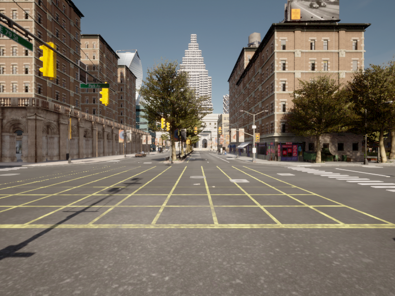 | 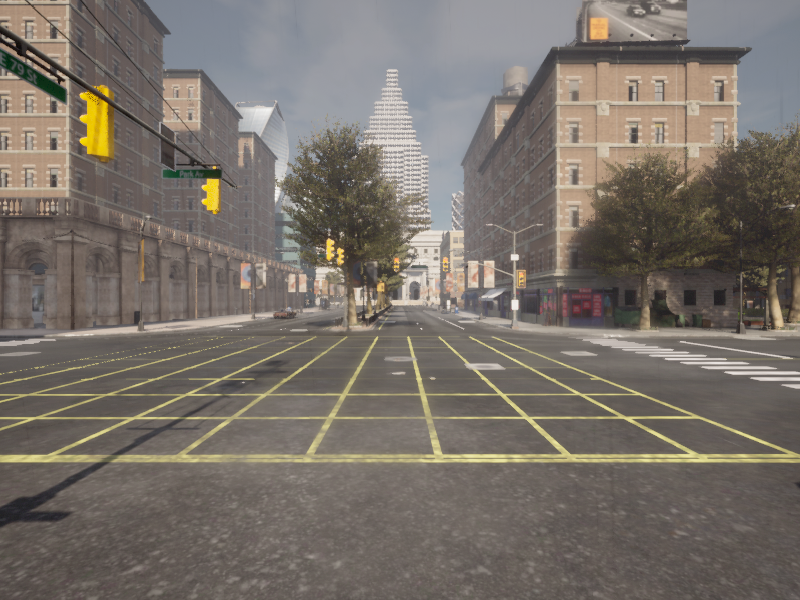 | 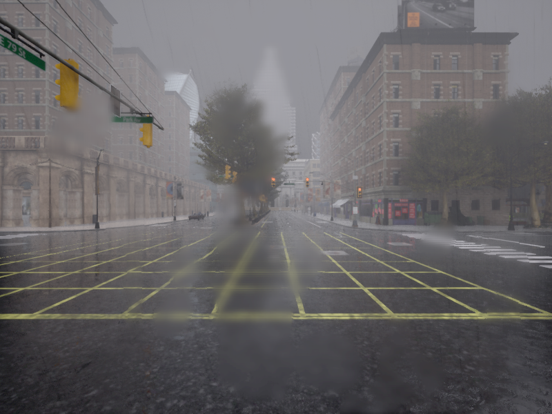 | 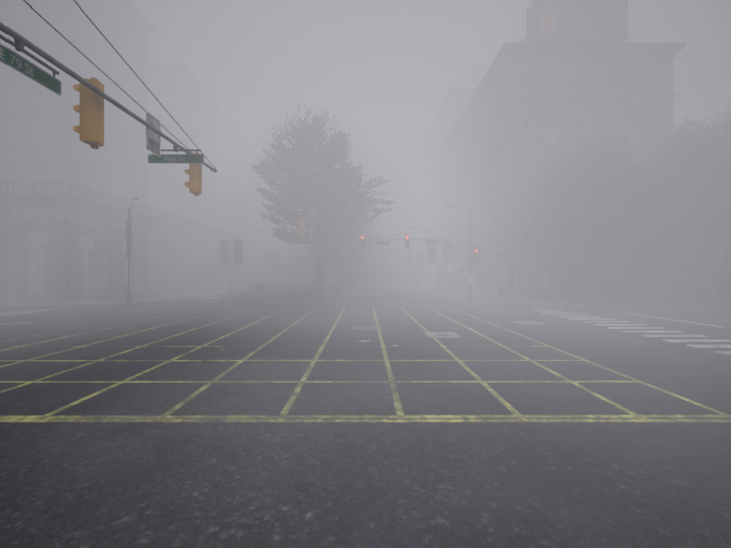 |

指标对比表（CARLA 0.9.15，Town10HD，同一路口同一机位，各档取 5 帧平均）：

| 天气 | 亮度 | 对比度 | 边缘密度(%) |
| --- | --- | --- | --- |
| ClearNoon | 113.6 | 43.8 | 13.93 |
| SoftRainNoon | 114.2 | 35.0 | 10.96 |
| HardRainNoon | 102.9 | 32.1 | 3.79 |
| HeavyFog | 131.0 | 35.9 | 2.21 |

从表中可以看到：
- **边缘密度单调下降**：13.93% → 10.96% → 3.79% → 2.21%，浓雾下可提取结构信息仅剩晴朗时的约 1/6；
- **亮度**：大雨明显压暗画面（102.9），浓雾则使画面白化、亮度升高（131.0）；
- **对比度**：雨天与雾天均低于晴朗基准（43.8），视觉层次被压缩。

对比柱状图：

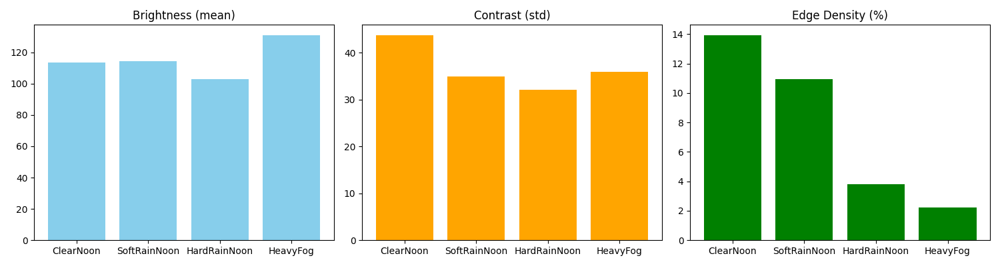

地面载具在恶劣天气下行驶的演示动图（浓雾中自动驾驶）：

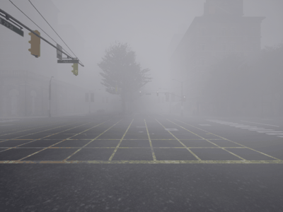

## 6. 结论

在同一场景、同一视角下对比四档天气，可以看到：

- **浓雾**对视觉感知的退化最直接：可提取的边缘结构大幅减少（边缘密度由 13.93% 降至 2.21%，降幅约 84%），
  远处建筑在画面中几乎完全消失，仅剩近处的地面标线；
- **大雨**明显压暗画面（亮度 113.6 → 102.9）并缩小亮度动态范围，对比度下降，视觉层次变差；
- **小雨**影响最小，但对比度仍从 43.8 降到 35.0，说明雨天对视觉感知已有可测的削弱。

同时需要注意：**雨滴本身会在图像中产生伪边缘**，因此雨天的边缘密度并不必然随雨量单调下降，
说明单独依靠一个指标不足以刻画感知退化，需要亮度、对比度、边缘密度多指标联合评价。

## 7. 图像增强恢复实验

第一部分量化了四档天气下相机图像的退化程度，一个自然的追问是：**图像增强能把退化救回来多少？**
本部分在与第一部分完全相同的采集流程（同参考位姿、同相机参数、同 5 帧平均口径）之上，
对退化图像施加经典增强算法，再用相同指标衡量恢复效果。

### 7.1 增强方法

按天气类型选择针对性的经典算法：

| 天气 | 方法 | 说明 |
| --- | --- | --- |
| ClearNoon | 不处理 | 晴朗基准，作为恢复率计算的分母 |
| SoftRainNoon / HardRainNoon | CLAHE | 限制对比度自适应直方图均衡（clipLimit=2.0，8×8 分块）。作用于 LAB 空间的 L 通道，只拉伸亮度分布而不扰动色彩，适合改善雨天的低对比度 |
| HeavyFog | 暗通道先验去雾 | He 等人 CVPR 2009 经典算法的简化实现（omega=0.95，t0=0.1，15×15 块，以均值滤波粗精炼透射率代替软抠图） |

暗通道先验去雾基于大气散射模型 `I = J·t + A`：先由暗通道（RGB 最小值再做最小值滤波）估计透射率 `t`，
取暗通道最亮 0.1% 像素对应的原图强度估计大气光 `A`，再反解无雾图像 `J = (I − A) / t + A`。

完整源码位于：[`src/ground/weather_image_enhancement/main.py`](https://github.com/OpenHUTB/ros2/tree/master/src/ground/weather_image_enhancement)，
采集部分与第一部分脚本相同，新增 `clahe_enhance()`、`defog_dark_channel_prior()` 等增强与对比图生成代码。

### 7.2 恢复率定义

```
恢复率 = (增强后指标 − 退化指标) / (晴朗基准指标 − 退化指标) × 100%
```

- 100% 表示恰好恢复到晴朗水平；
- 超过 100% 表示**过冲**（增强过度，越过晴朗基准）；
- 接近 0% 表示基本没有恢复。

### 7.3 增强恢复结果

三档恶劣天气的增强前后对比（左：原图，右：增强后）：

| SoftRainNoon（CLAHE） | HardRainNoon（CLAHE） | HeavyFog（去雾） |
| --- | --- | --- |
| 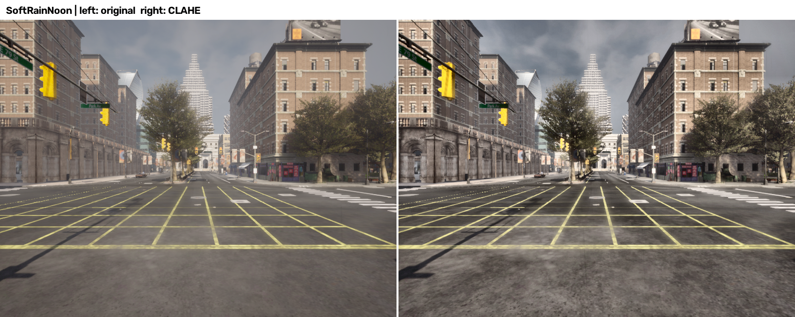 | 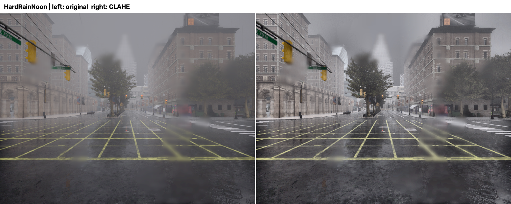 | 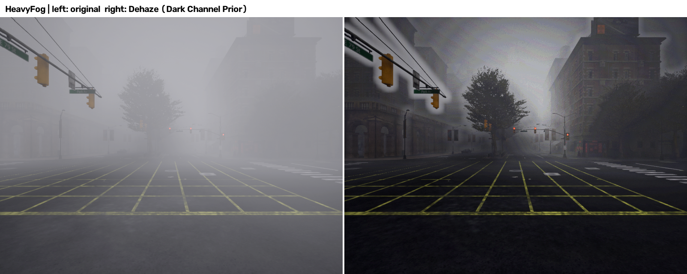 |

指标对比表（与第 5 节同一机位重新采集，晴朗基准 115.1/44.2/13.75% 与第一部分存在小幅波动，
属同场景不同帧的正常差异，退化趋势一致）：

| 天气 | 处理 | 亮度 | 对比度 | 边缘密度(%) |
| --- | --- | --- | --- | --- |
| ClearNoon | 原图（基准） | 115.1 | 44.2 | 13.75 |
| SoftRainNoon | 原图 | 114.8 | 34.9 | 10.85 |
| SoftRainNoon | CLAHE | 113.8 | 44.3 | 16.03 |
| HardRainNoon | 原图 | 104.0 | 32.2 | 4.22 |
| HardRainNoon | CLAHE | 108.0 | 38.7 | 10.93 |
| HeavyFog | 原图 | 131.1 | 35.8 | 2.18 |
| HeavyFog | 去雾（暗通道先验） | 57.2 | 43.5 | 3.97 |

恢复率（以 ClearNoon 原图为 100% 基准）：

| 天气 | 方法 | 亮度恢复率 | 对比度恢复率 | 边缘密度恢复率 |
| --- | --- | --- | --- | --- |
| SoftRainNoon | CLAHE | —* | 101.1% | 178.2% |
| HardRainNoon | CLAHE | 35.9% | 54.6% | 70.4% |
| HeavyFog | 去雾（暗通道先验） | 461.5%（过冲） | 92.3% | 15.5% |

\* 小雨的亮度退化仅 0.3（114.8 vs 基准 115.1），恢复率公式分母过小，数值不稳定、无实际意义，故不列出。
这也说明恢复率只在「退化显著」时才是有效评价量。

分组柱状图：

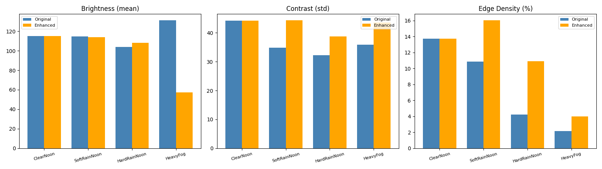

### 7.4 分析与结论

- **对比度最容易恢复**：CLAHE 使小雨对比度恢复 101.1%（恰好回到晴朗水平），暗通道去雾使浓雾对比度恢复 92.3%，
  大雨也恢复了约一半（54.6%）。直方图类算法对「分布层面」的退化确实有效；
- **边缘结构很难凭空找回**：浓雾去雾后边缘密度恢复率仅 15.5%（2.18% → 3.97%），远处建筑被雾物理遮挡，
  信息已经丢失，增强算法无法重建不存在的结构；
- **增强会引入新的失真**：小雨 CLAHE 后边缘密度反而冲到 16.03%（恢复率 178.2%），把雨滴和湿路面反光形成的
  伪边缘一并放大——与第 6 节「雨滴产生伪边缘」的结论互相印证；浓雾去雾后亮度从 131.1 拉到 57.2
  （恢复率 461.5%），明显过冲、画面偏暗，说明固定参数的去雾在浓雾档下力度过猛。

因此，恶劣天气下的可靠感知不能只依赖相机图像后处理：增强算法可作为低成本的第一层补救，
但更根本的方向是多传感器融合（如不受可见光散射影响的激光雷达）与对天气鲁棒的感知模型，
这也将是本系列后续部分的内容。

## 8. 激光雷达感知退化评测与跨传感器对比

第 1~6 节与第 7 节都以相机（`sensor.camera.rgb`）为感知对象。本节在同一辆车、同一参考位姿、
同一四档天气下**同时挂载 RGB 相机与激光雷达**，一次采集得到两套数据，再用统一的
「相对晴朗基准的退化率」把两个传感器的退化程度放进同一口径，回答「雨雾到底更伤相机还是更伤雷达」。

### 8.1 传感器配置与采集口径

| 传感器 | 参数 |
| --- | --- |
| `sensor.camera.rgb` | 800×600、FOV 90°（与第 1、7 节完全一致，保证三场实验可比） |
| `sensor.lidar.ray_cast` | 32 线、量程 50 m、转速 20 Hz、`points_per_second=200000`、`upper_fov=10`、`lower_fov=-30` |

雷达回波的大气衰减由 blueprint 属性 `atmosphere_attenuation_rate` 描述（引擎默认 0.004）。
雨滴与雾滴会对 ~905 nm 激光产生散射与吸收，因此本实验按天气档位递增设定该系数：

| 天气 | ClearNoon | SoftRainNoon | HardRainNoon | HeavyFog |
| --- | --- | --- | --- | --- |
| `atmosphere_attenuation_rate` | 0.004 | 0.01 | 0.03 | 0.06 |

该属性只能在传感器生成时写入、运行中不可修改，所以**每档天气前都要销毁旧雷达、用新系数重建一次**。

另需注意 CARLA 雷达的发布方式：它**按渲染帧发布**，本机世界频率约 160 FPS，
20 Hz 转速下单帧只含约 45° 的扇形、约 1000 个点，并不代表一整圈。为得到可用于统计的完整扫描，
本实验在车辆静止的前提下，于固定 **0.2 s 时间窗内累积连续多帧点云取并集**（约 4 圈、3 万个点），
四档天气使用完全相同的窗口。若直接拿单帧统计，「近/中/远占比」会随扇形相位大幅跳动，
把采样噪声误判成天气退化。

### 8.2 雷达指标与退化率口径

- **有效点数**：回波衰减会让强度落到丢点阈值以下而被丢弃，点数随之下降；
- **平均回波强度**：回波质量，最灵敏的退化指标；
- **距离 95 分位**：近似「还能看多远」；
- **近/中/远点数占比**：<15 m / 15–30 m / ≥30 m 三段的点数占比，反映几何覆盖的变化。

退化率沿用第 7.2 节的同口径定义：`退化率 = (晴朗基准 − 当前值) / 晴朗基准 × 100%`。

### 8.3 实验结果

四档天气下同一场景、同一机位的点云 BEV 俯视图（按高度 z 着色，浓雾档外圈点已明显变稀）：

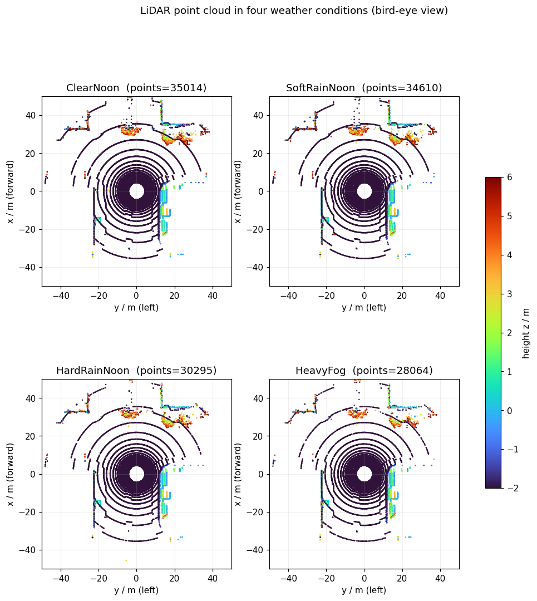

相机与雷达指标原始数值（同一参考位姿；相机取 5 帧平均，雷达在 0.2 s 窗口内累积成整圈）：

| 天气 | 相机 亮度 | 相机 对比度 | 相机 边缘密度(%) | 雷达 点数 | 雷达 平均强度 | 雷达 距离95分位(m) | 雷达 近/中/远(%) |
| --- | --- | --- | --- | --- | --- | --- | --- |
| ClearNoon | 113.8 | 43.8 | 13.92 | 35014 | 0.944 | 35.85 | 65.7 / 24.0 / 10.3 |
| SoftRainNoon | 115.0 | 35.4 | 10.97 | 34610 | 0.872 | 35.58 | 67.0 / 23.7 / 9.3 |
| HardRainNoon | 103.9 | 32.2 | 4.34 | 30295 | 0.692 | 34.93 | 69.8 / 22.6 / 7.6 |
| HeavyFog | 131.0 | 35.9 | 2.21 | 28064 | 0.509 | 34.26 | 71.0 / 21.8 / 7.2 |

相对晴朗基准的退化率：

| 天气 | 相机边缘密度 | 雷达点数 | 雷达平均强度 | 雷达距离95分位 | 雷达远端占比 |
| --- | --- | --- | --- | --- | --- |
| SoftRainNoon | 21.2% | 1.2% | 7.6% | 0.8% | 9.7% |
| HardRainNoon | 68.8% | 13.5% | 26.7% | 2.6% | 26.0% |
| HeavyFog | 84.1% | 19.8% | 46.1% | 4.4% | 29.9% |

把各自各指标的退化率取绝对值后平均，得到传感器级的单一可对比数：

| 天气 | 相机（3 指标平均） | 雷达（4 指标平均） |
| --- | --- | --- |
| SoftRainNoon | 13.8% | 4.8% |
| HardRainNoon | 34.6% | 17.2% |
| HeavyFog | 39.1% | 25.1% |

相机与雷达退化率对照柱状图：

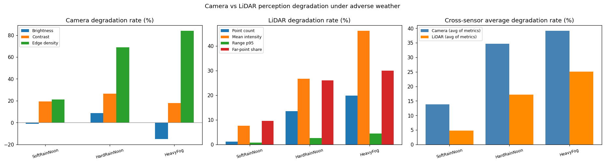

### 8.4 建模口径与对照实验

需要如实说明雷达退化的来源：**CARLA 引擎本身不会按天气改变激光回波**——
`atmosphere_attenuation_rate` 默认恒为 0.004，雨雾粒子只参与画面渲染、并不遮挡激光射线，
所以本实验的雷达退化完全来自 8.1 节中显式递增的衰减系数。

为验证这一点，把该系数四档全部固定为引擎默认值 0.004、其余流程不变再跑一遍
（复现方式：将源码中 `LIDAR_ATTENUATION` 的四档取值全部改为 0.004 后重跑），结果如下：

| 天气 | 点数 | 平均强度 | 距离95分位(m) | 近/中/远(%) |
| --- | --- | --- | --- | --- |
| ClearNoon | 36148 | 0.944 | 35.58 | 65.3 / 24.7 / 10.0 |
| SoftRainNoon | 35616 | 0.944 | 35.58 | 65.6 / 24.2 / 10.2 |
| HardRainNoon | 36508 | 0.944 | 35.58 | 65.2 / 24.9 / 9.9 |
| HeavyFog | 35745 | 0.944 | 36.62 | 65.7 / 24.0 / 10.3 |

四档天气的指标几乎完全一致（平均强度恒为 0.944、点数波动在 ±3% 以内），
证明在没有显式衰减建模时，CARLA 的雷达对雨雾是「免疫」的。

### 8.5 分析与结论

- **雷达退化随天气单调上升，但幅度明显小于相机**：浓雾下相机各指标平均退化 39.1%，
  雷达 25.1%；相机最关键的边缘密度损失 84.1%（13.92% → 2.21%），
  而雷达平均回波强度损失 46.1%、有效点数只损失 19.8%。
- **雷达的退化集中在远距离**：远端（≥30 m）点数占比由 10.3% 降到 7.2%，
  而近端（<15 m）占比反而从 65.7% 升到 71.0%，近处结构几乎完整保留——
  雨雾削掉的主要是「看得多远」。
- **两个传感器的退化机理不同**：相机是在成像环节整体损失结构信息（白化、低对比、边缘消失），
  靠后处理最多只能挽回一部分（第 7 节实测浓雾边缘密度恢复率仅 15.5%）；
  雷达则是回波强度按距离与衰减系数衰减、并因低于丢点阈值而掉点，属于可建模、可预测的退化。
- 结合 8.4 节的对照可以给出更一般的判断：**激光雷达对雨雾的敏感度远低于可见光相机**——
  需要人为把衰减系数放大 15 倍（0.004 → 0.06），其指标损失仍只有相机在同一批天气下的一半左右。
  因此相机 + 激光雷达的多传感器融合，是恶劣天气下比「单靠相机 + 图像增强」更可靠的方案。

本节源码位于
[`src/ground/weather_lidar_perception`](https://github.com/OpenHUTB/ros2/tree/master/src/ground/weather_lidar_perception)，
采集流程与指标口径与本文档一致，依赖与运行方式见该目录的 README。

## 9. 相机-激光雷达融合可行性实验

第 8.5 节的结论是「相机 + 激光雷达的融合比单靠相机更可靠」。本节把这句话拆成可测量的两问：
**几何上投得上吗**、**语义上对得上吗**。

### 9.1 实验设计

在同一辆车、同一参考位姿、同一四档天气下同时挂载三台传感器：

| 传感器 | 安装位置 | 参数与作用 |
| --- | --- | --- |
| `sensor.camera.rgb` | x=1.5, z=2.4 | 800×600、FOV 90°，待投影的图像（与前三部分一致） |
| `sensor.camera.depth` | x=1.5, z=2.4 | 同机位同内参，仅用于把天空像素从覆盖率分母中剔除 |
| `sensor.lidar.ray_cast` | x=0.0, z=2.6 | 32 线、50 m 量程、20 Hz、100 万点/秒，待投影的点云 |

**投影口径**：两台传感器姿态相同、只差固定平移，因此雷达坐标系到相机坐标系只需平移换算；
相机内参由 FOV 与分辨率反解，`fx = fy = (W/2)/tan(FOV/2) = 400`、主点 `(400, 300)`。
投影公式为 `u = cx + fx·y/x`、`v = cy − fy·z/x`（z 轴向上，故 v 取负），只保留相机前方的点。

**点云口径**：雷达按渲染帧发布，单帧只含约 45° 扇形，因此把 **0.3 s 窗口**内累积的整圈点云
（约 21~26 万点）取并集后再投影；四档天气使用完全相同的窗口，测量期间车辆保持静止。
点密度比第 8 节提高到 100 万点/秒，目的是让 800×600 图像上的投影点足够密，
否则覆盖率会被单帧采样随机性主导。

### 9.2 融合指标

| 指标 | 定义 | 衡量什么 |
| --- | --- | --- |
| 投影有效率 | 相机前方点中落在图像范围内的比例 | 几何链路是否正常 |
| 天空误投率 | 投到天空像素的点占比 | 标定是否正确（正常应接近 0） |
| 图像覆盖率 | 非天空像素中被至少一个投影点覆盖的比例 | 雷达能标注多少图像区域 |
| 近场 / 远端覆盖率 | 只用 ≤20 m / ≥30 m 的点计算的覆盖率 | 近场与远端的标注能力 |
| 边缘命中率 | 投影点落在图像 Canny 边缘 3 像素邻域内的比例 | 几何对齐之后语义是否还对得上 |

### 9.3 实验结果

四档天气的投影叠加图（点按距离着色，暖色为远处）：

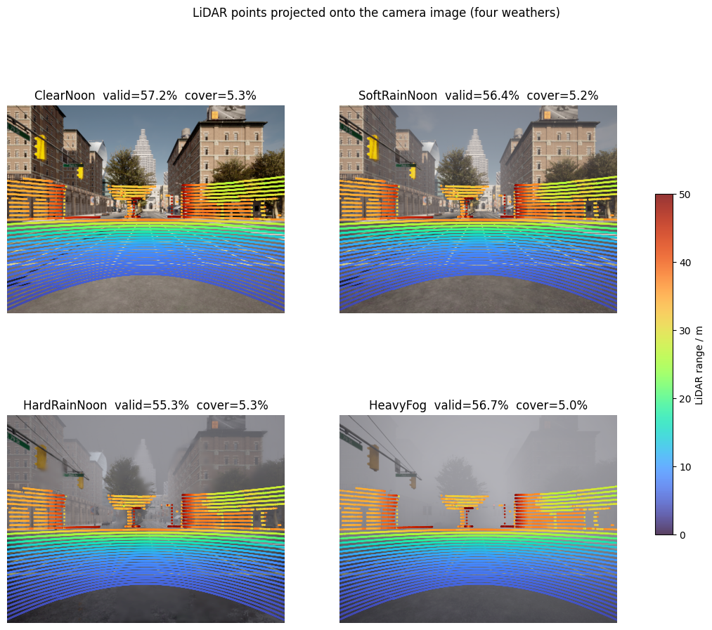

指标数据（同一参考位姿，0.3 s 窗口累积整圈点云）：

| 天气 | 点数 | 投影有效率(%) | 天空误投率(%) | 图像覆盖率(%) | 近场覆盖(≤20m,%) | 远端覆盖(≥30m,%) | 边缘命中率(%) |
| --- | --- | --- | --- | --- | --- | --- | --- |
| ClearNoon | 255776 | 57.4 | 0.00 | 5.59 | 3.95 | 1.23 | 40.6 |
| SoftRainNoon | 241964 | 58.8 | 0.00 | 5.59 | 3.97 | 1.21 | 36.2 |
| HardRainNoon | 229816 | 57.0 | 0.00 | 5.41 | 3.91 | 1.11 | 21.0 |
| HeavyFog | 211586 | 58.0 | 0.00 | 5.42 | 3.92 | 1.11 | 11.4 |

指标柱状图与边缘命中率随距离的变化曲线：

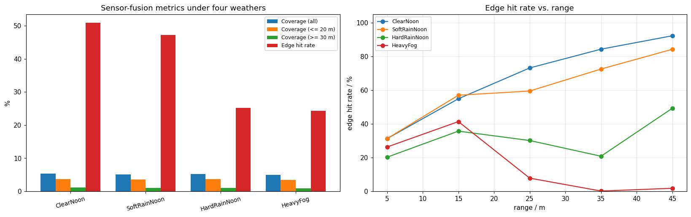

### 9.4 分析与结论

- **几何链路在四档天气下完全稳定**：投影有效率 57.0%~58.8%，波动来自点云角向分布的
  随机性而非天气；天空误投率四档恒为 **0.00%**，说明外参与内参在整个系列的四档天气下都成立。
- **图像覆盖率几乎不受天气影响**：5.59% → 5.42%（仅降 3%），近场覆盖率更是稳定在 3.9% 左右。
  雷达能「标注」的图像面积基本保持，退化只体现在远端（≥30 m 由 1.23% 降到 1.11%）。
- **真正的退化发生在「对得上」这一侧**：边缘命中率由 40.6% 降到 11.4%（降幅约 72%）。
  同样的点、同样的几何位置，晴天时有四成落在建筑轮廓、车道线、车辆边界上，
  浓雾里却只剩一成——不是点错了位，而是图像那一侧的结构已经被雾抹掉了。
  曲线也印证这一点：晴天与小雨的边缘命中率随距离单调上升（远处是建筑轮廓密集区），
  而浓雾在 15 m 之后从 38% 迅速塌到 25 m 的 5%、35 m 以上的 0。
- **与第 8 节对照**：同一批天气下相机边缘密度损失 84%，融合的边缘命中率损失 72%——
  两者在「语义结构」上的损失量级相当，融合略轻但谈不上免疫。融合真正的优势在另一半：
  图像覆盖率四档几乎不变（5.59% → 5.42%），而相机那一侧的结构已经大面积消失。
  雷达提供了稳定的深度与几何覆盖，却没有提供被雾遮挡的结构，
  因此融合的价值集中在近中距离；远端应退化为雷达单模态。

本节源码位于
[`src/ground/weather_sensor_fusion`](https://github.com/OpenHUTB/ros2/tree/master/src/ground/weather_sensor_fusion)，
采集流程与指标口径与本文档一致，依赖与运行方式见该目录的 README。


## 10. 雨雾天气下的自适应感知降级策略

前四部分依次回答了「相机退化多少」「增强能补回多少」「雷达比相机强多少」「融合还能不能用」。
本节把结论落地成一个可运行的策略：**不依赖天气真值**，只从图像判别当前天气等级，
再据此在感知模式之间自动切换——晴天用相机、雨天用融合、浓雾退化为雷达。

### 10.1 实验设计

在同一辆车、同一参考位姿、同一四档天气下挂载相机与 32 线激光雷达，
并在 ego 正前方按固定距离逐辆放置目标车作为待检测对象。

| 项目 | 设置 |
| --- | --- |
| 目标车 | `vehicle.tesla.model3`，摆放在 ego 正前方车道中心，距离 10 / 16 / 22 / 28 / 34 / 40 m |
| 测量方式 | **同一时刻只放一辆目标车**，测完销毁再测下一档距离 |
| RGB 相机 | 800×600、FOV 90°，x=1.5、z=2.4 |
| 激光雷达 | 32 线、50 m、20 Hz、60 万点/秒，x=0.0、z=2.6 |
| 雷达衰减系数 | 按天气档位递增 0.004 / 0.01 / 0.03 / 0.06 |

目标车逐辆摆放而不是一次摆 6 辆，是因为同一参考位姿下 6 辆车的投影几乎完全重叠：
一旦纵向排成一列，后车就被前车挡住，投影框里装的其实是前车车身，判据会失真；
若左右错开，又会把车摆到路缘和绿化带上。逐车测量消除了这两个干扰，
每个距离档拿到的都是「该目标单独存在时」的数据。

雷达按渲染帧发布，需在 **0.2 s 时间窗**内累积成整圈点云；整个测量期间车辆全程刹停，
保证四档天气看到的是同一场景、同一参考位姿。

### 10.2 判据与指标

| 环节 | 判据 |
| --- | --- |
| 天气判别 | 当前帧边缘密度 / 晴天基准边缘密度，按 0.85 / 0.50 / 0.19 三档阈值分档 |
| 相机可检出 | 目标投影框内与框外环形背景的平均亮度对比度 ≥ 0.10 |
| 雷达可检出 | 目标 3D 包围盒（外扩 0.25 m）内回波点数 ≥ 5 |
| 融合检出 | 相机与雷达取并集 |
| 自适应检出 | 按判别出的天气选择模式，取该模式的检出结果 |
| 检出率 | 6 个距离档中被检出的比例 |

天气判别只用**当前图像**的边缘密度与现场测得的晴天基准之比，不需要任何天气先验；
三个阈值取在四档实测比值（1.00 / 0.77 / 0.24 / 0.16）相邻两档之间并向下取整，避免某一档恰好压在阈值上。

相机判据没有用「框线上有强梯度像素的比例」，是因为近距离目标的框线恰好落在车身平滑面上：
晴天也会判成不可检出（实测 10 m 处只有 0.46）。改成「框内外亮度差」后，
判据直接对应目标还能不能从背景里分出来，雨雾的退化恰好就体现在这个差值被压缩上。

雷达阈值取 5 点，是因为 32 线雷达在 40 m 处对轿车只剩 20~30 个回波点（垂直分辨率限制），
再用 12 点会把「雷达其实还能看到」的目标判成丢失。

### 10.3 实验结果

四档天气的检出叠加图（蓝框为相机检出，灰框为相机未检出，红点为雷达回波，图中为 28 m 目标）：

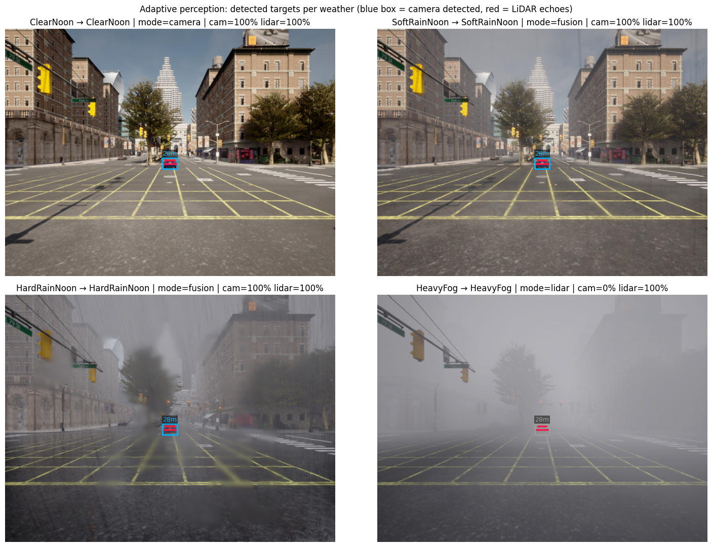

天气判别与各模式检出率：

| 天气 | 边缘密度 | 相对晴天 | 判别结果 | 采用模式 | 相机(%) | 雷达(%) | 融合(%) | 自适应(%) |
| --- | --- | --- | --- | --- | --- | --- | --- | --- |
| ClearNoon | 0.1391 | 1.00 | ClearNoon | 相机 | 100.0 | 100.0 | 100.0 | 100.0 |
| SoftRainNoon | 0.1076 | 0.77 | SoftRainNoon | 融合 | 100.0 | 100.0 | 100.0 | 100.0 |
| HardRainNoon | 0.0329 | 0.24 | HardRainNoon | 融合 | 100.0 | 100.0 | 100.0 | 100.0 |
| HeavyFog | 0.0219 | 0.16 | HeavyFog | 雷达 | 0.0 | 100.0 | 100.0 | 100.0 |

传感器自身的退化量（6 个距离档统计）：

| 天气 | 相机对比度均值 | 雷达回波总点数 | 雷达平均回波强度 |
| --- | --- | --- | --- |
| ClearNoon | 0.291 | 1476 | 0.913 |
| SoftRainNoon | 0.208 | 1476 | 0.799 |
| HardRainNoon | 0.184 | 1288 | 0.526 |
| HeavyFog | 0.033 | 1342 | 0.302 |

其中浓雾档的相机对比度按距离依次为 0.096 / 0.049 / 0.025 / 0.008 / 0.010 / 0.009，
10 m 处已低于 0.10 的判据阈值，因此 6 个距离档全部判为不可检出。

检出率对比、天气判别特征与逐距离的对比度/回波点数曲线：

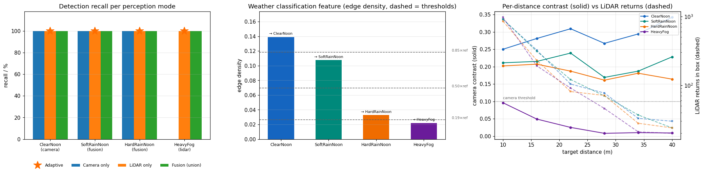

### 10.4 分析与结论

- **天气判别在四档上全部正确**：边缘密度比值 1.00 / 0.77 / 0.24 / 0.16，与第一部分实测的退化幅度
  （1.00 / 0.79 / 0.31 / 0.16）基本一致。判据只依赖图像本身与现场测得的晴天基准，
  不需要外部天气信息，换一条街道也不必重新标定阈值。
- **相机在浓雾中完全失效，雷达不失效**：相机检出率 100% → 100% → 100% → 0%，
  目标-背景对比度均值由 0.291 压到 0.033（-89%）；雷达检出率四档都是 100%。
- **相机对下雨并不敏感，对起雾才敏感**：大雨下相机对比度仅由 0.291 降到 0.184（-37%），
  6 个距离档仍全部可检出。这与第一部分「大雨边缘密度下降 69%」并不矛盾——
  全局纹理被雨幕抹平，但一个大面积均色目标与路面的亮度差仍在；到了浓雾，
  散射把目标与背景的亮度拉到同一水平，可检出性才整体崩塌。
- **雷达退化体现在回波质量而非可检出性**：回波总点数四档为 1476 / 1476 / 1288 / 1342（波动 ±13%），
  但平均回波强度由 0.913 降到 0.302（-67%）。衰减建模削弱的是强度，点数只随距离和丢点概率小幅变化，
  所以距离档上的检出结果不变。这与第 8 节「雷达退化幅度小于相机」、第 9 节「融合几何覆盖几乎不变、
  语义对齐明显退化」的结论一致。
- **自适应策略在四档天气都达到了该天气下的最优水平**：晴天只用相机即达 100%，
  大雨、浓雾由融合/雷达补齐，四档均为 100%；作为对照，纯相机在浓雾下是 0%。
- 需要说明的边界：在本场景下「始终融合」与自适应策略的检出率相同（都是 100%），
  自适应带来的不是更高的召回，而是**晴天不必付出雷达的代价**——
  雷达需要 0.2 s 窗口累积整圈点云，相机单帧即可；同时雷达在 34~40 m 的回波点数已降到 20~30 个，
  属于勉强可用，融合的价值主要集中在近中距离。
- 局限：可检出性判据使用真值包围盒，衡量的是「该天气下目标还剩多少可被检出的结构」，
  而不是完整检测器的端到端召回。这样可以把天气的影响与检测器自身的能力隔离开，
  但也意味着本实验不评估误检率与检测框精度，这两项需要接入真实检测器后再做。

本节源码位于
[`src/ground/weather_adaptive_perception`](https://github.com/OpenHUTB/ros2/tree/master/src/ground/weather_adaptive_perception)，
采集流程与指标口径与本文档一致，依赖与运行方式见该目录的 README。
