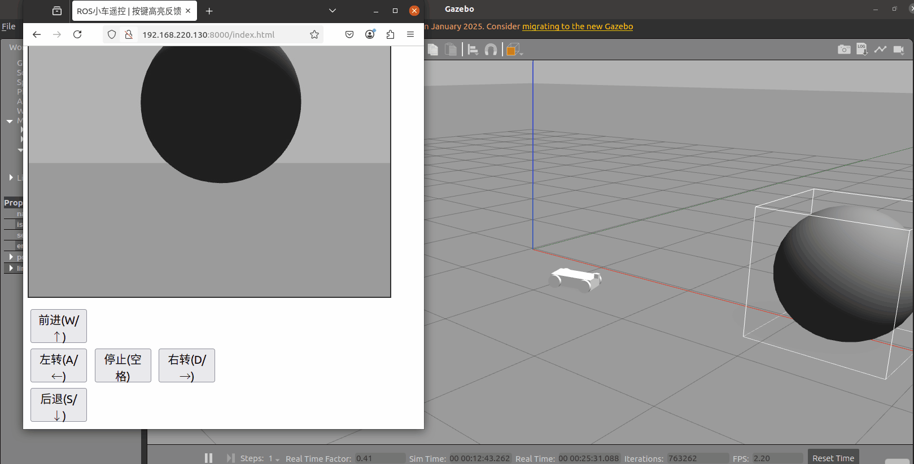
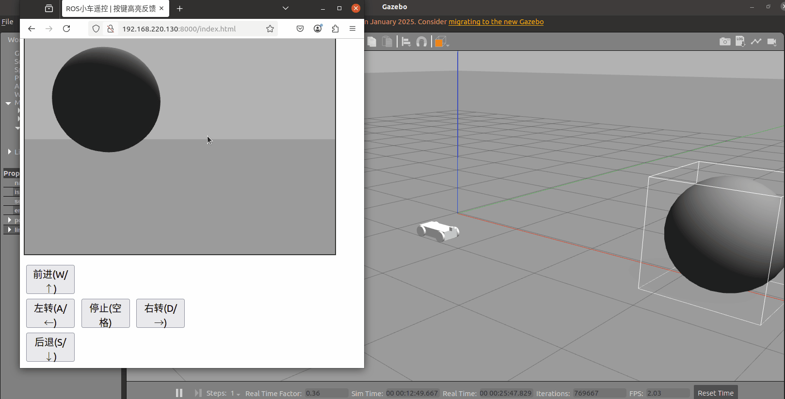

# 网页远程遥控小车

在 Gazebo 仿真环境中搭建搭载 RGB 相机的差速小车模型，通过 `rosbridge_server` 实现 ROS 与前端 JS 的 WebSocket 通信，`web_video_server` 推送相机图像流；网页端支持键盘控制小车运动，带按键按下高亮反馈，同步展示小车相机视角画面。

源码位置：`src/ground/web_remote_car`

## 1. 项目目标

- 在 Gazebo 中搭建搭载 RGB 相机的差速小车 Xacro 模型
- 使用 `rosbridge_server` 建立 ROS 与网页前端的 WebSocket 通信
- 使用 `web_video_server` 发布相机图像流
- 网页前端实现 W/A/S/D 键盘遥控小车，按键高亮反馈
- 网页实时渲染相机画面，实现远程可视化监控

## 2. 数据流

```text
键盘按键事件 -> JS -> rosbridge_server -> /cmd_vel -> 小车运动

相机图像话题 /front_camera/image_raw -> web_video_server -> HTTP 图像流 -> 网页展示
```

## 3. 运行环境

| 项目 | 说明 |
| --- | --- |
| 操作系统 | Ubuntu 20.04.6 LTS |
| ROS | Noetic（1.17.4） |
| Python | 3.8.10 |
| 仿真器 | Gazebo 11 |
| 依赖 | `ros-noetic-rosbridge-server`、`ros-noetic-web-video-server`、`xacro`、`joint_state_publisher`、`robot_state_publisher`、`gazebo_ros` |

依赖安装：

```bash
sudo apt install ros-noetic-rosbridge-server ros-noetic-web-video-server
```

本项目依赖 Gazebo 仿真环境，不需要真实硬件小车与实体相机。

## 4. 构建

```bash
mkdir -p ~/ros1_ws/src
cp -r <仓库路径>/src/ground/web_remote_car ~/ros1_ws/src/
cd ~/ros1_ws
source /opt/ros/noetic/setup.bash
catkin_make
source devel/setup.bash
```

## 5. 启动

一条命令就把仿真、小车模型、`rosbridge_server`、`web_video_server` 和前端静态页面服务全部拉起来：

```bash
roslaunch web_remote_car start_all.launch
```

启动日志里会直接打印可以访问的地址，例如：

```text
[INFO] 前端页面目录：/home/xxx/ros1_ws/src/web_remote_car/www
[INFO] 本机访问：http://127.0.0.1:8000/
[INFO] 局域网访问：http://192.168.1.102:8000/
```

浏览器打开日志里给出的地址即可，**不需要再另外开终端跑 `python3 -m http.server`**。静态页面由 `scripts/web_server.py` 节点托管（`launch/web_bridge.launch` 里已包含），监听 `0.0.0.0:8000`。

如果 8000 端口被占用，换端口启动：

```bash
roslaunch web_remote_car start_all.launch frontend_port:=8001
```

三个端口都能这样覆盖：`frontend_port`（前端页面，默认 8000）、`bridge_port`（rosbridge，默认 9090）、`video_port`（图像流，默认 8080）。改了 `video_port` 时，页面要带上 `?video=<IP>:<端口>`，否则页面仍按 8080 取流。

仍然想手动起静态页面（例如只调试前端、不起仿真）时，用这条：

```bash
cd ~/ros1_ws/src/web_remote_car/www
python3 -m http.server 8000
```

必须在 `www` 目录下启动。`http.server` 遇到目录会自动返回 `index.html`，所以访问 `http://127.0.0.1:8000/` 就直接进入遥控面板；如果在包根目录（`web_remote_car/`）里启动，打开只会看到一个文件列表，要点进 `www/index.html` 才到遥控页。

### 5.1 局域网内其他电脑访问

只在虚拟机本机测试，到上面这一步就够了。要让同一局域网的其他电脑也能操作，需要确认三件事：

1. 虚拟机网络用**桥接模式**。NAT 模式下局域网里的其他机器访问不到虚拟机 IP。
2. rosbridge 必须监听所有网卡。`launch/web_bridge.launch` 里已经写了 `<param name="address" value="0.0.0.0"/>`，启动后核对：

```bash
netstat -tulpn | grep 9090
```

输出必须是 `0.0.0.0:9090`（或 `:::9090`）。如果只有 `127.0.0.1:9090`，说明没监听外网，其他机器连不上。

3. 防火墙放行三个端口：

```bash
sudo ufw allow 9090/tcp   # rosbridge WebSocket
sudo ufw allow 8080/tcp   # web_video_server 图像流
sudo ufw allow 8000/tcp   # 前端静态页面
```

然后在其他电脑上打开 `http://<虚拟机IP>:8000/`，页面自动连 `ws://<虚拟机IP>:9090`，不需要改代码。

如果网页所在主机和跑 rosbridge 的主机不是同一台，用地址栏参数显式指定：

```text
http://<网页IP>:8000/index.html?bridge=<rosbridge所在IP>:9090
```

## 6. 查看结果

新开终端查看话题：

```bash
source /opt/ros/noetic/setup.bash
source ~/ros1_ws/devel/setup.bash
rostopic echo /cmd_vel
rostopic hz /front_camera/image_raw
```

浏览器打开 `roslaunch` 日志里打印的地址（默认 `http://127.0.0.1:8000/`，等价于 `http://127.0.0.1:8000/index.html`），默认控制按键：W 前进、S 后退、A 左转、D 右转、空格停止，方向键等效。

页面里的 rosbridge 地址和视频流地址由当前访问的主机名自动拼接，浏览器地址填哪台机器的 IP，前端就连哪台机器，不需要改代码。页面顶部会显示当前实际连接的 `ws://` 地址，连接异常时原地给出排查提示，不会一直停在“正在连接”。

默认端口与话题：

| 话题 / 端口 | 说明 | 定义位置 |
| --- | --- | --- |
| `/cmd_vel` | 小车速度控制指令 | `www/index.html` |
| `/front_camera/image_raw` | 相机原始图像 | `urdf/car_cam.xacro` |
| 9090 | rosbridge WebSocket 端口 | `launch/web_bridge.launch` |
| 8080 | web_video_server 服务端口 | `launch/web_bridge.launch` |
| 8000 | 前端静态页面端口 | `launch/web_bridge.launch` 的 `frontend_port`，由 `scripts/web_server.py` 提供 |

控制与相机画面演示：





## 7. 参数调整

参数直接写在各文件里，没有单独的 yaml 配置文件：

| 参数 | 默认值 | 位置 |
| --- | --- | --- |
| rosbridge 端口 | 9090 | `launch/web_bridge.launch` 的 `bridge_port` 参数 |
| 视频流端口 | 8080 | `launch/web_bridge.launch` 的 `video_port` 参数 |
| 前端页面端口 | 8000 | `launch/web_bridge.launch` 的 `frontend_port` 参数 |
| 相机话题 | `/front_camera/image_raw` | `urdf/car_cam.xacro` 的 `imageTopicName` |
| 线速度 | 0.3 m/s | `www/index.html` 中 `SPEED` |
| 角速度 | 0.4 rad/s | `www/index.html` 中 `TURN_SPEED` |

修改端口或相机话题后，需要同步修改前端 `www/index.html` 里的 `BRIDGE_PORT`、`VIDEO_PORT`、`CAMERA_TOPIC` 三个常量，重启 launch 生效。

## 8. 实测结果

测试环境：Ubuntu 20.04.6 LTS、ROS Noetic 1.17.4、Python 3.8.10、Gazebo 11。

- `catkin_make` 构建成功
- Gazebo 正常加载小车模型，`/front_camera/image_raw` 正常发布
- 网页端按键指令正常下发到 `/cmd_vel`，小车按 W/A/S/D 平顺运动
- `web_video_server` 图像流在网页端正常渲染

另外在一台干净的 Ubuntu 上从零复现过一遍（clone 仓库 → `catkin_make` → `roslaunch web_remote_car start_all.launch` → 浏览器访问）：`/gazebo/model_states` 里能看到 `web_car`，`/front_camera/image_raw` 出 640×480 图像，网页点「前进」后 `/cmd_vel` 的发布者是 `rosbridge`、订阅者是 `gazebo`，小车位姿实际发生位移。

话题实测频率：

| 话题 | 实测频率 |
| --- | --- |
| `/front_camera/image_raw` | 约 30 Hz |
| `/cmd_vel` | 按键触发，按需发布 |

## 9. 常见问题

| 现象 | 原因 | 处理 |
| --- | --- | --- |
| 启动报找不到 `rosbridge_server` / `web_video_server` | 未安装对应包 | `sudo apt install ros-noetic-rosbridge-server ros-noetic-web-video-server` |
| 浏览器打不开，提示“无法连接 / 拒绝连接” | `frontend_http` 节点没起来（launch 未启动、端口被占、或包没重新 `catkin_make` 导致 node 找不到） | 看 `roslaunch` 日志里有没有 `前端页面目录` 那几行；`ss -tlnp \| grep 8000` 确认在监听；端口被占就 `roslaunch web_remote_car start_all.launch frontend_port:=8001` |
| 打开 `...:8000` 只看到文件列表，不进遥控页 | 用的是手动 `http.server` 且启动目录是包根目录 | `cd` 到 `www` 目录重新启动；或直接访问 `...:8000/index.html`；推荐直接用 launch 自带的服务 |
| 本机能控制，别的电脑一直停在“正在连接” | 访问地址用了 127.0.0.1（那指对方自己的电脑），或 rosbridge 没监听外网、防火墙拦截 | 用 `http://<虚拟机IP>:8000/index.html` 访问；`netstat -tulpn` 里 9090 要显示 `0.0.0.0:9090`；`sudo ufw allow 9090/tcp` |
| 页面能打开，但一直停在“正在连接 rosbridge…”，按 F12 控制台报 `ROSLIB is not defined` | 2026-11-09 之前的版本从公网 CDN（`cdn.jsdelivr.net`）加载 `roslib.js`，只有内网 / 无外网的机器（虚拟机、校园网）取不到，`ROSLIB` 为 `undefined`，连接函数抛异常，页面就永远不会进入连接成功，也来不及弹出超时提示 | 本次已改为零依赖实现（用浏览器原生 `WebSocket` 直接说 rosbridge 的 JSON 协议，不再引用任何 CDN 脚本）；更新代码后 `catkin_make` 并重启 `start_all.launch`，浏览器按 `Ctrl+F5` 强制刷新旧页面 |
| 改了 `www/index.html`，浏览器里还是旧页面 | `SimpleHTTPRequestHandler` 默认允许缓存 | 本次已给 `scripts/web_server.py` 加上 `Cache-Control: no-store`；旧版本抓过的页面仍需按一次 `Ctrl+F5` |
| 网页提示连接断开 | rosbridge 未运行或端口被占用 | `rostopic list` 确认 ROS 正常，检查 9090 端口 |
| 网页看不到相机画面 | 视频流话题与 xacro 中的话题不一致 | 核对 `urdf/car_cam.xacro` 的 `imageTopicName` 与 `index.html` 的 `CAMERA_TOPIC` |
| 按键控制小车不动 | `/cmd_vel` 没有消息或差速插件未加载 | `rostopic echo /cmd_vel` 排查，检查 xacro 中 `libgazebo_ros_diff_drive.so` 插件 |

## 10. 已知限制

1. 仅支持单用户控制，多端同时下发速度指令会互相覆盖。
2. 只有远程手动遥控，没有自主避障、路径规划、自动巡航。
3. 相机只做原始图像推流，不含图像识别、目标检测处理。
4. 模型为纯仿真差速车，未在实体硬件上部署验证。
5. 断线后需要点页面上的「重新连接」按钮，未做全自动重连。

## 11. 小结

本项目基于 ROS Noetic 搭建网页远程监控遥控系统，`rosbridge` 打通 ROS 后端与前端，`web_video_server` 完成图像推流。适合仿真小车远程操控、车载相机可视化场景，可以在此基础上扩展雷达数据可视化、自动避障、AEB 制动等功能。
