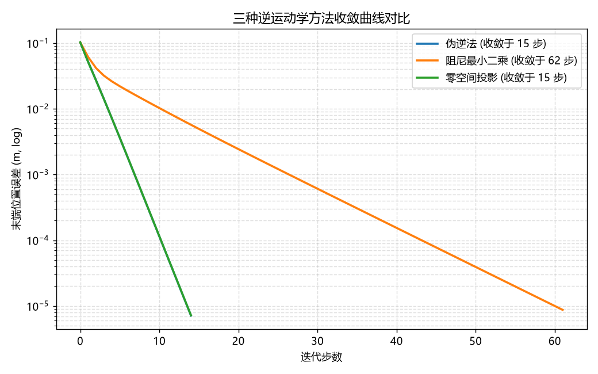
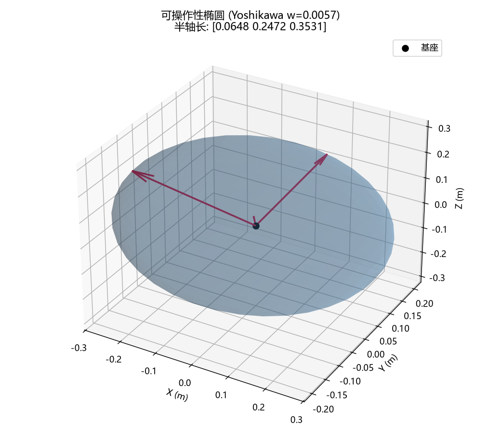
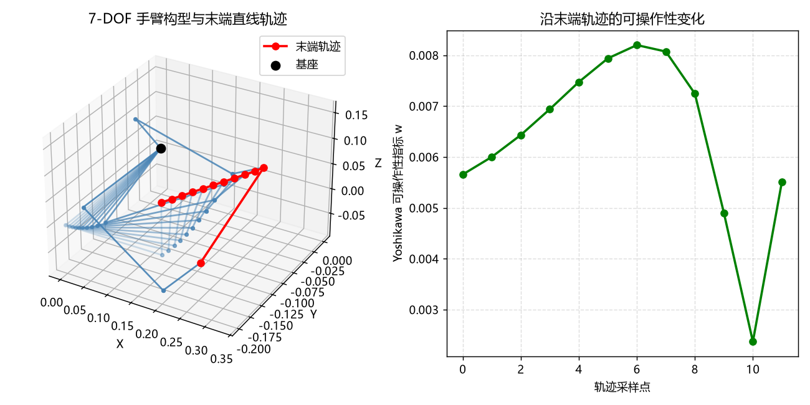
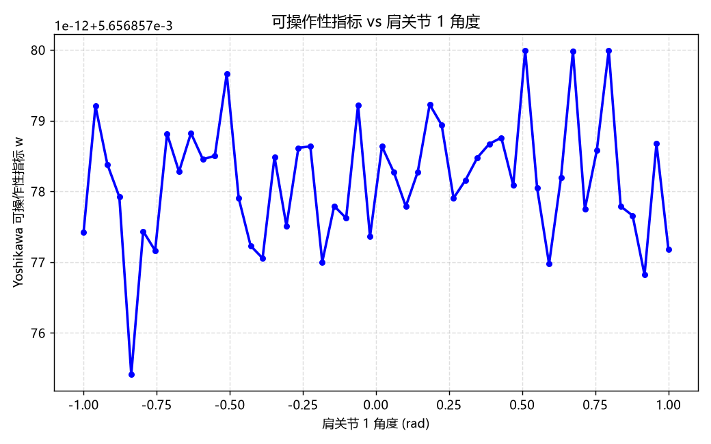
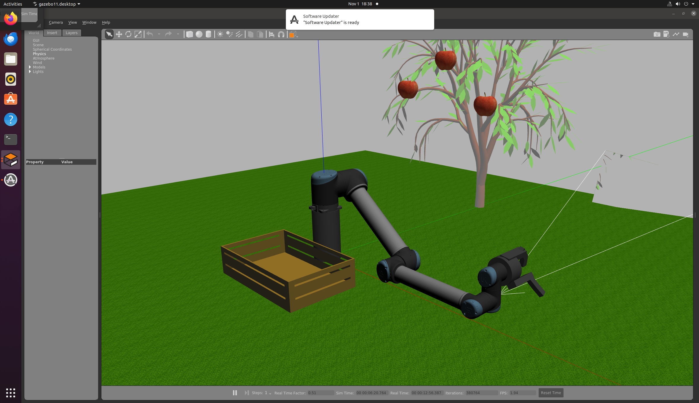
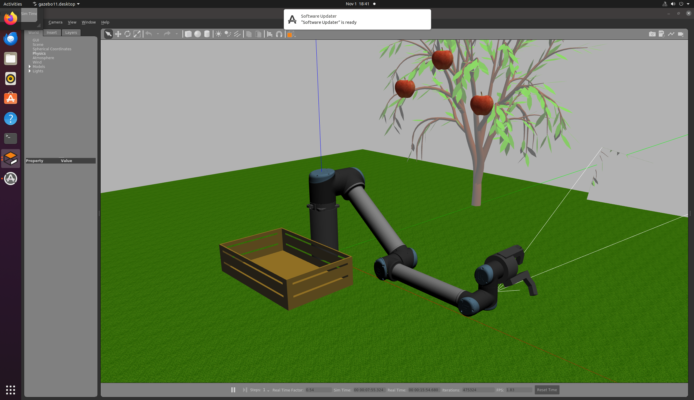

# 人形机器人手臂逆运动学（humanoid_arm_ik）

> 7 自由度人形机械臂正运动学、三种逆解算法与 Yoshikawa 可操作性分析。
> 纯 Python 实现，仅依赖 `numpy` + `matplotlib`，无 ROS 依赖，可独立运行。

## 为什么做这个模块

本模块以"具身机器人"课题为目标，实现人形机械臂（肩 3 + 肘 1 + 腕 3，共 7 DOF）的完整逆运动学求解链路，并配套**仿真数据采集**（UR10 机械臂水果采摘场景截图），作为课题的可复现代码与可视化数据。

## 模块内容

1. **正运动学**：DH 参数建模，输入关节角输出末端位姿
2. **几何雅可比**：数值差分计算 J = ∂p/∂q
3. **三种逆解算法**：
   - 伪逆法（pseudoinverse）
   - 阻尼最小二乘法（damped LS）
   - 零空间投影（主任务追末端 + 零空间优化关节偏好位姿）
4. **Yoshikawa 可操作性分析**：可操作性指标 w、椭球半轴、条件数
5. **单元测试**：6 项测试全部通过
6. **可视化**：收敛曲线对比、可操作性椭球、手臂轨迹

## 运行环境

- Python 3.8+
- `numpy`、`matplotlib`

```bash
pip install numpy matplotlib
```

## 运行步骤

```bash
# 1) 跑单元测试（6 项全部通过）
python tests/test_ik.py

# 2) 运行主程序，生成 4 张可视化图像到 output/
python main.py
```

## 运行效果图

三种逆解方法收敛曲线对比：



Yoshikawa 可操作性椭球（w=0.0057，半轴 [0.065, 0.247, 0.353]）：



7-DOF 手臂构型与末端直线轨迹、可操作性沿轨迹变化：



可操作性指标 vs 肩关节 1 角度：



## 仿真数据采集（UR10 机械臂水果采摘）

为验证机械臂操作类具身机器人场景，在虚拟机（Ubuntu 22.04 + Gazebo 11）中加载 UR10 机械臂水果采摘世界（`Ur10FixedFruitPickingworld.world`：UR10 + 苹果树 3 颗红苹果 + 木箱 + 草地），以三个相机视角采集仿真数据：

主视角：



侧面视角：



俯视视角：


运行方式（虚拟机内）：

```bash
export DISPLAY=:0
export SVGA_VGPU10=0
export LIBGL_ALWAYS_SOFTWARE=1
export GAZEBO_MASTER_URI=http://127.0.0.1:11346
export GAZEBO_MODEL_PATH=/home/user/worlds/fruit_picking_example_models:$GAZEBO_MODEL_PATH
export GAZEBO_PLUGIN_PATH=/home/user/src/GazeboPlugin/export/lib:$GAZEBO_PLUGIN_PATH
gazebo /home/user/worlds/Ur10FixedFruitPickingworld.world
```

## 实验结果

| 方法 | 收敛步数 | 最终误差 |
|---|---|---|
| 伪逆法 | 15 步 | ~1e-5 m |
| 阻尼最小二乘 | 62 步 | ~1e-5 m |
| 零空间投影 | 15 步 | ~1e-5 m |

零空间投影法在收敛速度与伪逆法相当的同时，最终关节角更接近偏好位姿（距离 0.354 vs 伪逆 0.398）。

## 理论要点

- **伪逆法**：Δq = J⁺ e，收敛快但奇异点附近数值不稳定
- **阻尼最小二乘**：Δq = Jᵀ (JJᵀ + λ²I)⁻¹ e，奇异点附近更稳定，收敛略慢
- **零空间投影**：Δq = J⁺ e + (I - J⁺J) q_pref，主任务追末端，零空间优化次级目标（避关节限位）
- **Yoshikawa 指标**：w = √det(JJᵀ)，w 越大该方向可操作性越好；w→0 表示接近奇异位形

## 声明

本作业由大模型（豆包）辅助完成，提交人对内容负责。
