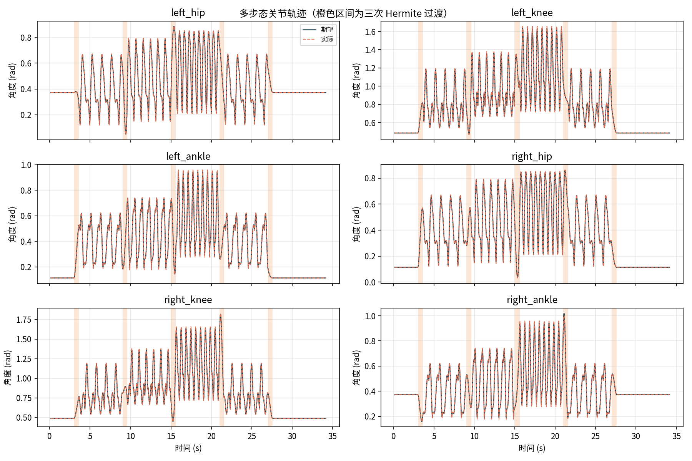
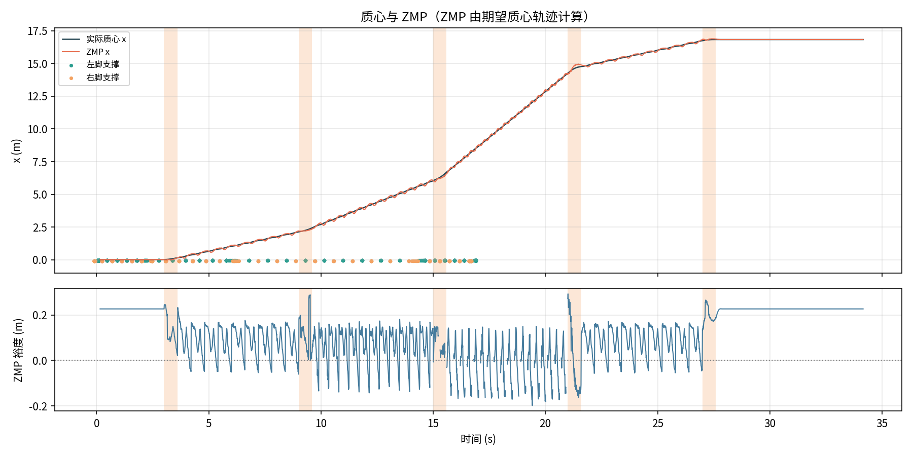
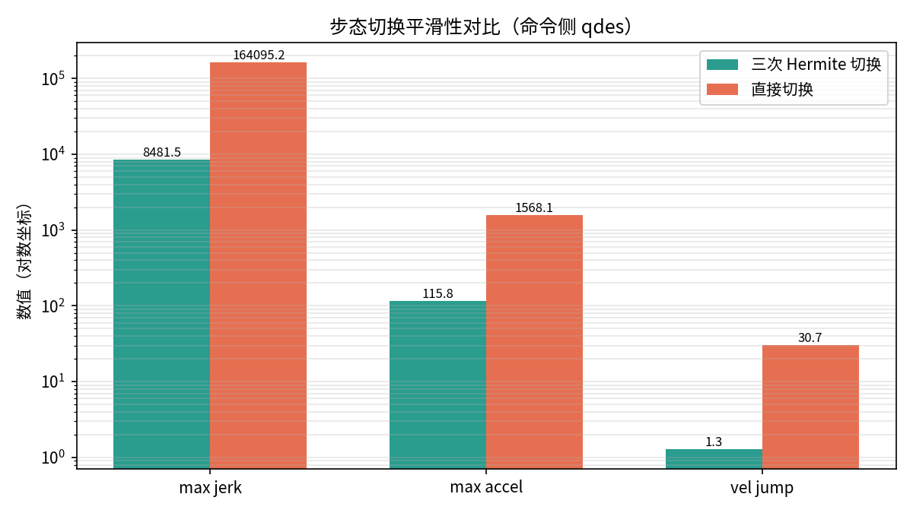
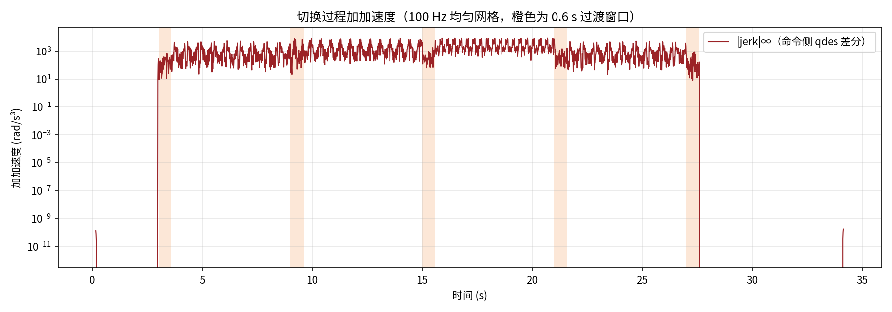
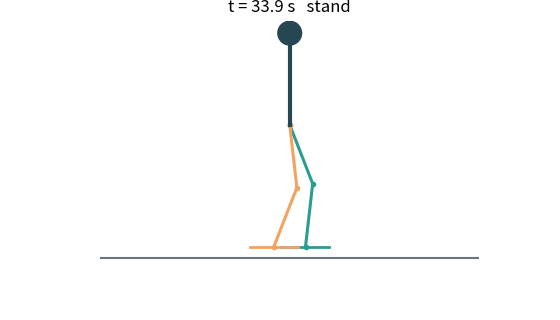

# 基于三次样条插值的双足机器人多步态平滑切换仿真

## 项目概述

本教程在 ROS 2 Humble 中搭建一个平面双足机器人：躯干 + 双腿，每条腿 3 个关节（髋、膝、踝），共 6 个主动关节。
机器人依次经历 **站立 → 行走 → 快步 → 跑步 → 行走 → 站立** 六段步态，每段之间用**三次 Hermite 样条**完成平滑切换。

重点不是单一步态的步态生成，而是**多步态切换的连续性**：切换瞬间如果直接跳变关节目标，关节角速度/角加速度会出现尖峰；
三次样条同时匹配切换起点与终点的位置和速度，使关节运动在 C1 意义下连续。项目还运行一组“直接切换”对照实验，用实测数据量化平滑效果。

## 系统结构

```
controller_node (200 Hz)
   │  /joint_cmd (期望角度 + 角速度)
   ▼
sim_node (500 Hz, 子步进 PD 伺服)
   │  /joint_states (实际角度)
   │  /biped_metrics (质心、ZMP、裕度、双脚位置/接触)
   ▼
logger_node (100 Hz 固定网格) → trajectory.csv
```

- 控制器只使用自身规划，不读取任何外部定位；
- 仿真节点用带速度前馈的 PD 伺服跟踪期望角，关节限位做饱和保护；
- 记录节点以自身单调时钟按 100 Hz 固定网格打时间戳（`time = 起始时刻 + 序号/rate`），CSV 相邻行严格等间隔，不再使用控制器消息中四舍五入的 `elapsed`；
- 接触状态由控制器按规划相位给出，仿真节点用期望关节角 `qdes` 的 FK 构造支撑多边形；ZMP 由期望质心轨迹的平滑二阶差分计算，实际质心与跟踪误差单独统计。

## 步态定义

| 步态 | 周期 (s) | 支撑相占比 | 步长 (m) | 抬脚高度 (m) | 髋高 (m) | 前倾 (rad) |
| --- | --- | --- | --- | --- | --- | --- |
| stand | 1.00 | 0.50 | 0.00 | 0.00 | 0.84 | 0.00 |
| walk | 1.20 | 0.62 | 0.22 | 0.10 | 0.82 | 0.06 |
| fast_walk | 0.90 | 0.58 | 0.30 | 0.13 | 0.80 | 0.10 |
| run | 0.60 | 0.38 | 0.42 | 0.18 | 0.78 | 0.16 |

单腿相位 `p` 在 `[0, 1)` 内循环，左右腿相差 0.5。支撑相占比大于 0.5 时存在双支撑（行走/快步），小于 0.5 时存在腾空（跑步）。

摆动脚相对髋部的位置：

```
支撑相：x_rel = A - 2A·p/s        （A = s·step）
摆动相：u = (p - s)/(1 - s)
        x_rel = -A + 2A·(3u² - 2u³)
        z_rel = clearance·16u²(1-u)²
```

摆动相的水平与竖直曲线在两端速度均为 0，减少落足冲击。

## 三次 Hermite 样条切换

设切换时刻为 `t0`，过渡时长 `T = 0.6 s`。记录当前 6 个关节角 `q0` 与角速度 `dq0`，
并预测目标步态在 `t1 = t0 + T` 时的角度 `q1` 与角速度 `dq1`。过渡期内：

```
u  = (t - t0) / T
h00 = 2u³ - 3u² + 1      h10 = u³ - 2u² + u
h01 = -2u³ + 3u²        h11 = u³ - u²
q(t) = h00·q0 + h10·T·dq0 + h01·q1 + h11·T·dq1
```

该式为标准三次 Hermite 插值：端点位置精确，端点速度精确，因而位置与速度连续（C1）。
控制器同时使用该式的解析导数作为 `/joint_cmd` 的速度前馈，切换首拍不会把速度发布成 0。
切换期间前进速度也从旧步态速度平滑过渡到新步态速度（smoothstep），避免基座速度突变。

> 本教程中的“三次样条”指分段三次 Hermite 插值；自然三次样条（C2 连续、端点二阶导为零）并未在主流程中使用。

## 运行方法

```bash
mkdir -p ~/biped_ws/src
ln -s /path/to/biped_cubic_spline_gait_switch ~/biped_ws/src/
cd ~/biped_ws
colcon build --packages-select biped_cubic_spline_gait_switch --symlink-install
source install/setup.bash
cd src/humanoid/biped_cubic_spline_gait_switch
python3 main.py
```

`main.py` 会依次运行 `spline` 与 `direct` 两组 34 s 实验，并调用 `tools/analyze.py` 生成指标、图表与 GIF。

## 实验结果

34 s 调度（站立 3 s → 行走 6 s → 快步 6 s → 跑步 6 s → 行走 6 s → 站立 7 s），100 Hz 记录，共 3401 条严格等间隔采样。对照组在相同参数下把切换方式改为直接跳变。

| 指标 | 三次 Hermite 切换 | 直接切换 |
| --- | --- | --- |
| 前进距离 / 平均速度（全程） | 16.799 m / 0.494 m/s | 同调度 |
| 平均速度（行进段） | 0.686 m/s | 同调度 |
| 关节跟踪 RMS | 0.0102 rad | — |
| 切换窗口最大 jerk（命令侧 qdes） | **8481.5 rad/s³** | 164095.2 rad/s³ |
| 切换窗口最大角加速度（命令侧 qdes） | **115.83 rad/s²** | 1568.11 rad/s² |
| 切换窗口最大速度跳变（qdes 差分） | **1.273 rad/s** | 30.683 rad/s |
| 切换窗口最大命令速度跳变（qddes） | **0.570 rad/s** | 124.348 rad/s |
| jerk 降低 | **94.8%** | — |
| 角加速度降低 | **92.6%** | — |
| ZMP 最小裕度（规划几何量） | -0.1980 m | — |
| 腾空比例 / 步数（规划相位） | 0.043 / 52 | — |

| 步态 | 采样数 | ZMP 最小裕度 (m) | 跟踪 RMS (rad) |
| --- | --- | --- | --- |
| stand | 1002 | 0.1339 | 0.0005 |
| walk | 1200 | -0.1633 | 0.0081 |
| fast_walk | 599 | -0.1426 | 0.0123 |
| run | 600 | -0.1980 | 0.0172 |

三次 Hermite 切换把切换窗口内的最大 jerk（命令侧 qdes 差分）降低 94.8%、角加速度降低 92.6%，命令速度 `qddes` 的相邻跳变从 124.348 降到 0.570 rad/s。指标先在 100 Hz 均匀网格上重采样，再对命令侧位置 `qdes` 差分，因此不再受控制器时间戳重复或采样间隔抖动影响。接触状态按规划相位统计，walk / fast_walk 腾空为 0、run 段为 0.243（理论 0.24）、整体 0.043；步数 52（排除步态切换边界假上升沿）；ZMP 裕度由 `qdes` 的 FK 支撑多边形得到，为规划几何量；行走/跑步阶段为负是因为本仿真为开环轨迹跟踪、未加入平衡控制器。

### 关节轨迹



上图为 6 个关节的期望角（实线）与实际角（虚线），橙色区间为 0.6 s 切换过渡。切换期间角度、角速度均连续。

### 质心与 ZMP



### 切换平滑性对比



三次样条切换与直接切换在同一调度、同一 PD 参数下对比：切换窗口内的最大角加速度、最大 jerk 与速度跳变均显著下降。

### 加加速度



### 行走动画



## 局限性

- 采用平面（矢状面）运动学，未建模侧向平衡、脚掌打滑与接触力；
- 浮动基座位置由步态规划给定，不是完整浮动基动力学积分；
- ZMP 由期望质心轨迹计算，支撑多边形由期望关节角 `qdes` 的 FK 与规划接触相位得到；二者均为规划几何量，不代表真实接触力；
- PD 伺服参数为等效惯量模型，不等同于真实电机/减速器参数。

## 复现说明

`results/run_spline` 与 `results/run_direct` 均由 `main.py` 在本机实际运行产生，均包含 100 Hz、3401 条等间隔采样的 `trajectory.csv`；`run_spline` 还包含由分析脚本生成的 `metrics.json`、`metrics.md`、图表与 GIF。测试通过 `python3 -m pytest -q test` 验证三次 Hermite 插值与解析导数、运动学，以及完整 34 s 调度下全部 5 次切换的逐窗口速度连续性。
