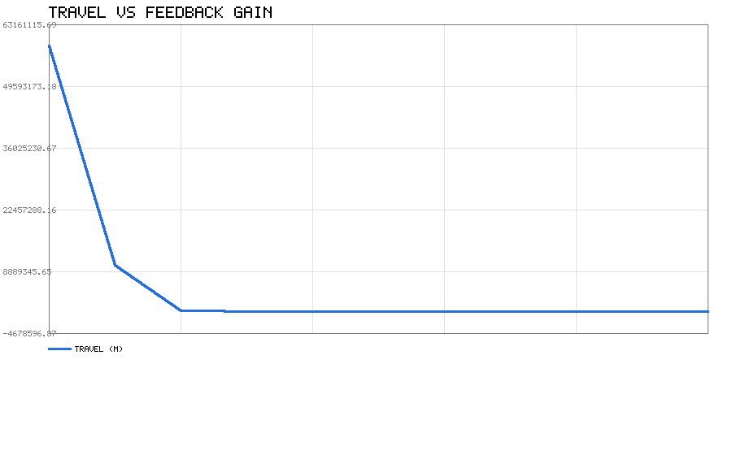
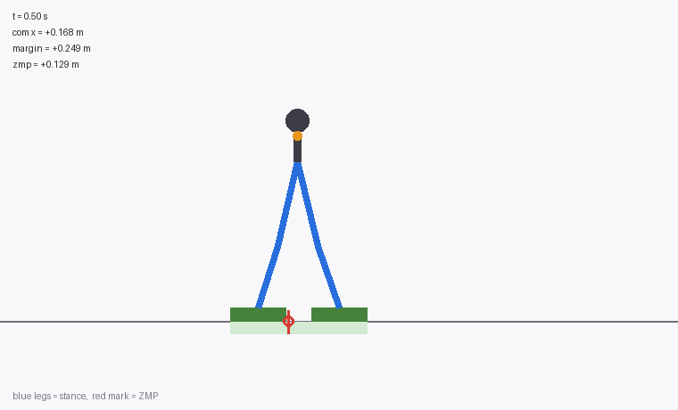
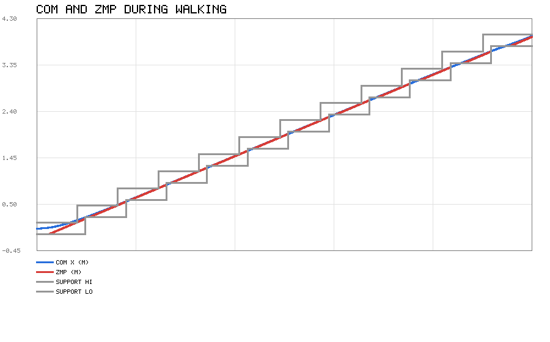
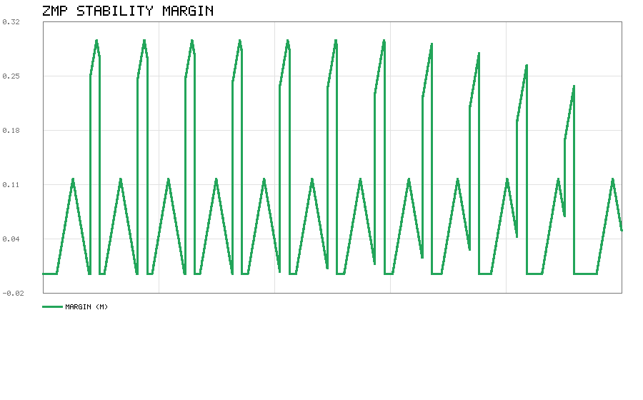
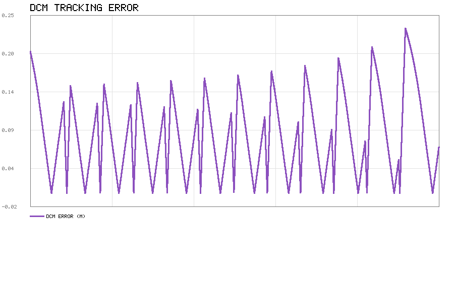

# 双足步态生成与 ZMP 稳定性验证

用线性倒立摆模型（LIPM）做双足行走的步态生成，并检查每一时刻的 ZMP 是否
落在支撑多边形内。

代码在 `src/humanoid/bipedal_gait_zmp/`。离线分析只用 Python 标准库，
另有一个 rospy 节点把结果发布成话题。

## 倒立摆模型

把机器人简化成一根倒立摆：质量全在质心，摆长等于质心高度 z_c，并且假设质心
高度恒定。这样一来水平方向只有前后一个自由度，运动方程是线性的：

```
ẍ = ω² (x − p),      ω = sqrt(g / z_c)
```

x 是质心位置，p 是零矩点（ZMP）。z_c = 0.8 m 时 ω = 3.50 1/s，特征时间 1/ω
约 0.29 s。

反过来，由质心轨迹能算出 ZMP：

```
p = x − ẍ / ω²
```

给定恒定 ZMP，方程有解析解：

```
x(t) = (x₀ − p)·cosh(ωt) + (v₀/ω)·sinh(ωt) + p
v(t) = (x₀ − p)·ω·sinh(ωt) + v₀·cosh(ωt)
```

代码里用数值二阶差分验证过这个解析解，差值在 1e−5 量级。

### 一个容易误解的地方

倒立摆是**不稳定**的。质心偏到 ZMP 前面时，加速度朝**正方向**（越跑越远），
不是被拉回来。很多人直觉上以为会往回走，写测试时我自己也先写错了。

## 落脚点与支撑多边形

步态计划是一串落脚点，每只脚有落地和离地时刻。只看前后方向，脚的支撑范围是
一个区间 `[center − half_length, center + half_length]`。

| 阶段 | 支撑区间 | ZMP 参考 |
|---|---|---|
| 单脚支撑 | 支撑脚的脚掌范围 | 脚掌中心 |
| 双脚支撑 | 两只脚脚掌的并集 | 从前一只脚中心线性过渡到后一只 |

**稳定裕度**取 ZMP 到支撑区间边界的最小距离。正值表示在区间内，越接近 0
越危险，负值就是已经翻倒了。

## 步态求解

LIPM 是线性系统，从初值 `[x₀, v₀]` 积分一个周期 T 后，状态可以写成仿射形式：

```
[x(T)]   [a11 a12] [x₀]   [b1]
[v(T)] = [a21 a22] [v₀] + [b2]
```

矩阵 A 和向量 b 只取决于 ZMP 参考轨迹，用三次积分就能定出来（分别喂
`(0,0)`、`(1,0)`、`(0,1)` 三个初值）。

对称行走要求一个周期后质心前进一个步幅、速度回到原值：

```
x(T) = x₀ + stride
v(T) = v₀
```

代入就得到二元一次方程组，解出唯一的周期解。

**注意周期起点要跳过第一步**。第一步落地时支撑关系里没有"前一只脚"，属于
起步瞬态，那一段的 ZMP 参考不满足周期性。代码里从第二只脚落地开始取周期。

## 关键发现：周期解存在但不稳定

用周期解做初值，开环积分下去，速度偏差的变化是：

| 周期 | 速度偏差 Δv |
|---|---|
| 1 | 7.17e−14 |
| 2 | 3.70e−12 |
| 3 | 1.24e−10 |
| 4 | 4.12e−09 |
| 5 | 1.37e−07 |

相邻周期的放大倍数实测 **37.9**，理论值 `e^(ωT) = e^3.5 = 33.2`。

也就是说这是**不稳定平衡点**：能算出来、能当参考，但任何微小误差都会指数
放大。真实机器人必须闭环控制。这正是双足行走难的地方。

如果直接按 ZMP 参考开环跟踪（增益 K = 0），质心会跑到 −5800 万米，完全飞掉。

## 闭环控制

用发散分量（DCM）做反馈。定义

```
ξ = x + ẋ/ω
```

代入 LIPM 可得

```
ξ̇ = ω (ξ − p)
```

这是一阶不稳定系统，ZMP 必须跑到 ξ 前面才能把它拉回来。

稳走时质心平均速度 v_avg 恒定，取参考

```
ξ_ref = p_ref + v_avg / ω
```

控制律是比例反馈加限幅：

```
p = p_ref + K·(ξ − ξ_ref)
p ← clip(p, 支撑区间)
```

限幅是必需的，ZMP 不可能跑到脚外面去。

### 增益怎么选

实测（步长 0.35 m、步时 0.5 s、支撑相占比 0.6、z_c = 0.8 m）：

| 增益 K | 行程 (m) | ZMP 饱和比例 | 平均裕度 (m) |
|---|---|---|---|
| 0.0 | −58482514 | 0.0 % | 0.1358 |
| 0.3 | −10237182 | 81.9 % | 0.0144 |
| 0.6 | −290271 | 74.5 % | 0.0238 |
| **1.0** | **4.0003** | **16.2 %** | **0.0891** |
| 1.5 | 4.0310 | 36.3 % | 0.0742 |
| 2.0 | 4.0427 | 47.2 % | 0.0626 |
| 3.0 | 4.0573 | 58.2 % | 0.0442 |

**K = 0 发散，K ≥ 1 才能走起来。** 但 K 也不是越大越好：增益越大，ZMP 越常
贴到支撑边界（饱和比例升高），平均裕度反而下降。默认取 K = 1.0。



## 运行结果

### 行走动画



侧视视角。深蓝色是支撑腿，浅蓝色是摆动腿，地面上的绿色带是当前支撑区间，
红色竖线是 ZMP 位置。镜头跟随质心，所以看起来机器人原地走，实际每帧都在前进。

跑 `python3 scripts/animate.py` 可以重新生成这个动图（需要 Pillow）。

### 数据

参数：步长 0.35 m，步时 0.5 s，支撑相占比 0.6，12 步，z_c = 0.8 m，
反馈增益 1.0，仿真步长 0.001 s。

| 指标 | 数值 |
|---|---|
| 仿真时长 | 6.100 s |
| 质心行程 | +3.9282 m |
| 平均速度 | 0.6440 m/s |
| 最大速度 | 0.6981 m/s |
| DCM 最大误差 | 0.2326 m |
| DCM 平均误差 | 0.0808 m |
| 最小稳定裕度 | +0.0000 m |
| ZMP 饱和比例 | 20.3 % |

目标平均速度是 0.70 m/s，实际 0.644 m/s，偏低是因为起步阶段要加速。



蓝线是质心，红线是 ZMP，两条灰线是支撑区间的上下界。可以看到 ZMP 在两只脚
之间来回跳，质心则平滑前进。



稳定裕度在起步阶段为 0（ZMP 贴着脚边缘），进入稳态后升到 0.05～0.27 m。



## 怎么跑

### 不需要 ROS

在包目录下直接跑（不用先 cd 进 scripts）：

```bash
cd src/humanoid/bipedal_gait_zmp
python3 main.py            # 完整演示，图输出到包根 demo_out/
python3 main.py --quick    # 跳过增益扫描
python3 main.py --gain 1.5 # 指定反馈增益
python3 scripts/animate.py # 重新生成行走动图（需要 Pillow）
```

`main.py` 只用标准库；`scripts/animate.py` 画动图用了 Pillow，需要时
`pip install pillow`（Ubuntu 下也可以 `sudo apt install python3-pil`）。

### 在 ROS 里跑

```bash
cd ~/catkin_ws
catkin_make
source devel/setup.bash
roslaunch bipedal_gait_zmp main.launch
```

launch 起两个节点：`bipedal_gait_demo` 跑上面的离线演示并出图，`bipedal_gait_zmp`
把同一次仿真的结果发布成话题。离线分析只吃标准库，ROS 这一侧是真的注册节点、
真的在发消息，可以用 `rostopic` / `rqt_plot` 验收。

| 话题 | 类型 | 内容 |
|---|---|---|
| `/bipedal_gait/com_path` | `nav_msgs/Path` | 整条质心轨迹（latched）|
| `/bipedal_gait/zmp_path` | `nav_msgs/Path` | 整条 ZMP 轨迹（latched）|
| `/bipedal_gait/com_pose` | `geometry_msgs/PoseStamped` | 当前质心，随回放逐帧发 |
| `/bipedal_gait/zmp_pose` | `geometry_msgs/PoseStamped` | 当前 ZMP |
| `/bipedal_gait/margin` | `std_msgs/Float64` | 当前稳定裕度 |
| `/bipedal_gait/footsteps` | `visualization_msgs/MarkerArray` | 12 个落脚点 |
| `/bipedal_gait/support` | `visualization_msgs/Marker` | 当前支撑区间 |

验收：

```bash
rostopic list | grep bipedal_gait
rostopic hz /bipedal_gait/margin        # 约 50 Hz
rostopic echo -n1 /bipedal_gait/margin  # 一时一值
rqt_plot /bipedal_gait/margin/data      # 曲线不发散
```

节点参数：`step_length` 0.35、`step_time` 0.5、`duty` 0.6、`n_steps` 12、
`com_height` 0.8、`gain` 1.0、`playback_rate` 1.0、`publish_rate` 50、
`loop` true、`frame_id` map，在 launch 里用 `<param>` 覆盖。只要话题不出图用
`demo:=false`，只跑演示用 `node:=false`。

跑测试：

```bash
cd src/humanoid/bipedal_gait_zmp
python3 -m unittest discover -s tests
```

## 测试

`tests/test_gait.py` 一共 73 个测试，分七组：

| 组 | 覆盖内容 |
|---|---|
| LIPMParams | ω 计算、参数校验 |
| ComTrajectory | 初值、静止平衡、满足运动方程、数值二阶导对比、倒立摆方向 |
| ZMP | 静止时等于质心投影、加速时落在后方、两种公式一致 |
| CapturePoint | 捕获点、停止位置、停车时间 |
| Footstep / GaitPlan | 脚掌区间、支撑多边形、ZMP 参考、阶段类型 |
| StabilityMargin | 区间内为正、边界为零、越界为负 |
| PeriodicSolution | 周期解是真正的不动点、stride 正确、**开环不稳定** |
| ClosedLoop | ZMP 不越界、K=0 发散、K=1 稳定 |

其中"开环不稳定"那条是这么写的：用周期解积分四个周期，检查相邻周期的速度
偏差比值明显大于 1。这条测试把整个项目的核心结论固定住了。

## 文件结构

```
src/humanoid/bipedal_gait_zmp/
├── README.md
├── main.py             包根入口，转调 scripts/main.py
├── package.xml
├── CMakeLists.txt
├── launch/
│   └── main.launch     离线演示 + ROS 节点
├── scripts/
│   ├── lipm.py         LIPM 动力学与解析解
│   ├── footstep.py     落脚点、支撑多边形、稳定裕度
│   ├── gait.py         对称步态、周期解、开环仿真
│   ├── dcm.py          发散分量与反馈控制
│   ├── gait_node.py    ROS 节点：发质心、ZMP、裕度、落脚点
│   ├── animate.py      行走动图渲染（需要 Pillow）
│   ├── simple_plot.py  PNG 折线图（手写，只用 zlib）
│   └── main.py         演示入口
└── tests/
    └── test_gait.py
```

## 参考

* S. Kajita et al., *Biped Walking Pattern Generation by using Preview Control of
  Zero-Moment Point*, 2003
* P.-B. Wieber, *Trajectory Free Linear Model Predictive Control for Stable
  Walking*, 2006
* J. Englsberger et al., *Three-Dimensional Bipedal Walking Control Based on
  Divergent Component of Motion*, 2015
