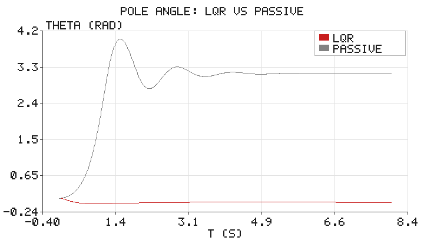
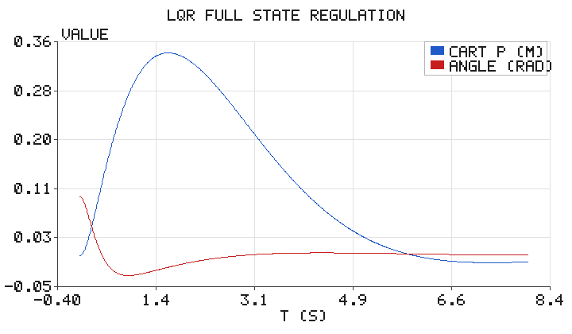

# 倒立摆（Cart-Pole）的 LQR 最优平衡控制

## 1. 背景与目标

倒立摆是控制理论中最经典的**不稳定平衡**例子：一根摆杆用铰链连在小车上，
不加控制时，任何微小倾斜都会在重力作用下迅速放大，摆杆最终倒下。让摆杆
稳定地"立"在竖直向上位置，是检验控制算法（PD、极点配置、LQR、MPC 等）的
标准考题，也直接对应人形机器人、平衡车等真实系统的核心问题。

本模块用**线性二次型调节器（Linear Quadratic Regulator, LQR）**解决该问题：
它在"状态偏离"与"控制能量"之间做最优折中，得到状态反馈增益 $K$，使闭环系统
渐近稳定。全部计算仅用 Python 标准库实现（含手写的矩阵运算与 Riccati 迭代），
不依赖 numpy / scipy / matplotlib。

## 2. 运行环境

- Python 3（仅标准库，无第三方依赖）
- 运行方式：

```bash
cd src/humanoid/cartpole_lqr
python3 scripts/main.py --outdir scripts
```

运行后输出 `cartpole_angle.png`、`cartpole_state.png` 两张配图，并打印 LQR 增益与误差指标。

## 3. 代码文件清单

```
src/humanoid/cartpole_lqr/
├── scripts/
│   ├── minilinalg.py     # 极简矩阵库：乘/转置/求逆/秩/离散 Riccati 迭代/LQR 增益
│   ├── cartpole.py       # 倒立摆动力学、线性化、LQR 设计、RK4 闭环仿真
│   ├── simulate.py       # 组装仿真并输出配图
│   ├── simple_plot.py    # 仅用 zlib 的极简折线图输出
│   └── main.py           # 命令行入口
├── tests/
│   └── test_cartpole.py  # 单元断言（可控性 / 稳定性 / Riccati 残差等）
├── package.xml
├── CMakeLists.txt
├── launch/main.launch
├── README.md
└── requirements.txt
```

## 4. 处理原理

### 4.1 动力学模型

采用"质点摆"模型：小车质量 $M$，摆杆质量 $m$ 集中于距转轴 $l$ 处，
摆角 $\theta$ 相对竖直向上方向，$u$ 为作用在小车上的水平力。由拉格朗日方程得

$$
(M+m)\,\ddot{p} + m l \cos\theta\,\ddot{\theta} = u + m l \sin\theta\,\dot{\theta}^2
$$

$$
m l \cos\theta\,\ddot{p} + m l^2\,\ddot{\theta} = m g l \sin\theta - b\,\dot{\theta}
$$

其中 $b$ 为摆杆转动粘性阻尼（贴近真实关节摩擦）。上式为非线性、耦合的。

### 4.2 竖直平衡点线性化

在 $\theta=0,\ \dot\theta=0$ 附近取小角近似（$\sin\theta\approx\theta$，$\cos\theta\approx1$），
得状态空间模型 $\dot{\mathbf{x}} = A\mathbf{x} + B u$，状态
$\mathbf{x}=[p,\ \dot p,\ \theta,\ \dot\theta]^T$：

$$
A=\begin{bmatrix}
0 & 1 & 0 & 0\\
0 & 0 & -\frac{mg}{M} & \frac{b}{Ml}\\
0 & 0 & 0 & 1\\
0 & 0 & \frac{(M+m)g}{lM} & -\frac{(M+m)b}{ml^2M}
\end{bmatrix},\quad
B=\begin{bmatrix}0\\ \frac{1}{M}\\ 0\\ -\frac{1}{lM}\end{bmatrix}
$$

注意 $A_{32}=\frac{(M+m)g}{lM}>0$：竖直向上是**不稳定**平衡点（开环特征根有正实部），
这正是需要主动控制的原因。

### 4.3 离散 LQR

将系统按采样周期 $dt$ 离散化（$A_d\approx I+A\,dt,\ B_d\approx B\,dt$），
求解**离散代数 Riccati 方程（DARE）**

$$
P = Q + A_d^{T} P A_d - A_d^{T} P B_d \left(R + B_d^{T} P B_d\right)^{-1} B_d^{T} P A_d
$$

本模块用**不动点迭代**求解 $P$（无需任何线性代数库），再得最优增益

$$
K = \left(R + B_d^{T} P B_d\right)^{-1} B_d^{T} P A_d
$$

控制器为状态反馈 $u = -K\mathbf{x}$。权重取
$Q=\mathrm{diag}(1,\,0.1,\,100,\,1)$（重点惩罚摆角）、$R=1$。
解得

$$
K \approx [\,-0.954,\ -2.186,\ -35.768,\ -5.839\,]
$$

其中摆角项的增益最大（$-35.8$），体现"绝不让摆杆倒下"的强约束。

## 5. 仿真结果

初始条件：摆角 $\theta_0=0.1\,\mathrm{rad}$（轻微倾斜），其余为 0，仿真 8 s。
对照"无控制（$u=0$）"的自由响应。



- **LQR（红）**：摆角迅速收敛并稳定在 0 附近（末端 $|\theta|\approx 2.8\times10^{-4}\,\mathrm{rad}$）；
- **无控（灰）**：摆杆从 $0.1\,\mathrm{rad}$ 迅速倾倒，最终落在 $\theta\approx\pi$（完全倒下）。



上图给出 LQR 下小车位置 $p(t)$ 与摆角 $\theta(t)$ 的响应：控制器先让小车向一侧移动
"接住"摆杆（$p$ 出现约 $0.25\,\mathrm{m}$ 的瞬态偏移），随后两者都平稳回到 0，
即**全状态调节**（把 4 个状态同时驱动到原点）。

## 6. 小结

- 倒立摆在竖直位置线性化后是**不稳定**的，必须主动控制；
- LQR 通过解 Riccati 方程得到状态反馈增益，在"快速稳定"与"控制代价"间折中；
- 权重 $Q$ 中加大对摆角的惩罚，会得到更大的角度增益，优先保平衡；
- 全程仅用 Python 标准库（手写矩阵运算 + Riccati 迭代 + RK4 积分）即可复现。

## 参考

- R. E. Kalman, *Contributions to the theory of optimal control*, 1960
- B. D. O. Anderson, J. B. Moore, *Optimal Control: Linear Quadratic Methods*, 1990
- R. Tedrake, *Underactuated Robotics*（Cart-Pole 章节）

> 说明：本模块仅依赖 Python 标准库，开箱即跑；文档与代码在编写过程中使用 AI 辅助，
> 但均经实跑验证（单元测试与 `python3 main.py` 生成上图），作者对内容正确性负责。
