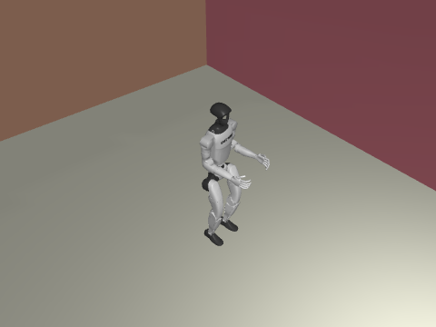

# G1 室内走廊键盘遥控

通过键盘复现 G1 预训练步态在室内走廊的前进、转向和停止。

## 环境与运行

使用 Python 3.11。在模块目录运行 `python -m pip install -r requirements.txt`。

在模块目录运行 `python scripts/fetch_assets.py /path/to/unitree_rl_gym` 获取固定版本的 G1 资产。底层步态来自 Unitree 预训练策略。

```bash
python main.py --assets /path/to/unitree_rl_gym
```

使用 WASD 或方向键前进、后退和转向，空格停车，+/- 调速。持续按键维持命令，0.6 秒无按键后速度归零。无窗口时可运行 `--mode smoke` 验证步态。

## ROS launch

在 ROS Noetic 源码空间运行，将路径替换为实际值。

```bash
source /opt/ros/noetic/setup.bash
export ROS_PACKAGE_PATH="$PWD:${ROS_PACKAGE_PATH:-}"
roslaunch g1_corridor_teleop main.launch sim_python:=/path/to/python sim_entry:=/path/to/main.py assets:=/path/to/unitree_rl_gym
```

## 运行效果



## 大模型使用声明

使用 OpenAI Codex 辅助拆分、编程、验证和文档整理，提交者复核并对提交内容负责。
