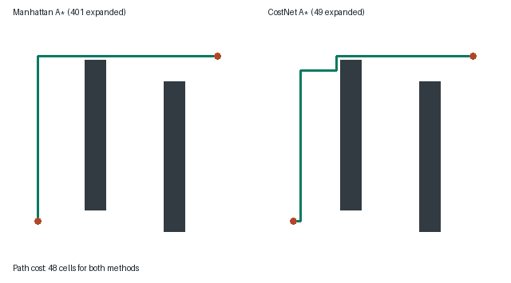

# G1 CostNet 栅格规划对照

在独立栅格示例中比较 CostNet 辅助 A* 和曼哈顿 A* 的路径代价与搜索扩展数。

## 环境与运行

使用 Python 3.11。在模块目录运行 `python -m pip install -r requirements.txt`。

```bash
python main.py --output results
```

示例在一个合成栅格比较经典和神经辅助搜索，输出路线图和 JSON。网络仅处理相同 f 值的排序。可用 `--mode train_planner` 重训，用 `--mode plan_stdio` 接收占据栅格 JSON。

## ROS launch

在 ROS Noetic 源码空间运行，将路径替换为实际值。

```bash
source /opt/ros/noetic/setup.bash
export ROS_PACKAGE_PATH="$PWD:${ROS_PACKAGE_PATH:-}"
roslaunch g1_costnet_grid_planner main.launch sim_python:=/path/to/python sim_entry:=/path/to/main.py
```

## 运行效果



## 大模型使用声明

使用 OpenAI Codex 辅助拆分、编程、验证和文档整理，提交者复核并对提交内容负责。
