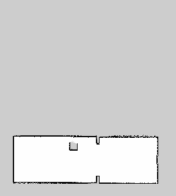

# G1 gmapping 室内建图导航

通过仿真雷达和里程计为 G1 同步建图，并用 move_base 执行地图目标。

## 环境与运行

使用 Python 3.11。在模块目录运行 `python -m pip install -r requirements.txt`。

在模块目录运行 `python scripts/fetch_assets.py /path/to/unitree_rl_gym` 获取固定版本的 G1 资产。底层步态来自 Unitree 预训练策略。

```bash
python3 main.py --sim-python /path/to/simulation/python --assets /path/to/unitree_rl_gym
```

需要 ROS Noetic、gmapping、move_base。等待 /map 后，在 RViz 选择 map 坐标系，用 2D Nav Goal 向 /move_base_simple/goal 发送目标。Windows 仿真环境与 WSL 组合时使用启动脚本转换路径。

## ROS launch

在 ROS Noetic 源码空间运行，将路径替换为实际值。

```bash
source /opt/ros/noetic/setup.bash
export ROS_PACKAGE_PATH="$PWD:${ROS_PACKAGE_PATH:-}"
roslaunch g1_gmapping_navigation main.launch sim_python:=/path/to/python sim_entry:=/path/to/main.py assets:=/path/to/unitree_rl_gym
```

## 运行效果



## 大模型使用声明

使用 OpenAI Codex 辅助拆分、编程、验证和文档整理，提交者复核并对提交内容负责。
