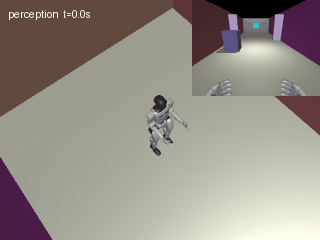

# G1 RGB 地面分割巡检

用地面分割和语义控制网络为 G1 生成通行速度，并在地面掩码为空时停车。

## 环境与运行

使用 Python 3.11。在模块目录运行 `python -m pip install -r requirements.txt`。

在模块目录运行 `python scripts/fetch_assets.py /path/to/unitree_rl_gym` 获取固定版本的 G1 资产。底层步态来自 Unitree 预训练策略。

```bash
python main.py --assets /path/to/unitree_rl_gym --record --output results
```

闭环默认使用留出种子 7，输出轨迹及到达、碰撞和跌倒指标。可用 `--mode collect` 采样，随后用 `--mode train` 复训。无地面停车由规则触发。

## ROS launch

在 ROS Noetic 源码空间运行，将路径替换为实际值。

```bash
source /opt/ros/noetic/setup.bash
export ROS_PACKAGE_PATH="$PWD:${ROS_PACKAGE_PATH:-}"
roslaunch g1_rgb_floor_patrol main.launch sim_python:=/path/to/python sim_entry:=/path/to/main.py assets:=/path/to/unitree_rl_gym
```

## 运行效果



## 大模型使用声明

使用 OpenAI Codex 辅助拆分、编程、验证和文档整理，提交者复核并对提交内容负责。
