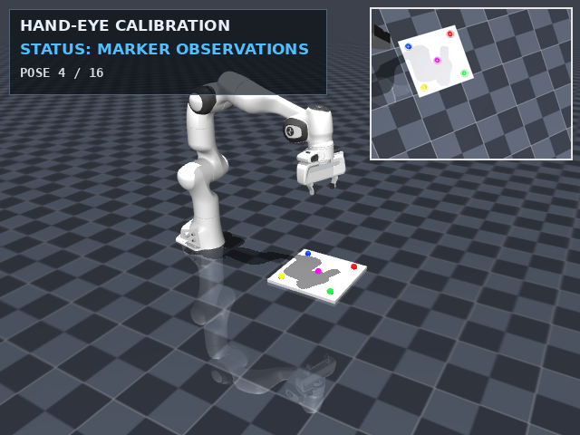
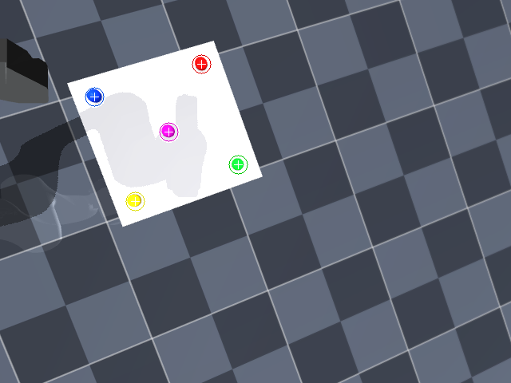
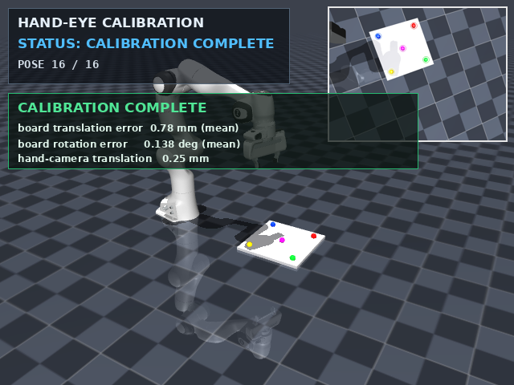
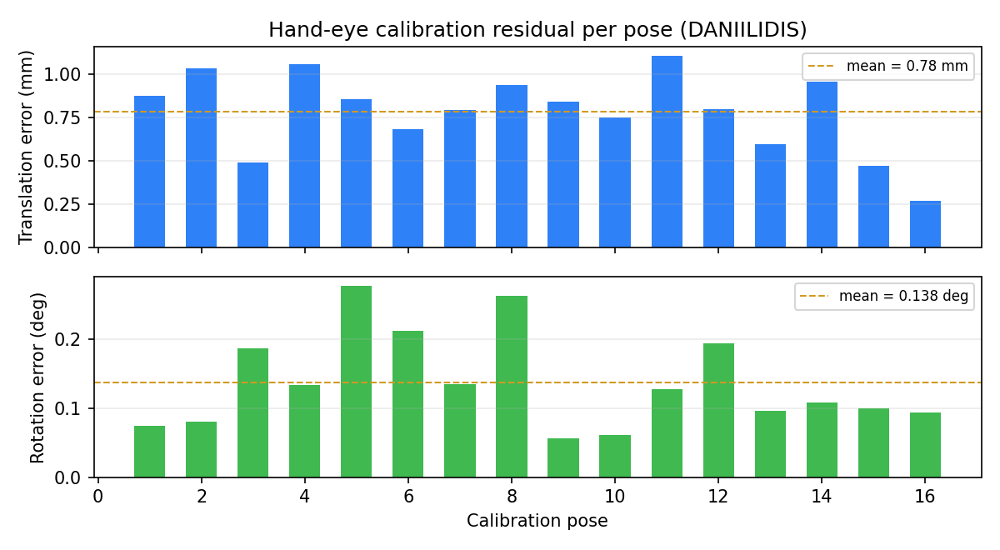
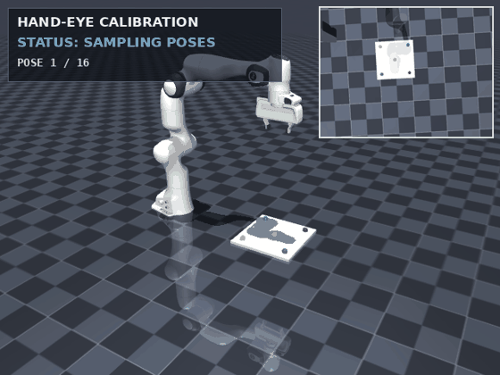

# MuJoCo 机械臂手眼标定仿真

> 对应源码模块：`src/manipulation/hand_eye_calibration/`

## 1. 简介

手眼标定用于确定机械臂末端与相机之间的固定变换（eye-in-hand），是视觉抓取、视觉伺服
与机器人自动化的基础环节。本模块在 MuJoCo 中搭建 Panda 机械臂 + 腕部相机 + 固定标定板，
在 16 组不同位姿下观测标定板上的彩色标记点，使用 OpenCV 求解手眼变换，并统计标定精度。

演示包含主视图、腕部相机画中画、标记点可视化、实时 HUD、标定结果面板与误差曲线。

## 2. 环境

| 项目 | 配置 |
|---|---|
| 系统 | Ubuntu 20.04.6（VMware，4 vCPU / 4 GB RAM） |
| Python | 3.8.10（venv） |
| 仿真器 | MuJoCo 2.3.7（CPU，无 GPU） |
| 视觉 | OpenCV 4.8.1（headless） |
| 渲染 | MuJoCo GLFW + Mesa 软件渲染 |

## 3. 安装与运行

### 纯 Python 运行（在模块根目录 `src/manipulation/hand_eye_calibration/` 下）

```bash
cd src/manipulation/hand_eye_calibration      # 模块根目录
python3 -m venv .venv && source .venv/bin/activate
pip install -r requirements.txt
python3 scripts/setup_model.py          # 先下载 Panda 网格资源（colcon 安装时打包）

# 可选：生成 MP4
sudo apt-get install -y ffmpeg

python3 main.py
bash scripts/record_demo.sh /tmp/he_frames
```

### ROS 2 工作区（在工作区根目录下，需先完成上面的网格下载）

```bash
colcon build --symlink-install --packages-select hand_eye_calibration
source install/setup.bash
ros2 launch hand_eye_calibration main.launch.py
```

> `ros2 launch` 会用 ROS 2 环境的 `python3` 执行安装出的入口脚本；若 MuJoCo/OpenCV 等 pip
> 依赖只装在 `.venv` 里，请给该解释器补装依赖（如 `python3 -m pip install --user -r requirements.txt`），
> 或把 ROS 2 环境建在同一个 venv 中。
>
> 渲染需要图形会话：`DISPLAY=:0`、`XAUTHORITY`（默认自动查找当前 UID 的 GDM
> Xauthority）、`MUJOCO_GL=glfw`。

## 4. 任务流程

| 步骤 | 说明 |
|---|---|
| 1. 位姿采样 | 16 组位姿覆盖标定板不同方向/高度/姿态（yaw ±20°、roll ±8°、pitch ±6°），IK 驱动机械臂到达 |
| 2. 相机观测 | 腕部相机拍摄标定板，获取 5 个标记点的图像坐标 |
| 3. 观测模型 | 由相机投影生成对应点，并在 `T_cam_board` 的平移上叠加 N(0, 0.4 mm)、在旋转向量上叠加 N(0, 0.08°) 噪声（图像用于可视化） |
| 4. 手眼求解 | `calibrateHandEye`（TSAI/PARK/HORAUD/ANDREFF/DANIILIDIS）；按组合残差选优（仿真中以标定板真值位姿为参考），对最优解做一次 `AX=XB` 非线性精化 |
| 5. 精度评估 | 反算标定板位姿到基座系，统计平移/旋转/重投影误差 |



*图 1：机械臂 + 标定板总览，右上角为腕部相机图像与标记点*



*图 2：腕部相机图像，5 个标记点（红/绿/蓝/黄/品红）*



*图 3：标定完成，HUD 显示平移/旋转误差*



*图 4：每个标定位姿的平移与旋转误差*



*图 5：完整标定过程 GIF（约 3.8 MB）*

## 5. 实现说明

1. **机械臂与相机**：Panda 模型（MuJoCo Menagerie）+ 自建手眼场景；腕部相机偏置安装，
   避免夹爪遮挡标定板；TCP 与相机外参固定。
2. **采样与 IK**：位置/姿态目标经阻尼最小二乘 IK 求解 7 个关节角，覆盖 16 个不同视角；
   每个位姿记录末端位姿 T_base_ee 与相机观测 T_cam_board。
3. **手眼求解**：OpenCV `calibrateHandEye` 的 TSAI/PARK/HORAUD/ANDREFF/DANIILIDIS 五种
   线性方法，按平移 mm + 10 × 旋转 deg 的组合残差排序（仿真中已知标定板真值位姿，用它作为
   评分参考；真实系统无真值，应改用 `A X = X B` 残差）；仅对排名第一的解做一次
   `A X = X B` 成对约束非线性精化。TSAI 在部分姿态下可能不收敛，代码对其异常做了跳过保护。
4. **精度评估**：用 X 将标定板从相机系变换到基座系，与标定板真实位姿比较；同时统计
   重投影误差。

## 6. 实测数据

| 指标 | 数值 |
|---|---|
| 采样位姿 | 16（IK 全部收敛） |
| 选中方法 | DANIILIDIS |
| 标定板平移误差 | **0.78 mm**（mean），最大 1.10 mm |
| 标定板旋转误差 | **0.138°**（mean），最大 0.277° |
| 重投影误差 | 0.49 px（mean），最大 0.72 px |
| 手眼平移误差 | **0.25 mm / 0.25 mm**（mean/max），真值 (0.09, 0.09, 0.02) m |
| 手眼旋转误差 | **0.081° / 0.081°**（mean/max） |
| 渲染 | 286 帧 / 20 fps / 640×480 + 画中画 |
| GIF / MP4 | 3.8 MB / 0.56 MB（GIF 为抽帧 10 fps；MP4 为 20 fps，需系统 ffmpeg） |

## 7. 已知限制

- 观测点由 MuJoCo 相机投影 + 噪声生成，不等同于真实图像特征提取（如 ArUco/棋盘格）；
- 未引入镜头畸变、颜色分割误差、光照变化与运动模糊；
- 方法选优使用仿真真值标定板位姿（纯仿真演示方法，真实系统需改用 `AX = XB` 残差）；
- 未提供 ROS 话题/服务/action；ROS 2 封装仅用于 `colcon build` / `ros2 launch` 启动 MuJoCo 演示进程；
- 标定板只有 5 个共面点，位姿覆盖有限；
- 仓库不直接提交约 33 MB 网格资源：需先运行 `setup_model.py` 再 `colcon build`，否则安装后的 share 目录只有 XML。

## 8. 参考

- MuJoCo Menagerie Franka Emika Panda 模型：<https://github.com/google-deepmind/mujoco_menagerie>
- OpenCV `calibrateHandEye`：<https://docs.opencv.org/4.x/d9/d0c/group__calib3d.html>
- 同类流程：MoveIt2 规划位姿 + easy_handeye2 采集/求解手眼标定（本模块为独立 MuJoCo 实现）
