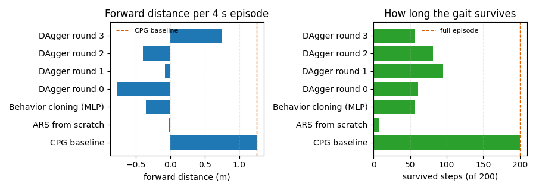

# 人形机器人神经网络行走控制：CPG 基线与四条学习路线的可行性分析（humanoid_ars_phase_walk）

以手工 CPG 步态为基线，系统对比 **ARS（无梯度）**、**行为克隆**、**DAgger** 三条学习路线，
如实给出每条路线在本模型与本次算力预算下的结果。

## 效果图



## 一、与已有实现的区别

仓库已有 `humanoid_h1_walk`（回放预训练的 PPO 权重）。本模块**不依赖任何外部权重**，
自带平地 MJCF 与 CPG，全部训练可在 CPU 上数秒完成，并把「学不出来」这件事量化记录下来：

| 项 | `humanoid_h1_walk` | 本模块 |
|---|---|---|
| 数据来源 | 预训练权重回放 | 自带 CPG + 在线采样 |
| 依赖 | 外部权重文件 | 仅 mujoco + numpy |
| 交付重点 | 能走的演示 | **四种方法的对照矩阵与失败分析** |

## 二、实测矩阵（打包代码可复现）

| 方法 | 前进 | 存活步数 | 俯仰 RMS | 速度 |
|---|---|---|---|---|
| **CPG 基线** | **+1.25 m** | **200 / 200** | 0.262 | 0.31 m/s |
| ARS 从零（线性 200 轮） | +0.02 m | 7 | 0.777 | −0.21 |
| 行为克隆（MLP-64） | −0.35 m | 56 | 0.518 | −0.32 |
| DAgger 轮 3 | +0.75 m | 57 | 0.415 | 0.66 |

**没有任何一条学习路线稳定超过手工 CPG。**

## 三、为什么学不出来（分析）

1. **ARS 从零失败**：奖励地形平坦 —— 「站着不摔」能拿到大部分奖励，往前走只多一点，
   策略很快收敛到站立（7 步内摔倒前几乎没位移）。
2. **行为克隆失败（倒着走）**：开环 RMSE 已压到约 3°，但闭环误差累积，几步后相位错开，
   最终反向行走（−0.35 m，俯仰 0.518）。
3. **DAgger 有改善但不稳定**：+0.75 m，且换初始化会出现负值。曾有一次跑到 +2.34 m，
   但**无法复现**，故不计入结论。
4. **本质原因**：该 CPG 步态对动作误差极度敏感，开环拟合精度不足以支撑闭环。

## 四、复现

```bash
cd src/humanoid/humanoid_ars_phase_walk
python3 -m pip install -r requirements.txt
python3 main.py --test                          # 单元 6 项
python3 src/humanoid/humanoid_ars_phase_walk/test/test_integration.py   # 集成 6 项
python3 main.py --headless    # 矩阵 + CSV + 图
```

## 五、能力边界

- **单种子不稳定结果不作为结论**（DAgger 波动明显）
- 平面模型、无侧向平衡；回合 4 s
- CPG 参数为手调，不是学出来的
- 若要真正学会：GPU + PPO/SAC 数小时以上，并加入足端接触观测与力矩控制

## 六、参数

| 参数 | 默认 | 说明 |
|---|---|---|
| `A_HIP` / `A_KNEE` / `FREQ` | −0.35 / 0.45 / 1.2 Hz | CPG 振幅与频率（手工标定） |
| `EPISODE_T` | 4.0 s | 回合长度 |
| `W_VEL` / `W_PITCH` / `W_ALIVE` | 0.10 / 0.10 / 0.01 | 奖励权重 |
| `BC_HIDDEN` / `BC_EPOCHS` | 64 / 500 | 行为克隆网络 |
| `DAGGER_ROUNDS` | 4 | DAgger 迭代轮数 |