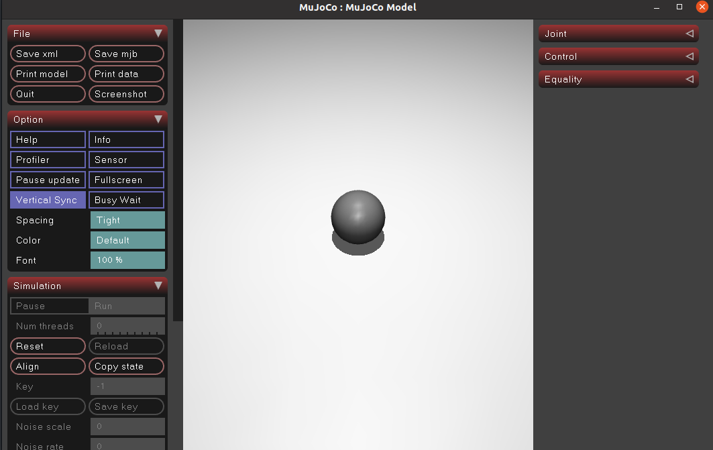
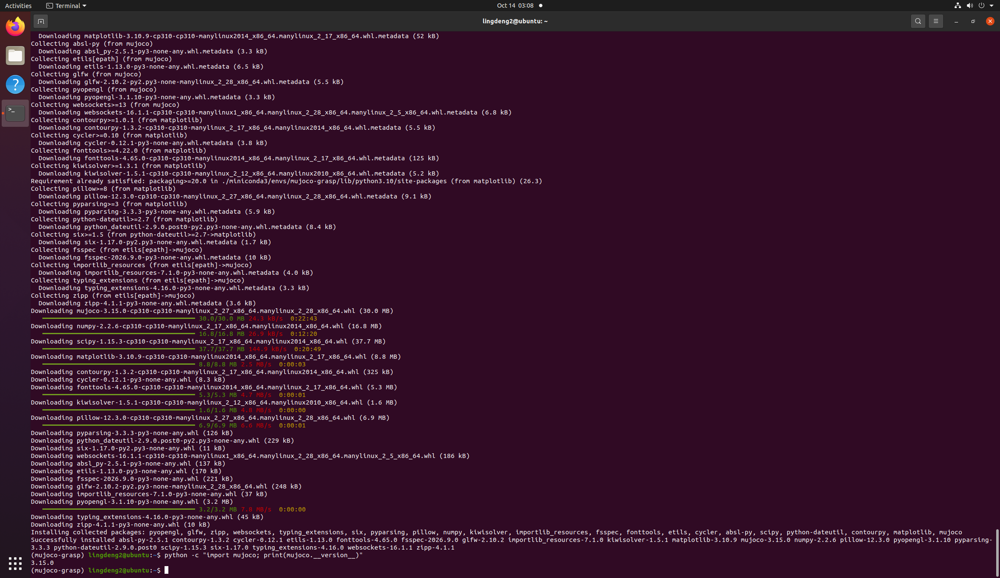

# 人形机器人基础

## 前言

本章介绍了怎么配置并使用Mujoco作为机器人的仿真环境。

## 配置Miniconda和MuJoCo物理仿真环境教程

以下教程在已有ROS Noetic的Ubuntu20.04虚拟机中进行，隔离配置一个基于Conda的MuJoCo仿真环境。

为了避免MuJoCo和ROS出现Python依赖冲突，且因为虚拟机硬盘和内存有限，所以选择更加轻量的Miniconda配置虚拟环境。

## 一、安装 Miniconda

1、下载安装脚本

打开终端，建议先回到主目录，然后下载安装脚本：

```bash
cd ~
wget https://mirrors.tuna.tsinghua.edu.cn/anaconda/miniconda/Miniconda3-latest-Linux-x86_64.sh
```

2、运行安装脚本

输入下面的代码安装

```bash
bash Miniconda3-latest-Linux-x86_64.sh
```

出现以下提示证明已经在许可协议页面了，持续按空格翻页

```text
Welcome to Miniconda3
In order to continue the installation process, please review the license agreement.
Please, press ENTER to continue
```

接下来只要继续输入yes或回车同意就行了。


**接下来是最关键的一步，如果你的电脑已经安装过其他版本的Mujoco或ros，在下面的选项一定要填no**

```text
Do you wish the installer to initialize Miniconda3
by running conda init? [yes|no]
```

最后输入以下代码激活conda环境

```bash
source ~/miniconda3/bin/activate
```

输入下面的代码确认是否安装成功

```bash
conda --version
```

出现版本号就证明安装成功了。


## 二、安装 Mujoco

1、接受服务条款

打开bash终端，输入代码激活conda环境

```bash
source ~/miniconda3/bin/activate
```

随后依次输入下面的代码进行授权

```bash
conda tos accept --override-channels --channel https://repo.anaconda.com/pkgs/main
```

```bash
conda tos accept --override-channels --channel https://repo.anaconda.com/pkgs/r
```

2、创建mujoco环境


输入下面的代码创建mujoco环境

```bash
conda create -n mujoco-grasp python=3.10 -y
```

创建完成之后激活环境

```bash
conda activate mujoco-grasp
```

看到命令行前缀从(base)变成(mujoco-grasp)，就可以了。

确认环境可以正常激活之后输入下面的代码退出conda环境

```bash
conda deactivate
```

3、安装系统图形库

输入下面的代码安装系统图形库

```bash
sudo apt update
```

```bash
sudo apt install -y libglfw3 libglew-dev libgl1-mesa-glx libosmesa6-dev patchelf
```


4、在 conda 环境里安装 MuJoCo

进入(mujoco-grasp) 环境

```bash
conda activate mujoco-grasp
```

安装Mujoco和其他所需库

```bash
pip install mujoco numpy scipy matplotlib
```

最后输入下面的代码验证是否安装成功

```bash
python -c "import mujoco; print(mujoco.__version__)"
```

出现版本号就可以了

最后每次要打开Mujoco就需要输入下面的代码进入环境

```bash
source ~/miniconda3/bin/activate
conda activate mujoco-grasp
```

## 三、代码示例

下面是一个MuJoCo小球自由落体测试脚本，用来简单测试。

### 1. 文件位置

完整代码的仓库路径[src/humanoid/mujoco_demo/falling_ball.py](../../src/humanoid/mujoco_demo/falling_ball.py)

### 2. 核心代码

```python
import mujoco
import mujoco.viewer
import time

# 定义模型
model = mujoco.MjModel.from_xml_string("""
    <mujoco>
    <option gravity = "0 0 -10"/>
        <worldbody>
            <light pos = "0 0 5"/>
            <geom type = "plane" size = "2 2 0.1" rgba = ".9 .9 .9 1"/>
                <body pos = "0 0 4">
                <freejoint/>
                <geom type = "sphere" size = "0.1" rgba = ".5 .5 .5 2" solref = "0.01 0.5"/>
            </body>
        </worldbody>
    </mujoco>
""")

# 创建数据对象
data = mujoco.MjData(model)

# 启动循环
with mujoco.viewer.launch_passive(model, data) as viewer:
    start_time = time.time()

    while viewer.is_running() and (time.time() - start_time < 10):

        mujoco.mj_step(model, data)

        viewer.sync()

        time.sleep(model.opt.timestep)
```
### 3、运行效果

如图所示，运行之后会弹出一个窗口，内容是一个小球从高处坠落，运行10秒后自动关闭。

成功事例截图：


## 参考

* [人形机器人的示例](https://openhutb.github.io/doc/pedestrian/humanoid/#humanoid_robot)
