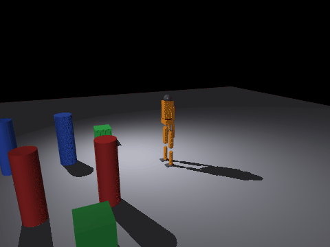
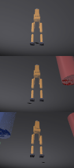
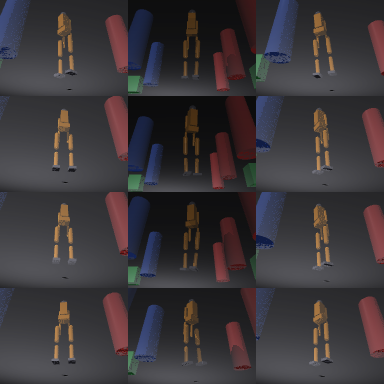
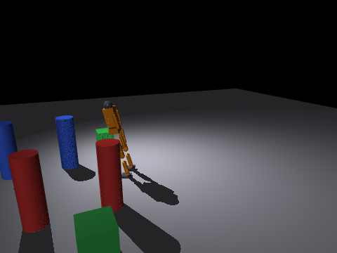
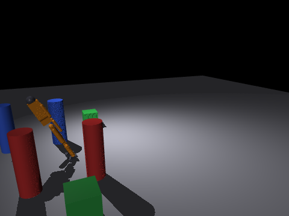
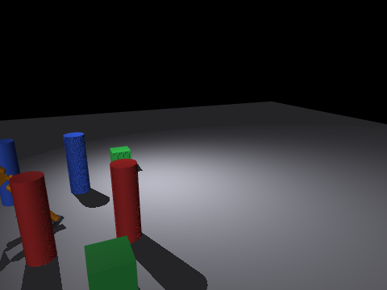
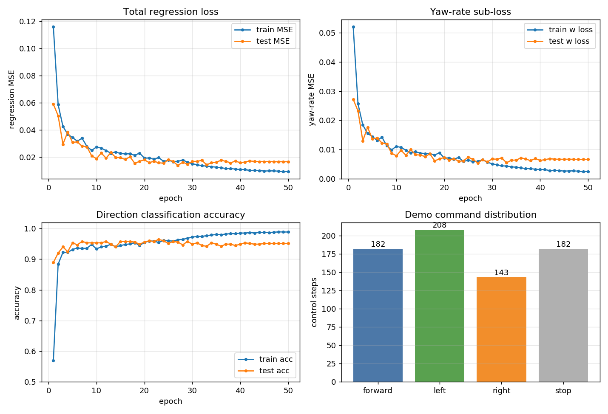
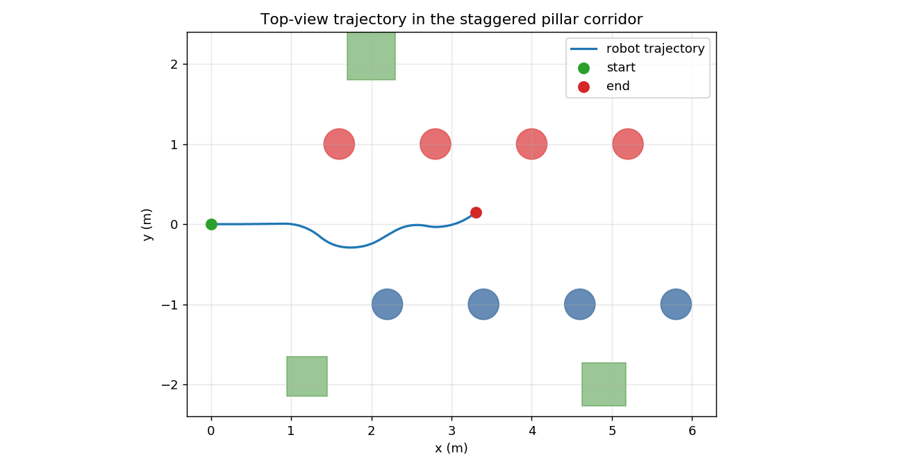

# 人形机器人单目相机图像端到端神经网络控制（humanoid_camera_e2e_control）

> 对应课程任务：对人形机器人进行物理仿真，由传感器图像完成感知、决策与控制；
> 其中感知、决策、控制链路为神经网络，推理阶段不含显式障碍物检测、规则避障或人工状态机。
> 本模块在 MuJoCo 中搭建 15 关节双足人形与交错立柱通道，用一个 PilotNet 风格卷积神经网络
> 把跟随视角相机图像直接回归成线速度与偏航角速度，形成"像素 → CNN → 控制指令"的闭环。

代码位于 `src/humanoid/humanoid_camera_e2e_control/`。

## 1. 概述与目标

### 1.1 核心任务目标

1. **物理仿真**：15 关节双足人形由 MuJoCo 解算动力学，站姿 PD 伺服维持直立；场景为左右交错的彩色立柱通道，另布若干散块。
2. **感知**：运行时 `MjvCamera`（free 模式）跟随机器人渲染 96×128 RGB 图像，作为 CNN 的唯一输入；不再使用激光雷达、深度图或显式障碍物坐标。
3. **决策与控制**：图像送入共享卷积主干，回归头直接输出归一化线速度 `v_n` 与偏航角速度 `w_n`；方向分类头只在训练阶段辅助监督，部署推理仅使用回归头。
4. **端到端**：训练完成后，闭环中没有任何避障规则、阈值判断或状态机；规则教师只在离线采集阶段生成标签，不参与推理。
5. **可复现**：提供规则教师自动采集、训练、推理演示与自动化测试四条 standalone 命令；同一条感知—推理—控制链路再拆成 ROS 2 Humble 双节点 launch 闭环。

### 1.2 与仓库已有模块的区别

| 对比项 | `humanoid_keyboard_control`（键盘规则基线） | `humanoid_lidar_nn_perception`（雷达 CNN 感知） | 本模块 |
|---|---|---|---|
| 引擎 | MuJoCo | MuJoCo | **MuJoCo** |
| 传感器 | 键盘 | 2D 激光雷达 `mj_ray` | **跟随视角 RGB 相机** |
| 决策方式 | 键盘直接映射速度 | CNN 感知距离 + BC-MLP 避障 | **图像 CNN 直接回归速度指令** |
| 推理时是否含规则分支 | 是（人在环） | 感知网络 + 网络控制器 | **否（纯神经网络闭环）** |
| 输入维度 | — | 360 束扫描 + 目标朝向 | **3×96×128 图像** |
| 运行前提 | mujoco + numpy | mujoco + torch + onnxruntime | **mujoco + torch + numpy** |

本模块复用了 `humanoid_keyboard_control` 已经调通的人形站姿 PD 与底盘运动学方案，差别在决策层：人在环键盘被替换成从像素学习的端到端 CNN；与雷达模块相比，感知源由扫描束换成单目图像，决策链路由"先感知距离再规划"换成"图像直接到速度指令"。

## 2. 计算原理

### 2.1 场景与人形站姿 PD 伺服

模型时间步长 `dt = 0.002 s`，Euler 积分，重力加速度 `g = 9.81 m/s²`。15 个关节（双足 + 双臂 + 头）由站姿 PD 伺服维持直立，目标姿态为全部关节角为 0。关节力矩指令为

$$
\tau_i = K_P\,(0 - q_i) - K_V\,\dot q_i
$$

其中髋部 roll 与踝部 roll 四个侧倾关节使用加强增益 `K_P_ROLL` 抑制侧倾：

$$
\tau_{roll} = K_{P,roll}\,(0 - q_{roll}) - K_V\,\dot q_{roll}
$$

力矩再按执行器量程裁剪到 `±250 N·m`。

| 参数 | 取值 | 说明 |
|---|---|---|
| `dt` | 0.002 s | 模型物理步长 |
| `K_P` | 120.0 | 普通关节比例增益 |
| `K_V` | 6.0 | 普通关节微分增益 |
| `K_P_ROLL` | 400.0 | 髋/踝 roll 关节加强比例增益 |
| 力矩量程 | ±250 N·m | 与 XML `ctrlrange` 对齐 |

### 2.2 运动控制：速度级前进与姿态级转向

每个控制周期先完成站姿 PD，再叠加底盘运动指令。前进按当前偏航角 `ψ` 分解到世界系线速度：

$$
\dot x = v\cos\psi,\qquad \dot y = v\sin\psi
$$

转向不依靠摩擦力矩，而是先清空根部 3:6 三个角速度，再把根部四元数 `q = (q_w, q_x, q_y, q_z)` 与绕世界 z 轴的增量四元数 `d = (cos(d/2), 0, 0, sin(d/2))`（`d = w·dt`）按 Hamilton 四元数乘法左乘：

$$
q' = d \otimes q
$$

这样避免脚底摩擦滑移造成的姿态漂移。运动指令限幅为

$$
|v| \le V_{max}=0.30\ \text{m/s},\qquad |w| \le W_{max}=0.60\ \text{rad/s}
$$

> **演示级运动学说明**：本模块直接改写 freejoint 线速度与根部四元数，不包含双足步态生成；端到端网络只学习"画面到速度指令"的映射，不代表真实步行动力学精度，边界见第 7.4 节。

### 2.3 感知图像与归一化

策略输入由运行时 `MjvCamera` 渲染（`sim_core.render_front`）：相机类型 `mjCAMERA_FREE`，`trackbodyid = -1`，距离 `distance = 2.6 m`，方位角 `azimuth = 180°`（位于机器人身后看向其前方），俯仰角 `elevation = 32°`，`lookat` 跟随机器人位置 `(x, y, 0.6)`。场景内另有固定第三方视角相机 `overview`，仅用于演示 GIF 与关键帧录制。

跟随相机不同时刻全局明暗略有差异，图像按**逐帧零均值、单位方差**归一化抵消亮度漂移，让卷积网络聚焦障碍的左右方位而非绝对亮度。对单帧图像 `I ∈ [0,255]^{H×W×3}`：

$$
\tilde I = \frac{I/255 - \mu}{\sigma + 10^{-3}},\qquad
I_{n} = \mathrm{clip}(\tilde I,\,-3,\,3)/3
$$

其中 `μ = mean(I/255)`、`σ = std(I/255)`。训练与推理必须使用同一口径（`data_io.normalize_image`）。

物理指令再归一化到网络空间：

$$
u_v = \frac{v}{V_{max}},\qquad u_w = \frac{w}{W_{max}},\qquad \mathbf u = (u_v, u_w) \in [-1,1]^2
$$

### 2.4 CNN 网络结构

网络 `E2ECNN` 参照 Nvidia PilotNet 的卷积—全连接布局，按 96×128 小图压缩通道数；5 层卷积构成共享主干，后接回归头与方向分类头两个任务头。

| 层 | 结构 | 激活 / 说明 |
|---|---|---|
| 输入 | 3×96×128 | 归一化 RGB |
| Conv1 | Conv 3→24，5×5，stride 2 | ReLU |
| Conv2 | Conv 24→36，5×5，stride 2 | ReLU |
| Conv3 | Conv 36→48，5×5，stride 2 | ReLU |
| Conv4 | Conv 48→64，3×3，stride 1 | ReLU |
| Conv5 | Conv 64→64，3×3，stride 1 | ReLU |
| Flatten | 展平 | 共享视觉特征 `f` |
| 回归头 | Linear 100 → ReLU → Dropout 0.3 → Linear 50 → ReLU → Linear 2 | `tanh` 输出归一化指令 |
| 分类头 | Linear 50 → ReLU → Linear 3 | 三分类 logits（训练辅助） |

共享主干前向：

$$
\mathbf f = \mathrm{Flatten}\big(\mathrm{Conv}_5(\cdots \mathrm{Conv}_1(I_n)\cdots)\big)
$$

回归头输出经 `tanh` 约束在 `[-1,1]`：

$$
(u_v, u_w) = \tanh\big(\mathbf W_r\,\mathbf f + \mathbf b_r\big)
$$

分类头输出方向三态 logits：0 = 直行/停止，1 = 左转，2 = 右转。

部署推理时回归量反归一化为物理指令：

$$
v = u_v \cdot V_{max},\qquad w = u_w \cdot W_{max}
$$

出口再经 `calibrate_command` 做温和线速度增益补偿并限幅：

$$
v = \mathrm{clip}(1.4\,v,\ 0,\ V_{max}),\qquad
w = \mathrm{clip}(w,\ -W_{max},\ W_{max})
$$

转向 `w` 不放大，避免过度转向；standalone 演示与 ROS 2 策略节点共用同一标定口径。全连接层使用 `LazyLinear`，首次前向自动推导展平维度，避免手工计算特征图尺寸。

### 2.5 训练目标与优化

训练把教师标签当作回归目标，联合损失由回归子损失与方向分类交叉熵组成。设第 `k` 个样本回归标签 `(u_v, u_w)`、分类标签 `c ∈ {0,1,2}`，预测归一化指令 `(û_v, û_w)`、分类 logits `z`：

$$
\mathcal L_v = \frac{1}{B}\sum_k (\hat u_{v,k} - u_{v,k})^2
$$

$$
\mathcal L_w = \frac{1}{B}\sum_k (\hat u_{w,k} - u_{w,k})^2
$$

$$
\mathcal L_{reg} = \mathcal L_v + 2.0\,\mathcal L_w
$$

转向 `w` 是避障关键，回归损失加权 2.0；分类头以交叉熵辅助主干先学到左右障碍判别特征：

$$
\mathcal L_{cls} = -\frac{1}{B}\sum_k \log \frac{\exp(z_{k,c_k})}{\sum_j \exp(z_{k,j})}
$$

$$
\mathcal L = \mathcal L_{reg} + 1.0\,\mathcal L_{cls}
$$

优化器为 Adam，余弦退火学习率调度（`CosineAnnealingLR`，`T_max = epochs`）；数据集按固定种子 42 做 85% / 15% 训练集 / 测试集划分。

| 超参 | 实测取值 |
|---|---|
| 训练轮数 `epochs` | 50 |
| 批大小 `batch_size` | 32 |
| 学习率 `lr` | 3×10⁻³ |
| 随机种子 `seed` | 42 |
| 样本总数 | 3000（训练 2550 / 测试 450） |
| 设备 | CPU（torch 2.4.1+cpu） |
| 训练用时 | 231.7 s |

### 2.6 规则教师策略（仅作离线标签）

教师 `teacher_collect.py` 只在采集阶段生成训练标签，推理时完全不参与。它遍历场景立柱与散块，取机器人前方 `x_rel ∈ [0.1, 1.2] m` 内最近障碍，计算相对机器人的横向偏移 `dy = p_y - y`：

| 条件 | 偏航角速度 `w` | 含义 |
|---|---|---|
| `dy > 0.12` | −0.22 rad/s | 障碍在机器人 `+y` 侧（画面右侧），向另一侧右转避让 |
| `dy < −0.12` | +0.22 rad/s | 障碍在机器人 `−y` 侧（画面左侧），左转避让 |
| 前方无近障碍 | 0 | 直行 |

线速度固定 `v = 0.10 m/s`；约 5% 帧随机停车补充停止样本。采集时随机重置初始位姿 `x ∈ [0,1.2]`、`y ∈ [−0.3,0.3]`、`yaw ∈ [−0.2,0.2]`；跌倒、碰撞或 `x > 6.2 m` 后随机重置继续采集。采样间隔 50 个物理步，每 400 帧落盘一个独立批次 npy，避免全量 concat 的 O(n²) 开销。

## 3. 算法流程

standalone 流水线由 `main.py` 用互斥模式触发，规则教师采集为默认采集路径：

```text
--teacher   规则教师自动采集（默认路径，无需人工键盘）
  ├─ 随机重置位姿；每个控制周期：
  │    ① 运行时跟随相机渲染 RGB 图像                 sim.render_front()
  │    ② 规则教师按最近障碍横向偏移生成 (v, w) 标签    teacher_collect.py
  │    ③ 物理步进；跌倒 / 碰撞 / 到通道末端随机重置
  │    ④ 每 50 步记录一帧 图像 -> 指令对，分批落盘 npy
  └─ 输出 data/training/（数据集不随仓库提交）

--collect   人工键盘驾驶采集（备选路径，W/S/A/D/空格/ESC）
  └─ 同一套数据格式，供人工示范轨迹补充

--train     训练 E2ECNN
  ├─ 读取全部批次 npy，种子 42 划分 85% / 15%
  ├─ 联合损失（v MSE + 2.0·w MSE + 方向交叉熵）反向传播 50 轮
  └─ 测试集回归 RMSE、方向三态准确率、分类头准确率
  └─ 保存 weights/humanoid_cnn.pt 与 weights/metrics.json

--run       端到端闭环演示（纯神经网络推理，无规则分支）
  ├─ 加载权重；每 0.05 s 推理一次（25 个物理步 @ dt=0.002）
  │    ① 跟随相机图像 -> preprocess -> CNN -> (v, w) -> calibrate_command
  │    ② 物理步进；记录站立率、碰撞 / 跌倒、指令分布、推理耗时、轨迹
  ├─ 第三方视角录制 GIF 与 4 张关键帧 PNG
  └─ 输出 demo_assets/（GIF、关键帧、metrics_demo.json、trajectory.csv）

--test      自动化测试：站姿保持、渲染尺寸、网络限幅、渲染帧率、单帧推理耗时、权重加载
```

ROS 2 闭环把同一条感知—推理—控制链路拆成两个节点：`mujoco_sim_node` 在 ROS 里跑 MuJoCo、发布里程计 / 关节状态 / TF / 跟随图像、订阅 `/cmd_vel`；`e2e_policy_node` 订阅图像、用训练好的 CNN 推理后发布 `/cmd_vel`。`mode:=run` 启动仿真节点 + 策略节点，`mode:=collect` 启动仿真节点 + 键盘遥控节点。

## 4. 源码解析

| 文件 | 类型 | 职责 |
|---|---|---|
| `main.py` | 入口 | `--teacher / --collect / --train / --run / --test / --ros2` 互斥模式；`--no-viewer` 关闭窗口；退出码 0 成功 / 1 失败 |
| `humanoid_camera_e2e_control/sim_core.py` | 仿真核心 | 模型加载、站姿 PD、速度级前进、姿态级转向四元数、跟随 / 第三方相机渲染、站立与接触检测、出口指令标定 |
| `humanoid_camera_e2e_control/network.py` | 纯逻辑 | PilotNet 风格共享卷积主干 + 回归头 + 方向分类头；前向、部署反归一化、权重保存与加载（含 `v_max`/`w_max` 元信息） |
| `humanoid_camera_e2e_control/data_io.py` | 纯逻辑 | 批次 npy 读写、逐帧归一化、图像预处理、指令三态标签、PyTorch `Dataset` |
| `humanoid_camera_e2e_control/keyboard.py` | 工具 | 跨平台非阻塞按键读取 |
| `humanoid_camera_e2e_control/mujoco_sim_node.py` | ROS 2 | 仿真节点：跑 MuJoCo，发布 `/humanoid/odom`、`/joint_states`、`/tf`、`/humanoid/camera/image_raw`，订阅 `/cmd_vel`（超时 0.5 s 停车） |
| `humanoid_camera_e2e_control/e2e_policy_node.py` | ROS 2 | 策略节点：订阅图像，CNN 推理 + 出口标定后发布 `/cmd_vel`，`threading.Lock` 缓存最新帧 |
| `humanoid_camera_e2e_control/keyboard_teleop_node.py` | ROS 2 | 键盘遥控节点：W/S/A/D/空格/ESC，30 Hz 发布 `/cmd_vel`（采集模式） |
| `scripts/teacher_collect.py` | 采集 | 规则教师自动采集图像—指令数据集，随机初始位姿与周期重置 |
| `scripts/collect_data.py` | 采集 | 人工键盘驾驶采集数据集（备选路径） |
| `scripts/train_e2e.py` | 训练 | 数据集划分、联合损失训练、测试集回归 RMSE 与方向准确率、权重与指标 JSON 保存 |
| `scripts/record_demo.py` | 演示 | 加载权重闭环推理，录制 GIF / 关键帧，统计站立率、碰撞跌倒、指令分布、推理帧率与轨迹 |
| `models/humanoid_obstacle.xml` | 场景 | 15 关节双足人形 + 交错红蓝立柱通道 + 绿块散块；固定 `overview` 第三方相机 |
| `config/params.yaml` | 配置 | 仿真频率、PD 增益、指令限幅、策略周期、训练超参 |
| `launch/main.launch.py` | launch | `mode:=run / collect` 条件启停双节点；`visualize` 开关；模型与权重路径默认值 |
| `test/test_standalone.py` | 测试 | 站姿保持、渲染尺寸、网络限幅、渲染帧率、单帧推理耗时、权重加载（pytest + 脚本双模式） |
| `requirements.txt` | 依赖 | `mujoco>=2.3,<3.0`、numpy、torch≥1.13、imageio、Pillow |

## 5. 仿真运行步骤

### 5.1 支持与测试环境

| 组件 | 版本 / 说明 |
|---|---|
| 操作系统 | Ubuntu 20.04.6（虚拟机，实测通过） |
| Python | 3.8.10 |
| ROS | ROS 2 Humble（仅 ROS 节点与 `--ros2` / launch 需要） |
| MuJoCo | 2.3.7（Python 3.8 下 3.x 不兼容，依赖已锁定 `<3.0`） |
| PyTorch | 2.4.1+cpu |
| NumPy | 1.24.4 |
| 图像库 | imageio 2.34.2、Pillow 10.4.0 |
| 显卡 | 不需要；CPU 训练与推理，无图形环境可用 `--no-viewer` / `visualize:=false` |

### 5.2 安装

```bash
sudo apt update && sudo apt install -y python3-pip libgl1
python3 -m pip install -r src/humanoid/humanoid_camera_e2e_control/requirements.txt
```

### 5.3 本地 standalone 运行

在模块根目录 `src/humanoid/humanoid_camera_e2e_control/` 下执行：

```bash
# 0) 自动化测试：站姿、渲染尺寸、网络限幅、帧率、推理耗时、权重加载
python3 main.py --test

# 1) 规则教师自动采集数据集（默认路径，无需人工键盘）
python3 main.py --teacher --max-frames 3000

# 备选：人工键盘驾驶采集（W/S 前后、A/D 转向、空格停止、ESC 退出落盘）
# python3 main.py --collect --max-frames 2000

# 2) 训练端到端 CNN，保存权重与测试集指标
python3 main.py --train --epochs 50

# 3) 加载权重端到端推理演示，录制 GIF / 关键帧 / 指标到 ./demo_assets/
python3 main.py --run --duration 25 --no-viewer
```

一键流程：

```bash
bash main.sh
```

仓库已随包附带训练好的 `weights/humanoid_cnn.pt`；只复现推理演示与测试时，跳过采集与训练直接跑 `--run` / `--test` 即可。

### 5.4 ROS 2 Humble launch

```bash
cd ~/ros2_ws
colcon build --symlink-install --packages-select humanoid_camera_e2e_control
source install/setup.bash

# 端到端推理：仿真节点 + CNN 策略节点
ros2 launch humanoid_camera_e2e_control main.launch.py mode:=run

# 键盘驾驶采集：仿真节点 + 键盘遥控节点
ros2 launch humanoid_camera_e2e_control main.launch.py mode:=collect

# 无图形环境关闭可视化窗口
ros2 launch humanoid_camera_e2e_control main.launch.py mode:=run visualize:=false
```

另开终端观察话题：

```bash
ros2 topic echo /humanoid/camera/image_raw --once
ros2 topic echo /humanoid/odom --once
ros2 topic echo /cmd_vel
```

**ROS 2 Humble 双模式实测记录**（Ubuntu 20.04.6 + ROS 2 Humble + MuJoCo 2.3.7，CPU；`colcon build --symlink-install` 后 launch）：

| 启动模式 | 拉起节点 | 图像 `/humanoid/camera/image_raw` | 里程计 `/humanoid/odom` | 关节状态 `/joint_states` |
|---|---|:---:|:---:|:---:|
| `mode:=run` | `mujoco_sim_node` + `e2e_policy_node` | 10.00 Hz | 30.00 Hz | 30.00 Hz |
| `mode:=collect` | `mujoco_sim_node` + `keyboard_teleop_node` | 10.00 Hz | 30.00 Hz | 30.00 Hz |

`mode:=run` 闭环中策略节点订阅图像、按 50 ms 周期发布 `/cmd_vel`，实测抓到一条指令：`linear.x = 0.1295 m/s`、`angular.z = −0.2016 rad/s`，均在出口限幅 `v_max = 0.30 m/s`、`w_max = 0.60 rad/s` 以内；`mode:=collect` 下策略节点不启动，仅键盘节点在有按键时发布指令。两种模式下图像频率与 `image_rate=10`、里程计和关节状态频率与 `publish_rate=30` 一致。

> 注：`ros2 topic hz` 被 `timeout` 终止时抛出的 `ExternalShutdownException` 是命令正常关闭行为，不代表节点故障。

### 5.5 话题与参数

| 话题 | 类型 | 方向 | 说明 |
|---|---|---|---|
| `/cmd_vel` | `geometry_msgs/Twist` | 订阅 | 速度指令（策略节点 / 键盘节点发布） |
| `/humanoid/odom` | `nav_msgs/Odometry` | 发布 | 里程计（位置、偏航角、速度），`world → humanoid/base_link` |
| `/joint_states` | `sensor_msgs/JointState` | 发布 | 15 个关节位置 |
| `/humanoid/camera/image_raw` | `sensor_msgs/Image` | 发布 | 跟随视角 RGB8，96×128，10 Hz |
| `/tf` | `tf2_msgs/TFMessage` | 发布 | `world → humanoid/base_link` |

主要 launch 参数：`sim_rate=500`（物理 Hz）、`publish_rate=30`（状态 Hz）、`image_rate=10`（图像 Hz）、`control_period=0.05`（策略周期 s）、`cmd_timeout=0.5`（指令超时停车 s）、`visualize=true`。

## 6. 运行效果

### 6.1 端到端闭环演示



*第三方固定视角演示：CNN 接收跟随视角图像回归速度指令，机器人在交错立柱通道内直行并左右避让；动图 178 帧、12 fps、总大小约 4.2 MB（< 10 MB），按真实仿真速度录制。*

### 6.2 感知视角与数据集样本



*运行时 `MjvCamera`（free 模式）跟随 lookat 渲染的三种姿态：机器人居中，红柱 / 蓝柱相对方位分置画面左右，画面干净、无躯干遮挡。*



*规则教师采集的图像—指令样本分组：障碍出现在画面左侧时标签为左转，出现在右侧时标签为右转，正中直行；图像左右与转向标签因果对齐。*

### 6.3 演示关键帧


*起点直立站姿，前方红蓝柱交错排列，绿块散置通道两侧。*



*机器人绕红柱一侧转向避让，姿态保持直立偏转。*



*机器人贴近蓝柱一侧避让，已进入第二组立柱之间。*



*第一段行程后段，机器人贴近蓝柱一侧；该帧为绕柱过程中的短暂侧倾状态，能力边界见 7.4 节。*

### 6.4 训练曲线与闭环轨迹



*上排：总回归 MSE 与偏航角子损失 train/test 曲线；左下：方向分类准确率 train/test 曲线；右下：演示全程指令分布（直行 / 左转 / 右转 / 停车步数）。*



*闭环第一段连续行程俯视图：蓝色为机器人实际轨迹，红点为终点；红蓝圆为通道立柱位置，绿块为散块。轨迹沿通道中线小幅左右摆动，全程零碰撞。*

## 7. 性能评价

### 7.1 训练集 / 测试集指标

加载随包权重在 450 个测试样本上实测（`weights/metrics.json`，可执行 `python3 main.py --train` 复现）：

| 指标 | 数值 | 说明 |
|---|:---:|---|
| 样本规模 | 3000（训练 2550 / 测试 450） | 85% / 15% 固定种子划分 |
| 最终训练 MSE | 0.00956 | 归一化指令空间 |
| 最终测试 MSE | 0.01668 | 测试集泛化误差 |
| 最终训练 w 子损失 | 0.00249 | 偏航角回归子项 |
| 最终测试 w 子损失 | 0.00660 | 测试集偏航角回归子项 |
| 线速度 RMSE | 0.0177 m/s | 物理量回归误差 |
| 偏航角速度 RMSE | 0.0488 rad/s | 物理量回归误差 |
| 方向三态准确率（回归头） | 95.11%（428/450） | 按回归输出归类方向与标签比对 |
| 方向三态准确率（分类头） | 95.11%（428/450） | 辅助分类头判别准确率 |
| 训练用时 | 231.7 s | CPU，50 epoch |

### 7.2 闭环演示实测指标

加载随包权重，在交错立柱通道内闭环推理，录制第一段连续行程（`demo_assets/metrics_demo.json`）：

| 指标 | 数值 | 定义 |
|---|:---:|---|
| 控制周期 | 0.05 s | 每 25 个物理步推理一次 |
| 控制步数 | 533 | 第一段连续行程控制周期数 |
| 站立步数占比 | 99.86% | 物理步中根高 > 0.9 m 的比例 |
| 碰撞次数 | 0 | 人形与立柱 / 散块接触次数 |
| 短暂失衡步数 | 19 | 绕柱过程中根高低于阈值的物理步 |
| 重置次数 | 0 | 第一段行程内不重置，避免素材位置跳变 |
| 最大前进位移 | 3.303 m | 沿通道 x 方向最大位移 |
| 是否到达 x=4.0 终点 | 否 | 行程后段在绕柱失衡前结束第一段记录 |
| 指令分布 | 直行 182 / 左转 208 / 右转 143 / 停车 182 | 各方向控制步数 |
| 单帧推理耗时 | 1.39 ms | CNN 前向平均 |
| 推理帧率 | 720.2 FPS | CPU 单核，远高于 20 Hz 控制需求 |
| GIF 帧数 / 大小 | 178 帧 / 4.20 MB | 12 fps，< 10 MB |
| 终点坐标 | (3.303, 0.149) m | 轨迹记录终点 |

### 7.3 多场景与覆盖说明

- **初始位姿扰动**：数据集采集时随机重置 `x ∈ [0,1.2]`、`y ∈ [−0.3,0.3]`、`yaw ∈ [−0.2,0.2]`，网络在多种起跑位置与朝向状态下看到"画面—指令"样本，而非单一固定起点。
- **通道布局**：红蓝立柱在 `y = ±1.0 m` 两侧交错（红柱 `x = 1.6/2.8/4.0/5.2`，蓝柱 `x = 2.2/3.4/4.6/5.8`），另有三个绿块散置 `(1.2,−1.9)`、`(2.0,2.1)`、`(4.9,−2.0)`；训练与演示在同一通道内完成。
- **可扩展性**：更换 `models/humanoid_obstacle.xml` 中的立柱 / 散块坐标即可构造新通道布局，再跑一遍 `--teacher → --train → --run` 即可复现新场景评测；本模块当前实测结果仅对应上述交错立柱通道，不跨场景泛化。

### 7.4 能力边界（如实说明）

1. **运动学级控制**：前进改写底盘 freejoint 世界系线速度、转向直接旋转根部四元数，不包含双足步态生成与平衡反馈；站立依靠站姿 PD 力矩维持，绕柱阶段出现过 19 个物理步的短暂失衡（站立率 99.86%）。
2. **单通道观测**：训练与演示固定在同一交错立柱通道，网络只学习该分布下的画面—指令映射，未在陌生布局、动态障碍或真实光照条件下验证泛化能力。
3. **未到达终点**：第一段连续行程位移 3.303 m，未到达 `x = 4.0 m`；行程在绕柱后段短暂失衡前结束录制，不代表完成全程导航。
4. **规则教师仅离线**：推理闭环不含任何规则避障；演示出口的线速度增益标定（1.4×）是固定补偿项，不是规则感知分支。
5. **本模块不覆盖 SLAM 建图与自主导航**：不输出栅格地图、不做全局路径规划，对应课程任务③另立模块。

## 8. 常见问题

| 现象 | 原因与处理 |
|---|---|
| `ModuleNotFoundError: No module named 'mujoco'` | 依赖未装好或 `pip` 与解释器不一致；用 `python3 -m pip install -r requirements.txt` 对齐当前解释器 |
| MuJoCo 3.x 安装后启动报错 | Python 3.8 下 MuJoCo 3.x 不兼容；保持 `mujoco>=2.3,<3.0`，卸载 3.x 后装 2.3.7 |
| 虚拟机里开窗失败 / 黑屏 | 无图形环境或 GLFW 上下文缺失；standalone 加 `--no-viewer`，launch 用 `visualize:=false`；图像由离屏渲染输出 |
| 训练后损失降不下去、直行冲障碍 | 检查采集转向样本占比；确认 `--teacher` 规则教师已生成左右避让样本，必要时加大 `--max-frames` |
| ROS 节点报找不到 `humanoid_cnn.pt` | 确认用 `--symlink-install` 构建，权重已由 `setup.py` 的 `data_files` 安装到 `share/humanoid_camera_e2e_control/weights/` |
| ROS 启动报 `ParseXML: Error opening file` | 场景 XML 未随包安装；确认 `setup.py` 已打包 `models/*.xml`，重新 `colcon build` |
| 数据集目录为空 | `data/training/` 不随仓库提交；先执行 `python3 main.py --teacher` 采集，再 `--train` |
| 策略推理速度慢 | 默认 CPU 推理单帧 1.39 ms；如显卡可用，将 `device` 参数改为 `cuda`（节点参数 `device`） |

## 9. 参考

- MuJoCo 文档：`MjvCamera` 相机、Renderer 离屏渲染、freejoint 四元数姿态、接触 `data.contact`
- 仓库同类模块：`docs/humanoid/humanoid_keyboard_control.md`（人形站姿 PD 与底盘控制基线）、`docs/humanoid/humanoid_lidar_nn_perception.md`（人形传感器 CNN 感知范式）
- PilotNet 网络布局参考：Bojarski 等，*End to End Learning for Self-Driving Cars*，2016
- ROS 2 Humble：`ament_python` 包结构、`sensor_msgs/Image`、`geometry_msgs/Twist`、`tf2_ros` 坐标变换广播

---

编写过程中使用 AI 编程助手辅助代码与文档起草；全部代码、训练权重与实测指标均在 Ubuntu 20.04.6 + ROS 2 Humble + MuJoCo 2.3.7 环境中真实跑通验证，提交者对提交内容负全部责任。
