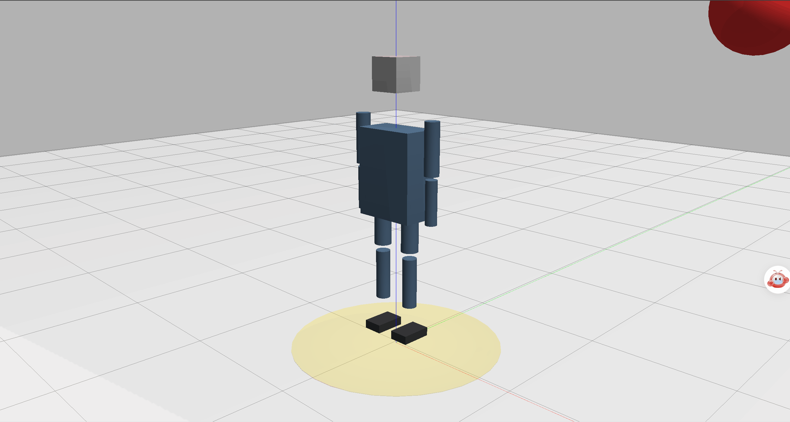

# 人形机器人 3D 碰撞体边界检测可视化 ROS 2 封装模块

## 作业概述与背景

本模块实现基于 ROS 2 的 3D 人形机器人碰撞体边界检测可视化。节点为简化人形机器人注册 12 个碰撞体（头、躯干、左右上臂、左右前臂、左右大腿、左右小腿、左右足），以球体作为障碍物，在每个控制周期实时计算障碍物到所有碰撞体的最短表面距离，并输出最近距离、碰撞标志与可视化 MarkerArray。RViz2 中可同时观察到半透明碰撞体包围盒、线框边界与距离指示，用于直观判断机器人本体与障碍物之间的空间关系。

模块附带一个正弦轨迹的障碍物演示节点，可独立验证检测链路，无需外部仿真环境。

## 运行环境

- 操作系统：Ubuntu 22.04（虚拟机）
- ROS 2 版本：Humble
- 依赖库：rclcpp、std_msgs、geometry_msgs、visualization_msgs、eigen

## 核心代码文件清单

本模块包含以下核心文件，均已提交至仓库：

```text
src/
└── humanoid_collision_detector/
    ├── include/
    │   └── humanoid_collision_detector/
    │       └── collision_detector.hpp      # 碰撞体与检测结果数据结构、检测器类声明
    ├── humanoid_collision_detector/
    │   ├── collision_detector_core.cpp     # 距离计算核心（BOX / SPHERE / CYLINDER）
    │   ├── collision_detector_node.cpp     # 检测节点：碰撞体注册、话题收发、Marker 生成
    │   └── obstacle_demo_node.cpp          # 正弦轨迹障碍物演示节点
    ├── launch/
    │   └── main_launch.py                  # 一键启动文件
    ├── rviz/
    │   └── collision_boundary.rviz         # RViz2 可视化配置
    ├── resource/                           # 资源目录
    │   └── humanoid_collision_detector     # 无后缀空文件
    ├── CMakeLists.txt                      # 构建配置
    ├── package.xml                         # ROS 2 依赖声明文件
    └── README.md                           # 模块说明文档
```

## 检测原理

1. **碰撞体建模。** 每个人形部件用 BOX 或 CYLINDER 基元近似，位置与尺寸均以 z 轴为高度方向。
2. **距离计算。** 对 BOX 取障碍物点到包围盒的有符号表面距离；对 CYLINDER 用外接盒近似；最后减去障碍物半径，得到表面间距。
3. **风险分级。** 依据安全边界 `safety_boundary` 与距离阈值，把结果分为 safe、warning、danger、collided 四级。当最近距离小于 `safety_boundary` 时，`collision_detected` 置为 `true`；距离小于 0（几何侵入）时风险等级记为 collided。
4. **可视化。** 最近碰撞体以高亮色显示，其余碰撞体以半透明青色显示，并绘制边界线框与距离指示线；距离指示线连接障碍物中心与最近碰撞体表面的最近点。

## 运行步骤

1. 新建标准工作空间并进入 src 目录：

   ```bash
   mkdir -p ~/ros2_ws/src
   cd ~/ros2_ws/src
   ```

2. 从 ros2 仓库拷贝模块代码到工作空间：

   ```bash
   cp -r ~/ros2/src/humanoid_collision_detector ~/ros2_ws/src/
   cd ~/ros2_ws
   ```

3. 安装依赖并编译工作空间、部署环境：

   ```bash
   rosdep install --from-paths src --ignore-src -r -y
   colcon build --packages-select humanoid_collision_detector
   source install/setup.bash
   ```

4. 启动碰撞体边界检测节点与障碍物演示节点：

   ```bash
   ros2 launch humanoid_collision_detector main_launch.py
   ```

5. 另开终端查看实时检测结果：

   ```bash
   source install/setup.bash
   ros2 topic echo /distance_to_obstacle
   ros2 topic echo /collision_detected
   ```

6. 可选：打开 RViz2 查看碰撞体边界可视化：

   ```bash
   ros2 run rviz2 rviz2 -d install/humanoid_collision_detector/share/humanoid_collision_detector/rviz/collision_boundary.rviz
   ```

   Fixed Frame 设为 `world`，MarkerArray 话题选择 `/collision_boundary`。

## 话题与参数

| 话题 | 类型 | 说明 |
| --- | --- | --- |
| `/obstacle_position` | `geometry_msgs/msg/PointStamped` | 障碍物世界坐标（输入，可被外部节点覆盖） |
| `/distance_to_obstacle` | `std_msgs/msg/Float64` | 最近碰撞体到障碍物的表面距离（m） |
| `/collision_detected` | `std_msgs/msg/Bool` | 是否侵入安全边界 |
| `/collision_boundary` | `visualization_msgs/msg/MarkerArray` | 碰撞体与安全边界可视化 |

| 参数 | 默认值 | 说明 |
| --- | --- | --- |
| `safety_boundary` | `0.15` | 安全边界膨胀量（m） |
| `obstacle_radius` | `0.20` | 障碍物近似半径（m） |
| `check_frequency` | `100.0` | 检测频率（Hz） |
| `origin_x` / `origin_y` / `origin_z` | `0.85` / `0.0` / `1.15` | 演示障碍物轨迹中心 |
| `amplitude` | `0.55` | 演示障碍物振幅（m） |
| `frequency` | `1.0` | 演示障碍物角频率（rad/s） |

## 运行效果

节点启动后，障碍物按 `x = 0.85 + 0.55·sin(t)`、`y = 0.187·cos(0.7t)`、`z = 1.15 + 0.2·sin(0.5t)` 运动，x 覆盖 0.30~1.40 m。该轨迹会穿过躯干与右臂所在空间，因此最近距离在部分时段为负值（障碍物中心进入碰撞体），最近碰撞体在 `R_forearm`、`R_upper_arm` 与 `torso` 之间切换。距离小于安全边界 0.15 m 时 `/collision_detected` 为 `true`，小于 0 时风险等级为 `COLLIDED`。



> 上图为历史录制版本，录制时 CYLINDER Marker 尺寸轴尚未修正，仅用于说明可视化形态。

## 验证范围说明

本模块已在该虚拟机上完成以下验证：节点正常启动、话题正常收发、距离数值随障碍物位置连续变化、碰撞标志随安全边界正确翻转、`/collision_boundary` 持续发布结构合法的 MarkerArray。

可视化仅完成 MarkerArray 消息结构与内容层面的校验，**未在 RViz2 中完成人工视觉确认**；上图为修正前的历史版本。

碰撞体为简化几何近似（12 个基元），并非完整 URDF 碰撞模型。当前版本只支持静态碰撞体：位姿在节点启动时确定，运行期不做 TF/URDF 跟踪，因此不解析 `robot_description`，也不需要 `robot_state_publisher`。
