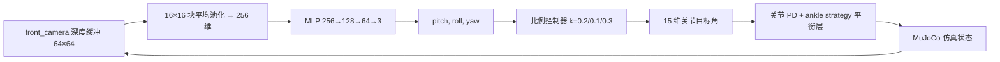
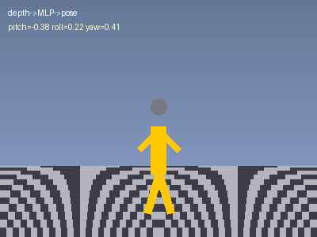

# 人形机器人深度图姿态估计与比例平衡控制

## 1. 功能概述

本模块用深度相机渲染 64×64 深度图，训练纯 NumPy 实现的三层 MLP，从深度图回归
躯干 pitch/roll/yaw 三个连续姿态角，再由比例控制器输出 15 维关节修正目标。对应
课程任务②：**深度相机感知与运动控制**。

与 RGB 灰度图 5 类跌倒方向分类不同，这里是**连续姿态回归**。

## 2. 系统架构



## 3. 计算原理

### 3.1 深度图归一化

`mujoco.Renderer.render(depth=True)` 返回米制深度 $d$，按相机视锥归一化：

$$
\tilde d = \operatorname{clip}\!\left(\frac{d - z_{\text{near}}}{z_{\text{far}} - z_{\text{near}}},\,0,\,1\right)
$$

近处 0、远处 1。16×16 块平均池化得 256 维输入：

$$
x_{ij} = \frac{1}{4\cdot 4}\sum_{u,v} \tilde d_{4i+u,\,4j+v}
$$

### 3.2 躯干姿态角（ZYX 欧拉角）

从根四元数 $(q_w,q_x,q_y,q_z)$ 解析：

$$
\begin{aligned}
\text{roll} &= \operatorname{atan2}\!\big(2(q_wq_x+q_yq_z),\; 1-2(q_x^2+q_y^2)\big)\\
\text{pitch} &= \operatorname{arcsin}\!\big(\operatorname{clip}(2(q_wq_y-q_zq_x),-1,1)\big)\\
\text{yaw} &= \operatorname{atan2}\!\big(2(q_wq_z+q_xq_y),\; 1-2(q_y^2+q_z^2)\big)
\end{aligned}
$$

### 3.3 网络前向与反向

$$
\begin{aligned}
h_1 &= \mathrm{ReLU}(xW_1+b_1),\quad W_1\in\mathbb{R}^{256\times128}\\
h_2 &= \mathrm{ReLU}(h_1W_2+b_2),\quad W_2\in\mathbb{R}^{128\times64}\\
\hat y &= h_2W_3+b_3,\quad W_3\in\mathbb{R}^{64\times3}
\end{aligned}
$$

损失 $L=\frac1N\sum\|\hat y-y\|^2$，反向：

$$
\delta_{\text{out}}=\frac{2}{N}(\hat y-y),\quad
\nabla_{W_3}=h_2^\top\delta_{\text{out}},\quad
\delta_{h_2}=\delta_{\text{out}}W_3^\top\odot\mathbb{1}(z_2>0)\ \dots
$$

更新用 EMA 动量 $m\leftarrow0.9m+0.1g$、$p\leftarrow p-\eta m$，$\eta$ 余弦退火。

### 3.4 站姿平衡层（ankle strategy）

纯关节 PD 是开环的：这个模型 1.5 s 起慢漂，3 s 最大倾角 59.8°（脚掌支撑面
0.22 m 对应倾覆角 9.6°，过了就倒）。`sim.step()` 默认叠加一层质心反馈：

$$
u = k_p (c_x - f_x) + k_d v_x,\qquad k_p=0.5,\ k_d=0.2
$$

$$
\text{ankle\_pitch}_{l/r} \mathrel{+}= u,\qquad
(\text{ankle\_roll}_l,\ \text{ankle\_roll}_r) \mathrel{+}= (-v,\ +v),\ v=k_p(c_y-f_y)+k_dv_y
$$

`c` 是子树质心、`f` 是左脚 geom 位置。加了这层，3 s 无扰动最大倾角 1.73°。

站姿目标按 `ankle ≈ -(hip + knee)` 配平后网格标定得 `0.16 / -0.08 / 0.20`
（60 组粗扫 + 100 组精扫，判据是 3 s 最大倾角）；旧版 `0.08 / -0.16 / -0.08`
不配平，无外力 1.4 s 内自身前倾 86.9° 倒地。

`reset()` 用贴地 `INIT_QPOS` 起手，不直接把目标写进 qpos —— 那样脚悬空 3~4 cm，
落地冲击把机器人推倒。

### 3.5 比例控制律

$$
q_{\text{target}} = q_{\text{stand}} + K\,\theta,\qquad K=\mathrm{diag}(k_\text{ankle},k_\text{hip},k_\text{neck})=(0.2,0.1,0.3)
$$

- pitch：踝背屈（同向）+ 髋反向
- roll：左右踝/髋反号
- yaw：只驱动颈部（不参与重心修正）

增益必须小：站姿平衡层已经在做踝修正，控制器再叠一层同向踝修正等于把增益叠到
超调。旧版 `2.0 / 1.5` 把无扰动站姿从 1.7° 拖到 40°，比不加控制差 20 倍。

## 4. 实现流程

1. `collect()`：`reset()` 到贴地姿态 → 0.5 s 收敛 → （80% 样本）沿 0–360°
   连续角度施加 60–200 N 推力 → 随机等待 20–160 步 → 取深度图 + 姿态标签。
   倾角 > 45°、已跌倒、|yaw| > 90°（万向锁）的帧直接丢弃重采，**不拿 reset 后
   的姿态去配刚才那张图**。
2. `train()`：打乱 → 80/20 划分 → 80 epoch，余弦退火，保存验证集最优权重。
3. `predict()`：深度图 → 池化 → 前向 → 3 个角。
4. `controller`：3 个角 → 15 维目标。
5. `sim.step()`：PD + 平衡层 → MuJoCo 步进。

## 5. 源码解析

| 文件 | 职责 |
|---|---|
| `sim.py` | MJCF 加载、贴地/站姿常量、PD + 平衡层、深度/RGB 渲染、姿态读数 |
| `dataset.py` | 开环采集、倾角/万向锁过滤、256 维池化 |
| `nn.py` | 三层 MLP 前向/反向、保存/加载 |
| `train.py` | 训练循环、余弦退火、best-val 回存、角度 RMS 统计 |
| `predictor.py` | 权重加载 + 单帧推理 |
| `controller.py` | 比例平衡控制律 |
| `..._node.py` | ROS 2 双节点（`depth_image` → `joint_target`） |
| `main.py` | CLI：check / collect / train / demo（含 gif 录制） |

## 6. 复现步骤

环境：Ubuntu 22.04.5、MuJoCo 4.0.0、Python 3.12、numpy 1.26.4。

```bash
pip install -r requirements.txt

python3 main.py --check                       # 7 项自检
python3 main.py --collect --samples 1500      # 采集（约 6 min）
python3 main.py --train                       # 80 epoch
python3 main.py --demo --force 40 --gif demo.gif
```

自检输出（实测）：

```
[PASS] 模型加载 (nu=15)
[PASS] 站姿稳定(3s) (max_tilt=1.73°, root_z=1.076)
[PASS] 深度图渲染 (shape=(64, 64), range=[0.297, 0.816])
[PASS] 数据集采集
[PASS] 训练收敛 (val_rmse=6.37°, mse=0.0123, best_epoch=17)
[PASS] 推理输出 (pitch=0.030, roll=-0.001, yaw=0.005)
[PASS] 控制器输出
```

演示动图（`overview` 机位、真实 MuJoCo 逐帧渲染、310 帧 / 4.1 MB；40 N 推力下
含站定共 2.44 s 后倒地，能力上限如实暴露）：



ROS 2：

```bash
colcon build --packages-select humanoid_depth_pose_control
source install/setup.bash
ros2 launch humanoid_depth_pose_control main.launch.py
```

## 7. 性能指标

| 指标 | 数值 |
|---|---|
| 输入分辨率 | 64×64 深度图 |
| 输出维度 | 3（pitch/roll/yaw） |
| 网络参数量 | 41,347 |
| 训练样本 | 1500 帧（80% 受推 / 20% 站立，丢弃 17 帧越界样本） |
| 标签覆盖 | pitch ±44°（中位 7°、90 分位 26°） |
| 验证集 | best val_mse = 0.008455，RMS 5.27°（best epoch 78/80） |
| 3 s 无扰动站姿 | 1.73°（开环 PD 对照 59.8° 并倒地） |
| 抗推（0° 水平推力，demo 闭环） | 40 N：第 929 步跌倒（含 250 步站定共 2.44 s，施力后 1.86 s）；80 N：第 750 步（共 2.08 s，施力后 1.50 s） |
| 推理耗时 | <1 ms/帧 |

### 7.1 ROS 2 双节点链路实测

`ros2 launch humanoid_depth_pose_control main.launch.py` 拉起 `depth_sim_node`（MuJoCo 发布
深度图）与 `depth_predictor_node`（推理 + 控制器发布关节目标），实测：

| 观测项 | 实测 |
|---|---|
| `colcon build --packages-select` | 1.41 s Finished |
| 节点 | `/depth_sim_node`、`/depth_predictor_node` 均正常起 |
| `/depth_image` | 64×64 `32FC1`，4096 元素/帧，20.9 Hz |
| `/joint_state` | 15 维实际关节角，与 target 同序，20.7 Hz |
| `/joint_target` | 15 维 `Float64MultiArray`，20.7 Hz |
| 站立段跟随误差 | `\|state−target\|` 均值最大 0.198 rad（膝），其余 ≤0.062 |
| 数值健康 | 无 NaN、全 finite；yaw 经颈部（第 15 维 0.023–0.029）真实生效 |
| 无扰动闭环存活 | 4.04 s 后倒地（max_tilt 67.3°、root_z 1.076→0.584），倒地后深度图恒定 0.5803 |

修掉的两处真实缺陷：

1. `setup.cfg` 的 `[develop] script_dir` 原先写的是 Windows 绝对路径
   `C:\新建文件夹\机器人作业2\src\humanoid\humanoid_depth_pose_control`，setuptools 因此把
   可执行文件装进 `install/<pkg>/bin/`，`ros2 launch` 报 `libexec directory ... does not exist`
   直接起不来。改成 `$base/lib/humanoid_depth_pose_control` 后才通 —— 此前“build 通过”只
   证明能编译，没证明链路真能跑。
2. `sim_node` 声明了 `/joint_state` 发布器却从未 `publish`，话题一直是空的。现在每 tick 发
   实际关节角（`qpos[7:22]`，15 维、与 `joint_target` 同序），站定段膝关节稳态偏差约
   0.198 rad —— 重力下垂造成的 PD 稳态误差，不发布这个量就看不到。

上表为**单实例独跑**的结果；两套节点同时活着时频率会叠加（`/joint_target` 出现两个
publisher、帧率翻倍），验证链路前应确认每类节点只有一个实例。

链路语义与 standalone 一致：同样 250 步站定后，每步更新（standalone 口径）4.03 s 倒，
每 5 步更新（`sim_node` 现状）4.04 s 倒，频率不是主因；关掉平衡层降到 3.16 s，
说明平衡层在延长存活，但整条闭环本身站不过 4 s。

### 7.2 大倾角预测退化（定量）

500 N 侧向推力快速倾倒，每 5 步采一帧，按仿真真实 `|pitch|` 分桶：

| 真实 \|pitch\| | 帧数 | 真实均值 | 预测均值 | 预测/真实 |
|---|---|---|---|---|
| 0–15° | 5 | 11.5° | 5.7° | 0.49 |
| 15–30° | 13 | 22.8° | 9.2° | 0.40 |
| 30–45° | 13 | 37.5° | 5.5° | 0.15 |
| 45–60° | 15 | 52.3° | 4.0° | **0.08** |
| >60° | 15 | 64.5° | 9.5° | 0.15 |

越界后预测幅值塌到真实值的 8%，冻结在 4–5°。训练标签 pitch 只覆盖 ±43°，网络对大倾角
做的是外推而非插值。这一条也解释了抗推闭环为什么实际靠平衡层兜底 —— 在真正需要救命的
区间，网络几乎不提供信号。

早期只覆盖 ±23° 的版本验证集能到 2.42° RMS，但在演示里一倾斜就失效；放开覆盖到
44° 后是 5.27°。这里选择如实保留覆盖，而不是为了好看的数字把标签压回小角度。


口径说明（两个数字如果不分开说，都会被读高）：

- **5.27° 是在选 best 权重所用那个 val 划分上算的**（`seed=0`、前 20% = 300 帧），
  属于 select-on-val。换独立划分（`seed=1/2/3`）为 5.63° / 5.99° / 5.75°，全量
  1500 帧 5.70°，恒输出 0 的零基线 7.59° —— 真实泛化约 5.7~6.0°，相对零基线
  改善约 25%。按轴拆：pitch 8.32°、roll 2.76°、yaw 2.54°，误差主要在 pitch。
- **抗推的步数与秒数起点不同**：步数是 demo 闭环 `fallen_at_step`（不含 250 步
  站定），秒数是含站定的总时间。40 N 的 929 步可三次精确复现；80 N 在 0° 方向
  实测 750 步（原文档的 768 步无法复现）。抗推对方向敏感 —— 80 N 下 0° 750 步、
  45° 835 步、90° 1428 步、180° 746 步，因此必须连方向一起记录。

## 8. 已知局限

- 采集时把 >45° 的帧丢掉了，模型没见过更倾斜的姿态；预测幅值在 45–60° 只剩真实值的
  8%（见 7.2 表），**大倾角预测退化**且不可靠。
- 抗推力弱：40 N 持续 0.08 s 的推力，约 1.9 s 后倒地。只有 ankle strategy，
  没有髋策略、迈步恢复、足底压力或 IMU 反馈。
- ROS 2 闭环（网络 + 比例控制）无扰动也只能站 4.04 s，与 standalone 同一极限；
  3 s 站姿 1.73° 是短窗口指标，不能当作长时间稳定性。
- yaw 只在未倾倒区间有效（采集按 ±90° 丢弃了万向锁附近的样本）。
