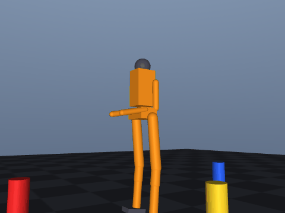

# 人形机器人端到端视觉平衡控制（行为克隆）

## 1. 功能概述

本模块采用行为克隆（Behavioral Cloning）方法，训练一个 3 层 MLP 神经网络直接从前视相机图像回归 **15 维关节力矩增量**，由站姿 PD 叠加后驱动机器人，实现"图像→控制指令"的端到端映射。对应课程任务④：**端到端模型（输入图像、输出控制指令）**。

选择"力矩增量"而非"关节目标角"作为网络输出，是因为 teacher 的平衡能力落在力矩层（见第 3 节）；若网络学目标角，teacher 的踝策略无法被复现，闭环会退化成纯位置 PD 而倒下。

## 2. 系统架构

```mermaid
graph LR
    A[前视相机 64×64] --> B[16×16 池化→256维]
    B --> C[MLP 256→128→64→15]
    C --> D[15维力矩增量 Δτ]
    D --> E[PD 叠加 tau = kp*(q_target-q) - kd*qv + Δτ]
    E --> F[clip ±300 N·m 下发]
```

## 3. 计算原理

### 3.1 网络

$$
\mathbf{h}_1 = \mathrm{ReLU}(\mathbf{W}_1 \mathbf{x} + \mathbf{b}_1),\quad
\mathbf{h}_2 = \mathrm{ReLU}(\mathbf{W}_2 \mathbf{h}_1 + \mathbf{b}_2),\quad
\mathbf{y} = \mathbf{W}_3 \mathbf{h}_2 + \mathbf{b}_3 \in \mathbb{R}^{15}
$$

损失为逐维标准化后的均方误差（力矩各维量级差异极大，踝约 52 N·m，其余接近 0）：

$$
\mathcal{L} = \frac{1}{N}\sum_{i=1}^{N}\left\|\frac{\mathbf{y}_i - \hat{\mathbf{y}}_i}{\boldsymbol{\sigma}}\right\|^2 ,
\qquad \boldsymbol{\sigma} = \mathrm{std}(\mathbf{Y}) \ \text{(采集时随权重一起保存)}
$$

### 3.2 teacher：为什么原方案站不住

原始 teacher 为关节 PD 加躯干倾角比例项，实测 **1.29 s 跌倒**，且 roll 恒为 0（纯前后方向倒）。逐个排除的错误方向：提高关节刚度（kp 60→2000，仍 1.26~1.31 s）、加大倾角反馈（0.90 s，根高塌到 0.32 m）、质心反馈（正负号全试，最好 1.76 s）、root 平移负反馈（kxy 50→3000，反而 1.09 s）、重力前馈（kp=120 时恶化到 0.75 s）、接触参数、关闭自碰撞、抬高初始高度——全部落在 1.09~1.38 s。

**分离实验**：每步强制 `qpos[0]=qvel[0]=0`（只锁水平平移，其余自由度放开），纯 PD 即可稳 10 s，根高保持 1.066~1.090 m、pitch 仅从 0 缓慢漂到 0.15 rad。结论：**腿和接触都正常，倒地起于骨盆沿 x 的漂移——纯位置 PD 对骨盆水平位移是开环的。**

### 3.3 有效的控制律

在踝 pitch（`ctrl[3]` / `ctrl[8]`）叠加骨盆反馈：

$$
\Delta\tau_{\text{ankle}} = K_{vx}\,v_x + K_x\,x + K_{\text{tilt}}\,\theta_{\text{pitch}} + K_{\text{rate}}\,\dot\theta_{\text{pitch}}
$$

$$
K_{vx}=1500,\ K_x=800,\ K_{\text{tilt}}=300,\ K_{\text{rate}}=30
$$

roll 方向配小增益（`K_ROLL=200`、`K_ROLL_RATE=20`）抑制侧向漂移，hip_roll 反向、ankle_roll 半量。

**通道敏感性**（重要）：同一组增益加到髋关节会恶化到 0.69 s，hip+ankle 同时加是 0.56 s，符号取反全部 0.63~1.21 s 倒。只有踝 pitch 单通道有效。

## 4. 性能指标

| 指标 | 数值 |
|---|---|
| 数据集规模 | 9 000 样本（12 回合 × 750） |
| 输入维度 | 256（64×64 图像平均池化到 16×16 灰度） |
| 输出维度 | 15（力矩增量 N·m） |
| 网络参数量 | ~41 K |
| 验证 MSE（标准化） | 3.73e-01 |
| 验证 RMSE（物理量） | **5.2 N·m**（相对 ±300 N·m 执行上限 1.7%） |
| 单帧推理 | < 1 ms |

### 闭环表现（timestep 0.002，跌倒判据 root_z < 0.6）

| 场景 | 结果 |
|---|---|
| teacher 0 N 空站 30 s | 未倒，最大倾角 5.7°，最低根高 1.075 m |
| teacher 抗 50 N 推扰 | 恢复，最大倾角 7° |
| 端到端网络 0 N 空站 10 s | 站稳，最大倾角 5.5° |
| 端到端网络 50 N 推扰后 10 s | 恢复并站稳，最大倾角 6.0° |
| 全零权重对照 10 s | 1.31 s 跌倒（判据有判别力） |

稳健性补充验证：初速 0.1/0.2/0.4 m/s 均能稳；力矩噪声 ±30% 稳 15 s（±50% 才 14.78 s 倒）；常值偏置 ±10/±20 N·m 稳 15 s。

### 自检为什么有判别力

旧版 `--check` 的站姿检查只跑 0.6 s，"2 s 内未倒"实际只跑了 1.2 s，而失稳发生在 1.29 s，因此写入全零权重仍然 8/8 PASS。现版本：

1. 站姿判据统一为 10 s（5 000 步），失稳点必然落在窗口内；
2. 加入 **全零权重对照**：W/b 清零后跑同样 10 s，必须跌倒才算 PASS；
3. 加入输出非常量检查（std > 1e-6），拦截权重未真正加载的静默失败；
4. 单独校验 teacher 自身站姿 10 s。

## 5. 复现步骤

### 5.1 环境安装

```bash
pip install -r requirements.txt
# 依赖：numpy >= 1.21, mujoco >= 3.0, imageio >= 2.9
```

### 5.2 自检

```bash
cd src/humanoid/humanoid_e2e_recovery
python3 main.py --check
# 8 项全部 PASS 才通过；写入全零权重必须判 FAIL
```

### 5.3 采集专家数据

```bash
python3 main.py --collect --episodes 12
# 输出：data/e2e_dataset.npz（12 回合 × 750 = 9 000 样本）
# 每回合 warmup 300 步后由专家抗 40~90 N 随机推力，只保留未倒回合
```

渲染是瓶颈（约 140 ms/步），`record_every` 控制抽帧间隔。

### 5.4 训练网络

```bash
python3 main.py --train
# 输出：models_trained/e2e_policy.npz（含 Y_scale）
# 80 epochs，典型验证 MSE 0.373（标准化）/ 27.5 N·m²（物理量）
# 数据集缺失时打印提示并以 exit code 2 退出
```

### 5.5 演示

```bash
python3 main.py --demo --force 50 --direction 0
# 先空站 3 s，再由端到端网络抗 50 N 推扰，随后录 10 s
# 输出：[结果] 恢复并站稳 10s | 最大倾角 6.0° | fell=null
```

### 5.6 生成演示动图

```bash
python3 generate_gif.py
# 默认输出：本模块目录下的 demo_test.gif（834 帧 / 480×360）
```

### 5.7 ROS2 launch（Ubuntu 20.04 Humble）

```bash
colcon build --packages-select humanoid_e2e_recovery
source install/setup.bash
ros2 launch humanoid_e2e_recovery main.launch.py
```

话题语义：`/e2e/torque_delta`（`std_msgs/Float64MultiArray`，15 维 N·m），由仿真节点叠加到 PD 输出上。

### 5.8 单元测试

```bash
python3 -m pytest test -q
# 6 passed：模型加载、teacher 站 10s、teacher 抗推、MLP 前向反传、
# 权重非全零、零权重必须失稳
```

## 演示动图



端到端网络驱动，先空站 2 s 再施加 50 N 前向推扰，全程站稳。
