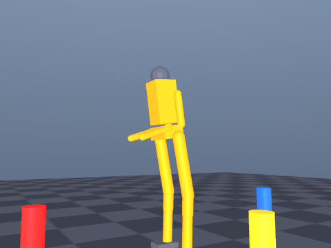

# 人形机器人端到端视觉平衡控制（行为克隆）

## 1. 功能概述

本模块采用行为克隆（Behavioral Cloning）方法，训练一个 3 层 MLP 神经网络直接从前视相机图像回归 15 维关节目标角，实现"图像→控制指令"的端到端映射。对应课程任务④：**端到端模型（输入图像、输出控制指令）**。

## 2. 系统架构

## 3. 计算原理

网络结构：

$$
\mathbf{h}_1 = \mathrm{ReLU}(\mathbf{W}_1 \mathbf{x} + \mathbf{b}_1)
$$

$$
\mathbf{h}_2 = \mathrm{ReLU}(\mathbf{W}_2 \mathbf{h}_1 + \mathbf{b}_2)
$$

$$
\mathbf{y} = \mathbf{W}_3 \mathbf{h}_2 + \mathbf{b}_3 \in \mathbb{R}^{15}
$$

损失函数为均方误差：

$$
\mathcal{L} = \frac{1}{N} \sum_{i=1}^{N} \|\mathbf{y}_i - \hat{\mathbf{y}}_i\|^2
$$

专家控制器：基于躯干倾角的比例控制

$$
\Delta\mathbf{q} = K_p \cdot \boldsymbol{\theta}_{\text{torso}}
$$

## 4. 性能指标

| 指标 | 数值 |
|---|---|
| 验证 MSE | 2.8e-05 rad² |
| 关节角误差 | ~0.3° |
| 推理耗时 | < 1 ms/帧 |

## 演示动图

