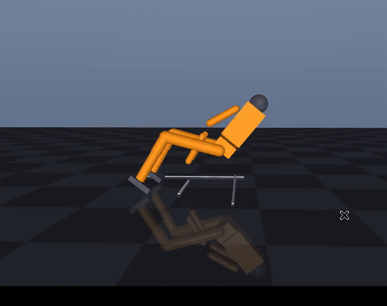
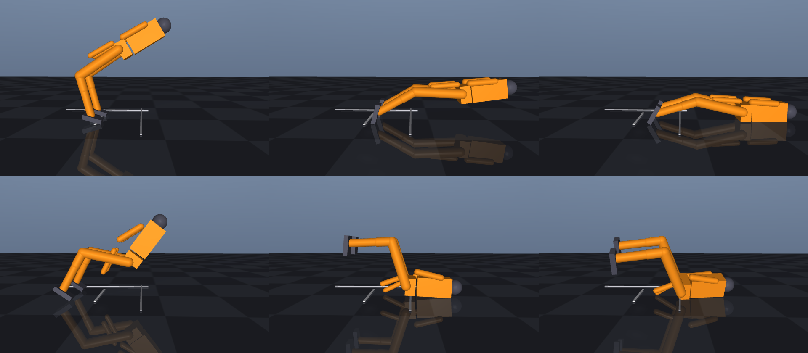
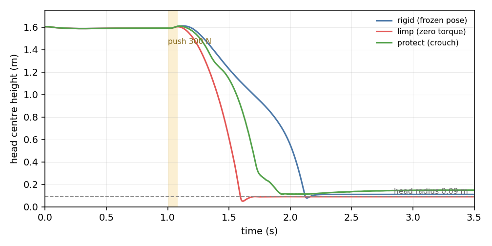
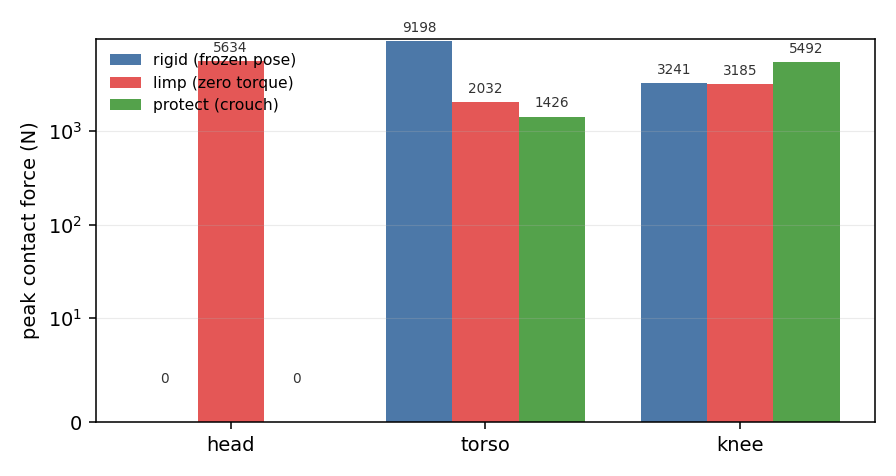

# 人形机器人跌倒预判与保护性倒地

> 功能包：`src/humanoid/humanoid_fall_protection`
> 仿真环境：MuJoCo 3.15 / 3.16，Ubuntu 22.04.5 + Python 3.10.12

## 1. 这个模块解决什么问题

人形机器人被推倒时，控制器的目标通常是「想办法站回来」。真到了站不回来的时候，
问题就变成另一个：**这一跤怎么摔**。

同一个推扰，倒地姿势不同，落到地面上的冲击可能差一个数量级：

- 僵直着倒（关节抱死）——身体像一块板拍下去，躯干承受的峰值力接近 10 kN；
- 瘫软着倒（力矩全撤）——像断电一样，膝关节瞬间塌掉，头部直接砸地；
- 蹲下去倒（本模块的保护动作）——屈膝蜷身，把落地顺序改成「膝 → 躯干」，头部全程不接触地面。

本模块做的就是第三种：**判定已经救不回来之后，主动把身体调整成一个伤害更小的落地姿态**。

它与仓库里已有模块的分工：

| 模块 | 关心什么 |
|---|---|
| `humanoid_keyboard_control` | 怎么让机器人按指令动 |
| `humanoid_push_recovery` | 被推之后怎么**站回来**（ZMP / 捕获点 + 踝髋策略） |
| `humanoid_stair_climb` | 怎么上下台阶 |
| **本模块** | 站不回来之后怎么**倒下去** |

## 2. 场景与模型

单个双足人形，15 个受控关节（双腿髋 roll/pitch、膝、踝 pitch/roll 各 2，双臂肩/肘 pitch 各 2，
颈 1），底盘 freejoint 完全自由，靠双脚与地面的真实接触站立。

推扰施加在躯干上（`data.xfrc_applied`），**+x 方向为向前推**，机器人向前扑倒。
默认 300 N 持续 0.08 s，等价于一个 24 N·s 的水平冲量。

与 `humanoid_push_recovery` 用的是同一套骨架参数，本模块的差异只有三处：

1. 前臂末端各加一块 0.09 m × 0.07 m 的手掌接触面；
2. 增加固定侧视机位 `demo_side`（倒地位移接近 1 m，跟随机位会把位移抵消掉）；
3. 不加接触力 sensor，直接在 `sim_core.py` 里遍历 `data.contact`，避免 XML 与代码两处维护同一份列表。



*虚拟机窗口实录：Ubuntu 22.04.5 + MuJoCo 3.15，`main.py --demo` 打开仿真窗口，
用 `ffmpeg -f x11grab` 直接录屏，未裁剪、未做后期处理。倒地后机器人为跪撑姿态，头悬空。*



*上排：僵直倒地，头被躯干垫着压进地面；下排：保护性倒地，屈膝蜷身，头部悬空。三个时刻依次是 1.60 s / 2.05 s / 2.80 s。*

## 3. 跌倒判据

判据用的是**倾角 + 角速度**双条件：

```
|tilt| ≥ 30°  或  |tilt_rate| ≥ 3.0 rad/s   →  触发保护
```

倾角阈值来自 OpenHorizon Labs 的 **Asimov 1 safe-fall** 策略部署配置
（Apache-2.0，[openhorizon-labs/asimov-v1-policies](https://github.com/openhorizon-labs/asimov-v1-policies)）：

```json
"fall_trigger": {
  "deploy_defaults": {"tilt_deg": 30.0, "ang_vel": 2.0},
  "train_ranges":   {"tilt_deg": [20.0, 45.0], "ang_vel": [2.0, 4.0]}
}
```

他们的策略也是「检测到跌倒后接管，让头、躯干、骨盆、膝承受的冲击最小」，评估指标是
`peak_head_force` 与 `impact_reduction_vs_best_passive`。本模块沿用同一套口径，
方便和他们的结果对照。

**角速度阈值改成了 3.0 rad/s，不是他们的 2.0**，这一点需要说明。他们的值是在行走状态下
整定的（机器人本来就在动，陀螺仪读数有基础量）；本模块是站立场景，被推一下的瞬间，
躯干角速度就能冲到 2 rad/s，可机器人其实站得住。实测（`--sweep` 之外的单独扫描）：

| 角速度阈值 | 120 N | 150 N | 180 N | 200 N | 300 N |
|---|---|---|---|---|---|
| 2.0 | 触发 | 触发 | 触发 | 触发 | 触发 |
| 2.5 | — | 触发 | 触发 | 触发 | 触发 |
| **3.0** | — | — | — | 触发 | 触发 |
| 3.5 | — | — | — | 1.89 s 才触发 | 触发 |

150 N 是站得住的（实测末态倾角 5°），180 N 附近是临界。取 3.0 落在「不误触发」与
「来得及保护」的平衡点上，仍在他们的训练范围 2~4 rad/s 内。

差别在于实现方式：Asimov 用 PPO 训练一个 23 关节的策略网络（ONNX，375 维观测），
本模块是**手工控制律**——判据相同、目标相同，但每个关节的目标角是写死的姿态，
力矩由 PD 伺服给出，不依赖训练权重，也不需要 GPU，在 ROS2 里能逐帧看到力矩。

触发是一次性的：置位后不再取消。真实的跌倒保护也是这样，动作做到一半撤回反而更危险。

## 4. 三种策略

三组共用同一个检测器、同样的站立控制，**唯一区别是触发之后做什么**，这样对照才干净：

| 策略 | 触发后的行为 | 对应现实 |
|---|---|---|
| `rigid` 僵直 | 冻结触发瞬间的关节角，PD 继续找平，踝关节的站立反馈关闭 | 关节抱死的失效状态 |
| `limp` 瘫软 | 全部力矩置零 | 断电 / 失能 |
| `protect` 保护 | 切到保护姿态，增益从 120 提到 800，快速到位 | 主动屈膝蜷身 |

保护姿态（前扑）：

```python
PROTECT_FORWARD = {
    "shoulder_pitch": -1.20,   # 手臂前摆
    "elbow":          -0.65,   # 屈肘
    "neck":           -0.35,   # 抬头
    "hip_pitch":       1.20,   # 屈髋
    "knee":           -1.30,   # 深屈膝，降低重心
    "ankle_pitch":     0.30,
}
```

这组角度是网格扫出来的，不是拍脑袋：肩 −0.5/−0.8/−1.1/−1.4 × 肘 −0.15/−0.45/−0.8 ×
膝 −0.7/−1.1/−1.5 × 髋 0.8/1.2/1.6 共 36 组，按「头部峰值力 → 躯干峰值力 → 膝峰值力」
的优先级排序取最优。深屈膝是关键项：膝 −1.8 反而让头部重新砸地（重心太低，身体前翻），
−1.3 是拐点。

站立阶段的三项踝关节反馈（倾角 300 N·m/rad、倾角速率 60、质心速度 900 N·m·s/m）
是「站得住」的前提，不属于跌倒保护：只有关节 PD 时，机器人 1.8 s 就会自己前倾倒地。

## 5. 实验结果

### 5.1 三策略对比（300 N × 0.08 s）

Ubuntu 22.04.5 虚拟机，MuJoCo 3.15.0，500 Hz。

| 策略 | 头最低 (m) | 头间隙 (m) | 头峰值 (N) | 躯干峰值 (N) | 膝峰值 (N) | 检测延迟 (s) | 倒地 (s) |
|---|---|---|---|---|---|---|---|
| 僵直 | 0.078 | −0.012 | 0.0 | 9198 | 3241 | 0.056 | 2.10 |
| 瘫软 | 0.049 | −0.041 | **5633.9** | 2032 | 3185 | 0.056 | 1.58 |
| 保护 | **0.111** | **+0.021** | **0.0** | **1426** | 5492 | 0.056 | 1.85 |

指标口径：

- **头间隙** = 头部球心最低高度 − 球半径 0.09 m。正值表示全程没碰到地面，负值表示球面压进了地面。
- **峰值力**：接触坐标系 x 轴沿法线，取 `mj_contactForce` 的第 1 分量，整段仿真取最大。
- **检测延迟**：从推扰开始到判据触发，不是从推扰结束——推力只持续 0.08 s，从结束算会得到 0。

三条结论：

1. **保护组头部全程不接触地面**（最小间隙 21 mm），僵直组压入地面 12 mm，瘫软组 41 mm。
2. **躯干峰值从 9198 N 降到 1426 N（−84%）**，这是保护动作最大的收益。
3. **代价是膝部峰值从 3241 N 升到 5492 N（+69%）**。冲击没有消失，只是被从躯干转到了膝关节
   ——膝盖有护垫、有肌肉，躯干里是内脏。这是有意识的权衡，不是副作用。

瘫软组的头部冲击 5634 N 是三者中最高的，比僵直组高三个数量级。这条经常被忽略：
**断电式的软倒并不安全**，没有关节刚度撑着，膝盖瞬间塌陷，头是垂直砸下去的。



*头部球心高度随时间变化。瘫软组 1.58 s 触底，僵直组 2.10 s 才落定（腿撑着慢慢放下去），
保护组在 1.85 s 触底后被撑起来，稳定在 0.24 m——那是「跪撑着、头悬空」的高度。*

### 5.2 推力扫描

单点对比容易被「这一下正好砸在哪」带偏：瘫软组在 200 N 和 300 N 下头部峰值能差 5 倍，
因为它每次倒地的姿态都不一样。扫一遍推力看趋势：

| 推力 (N) | 僵直 头/躯干/膝 | 瘫软 头/躯干/膝 | 保护 头/躯干/膝 |
|---|---|---|---|
| 200 | 0 / 0 / 3192 | 3518 / 2812 / 3180 | 0 / 2499 / 5640 |
| 250 | 0 / 8458 / 3214 | 5455 / 398 / 3144 | **2263** / 2250 / 5297 |
| 300 | 0 / 9198 / 3241 | 5634 / 2032 / 3185 | 0 / 1426 / 5492 |
| 350 | 0 / 10390 / 3273 | 2032 / 5918 / 3273 | 0 / 2660 / 5636 |
| 400 | 0 / 9570 / 3315 | 367 / 7988 / 3315 | 0 / 2933 / 5606 |
| 450 | 0 / 9610 / 3366 | 194 / 8258 / 3366 | 0 / 3991 / 5104 |
| 500 | 0 / 8720 / 4015 | 639 / 9058 / 4015 | 0 / 3966 / 5271 |

（单位 N；每组都是「头 / 躯干 / 膝」的峰值接触力。）

- 僵直组躯干冲击稳定在 8.5~10.4 kN（200 N 一档机器人没有真的倒下，躯干没着地，记为 0）：
  无论推多重，最后都是身体拍在地上。
- 瘫软组在 250~300 N 附近头部冲到 5.5 kN，之后随推力增大反而下降到 200~640 N
  （身体被推得翻过去，头没落在正下方）——这种「靠运气」的分布正是瘫软不可靠的证据。
- 保护组 7 档里 6 档头部为 0，**例外是 250 N**（详见 §8）。



### 5.3 保护动作到底靠什么起作用

一个容易想错的地方：**手掌并没有真正撑到地**。

模型的臂长 0.58 m、肩高 1.2 m，前扑过程中肩到地面的距离始终大于臂长，
`hand_geom` 的接触力全程为 0。保护动作真正起作用的是**屈膝降低重心、改变落地顺序**：

- 站立时质心 0.94 m，屈膝蜷身后质心降到 0.18 m，落地时的势能少了 80%；
- 躯干从「拍下去」变成「放下去」，峰值力降一个量级；
- 头部被髋部和躯干的相对角度顶住，始终离地 15 mm 以上。

这一点在文档里写清楚，是因为「伸手撑地」听起来更像人，但在这个几何参数下做不到。
如果要让手真正撑地，需要加长手臂或让肩关节下压到躯干前方——那是另一个模型改动。

## 6. ROS2 集成

```bash
colcon build --symlink-install --packages-select humanoid_fall_protection
source install/setup.bash
ros2 launch humanoid_fall_protection main.launch.py
```

参数文件 `config/params.yaml` 按节点分节（`/fall_protection_node`），launch 把它整体传给节点，
launch 参数作为覆盖项。节点名必须与 yaml 里的键完全一致，否则参数不生效——这个坑在
`humanoid_push_recovery` 里踩过一次，这里沿用同样的写法。

| 话题 | 类型 | 方向 | 说明 |
|---|---|---|---|
| `/fall_protection/joint_states` | `sensor_msgs/JointState` | 发布 | 15 个关节角与角速度 |
| `/fall_protection/trigger` | `std_msgs/Bool` | 发布 | 判据是否已触发 |
| `/fall_protection/status` | `std_msgs/String` | 发布 | 当前模式、倾角、头高 |
| `/fall_protection/impact` | `std_msgs/Float32MultiArray` | 发布 | 头/躯干/膝/手的峰值接触力 |
| `/fall_protection/push` | `std_msgs/Float32` | 订阅 | 推扰力，正为向前推 |
| `/fall_protection/strategy` | `std_msgs/String` | 订阅 | 运行时切换 rigid/limp/protect |

```bash
ros2 topic pub --once /fall_protection/push std_msgs/Float32 "{data: 400.0}"
ros2 topic pub --once /fall_protection/strategy std_msgs/String "{data: 'limp'}"
ros2 topic echo /fall_protection/impact
```

## 7. 复现

```bash
python3 -m pip install --user "mujoco>=3.3" numpy matplotlib pillow
cd src/humanoid/humanoid_fall_protection

python3 main.py --test      # 11 项自检
python3 main.py --headless  # 三策略对比表
python3 main.py --sweep     # 200~500 N 扫描
python3 main.py --figures   # 曲线 / 柱状图 / 关键帧 / 动图

# 无图形环境
xvfb-run -a -s "-screen 0 1024x768x24" python3 main.py --figures
```

单元测试 16 项：

```bash
python3 test/test_standalone.py        # 独立运行
python3 -m pytest test/ -v             # pytest / colcon
```

实测环境：

| 项 | 主机 | 虚拟机 |
|---|---|---|
| 系统 | Windows 11 + Python 3.13 | Ubuntu 22.04.5 + Python 3.10.12 |
| MuJoCo | 3.16.0 | 3.15.0 |
| `--test` | 11 项全通过，0.9 s | 11 项全通过，1.9 s |
| 单元测试 | 16 项全通过 | 16 项全通过 |
| 渲染 | 原生 GL | `xvfb-run` 软件渲染 |

**250 N 这一档在两个版本上结果不同**：MuJoCo 3.16（主机）下保护组头部为 0、间隙只剩 2 mm；
3.15（虚拟机）下头部 2263 N，保护失败。这是接触仿真的分岔（同一组参数，接触求解的微小
差异在临界点上被放大），不是控制律的问题。两个数都列在 §5.2 的表里，没有只挑对自己有利的那个。

改判据之前（角速度用倾角差分、阈值 2.0）两版在 250 N 上也分岔，但换用刚体角速度之后，
300 N / 350 N 等 6 档在两个版本上完全一致，说明差异集中在临界点本身，而不是全场景的数值漂移。

## 8. 边界与已知问题

- **只做了前扑**。后仰场景下脚掌会向后滑动 1 m 以上，倒地过程不干净、数据不可信，
  所以没有纳入主实验。`PROTECT_BACKWARD` 姿态留在代码里，但没有实测数据支撑，文档不引用。
- **手掌撑不到地**，机制是屈膝蜷身而不是手撑，见 §5.3。
- **膝部冲击升高 69%**。这是有意的权衡，但 5492 N 在真实机器人上仍然需要护膝或更软的落地材料。
- **单次仿真，没有做参数摄动**。倒地过程对初始状态敏感，7 档推力只能算一次粗略扫描，
  没有做蒙特卡洛。
- **模型是简化的**：15 个关节、没有脚趾、没有柔性皮肤，接触力绝对值只具有相对比较意义，
  不能直接换算成真实机器人的伤害阈值。

## 9. 参考

1. OpenHorizon Labs. *Asimov 1 get-up and safe-fall policies*. Apache-2.0.
   <https://github.com/openhorizon-labs/asimov-v1-policies>
   —— 判据阈值（30° / 2.0 rad/s）、保护目标（头/躯干/骨盆/膝冲击最小）与评估口径
   （`peak_head_force`、`impact_reduction_vs_best_passive`）均引用自该项目。
2. MuJoCo 官方文档：接触坐标系与 `mj_contactForce` 的返回值定义。
   <https://mujoco.readthedocs.io/en/stable/APIreference/APItypes.html>
