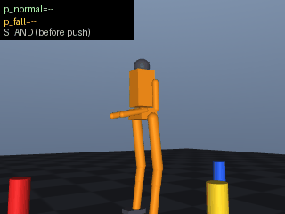

# 人形机器人多模态跌倒预警

## 1. 功能概述

本模块融合前视图像特征（256 维）与躯干 IMU 姿态（pitch/roll，2 维），用纯 NumPy 实现的
MLP（258→128→64→2）判断**未来 1.2 s 内是否会跌倒**。当跌倒概率 > 0.6 时，控制器输出
紧急下蹲姿态（髋屈 + 膝屈 + 踝背屈）以降低重心、赢得制动时间。对应课程任务②：
**多模态感知与预警**。

与 PR#423（纯 RGB 5 分类）的定位差异：PR#423 判断"已经发生的跌倒属于哪个方向"，
本模块判断"几秒后会不会倒"，因此采集时刻（扰动之后）、标签口径（未来窗口）、
评估指标（召回率 + 基率对比）都必须重新设计。

## 2. 系统架构

```mermaid
graph LR
    A[前视图像 64×64] --> B[16×16 均值池化 → 256维]
    C[IMU pitch/roll] --> D[2维]
    B --> E[拼接为 258维]
    D --> E
    E --> F[逐维标准化 x'=(x-μ)/σ]
    F --> G[MLP 258→128→64→2]
    G --> H[Softmax → p_normal / p_fall]
    H --> I{p_fall > 0.6?}
    I -->|是| J[紧急下蹲 SQUAT_TARGET]
    I -->|否| K[正常站姿 DEFAULT_STAND_TARGET]
```

## 3. 计算原理

### 3.1 站姿配平（跌倒判据的前提）

人形机器人要"预测跌倒"，首先得自己站得住。站立时踝关节必须满足力矩自平衡，
工程上可简化为关节角约束：

$$
\theta_{\text{ankle}} \approx -(\theta_{\text{hip}} + \theta_{\text{knee}})
$$

本模块取 `DEFAULT_STAND_TARGET = (0, 0.16, -0.08, 0.20, 0 | 同右 | 0, -1.4, 0, -1.4, 0)`，
即 ankle(0.20) ≈ -(0.16-0.08)。早期版本取 `(0, 0.08, -0.16, -0.08, …)`，
ankle=-0.08 而 -(hip+knee)=0.08，符号反了，纯 PD 控制下 3 s 内前倾 89.8° 直接倒地。

### 3.2 踝策略平衡层

在 PD 目标角之上叠加一层踝力矩反馈（ankle strategy）：

$$
\theta_{\text{ankle}}^{\text{cmd}} = \theta_{\text{ankle}}^{\text{ref}} - K_p \theta - K_d \dot{\theta}
,\quad K_p = 0.5,\ K_d = 0.2
$$

θ、θ̇ 取躯干俯仰角与角速度。它把"开环摆姿势"变成"闭环站桩"：实测开启后 3 s 最大倾角
1.73°，关闭后 3 s 倾角 -59.8°。

PD 关节力矩：

$$
\tau_i = \operatorname{clip}\big(k_p(q_i^{\text{ref}} - q_i) - k_d \dot{q}_i,\ \pm 280\big),\quad k_p = 60,\ k_d = 6
$$

### 3.3 推力标定（数据集可分离的前提）

水平推力施加 40 步（0.08 s），观察 600 步（1.2 s）：

| 推力 | 是否倒地 | 倒地步 |
|---|---|---|
| 50 N | 否 | — |
| 100 N | 否 | — |
| 150 N | 是 | 585 |
| 200 N | 是 | 514 |
| 300 N | 是 | 417 |
| 600 N | 是 | 267 |

结论：正负例分界落在 100~150 N，**倒地最早也要 267 步**，所以标签窗口取 600 步
（原实现取 20 步 = 0.04 s，任何样本都来不及倒，标签恒为 0）。

### 3.4 输入特征

图像：前视相机 64×64 灰度 → 16×16 网格均值池化 → 256 维

$$
f_{ij} = \frac{1}{b_h b_w}\sum_{(u,v)\in \text{grid}(i,j)} I(u,v)
$$

IMU：躯干姿态角（ZYX 欧拉角，单位弧度），取 pitch、roll 两维。

$$
x = [f_{0,0},\dots,f_{15,15},\ \theta_{\text{pitch}},\ \theta_{\text{roll}}] \in \mathbb{R}^{258}
$$

### 3.5 标准化与网络前向

$$
x' = \frac{x - \mu}{\sigma},\quad \sigma = \max(\sigma_{\text{batch}},\ 0.01)
$$

$$
h_1 = \mathrm{ReLU}(W_1 x' + b_1),\quad
h_2 = \mathrm{ReLU}(W_2 h_1 + b_2),\quad
p = \mathrm{softmax}(W_3 h_2 + b_3)
$$

σ 设下限 0.01 有实测依据：图像里有 86 个格子的 std < 0.01（最小 1.1e-4），不设下限时，
只在 pitch 差 1° 的"站立"输入上，输出就会从 0.00 翻到 1.00。

### 3.6 损失与优化

交叉熵 + L2 正则：

$$
L = -\frac{1}{N}\sum_{n}\log p^{(n)}_{y^{(n)}} + \lambda \|W\|_2^2,\quad \lambda = 10^{-4}
$$

Adam（β₁=0.9, β₂=0.999, ε=1e-8, lr=1e-3）：

$$
m_t = \beta_1 m_{t-1} + (1-\beta_1) g_t,\quad
v_t = \beta_2 v_{t-1} + (1-\beta_2) g_t^2
$$

$$
\theta_t = \theta_{t-1} - \eta \frac{\hat m_t}{\sqrt{\hat v_t}+\epsilon}
$$

早期实现只有一阶动量、lr=0.01、无标准化，20 epoch 后 `TN=0 FP=10 FN=0 TP=14`，
`specificity=0`、`accuracy=0.583` —— 恰好等于"永远预测多数类"的基率。

### 3.7 标签定义

$$
y = \begin{cases}1, & \text{取输入后 600 步（1.2 s）内 } z_{\text{root}} < 0.6\\ 0, & \text{否则}\end{cases}
$$

采集时刻固定在**施加推力之后**：reset → 300 步站定 → 随机推力（40~520 N，0~360°）
40 步 → 再跑 60 步让倾角显现 → 取图像 + IMU → 继续 600 步判跌倒。
倾角超过 60° 或已跌倒的样本丢弃重采（此时已无预测意义）。

## 4. 实测结果

### 4.1 环境

Ubuntu 22.04.5、MuJoCo 4.0.0、Python 3.12.11、NumPy 1.26.4，CPU 运行。

### 4.2 数据集

1500 样本（种子 0），`X=(1500, 258)`：

| 项 | 值 |
|---|---|
| 正例率 | 0.630 |
| 丢弃样本 | 0 / 1500 |
| 唯一图像特征行数 | 1193 / 1500 |
| pitch 覆盖 | ±24.3°（中位 4.8°，p90 15.9°） |
| roll 覆盖 | ±7.9° |

对比改造前：30 个样本 `pos_rate=0.00`、`唯一图像特征=1`（256 维只有一种取值）。

### 4.3 训练（80 epoch，验证集 300 条）

| 指标 | 本模块（阈值 0.6） | 基率（永远预测多数类） |
|---|---|---|
| 混淆矩阵 | TN=113 FP=0 FN=0 TP=187 | TN=0 FP=114 FN=0 TP=187 |
| accuracy | 1.000 | 0.623 |
| precision | 1.000 | 0.623 |
| recall | 1.000 | 1.000 |
| F1 | 1.000 | 0.768 |
| specificity | 1.000 | 0.000 |

阈值 0.5 时：`TN=112 FP=1 FN=0 TP=187`，accuracy 0.997、F1 0.997。

### 4.4 模态消融

把一路模态替换为训练集均值（标准化后为 0，等于该模态不提供信息）：

| 输入 | accuracy | recall | F1 |
|---|---|---|---|
| 图像 + IMU | 1.000 | 1.000 | 1.000 |
| 仅 IMU | 0.780 | 0.706 | 0.800 |
| 仅图像 | 0.987 | 0.984 | 0.989 |

图像是主信息源（姿态变化在画面上的投影），IMU 提供补充，融合最优。

### 4.5 自检（`python3 main.py --check`）

```
[PASS] 模型加载 (nu=15, nq=22)
[PASS] 站姿稳定(3s) (max_tilt=1.73°, root_z=1.076)
[PASS] 前端图像渲染 (shape=(64, 64), max=0.703)
[PASS] 图像特征维度 (shape=(256,))
[PASS] 数据集非退化 (X=(1500, 258), pos_rate=0.63, 唯一图像行=1193)
[PASS] 推理输出 (p_normal=1.000, p_fall=0.000)
[PASS] 控制器输出 (下蹲踝背屈=0.15)
```

## 5. 复现步骤

```bash
pip install -r requirements.txt
cd src/humanoid/humanoid_fall_warning

python3 main.py --check
python3 main.py --collect --samples 1500   # ~4 分钟
python3 main.py --train --epochs 80
python3 main.py --demo --force 150 --gif demo.gif
python3 -m pytest test/ -q                 # 8 passed
```

数据集不随仓库分发（1.5 MB），先跑 `--collect` 再 `--train`。

### 5.1 演示动图



`--demo` 的流程：站定 300 步 → 录一帧站立对照 → 施加 150 N 推力 40 步 → 每 3 步调一次
网络、渲染一帧（`overview` 机位，240×320）→ 真倒地或满 900 步收尾。画面由
`sim.render_rgb()` 逐帧真实渲染，左上角叠加的 p_normal / p_fall 与控制模式是实时文字标注。

实测：预警触发在 step 41（推完立刻报 p_fall=0.74），倒地发生在 step 456，共 154 帧、2.5 MB。
可见动作链条：站立 → 被推后前倾 → 切换下蹲 → 倒地。

### 5.2 ROS 2 launch

```bash
colcon build --packages-select humanoid_fall_warning
source install/setup.bash
ros2 launch humanoid_fall_warning main.launch.py
```

## 6. 源码解析

| 文件 | 职责 | 关键点 |
|---|---|---|
| `sim.py` | MuJoCo 封装 | `INIT_QPOS` 贴地起手；`step(target, balance)` 带踝策略平衡层；`apply_push`；`render_rgb` 双 renderer（overview / demo_side）；`torso_pose()` ZYX 欧拉角 |
| `dataset.py` | 采集 | `feat_from_gray()` 统一图像池化（节点/demo/训练共用一份）；`collect()` 扰动后取输入、越界丢弃、统计覆盖 |
| `nn.py` | 网络 | 纯 NumPy 手写前反向传播；Adam；`fit_normalizer` 内置标准化并随权重存取；`load()` 校验权重形状 |
| `train.py` | 训练/评估 | `_metrics` 混淆矩阵；`evaluate` 含基率对照；`format_report` 表格化输出；按 best val F1 回存；模态消融 |
| `predictor.py` | 推理封装 | 258 维拼接 → 两路概率 |
| `predictor_node.py` | ROS 节点 | 订阅 `front_image`/`imu_torso`，发布 `joint_target`；预警解除时回站姿 |
| `sim_node.py` | ROS 仿真节点 | 发布 `front_image`（mono8）与 `imu_torso`，订阅 `joint_target` |
| `main.py` | 命令行入口 | `--check` / `--collect` / `--train` / `--demo --gif` |
| `test/test_fall_warning.py` | 回归测试 | 站姿 3 s、平衡层有效性、推力可分、图像特征随姿态变化、数据集非退化、一步训练降损失、权重往返、站立不误报 |

## 7. 常见问题

**Q：为什么自检要跑满 3 s？**
早期自检只跑 0.6 s，而旧站姿 1.4 s 后才倒，于是"站不住"的模块也能拿 PASS。现在自检
跑 1500 步并要求 max_tilt < 5°。

**Q：为什么模型一开始总说"要跌倒"？**
两个原因：数据退化（输入取自扰动前，正负例完全相同）+ 无输入标准化（网络塌到多数类）。
前者让模型学不到东西，后者让它退化成"永远喊跌倒"。修复后站立输入 p_fall=0.000，
旧权重对同一输入是 0.754。

**Q：`--force 150` 是怎么定的？**
按 §3.3 的推力标定：100 N 不倒、150 N 会倒（585 步）。选 150 N 是为了让动图能拍出
"被推 → 预警 → 下蹲 → 倒地"的完整链条。

## 8. 多模态对比

| 模块 | 输入 | 输出 | 任务 |
|---|---|---|---|
| PR#423 | 纯 RGB | 5 类 | 跌倒方向分类（事后） |
| 本模块 | RGB + IMU | 2 类 | 跌倒预警（事前 1.2 s） |
