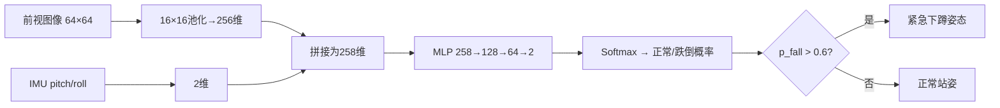

# 人形机器人多模态跌倒预警

## 1. 功能概述

本模块融合前视图像特征（256维）与躯干IMU姿态（pitch/roll，2维），通过纯NumPy实现的MLP（258→128→64→2）进行二分类判断。当跌倒概率>0.6时，控制器输出紧急下蹲姿态以减小倾倒冲击。对应课程任务②：**多模态感知与预警**。

## 2. 系统架构



## 3. 计算原理

多模态融合：x = [img_feat(256), pitch, roll] ∈ R^{258}

网络前向：
- h1 = ReLU(W1·x + b1), W1 ∈ R^{258×128}
- h2 = ReLU(W2·h1 + b2), W2 ∈ R^{128×64}
- logits = W3·h2 + b3 ∈ R^2
- p = softmax(logits)

损失函数：交叉熵 L = -Σ log(p[y])

## 4. 复现步骤

### 4.1 环境安装

```bash
pip install -r requirements.txt
```

### 4.2 采集数据

```bash
cd src/humanoid/humanoid_fall_warning
python3 main.py --collect --samples 2000
```

### 4.3 训练

```bash
python3 main.py --train
```

### 4.4 演示

```bash
python3 main.py --demo
```

### 4.5 ROS2 launch

```bash
colcon build --packages-select humanoid_fall_warning
source install/setup.bash
ros2 launch humanoid_fall_warning main.launch.py
```

## 5. 多模态对比

| 模块 | 输入 | 输出 | 任务 |
|---|---|---|---|
| PR#423 | 纯RGB | 5类 | 跌倒方向分类 |
| 本模块 | RGB+IMU | 2类 | 跌倒预警 |
