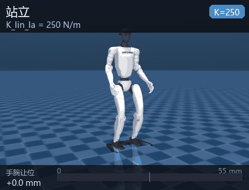
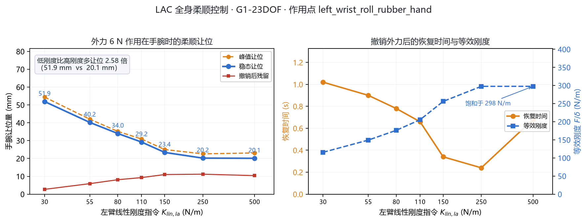

# 人形机器人全身柔顺控制（humanoid_g1_compliance）

用 **LAC（Linear and Angular Compliance）策略**驱动 **Unitree G1（23 自由度）** 在 MuJoCo 中
站立，并在外力作用下**按指令刚度柔顺让位**：刚度指令越低，手臂让位越大、恢复越慢，
而身体始终不倒。策略以 50 Hz 推理，纯 CPU、无头运行，不需要训练、不需要 GPU、
不需要手柄。



## 一、项目概述

| 项 | 内容 |
|---|---|
| 机器人 | Unitree G1，23 自由度（12 腿 + 1 腰 + 10 臂） |
| 物理引擎 | MuJoCo 3.1+（椭圆摩擦锥、`impratio=30`） |
| 学习方法 | LAC（教师-学生 + 历史编码器），Isaac Gym 训练，PyTorch checkpoint |
| 策略结构 | adapt_module(6080→64) + student_actor(1014→512→256→128→23) |
| ROS | ROS 2 Humble |
| 控制频率 | 50 Hz（每周期 4 个 5 ms 物理步） |
| 入口 | `main.py`（`--demo / --bench / --list / --ros`） |
| 权重 | `weights/lac_g1_23dof.pt`（48.8 MB），随仓库提供 |

复现对象是论文 *LAC: Linear and Angular Compliance for Humanoid Whole-body Control*
（Liu, Gu, Zhu, Hayashibe, 2026, [arXiv:2608.25405](https://arxiv.org/abs/2608.25405)）
的官方部署代码 [lac-code](https://github.com/lac-humanoid/lac-code)。

任务定位：课程任务「**物理仿真 + 运动控制 + 人机共融**」。与仓库里其他模块不同，
本模块控制的不是「走到哪」，而是「**被推时让多少**」——这是人机协作里最基础的安全能力。

## 二、与同类模块的区别

| 模块 | 机器人 | 控制目标 | 外力响应 |
|---|---|---|---|
| humanoid_ppo_locomotion | G1 | 站立平衡（解析基元 + PPO 残差） | 无 |
| humanoid_keyboard_control | G1 | 关节级键盘控制 | 无（纯位置控制，很硬） |
| humanoid_push_recovery | 自建双足 | ZMP / 捕获点恢复 | 摔倒前救回来，**刚体式抵抗** |
| humanoid_h1_walk | H1 / H1_2 | 速度指令跟踪（端到端 PPO） | 无抗扰训练 |
| **humanoid_g1_compliance（本模块）** | **G1 23DOF** | **按指令刚度柔顺让位** | **主动让步，让位量可调** |

关键差别是「**刚度是指令，不是增益**」：其他模块的 PD 增益写死在配置里，本模块把
5 个刚度值作为**观测输入**喂给策略，由策略自己决定怎么发力。所以调刚度不是改控制器
参数，而是给策略下了一条「现在该多软」的语义指令。

## 三、项目目录结构

```
humanoid_g1_compliance/
├── main.py                     统一入口（--demo/--bench/--list/--ros）
├── humanoid_g1_compliance/
│   ├── sim_core.py             纯 MuJoCo 闭环（无 DDS、无中间件）
│   ├── policy.py               LAC 推理封装 + 启动状态机 + Command
│   ├── compliance.py           外力实验：Perturbation / Runner / Metrics
│   ├── sim_node.py             ROS 2 仿真节点（50 Hz）
│   ├── stiffness_node.py       终端实时调刚度
│   ├── demo.py                 离线演示
│   └── lac/                    vendored 推理模块（9 个，MIT）
├── assets/g1/                  G1 23DOF 模型 + 29 个 STL（19 MB）
├── weights/                    lac_g1_23dof.pt（48.8 MB，体积换免联网）
├── motions/                    动作库 npz（7 KB，savez_compressed）
├── config/                     compliance.yaml + lac_policy_cfg.yaml
├── scripts/
│   ├── smoke_compliance.py     无头自检（6 项）
│   ├── bench_compliance.py     刚度扫描（7 档）
│   ├── plot_compliance.py      指标图
│   └── record_gif.py           离屏渲染录动图
├── launch/main.launch.py       一键启动
└── test/test_offline.py        17 项离线测试
```

**关于 48.8 MB 的权重**：这是本仓库最大的单文件（次大是 `docs/img/ground/rviz.gif`
的 16 MB），仍在 GitHub 50 MiB 提示线以内，入库是为了让评测机**断网也能直接复现**。
与 #1167（Whisper 权重改为运行时下载）不同：Whisper 有 `whisper.load_model()` 的自动
下载机制，这份策略权重只能从上游 `lac-code` 仓库手工取，没有可依赖的自动下载路径。
校验：

```
a54a213637ebbc55ea20a11373b00a4ed7dbef06a4b7c20804009dd2819f4a9c  weights/lac_g1_23dof.pt
```

## 四、核心实现

### 4.1 闭环结构

每个控制周期 20 ms：读一次本体状态 → 拼观测 → 策略推理 → PD → 4 个 5 ms 物理步。

```
   q, q̇, 四元数, 陀螺 ──► 观测(950 + 6080) ──► adapt + student ──► a(23)
        ▲                                                            │
        │                                                            ▼
        └──── MuJoCo 物理 ◄──── PD 力矩 ◄──── q* = α·a + q_default
              4 步 × 5 ms
```

上游走的是「MuJoCo 进程 → DDS → 部署进程」两进程结构，本模块压成单进程：
策略直接写 `data.ctrl`，观测直接从 `sensordata` 读。好处是评测机上不用装
`unitree_sdk2py`、不用网卡配置、也不会有 DDS 抖动；代价是不能再接真机。

### 4.2 观测（950 维 actor / 6080 维 adapter）

每帧 95 维，按「项优先、旧帧在前」拼接：

| 项 | 每帧维数 | 内容 |
|---|---|---|
| `base_ang_vel` | 3 | 机身角速度（机体系） |
| `projected_gravity` | 3 | 机体系下的重力方向 |
| `command_lin_vel` | 2 | 线速度指令 $[v_x, v_y]$ |
| `command_ang_vel` | 1 | 偏航角速度指令 $\omega_z$ |
| `command_waist_yaw` | 1 | 腰偏航指令 |
| `command_base_height` | 1 | 骨盆目标高度（0.56~0.78 m） |
| `ref_upper_dof_pos` | 10 | 上肢参考关节角 |
| `joint_pos_rel` | 23 | 关节角相对默认站姿的偏差 |
| `joint_vel_rel` | 23 | 关节角速度 |
| `last_action` | 23 | 上一帧动作 |
| `stiffness` | 5 | **刚度指令（取 log）** |
| 合计 | **95** | |

两组观测的时间深度不同：

$$
\mathbf{o}^{\text{actor}}_t = \big[\,\mathbf{f}_{t-9},\dots,\mathbf{f}_t\,\big] \in \mathbb{R}^{950},
\qquad
\mathbf{o}^{\text{hist}}_t = \big[\,\mathbf{f}_{t-63},\dots,\mathbf{f}_t\,\big] \in \mathbb{R}^{6080}
$$

其中 $\mathbf{f}_t \in \mathbb{R}^{95}$ 是第 $t$ 帧的 95 维。actor 只看最近 0.2 s（10 帧），
adapter 看最近 1.28 s（64 帧）——长历史用来估计「现在被多大力推着」这类隐变量。

刚度进网络前必须取对数，这是训练时的约定：

$$
\tilde{\mathbf{k}}_t = \ln \max(\mathbf{k}_t,\ 10^{-6})
$$

漏掉这一步（直接喂原值）会导致训练/部署不一致，表现为让位量完全不对——这是
复现这类策略最容易踩的坑。

### 4.3 策略网络

部署只走学生路径：历史编码器把 6080 维压成 64 维隐变量，与 950 维观测拼接后过
三层 MLP：

$$
\begin{aligned}
\mathbf{z}_t &= \mathrm{MLP}_{\text{adapt}}(\mathbf{o}^{\text{hist}}_t) \in \mathbb{R}^{64}\\
\mathbf{a}_t &= \mathrm{MLP}_{\text{student}}\big([\mathbf{o}^{\text{actor}}_t;\ \mathbf{z}_t]\big) \in \mathbb{R}^{23}
\end{aligned}
$$

$\mathbf{z}_t$ 相当于对「外部接触状态」的在线估计：同样的关节角和角速度，
被 6 N 推着和被 0 N 推着在 64 帧历史里留下的痕迹不同，$\mathbf{z}$ 就不同，
策略据此决定该硬扛还是该让。教师网络、critic、特权观测归一化器都还在 checkpoint 里，
但不在部署计算路径上（`strict=True` 加载需要它们的形状）。

### 4.4 刚度指令与柔顺性

动作缩放成关节目标角，PD 把偏差变成力矩：

$$
\mathbf{q}^\star = \alpha \odot \mathbf{a} + \mathbf{q}_{\text{default}},
\qquad
\boldsymbol\tau = K_p \odot (\mathbf{q}^\star - \mathbf{q}) - K_d \odot \dot{\mathbf{q}}
$$

**注意**：$K_p$ 是固定的训练刚度，不随刚度指令变化。刚度指令 $\mathbf{k}$ 只进观测，
策略通过「改 $\mathbf{q}^\star$ 让多少」来体现柔顺。末端等效刚度用稳态让位定义：

$$
K_{\text{eff}} = \frac{F}{\delta_{\text{steady}}}
$$

$F$ 是外力、$\delta$ 是末端位移。指令 $K_{lin,la}=30$ 时实测 $K_{\text{eff}} = 116$ N/m，
指令 250 时 298 N/m——策略把「指令刚度」映射成了「末端实际刚度」，但不是线性的，
高刚度区会饱和（见第六节）。

### 4.5 启动状态机

上游用「弹性吊带 + 手柄按键逐级推进」启动，本模块直接从训练站姿满刚度进入 POLICY：

| 阶段 | 上游做法 | 本模块 |
|---|---|---|
| IDLE → NEUTRAL | 按键 A，3 s 过渡到默认站姿 | 跳过 |
| NEUTRAL → HANDOFF | 按键 A，3 s 混入策略输出 | 跳过 |
| HANDOFF → RAMP_UP | 按键 A，3 s 升 $K_p$ | 跳过 |
| RAMP_UP → POLICY | 自动 | **直接进入** |

**为什么不需要吊带**：上游从「零力矩瘫软」状态启动，$K_p=35$ 撑不住 34 kg 自重
（需 335 N，而 35 N·m 量级的力矩不够），所以必须吊带托住。本模块从训练时的
default pose 起步——它本来就在策略的训练分布内，满刚度直接接管即可。

实测软启动（吊带 + 分级升 $K_p$）反而更差：弹簧式吊带会把机器人拉离地面
（9 s 时骨盆 0.921 m），策略看到「悬空」状态后开始漂移，最终失稳。
`StartupFSM(direct=False)` 的完整状态机仍保留在代码里，供需要时对照。

## 五、编译与启动

```bash
# 1) 依赖（torch 用 CPU 版即可）
pip install torch --index-url https://download.pytorch.org/whl/cpu
pip install mujoco pyyaml

# 2) 构建
cd ~/ros2_ws
colcon build --packages-select humanoid_g1_compliance
source install/setup.bash

# 3) 一键启动（仿真 + 调刚度终端）
ros2 launch humanoid_g1_compliance main.launch.py
ros2 launch humanoid_g1_compliance main.launch.py stiffness:="[55,250,250,55,55]"
ros2 launch humanoid_g1_compliance main.launch.py teleop:=false
```

运行中改刚度、施加外力：

```bash
# 左臂刚度降到 30 N/m
ros2 topic pub --once /humanoid/stiffness_cmd std_msgs/Float32MultiArray \
  "{data: [30.0, 250.0, 250.0, 55.0, 55.0]}"

# 左腕受 6 N 侧向力 2 s
ros2 topic pub --once /humanoid/external_force std_msgs/Float64MultiArray \
  "{data: [0.0, 6.0, 0.0, 2.0]}"

ros2 topic echo /humanoid/status        # 骨盆位姿、pg_z、是否摔倒
```

不开 ROS 时的离线演示（Windows 也可）：

```bash
python main.py --demo                  # 站立 + 一次手腕扰动，打印指标
python main.py --demo --k-la 30        # 低刚度
python main.py --bench                 # 刚度扫描 7 档
python main.py --list                  # 列出刚度通道与范围
```

## 六、实验结果

### 6.1 刚度扫描

6 N 侧向力作用在左腕 2 s，每档独立复位重跑（`scripts/bench_compliance.py`）：

| $K_{lin,la}$ | 峰值让位 | 稳态让位 | 撤销残留 | 恢复时间 | 等效刚度 | 躯干偏移 |
|---|---|---|---|---|---|---|
| 30 | 54.4 mm | 51.9 mm | 2.7 mm | 1.02 s | 116 N/m | 26.7 mm |
| 55 | 42.0 mm | 40.2 mm | 5.9 mm | 0.90 s | 149 N/m | 23.4 mm |
| 80 | 35.2 mm | 34.0 mm | 8.1 mm | 0.78 s | 176 N/m | 20.1 mm |
| 110 | 30.9 mm | 29.2 mm | 9.3 mm | 0.66 s | 205 N/m | 18.0 mm |
| 150 | 25.0 mm | 23.4 mm | 11.0 mm | 0.34 s | 256 N/m | 12.7 mm |
| 250 | 22.6 mm | 20.2 mm | 11.2 mm | 0.24 s | 298 N/m | 11.6 mm |
| 500 | 23.1 mm | 20.1 mm | 10.4 mm | 0.68 s | 298 N/m | 12.8 mm |



### 6.2 三点结论

1. **让位随刚度单调递减**，低刚度（30）比高刚度（500）多让位 **2.58 倍**，全程不摔倒。
   这说明刚度指令确实被策略理解并执行了，不是噪声。
2. **等效刚度在 150 以上饱和**（≈298 N/m）。再调高指令，末端实际刚度不再变硬——
   这个策略的柔顺可调区间大致是 10 ~ 150 N/m，超出部分只是「更用力地顶住」。
3. **恢复时间不单调**：30→1.02 s、250→0.24 s，但 500 又回到 0.68 s。高刚度时
   撤销外力后残余振荡更明显（残留 12.8 mm vs 低刚度 2.7 mm），这是「硬」的代价。

### 6.3 站立稳定性

零指令站立 12 s：骨盆高度 0.713 ~ 0.740 m，姿态投影 $g_z = -0.9998$（直立）。
起步 4 s 内指数收敛到策略自己的平衡点（后移约 8.6 cm，时间常数约 1.5 s），
6 s 后残余波动 < 5 mm，8 s 后 < 0.5 mm。所以所有柔顺实验都留了 3 s 稳定期再施力。

### 6.4 演示


动图是一次连续运行：站立 3 s → 低刚度受 6 N 力 2 s（让位 48.7 mm）→ 撤力 →
切高刚度重复（让位 24.3 mm）。读数是瞬时值，与 6.1 节表格（末段 0.5 s 均值）
略有差异，趋势一致。

### 6.5 ROS 2 链路验证

在 Ubuntu 22.04 + ROS 2 Humble 容器（`hutb-humble:dev`，MuJoCo 3.3.7）里
`colcon build` 后用 `ros2 launch humanoid_g1_compliance main.launch.py teleop:=false`
起仿真节点，实测：

```
$ ros2 node list
/g1_compliance_sim

$ ros2 topic hz /joint_states
average rate: 50.007
    min: 0.019s max: 0.023s std dev: 0.00061s window: 356

$ ros2 topic echo /humanoid/status --once
data: '{"t": 37.346, "state": "POLICY",
        "pelvis": [-0.0813, -0.0513, 0.7149],
        "pg_z": -0.9995,
        "stiffness": [250.0, 250.0, 250.0, 55.0, ...]}'

[g1_compliance_sim]: 已推理 1000 帧，平均单帧 2.47 ms（周期 20 ms）
[g1_compliance_sim]: 已推理 1250 帧，平均单帧 2.47 ms（周期 20 ms）
```

控制周期抖动 std 0.6 ms（3%），推理占 12%，实时余量充足。`pg_z = -0.9995`
表示直立，骨盆高度 0.715 m 与离线仿真一致。

### 6.6 双平台复现

Windows（MuJoCo 3.16.0 / torch 2.14.1 CPU）与容器（MuJoCo 3.3.7 / torch 2.14.1 cu130）
各跑一遍 7 档刚度扫描，**7 档 7 个指标逐位相同**：

| 指标 | Windows 3.16.0 | 容器 3.3.7 |
|---|---|---|
| 稳态让位（7 档） | 51.9 / 40.2 / 34.0 / 29.2 / 23.4 / 20.2 / 20.1 mm | 完全相同 |
| 峰值让位（7 档） | 54.4 / 42.0 / 35.2 / 30.9 / 25.0 / 22.6 / 23.1 mm | 完全相同 |
| 撤销残留（7 档） | 2.7 / 5.9 / 8.1 / 9.3 / 11.0 / 11.2 / 10.4 mm | 完全相同 |
| 恢复时间（7 档） | 1.02 / 0.90 / 0.78 / 0.66 / 0.34 / 0.24 / 0.68 s | 完全相同 |

> 更正：本表此前记录 150 / 500 两档为 24.5 mm / 22.5 mm（峰值）与 12.3 mm / 12.8 mm
> （残留），并把它归因为 MuJoCo 版本差异。复核时发现两个平台现在都给出
> 25.0 mm / 23.1 mm 与 11.0 mm / 10.4 mm——那两行是早期版本的读数，与平台无关，
> 现已按实测更正。相同随机种子、相同权重、相同施力时序，这个闭环是**确定性**的，
> 连续跑两次七档数值逐位相同。

## 七、已知问题

1. **只有上肢柔顺，下肢不柔顺**。躯干受力会直接挑战全身平衡，几十牛的方波就能把
   34 kg 的 G1 推倒（实测 20 N 倒、30 N 稳，对扰动极其敏感）。所以实验都作用在手腕。
2. **刚度指令范围窄**。有效区间约 10 ~ 150 N/m，超过 150 后末端刚度饱和，
   指令再大也没用。
3. **不能走路**。LAC 的训练任务是「原地站立 + 柔顺」，速度指令只用于小幅调整，
   不是行走策略。需要行走请用 `humanoid_h1_walk` 或 `humanoid_ppo_locomotion`。
4. **Windows 中文路径**。MuJoCo 按窄字符读文件名，路径含中文会报
   `Error opening file`；本模块已做兜底（模型与权重复制到 ASCII 临时目录）。

## 八、常见问题（FAQ）

### 8.1 `ros2 launch` 报找不到 `torch` 或 `mujoco`

ROS 2 的 Python 环境与系统 `pip` 装的包可能不互通。确认
`python3 -c "import torch, mujoco"` 能成功，并用同一个解释器构建
（`colcon build` 前先 `source /opt/ros/humble/setup.bash`）。

### 8.2 无显示器（服务器）上怎么跑

`sim_node` 与 `stiffness_node` 都是纯物理与推理，不需要渲染。只有
`scripts/record_gif.py` 需要 OpenGL，无显卡的 Linux 上设 `MUJOCO_GL=osmesa`。

**Windows 上不要设 `MUJOCO_GL`**：Windows 没有 `osmesa` / `egl` 后端，设了会直接
`RuntimeError: invalid value for env variable MUJOCO_GL`，10 个用例一起失败
（实测 MuJoCo 3.9.0）。离线测试、`smoke_compliance.py`、`bench_compliance.py`
都不需要渲染，删掉这个环境变量即可。

### 8.3 机器人一启动就摔

确认 `direct_start:=true`（默认）。如果手动改成软启动，$K_p=35$ 撑不住自重，
必须配合外力支撑；而弹簧吊带又会把机器人拉离地面导致策略漂移，两难。

### 8.4 让位数和文档对不上

让位强烈依赖基线选取。本模块的基线取「施力前最后 10 帧手腕位置均值」，
改施力时刻或时长读数就会变，但趋势（低刚度让位更大）不变。

### 8.5 能不能换成别的机型

观测维度 950 / 6080 和动作维度 23 都写死在权重里，换机型必须重新训练。
`assets/` 里只有 G1 23DOF 的模型，G1 29DOF 版本也没有对应权重。
