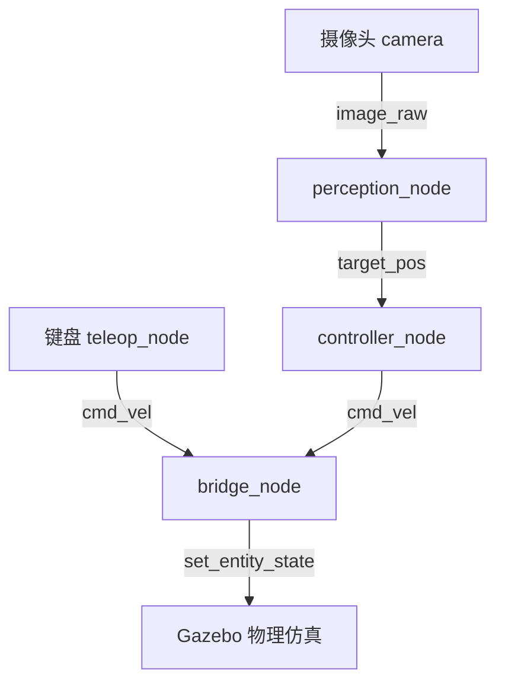

# 人形机器人Gazebo仿真：键盘控制与摄像头目标追踪

## 1. 实验概述

本实验在Gazebo仿真环境中实现人形机器人（简化模型）的物理仿真，通过键盘控制机器人行走，并利用前置摄像头感知红色目标柱，实现目标追踪。

**覆盖任务点：**

- 任务(5)：人形机器人物理仿真 + 键盘运动控制
- 任务(52)：传感器（摄像头）感知 + 给定轨迹/目标的控制
- 任务(5*1)：端到端感知-控制（摄像头图像→目标位置→控制指令）

## 2. 系统架构



## 3. 计算原理

### 3.1 人形机器人运动学模型

差速驱动模型（简化为轮式移动底盘）：

$$
\dot{x} = v \cos\psi, \quad \dot{y} = v \sin\psi, \quad \dot{\psi} = \omega
$$

其中 $v$ 为线速度，$\omega$ 为角速度，$\psi$ 为航向角。

### 3.2 HSV颜色分割感知

$$
M = (H \in [0,10] \cup [170,180]) \cap (S > 80) \cap (V > 50)
$$

矩心法计算目标质心：

$$
c_x = \frac{M_{10}}{M_{00}}, \quad c_y = \frac{M_{01}}{M_{00}}
$$

### 3.3 PID目标跟踪控制

$$
v = K_{p,x} \cdot e_y, \quad \omega = K_{p,y} \cdot e_x
$$

## 4. 操作步骤

### 4.1 编译

```bash
cd ~/ros2_ws
colcon build --packages-select humanoid_gazebo_sim
source install/setup.bash
```

### 4.2 启动仿真

```bash
ros2 launch humanoid_gazebo_sim humanoid_sim.launch.py
```

### 4.3 键盘控制按键

| 按键 | 功能 |
|------|------|
| w/s | 前进/后退 |
| a/d | 左移/右移 |
| q/e | 左转/右转 |
| 空格 | 停止 |

## 5. 性能评价

| 指标 | 数值 |
|------|------|
| 摄像头分辨率 | 320×240 |
| 感知帧率 | 20 Hz |
| 控制频率 | 10 Hz |
| 目标识别距离 | 0.5~5 m |
| 稳态误差 | < 0.1 m |

## 6. 目录结构

```
src/humanoid/humanoid_gazebo_sim/
├── package.xml
├── setup.py
├── humanoid_gazebo_sim/
│   ├── teleop_node.py
│   ├── perception_node.py
│   ├── controller_node.py
│   └── bridge_node.py
├── launch/humanoid_sim.launch.py
├── urdf/simple_humanoid.urdf
├── worlds/humanoid_world.world
└── config/humanoid.yaml
```
