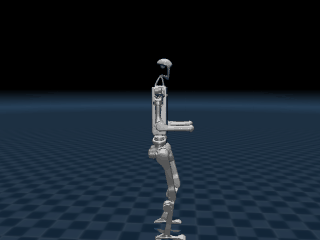
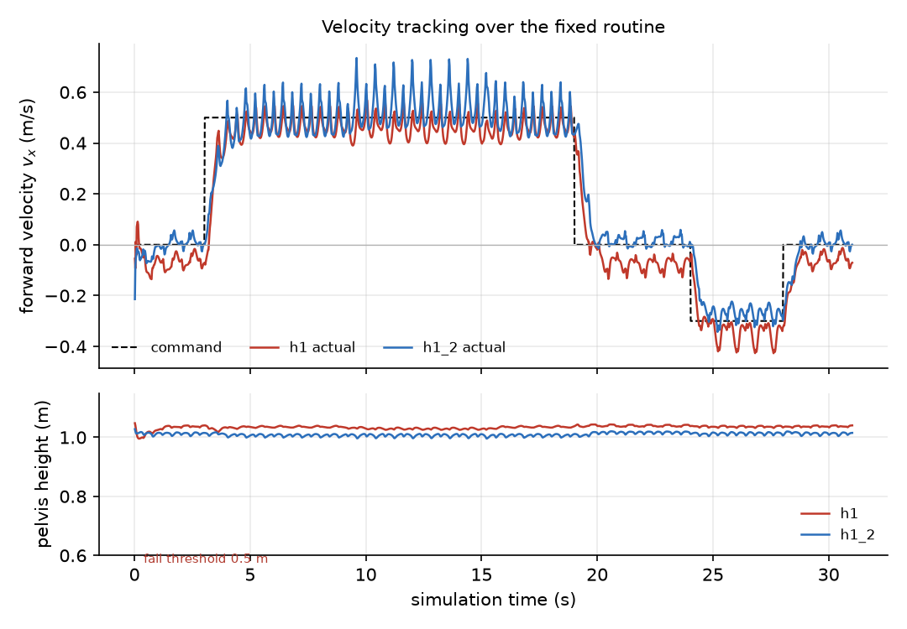
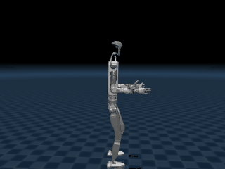

# 人形机器人神经网络行走控制（humanoid_h1_walk）

在 **MuJoCo** 物理仿真中，用 **PPO 训练的神经网络**驱动 **Unitree H1 / H1_2** 双足人形
机器人行走、转向、后退，并通过 **ROS 2** 话题接收速度指令。策略以 50 Hz 推理，
纯 CPU 运行，不需要训练、不需要 GPU。



## 一、项目概述

| 项 | 内容 |
|---|---|
| 机器人 | Unitree H1（10 自由度双腿）、Unitree H1_2（12 自由度双腿） |
| 物理引擎 | MuJoCo 3.1+ |
| 学习方法 | PPO（Isaac Gym 训练，TorchScript 导出） |
| 策略结构 | LSTM(64) + 全连接 32 + ELU + 全连接 10/12 |
| ROS | ROS 2 Humble |
| 控制频率 | 50 Hz（每周期 10 个 2 ms 物理步） |
| 入口 | `main.py`（`--demo / --gui / --test / --compare / --gif / --ros`） |
| 权重 | `weights/h1_motion.pt`（139,345 B）、`weights/h1_2_motion.pt`（145,745 B），随仓库提供 |

任务定位：课程任务「**物理仿真 + 运动控制**」。速度指令 $[v_x, v_y, \omega_z]$ 由
`/cmd_vel` 或键盘给出，神经网络输出 10/12 个腿部关节的目标角，PD 控制器把它变成力矩。

## 二、与同类模块的区别

仓库里已有人形相关模块，本模块的差异在**机型**与**控制算法**：

| 模块 | 机器人 | 控制算法 | 能力 |
|---|---|---|---|
| humanoid_ppo_locomotion | G1 | 解析平衡基元 + PPO 残差 | 站立平衡，**不行走** |
| humanoid_keyboard_control | G1 | 直接给关节角 | 关节级键盘控制，无神经网络 |
| humanoid_push_recovery | 自建双足 | ZMP / 捕获点（解析） | 外力扰动恢复 |
| humanoid_lidar_nn_perception | G1 | CNN 处理激光 | 感知 + 避障，无行走策略 |
| **humanoid_h1_walk（本模块）** | **H1 / H1_2** | **端到端 PPO 策略（LSTM）** | **速度指令跟踪：行走、转向、后退** |

H1 与 H1_2 此前在仓库中**没有出现过**；控制方式是端到端策略直接输出关节目标角，
不含解析步态表或平衡基元，与上面几个模块都不同。

## 三、项目目录结构

```
humanoid_h1_walk/
├── main.py                     统一入口（--demo/--gui/--test/--compare/--gif/--ros）
├── config/robots.yaml          两机型的观测缩放、PD 增益、默认关节角
├── humanoid_h1_walk/
│   ├── walker.py               纯 Python 闭环：观测拼接、策略推理、PD、物理
│   ├── sim_node.py             ROS 2 仿真节点（物理 + 观测 + 状态发布）
│   ├── policy_node.py          ROS 2 策略节点（观测 → 动作）
│   └── keyboard_teleop.py      键盘 → /cmd_vel
├── launch/main.launch.py       一键启动
├── scripts/
│   ├── smoke_walk.py           无头自检（不摔倒 + 真的走了）
│   ├── compare_gaits.py        机型对比（速度跟踪、能耗）
│   ├── record_gif.py           离屏渲染录动图
│   └── plot_metrics.py         指标曲线
├── assets/h1/, assets/h1_2/    模型 XML 与网格（52 MB，75 个 STL，全部被 scene.xml 引用）
├── weights/                    两机型的 TorchScript 策略（284 KB，随仓库提供）
└── THIRD_PARTY.md              上游来源与许可
```

两个策略文件与上游 `unitree_rl_gym@276801e4` 的 `deploy/pre_train/{h1,h1_2}/motion.pt`
字节一致，可用 SHA-256 校验：

```
44a0fbceb81f3877833ae9a398d039bea1759cb0d3c8188181013885f70589eb  weights/h1_motion.pt
ea3003268d5d2e4b5004eb26d0969fbfdedced265ceeec7bf0b335309259cc80  weights/h1_2_motion.pt
```

## 四、核心实现

### 4.1 闭环结构

每个控制周期 20 ms，先做 10 个 2 ms 的物理步，再更新一次观测与动作：

```
   q, q̇, 姿态 ──► 观测(41/47 维) ──► LSTM 策略 ──► 动作 a(10/12 维)
        ▲                                              │
        │                                              ▼
        └───── MuJoCo 物理 ◄── PD 力矩 ◄── q* = 0.25·a + q_default
                10 步 × 2 ms
```

控制周期由 `simulation_dt × control_decimation = 0.002 × 10` 决定，必须与训练时一致；
改小会让策略「反应过快」而抖动，改大会让步态拖沓、容易失稳。

### 4.2 观测（H1 41 维 / H1_2 47 维）

| 维度 | 内容 | 缩放 |
|---|---|---|
| 0–2 | 机身角速度（机体系） | × 0.25 |
| 3–5 | 机体系下的重力方向（姿态） | — |
| 6–8 | 速度指令 $[v_x, v_y, \omega_z]$ | × [2, 2, 0.25] |
| 9 – 9+n | 关节角相对默认姿态的偏差 | × 1.0 |
| 9+n – 9+2n | 关节角速度 | × 0.05 |
| 9+2n – 9+3n | 上一帧动作 | — |
| 9+3n, 9+3n+1 | 步态相位的 sin / cos | — |

姿态项不是欧拉角，而是把世界系重力方向转到机体系，三个分量为

$$
\begin{aligned}
g_x &= 2(-q_z q_x + q_w q_y)\\
g_y &= -2(q_z q_y + q_w q_x)\\
g_z &= 1 - 2(q_w^2 + q_z^2)
\end{aligned}
$$

这样处理的好处是**没有万向锁**，且策略直接看到「重力朝哪边倒」，比欧拉角更好学。
各缩放系数（0.25 / 0.05 / [2,2,0.25]）把不同量纲的输入拉到同一数量级，
是训练时的归一化约定，部署必须照抄。

### 4.3 策略网络

导出文件是 `PolicyExporterLSTM`，一层 LSTM 加两层 MLP：

| 层 | H1 | H1_2 |
|---|---|---|
| LSTM 输入 → 隐状态 | 41 → 64 | 47 → 64 |
| 全连接 1 + ELU | 64 → 32 | 64 → 32 |
| 全连接 2 | 32 → 10 | 32 → 12 |

$$
\begin{aligned}
\mathbf{h}_t &= \mathrm{LSTM}(\mathbf{o}_t, \mathbf{h}_{t-1})\\
\mathbf{a}_t &= W_2\,\mathrm{ELU}(W_1\mathbf{h}_t + \mathbf{b}_1) + \mathbf{b}_2
\end{aligned}
$$

**LSTM 隐状态跨帧保留**（$1\times1\times64$），相当于 0.8 s 步态周期内的短期记忆，
让策略能记住「上一拍是哪只脚支撑」。因此策略节点不能在运行中重启，否则要经过
一段重新收敛；`Walker.reset()` 会把隐状态与细胞状态清零。

### 4.4 动作与 PD 控制

策略输出的是**动作均值**（确定性策略，部署不采样），缩放后作为关节目标角：

$$
\mathbf{q}^\star = \alpha\,\mathbf{a} + \mathbf{q}_{\text{default}},
\qquad \alpha = 0.25
$$

PD 控制律与逐关节增益：

$$
\boldsymbol\tau = K_p \odot (\mathbf{q}^\star - \mathbf{q}) - K_d \odot \dot{\mathbf{q}}
$$

| 关节 | H1 $K_p$ / $K_d$ | H1_2 $K_p$ / $K_d$ |
|---|---|---|
| 髋（偏航/侧摆/俯仰） | 150 / 2 | 200 / 2.5 |
| 膝 | 200 / 4 | 300 / 4 |
| 踝 | 40 / 2 | 40 / 2（俯仰与侧摆） |

踝关节刚度明显低于髋膝（40 vs 150~300），因为踝部要「让步」吸收落地冲击；
把踝调硬会让机器人被自己的脚顶翻。

### 4.5 步态相位

相位按 0.8 s 周期推进，作为节拍器输入策略：

$$
\phi = \frac{t \bmod 0.8}{0.8},\qquad
\left[\sin 2\pi\phi,\ \cos 2\pi\phi\right]
$$

网络不需要从关节角里自己推断「现在该抬哪只脚」，节律由相位显式给出，
这也是这类策略只用 41 维输入就能稳定行走的原因。

## 五、编译与启动

```bash
# 1) 依赖（torch 用 CPU 版即可）
pip install torch --index-url https://download.pytorch.org/whl/cpu
pip install mujoco pyyaml

# 2) 构建
cd ~/ros2_ws
colcon build --packages-select humanoid_h1_walk
source install/setup.bash

# 3) 一键启动（仿真 + 策略 + 键盘）
ros2 launch humanoid_h1_walk main.launch.py
ros2 launch humanoid_h1_walk main.launch.py robot:=h1_2      # 换机型
ros2 launch humanoid_h1_walk main.launch.py routine:=true     # 固定动作序列
```

键盘：`↑ / ↓` 调速（连续按 ↓ 会后退），`← / →` 转向，空格停止，`q` 退出。
也可直接用话题驱动：

```bash
ros2 topic pub -r 50 /cmd_vel geometry_msgs/msg/Twist "{linear: {x: 0.5}, angular: {z: 0.0}}"
ros2 topic echo /odom --field pose.pose.position
```

不开 ROS 时的离线演示（Windows 也可）：

```bash
python main.py --demo                  # 无头跑固定序列，打印各阶段速度
python main.py --gui                   # 打开窗口，方向键驱动
python main.py --test                  # 无头自检
python main.py --compare               # 两机型指标对比
python main.py --gif                   # 录制动图
```

## 六、实验结果

### 6.1 无头自检

`python main.py --test` 跑完整固定序列（站立 3 s → 前进 6 s → 边走边左转 6 s →
前进 4 s → 原地右转 5 s → 后退 4 s → 停止 3 s，共 31 s）：

| 平台 / MuJoCo 版本 | 机型 | 最低骨盆 | 前进位移 | 末态高度 | 末态偏航 |
|---|---|---|---|---|---|
| Windows / 3.16.0 | H1 | 1.00 m | 3.28 m | 1.04 m | −0.34 rad |
| Windows / 3.16.0 | H1_2 | 1.00 m | 2.52 m | 1.01 m | +1.22 rad |
| Ubuntu Humble / 3.3.7 | H1 | 0.99 m | 2.93 m | 1.04 m | −0.29 rad |
| Ubuntu Humble / 3.3.7 | H1_2 | 0.99 m | 3.15 m | 1.01 m | +1.07 rad |

判定标准：骨盆最低点 > 0.5 m（没摔）且前进阶段位移 > 1.0 m（真在走），两平台均 PASS。
两个 MuJoCo 版本的接触求解器实现不同（3.3.7 与 3.16.0 之间有过求解器默认参数调整），
同一策略的步幅会有 10% 左右的差异，这属于仿真器差异而非策略行为变化。

### 6.2 指标对比



| 机型 | 质量 | 路径长 | 前进均速 | 最低骨盆 | vx RMSE | wz RMSE | CoT |
|---|---|---|---|---|---|---|---|
| H1 | 51.6 kg | 10.81 m | 0.44 m/s | 1.00 m | 0.101 | 0.083 | 0.34 |
| H1_2 | 67.4 kg | 10.55 m | 0.47 m/s | 1.00 m | 0.099 | 0.142 | 0.33 |

* **vx RMSE**：前进/后退阶段机体系 $v_x$ 与指令的均方根误差，越小越贴合指令；
* **wz RMSE**：转向阶段 $\omega_z$ 与指令的均方根误差；
* **CoT**：单位距离能耗 $\int \sum_i |\tau_i \dot q_i|\,dt \,/\, (mgd)$，无量纲。

指令 0.5 m/s 时两机型实际走出 0.44~0.47 m/s，误差主要来自起步与停止的加减速段
（图中 $t=3$ s 与 $t=19$ s 附近的爬升/下降沿）。H1_2 多两个踝侧摆关节，
转向跟踪略差（0.142 vs 0.083），但能耗更低（CoT 0.33 vs 0.34）：踝部主动发力
分担了髋膝的负担。

### 6.3 与上游实现的一致性

上游 `humanoid-walk` 的 `test_walk.py` 报告 H1 走 3.3 m、H1_2 走 2.5 m，
本模块为 3.28 m / 2.52 m，差异在数值积分误差量级。说明 ROS 2 拆分
（仿真节点 + 策略节点，每帧多一个控制周期延迟）没有改变策略行为；
零延迟与延迟一周期的对照实验为 H1 3.76 m → 3.75 m、H1_2 3.92 m → 4.18 m。

### 6.4 演示

| H1 | H1_2 |
|---|---|
|  |  |

### 6.5 ROS 2 链路验证

在 Ubuntu 22.04 + ROS 2 Humble 容器（`hutb-humble:dev`）里 `colcon build` 后，
用 `ros2 launch humanoid_h1_walk main.launch.py routine:=true teleop:=false` 起两节点，
实测：

```
$ ros2 node list
/humanoid_h1_walk_policy
/humanoid_h1_walk_sim

$ ros2 topic hz /joint_states
average rate: 49.999      # 目标 50 Hz，抖动 std dev 0.4 ms

$ ros2 topic echo /odom --field pose.pose.position --once
x: 1.9725688506855519
y: 2.078898649677158
z: 1.0319247295131657     # 骨盆高度 1.03 m，与仿真一致
```

策略节点日志：`已推理 750 帧，平均单帧 0.50 ms`，即推理占用控制周期的 2.5%，
其余时间都在物理步进。`/humanoid/obs` 的 41 维数据正常发布，前 6 维是机身角速度
与重力方向（$g_z \approx -1$ 表示直立）。

为排除本地残留文件的影响，上述流程在**从远端干净克隆**的工作空间又完整跑了一遍：

```
$ colcon list --base-paths src/humanoid/humanoid_h1_walk
humanoid_h1_walk	src/humanoid/humanoid_h1_walk	(ros.ament_python)

$ ros2 pkg prefix humanoid_h1_walk
/ws/install/humanoid_h1_walk

$ ls install/humanoid_h1_walk/share/humanoid_h1_walk/weights/
h1_2_motion.pt  h1_motion.pt        # setup.py 的 glob("weights/*.pt") 生效

$ ros2 launch humanoid_h1_walk main.launch.py robot:=h1_2 routine:=true teleop:=false
[h1_2 策略节点已启动：.../weights/h1_2_motion.pt，观测 47 维 → 动作 12 维]
[h1_2 仿真节点已启动：12 个关节，控制频率 50 Hz]
[已推理 250 帧，平均单帧 0.62 ms，动作范数 3.040]

$ ros2 topic hz /joint_states
average rate: 49.989 / 50.001     # std dev 0.4 ms
```

## 七、已知问题

1. **手臂不参与控制**。策略只输出腿部关节，手臂保持默认角，看起来不够自然，
   但不影响行走。
2. **没有外力恢复能力**。训练时未加入推力扰动，受侧向撞击会倒；需要抗扰请配合
   `humanoid_push_recovery`。
3. **后退速度有限**。指令范围限制在 $v_x \in [-0.5, 1.0]$ m/s，超出后策略跟踪不上，
   会拖步甚至失稳。
4. **Windows 中文路径**。MuJoCo 与 torch 都按窄字符读文件名，本模块已做兜底
   （模型复制到临时 ASCII 目录、权重读成字节流），首次运行会多花约 1 s。

## 八、部署常见问题（FAQ）

### 8.1 `ros2 launch` 报找不到 `torch`

ROS 2 的 Python 环境与系统 `pip` 装的包可能不互通。用 `pip install torch` 安装后，
若仍报 `ModuleNotFoundError`，确认 `python3 -c "import torch"` 能成功，
并用同一个解释器构建（`colcon build` 前先 `source /opt/ros/humble/setup.bash`）。

### 8.2 无显示器（服务器）上怎么跑

`sim_node` 与 `policy_node` 都是纯物理与推理，不需要渲染，可以直接跑：

```bash
ros2 launch humanoid_h1_walk main.launch.py teleop:=false routine:=true
ros2 topic echo /odom --field pose.pose.position
```

只有 `main.py --gui` 与 `scripts/record_gif.py` 需要 OpenGL；后者在无显卡的
Linux 上可设 `MUJOCO_GL=osmesa`。

### 8.3 为什么 `policy_in_sim:=true` 时没有策略节点

该参数让仿真节点自己推理（单进程，等价上游 `deploy_mujoco.py`），省掉一次话题往返。
默认 `false`，走两节点结构，便于替换策略。

### 8.4 机器人走得比指令慢

策略在指令 0.5 m/s 下实际约 0.44~0.47 m/s，是训练时的稳态误差，不是部署问题。
需要更快可以给 0.6~0.8 m/s，但超过 1.0 m/s 后跟踪误差迅速变大。
