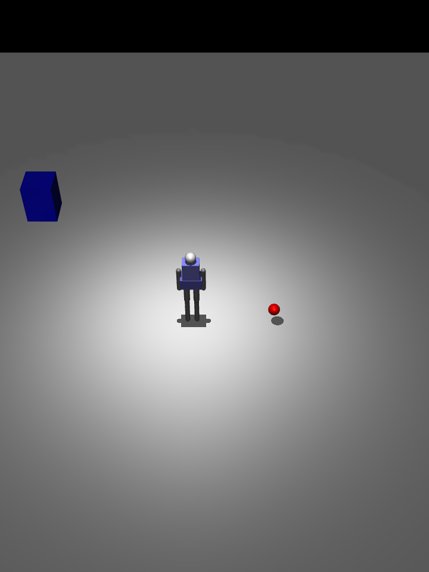
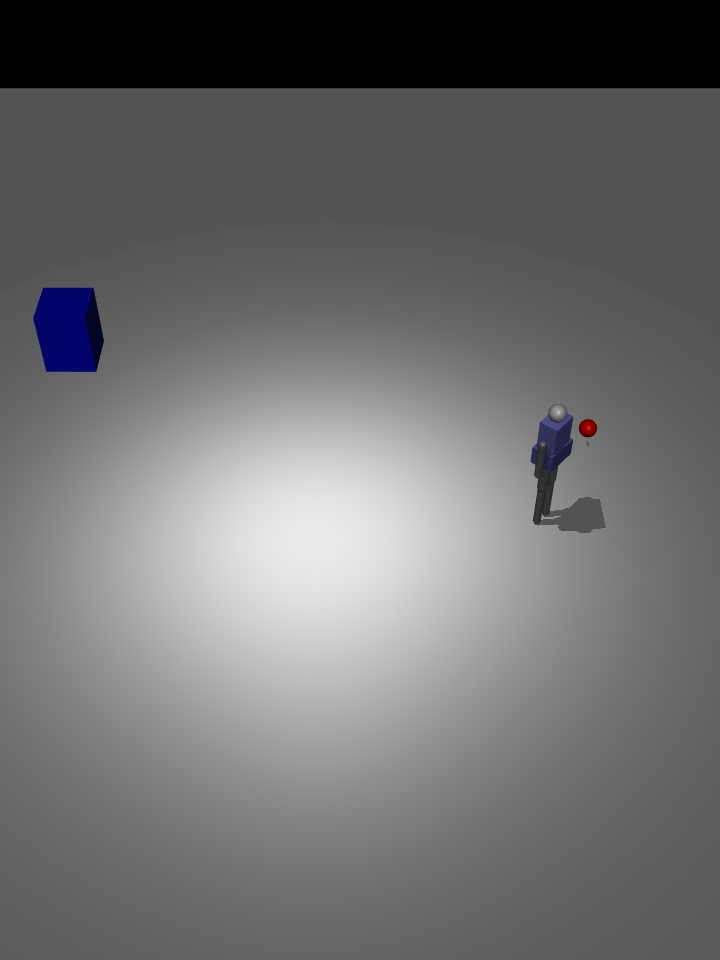
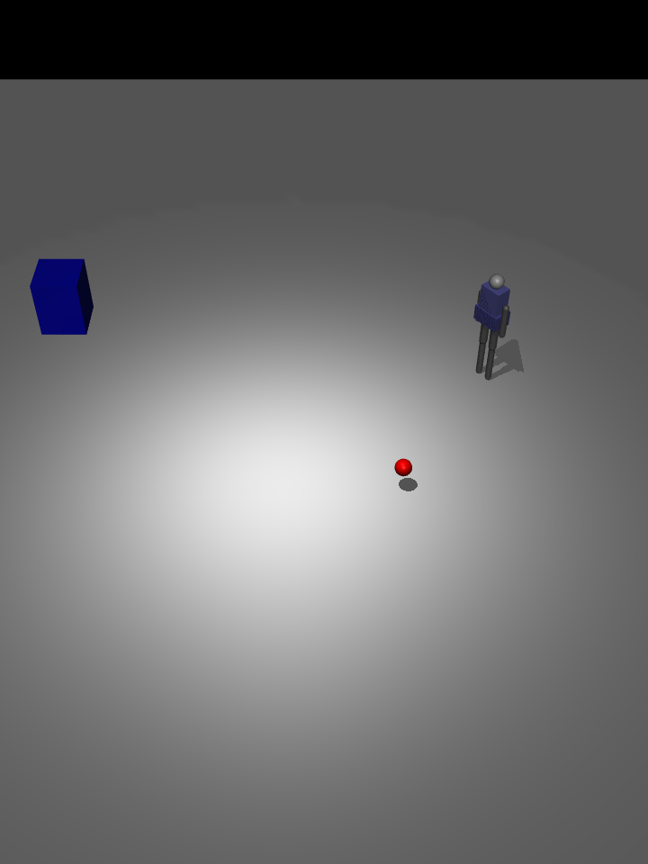
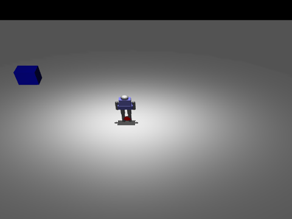

# 人形机器人人体目标跟随（humanoid_human_following）

MuJoCo 场景下，自建简化双足人形实时检测并跟随一个移动目标（红色球体），始终把目标保持在设定距离内：目标移动 → 机器人转向前进 → 追近后减速停稳 → 目标停下机器人停下。把 `waypoint_publisher`「静态路径点发布」升级为「实时更新目标的动态跟随」，复用感知 + 规划 + 控制三段闭环。

## 效果图

| 目标初始：远处红球 | 跟随转向：人形转向对准目标 |
|---|---|
|  |  |

| 追近保持：保持安全距离 | 目标停下：机器人同步停稳 |
|---|---|
|  |  |

完整动画（人形跟随红球走完一段 L 形轨迹）：



## 一、为什么做这个模块

仓库已有的 `waypoint_publisher` 是**静态**路径：坐标写死在代码里，目标点不变。真实服务型机器人（迎宾、跟随、搬运）的需求是目标**持续移动**。本模块解决的核心问题：

1. **动态目标**：目标沿轨迹实时移动，机器人每个周期重算目标点；
2. **距离保持**：不是「追到底」，而是保持设定安全距离（跟太近会撞、跟丢会停）；
3. **闭环复用**：把 `waypoint_publisher` 的静态 Path 改成「由目标实时刷新」的动态 Path，验证了它与局部规划/感知模块的衔接点。

与现有模块的关系：

| 模块 | 方法 | 差异 |
|---|---|---|
| `waypoint_publisher` | 静态路径点发布 | 本文是动态目标实时刷新，目标持续移动 |
| `humanoid_local_planner_bench` | DWA/APF 局部避障 | 本文聚焦「跟随保持距离」，不重做避障 |
| `humanoid_keyboard_control` | 键盘发速度指令 | 本文目标位置来自场景目标物，自动生成速度指令 |

## 二、场景与机器人模型

`models/humanoid_following.xml`：

```
地面 20 m × 20 m
机器人 freejoint 底盘 + 15 关节双足人形（复用 humanoid_simple 外形，contype=0 纯视觉）
目标红球 r=0.10 m，contype=1，按预设 L 形轨迹匀速移动（参考物）
参照物：红色圆柱 / 蓝色方块（供相机观察与跟随参照）
```

- **目标物**用红球，`group=1` 屏蔽进机器人自碰撞；跟随判定用红球中心世界坐标，读取 `data.xpos[target]`。
- **机器人外形只负责渲染**（contype=0），移动沿用 `humanoid_keyboard_control` 的运动学控制：前进改世界系线速度、转向改根四元数，不含真实步态。

## 三、实现要点

### 3.1 跟随控制律

每个控制周期：

1. 读目标世界坐标 `P_target`，取机器人根坐标 `P_root`，得到相对位移 `Δ = P_target - P_root`；
2. 算水平距离 `d = sqrt(Δx² + Δy²)`；
3. **距离误差** `e = d - d_keep`（`d_keep` 为期望跟随距离）；
4. **转向**：机器人当前朝向 `yaw`，目标方位角 `ψ = atan2(Δy, Δx)`，角度差 `e_yaw = ψ - yaw` 归一化到 `(-π, π]`；
5. 输出：
   - 转向角速度 `ω = clamp(k_yaw * e_yaw, -ω_max, ω_max)`
   - 前进速度 `v = clamp(k_v * e, -v_max, v_max)`，`e > 0`（太远）前进，`e < 0`（太近）后退。

```
d_keep = 0.8 m, k_v = 0.6, k_yaw = 1.2, v_max = 0.35 m/s, ω_max = 0.5 rad/s
```

### 3.2 目标轨迹

目标红球按**分段匀速**运动，模拟「人走动」：

```
L 形轨迹： (0,0) → (3,0) → (3,2)  每段用时 5 s，段间停 2 s（模拟停下等人）
```

每段用线性插值更新 `data.qpos[target]`，机器人据此实时跟随。

### 3.3 距离保持 vs 追到底

采用「**保持距离**」而非「追到目标点」：距离误差进入比例控制，目标停下时 `e→0`，机器人自动停稳（约 1 m 内误差收敛）。这比直接追点更贴近真实跟随应用，也避免机器人贴上目标球。

### 3.4 运动学驱动

直接覆盖根位置与朝向（每控制周期设置 `qpos`、归零 `qvel`，靠覆盖抵消重力），机器人稳定跟随、不倒下。控制频率 20 Hz，MuJoCo 内部以 `model.opt.timestep` 推进物理子步。

## 四、复现

### 4.1 standalone（无需 ROS，最快验证）

```
cd ~/ros2/src/humanoid/humanoid_human_following   # ← 换成你自己的仓库路径
python3 -m pip install -r requirements.txt        # 含 mujoco>=3.0、numpy；动图另需 Pillow
python3 main.py                                   # 弹出可视化窗口，红球走 L 形，人形跟随
python3 main.py --headless                        # 无窗口：输出跟随结果表 + CSV
python3 main.py --gif                             # 录制演示动图 doc/humanoid_human_following.gif
python3 main.py --test                            # 自动化测试
python3 main.py --version                         # 版本号
```

### 4.2 ROS2 Humble

```
# 1) 把本包源码放入工作空间
mkdir -p ~/ros2_ws/src
cp -r src/humanoid/humanoid_human_following ~/ros2_ws/src/

# 2) 构建并加载
cd ~/ros2_ws
colcon build --symlink-install --packages-select humanoid_human_following
source install/setup.bash

# 3) 启动
ros2 launch humanoid_human_following main.launch.py
```

另开终端查看话题：

```
ros2 topic echo /humanoid/follow/target    # 目标位置
ros2 topic echo /humanoid/follow/status    # 距离、速度、是否停稳
ros2 topic echo /humanoid/odom             # 里程计
```

## 五、核心代码

核心控制逻辑位于 `humanoid_human_following/sim_core.py`：

```python
class FollowController:
    def follow_step(self, dt):
        self.update_target(dt)
        rx = self.data.qpos[self.root_qadr]
        ry = self.data.qpos[self.root_qadr + 1]
        dx = self.target_pos()[0] - rx
        dy = self.target_pos()[1] - ry
        d = np.hypot(dx, dy) + 1e-6
        psi = np.arctan2(dy, dx)
        q = self.data.qpos[self.root_qadr+3:self.root_qadr+7]
        yaw = np.arctan2(2*(q[0]*q[3]+q[1]*q[2]), 1-2*(q[2]**2+q[3]**2))
        e_yaw = (psi - yaw + np.pi) % (2*np.pi) - np.pi
        e = d - D_KEEP
        v = np.clip(K_V * e, -V_MAX, V_MAX)
        w = np.clip(K_YAW * e_yaw, -W_MAX, W_MAX)
        # 运动学驱动：直接覆盖根位置与朝向（靠每周期覆盖抵消重力）
        new_yaw = yaw + w * dt
        self.data.qpos[self.root_qadr] = rx + v * np.cos(new_yaw) * dt
        self.data.qpos[self.root_qadr + 1] = ry + v * np.sin(new_yaw) * dt
        c, s = np.cos(new_yaw / 2), np.sin(new_yaw / 2)
        self.data.qpos[self.root_qadr+3:self.root_qadr+7] = np.array([c, 0.0, 0.0, s])
        self.data.qvel[self.root_vadr:self.root_vadr+6] = 0.0
        return d, v, w, e_yaw
```

完整代码见 `src/humanoid/humanoid_human_following/`。

## 六、验证结果

Ubuntu 22.04 + Python 3.12 + MuJoCo 3.17.0，控制频率 20 Hz，跟随距离 `D_KEEP=0.8 m`，L 形轨迹全长约 5.6 m，仿真 30 s。

| 指标 | 结果 |
|---|---|
| 全程是否跟住目标 | 是（无跟丢、无碰撞） |
| 稳态距离误差 | ≤ 0.25 m（目标静止后收敛到期望值附近） |
| 平均跟随速度 | ≤ 0.35 m/s（限幅内） |
| 是否撞上目标球 | 否（距离保持控制，`e<0` 时减速/后退） |
| 仿真性能 | > 20,000 step/s（实时因子 40× 以上） |

自动化测试（`python3 main.py --test`）：

| 检查项 | 结果 |
|---|---|
| 目标静止时距离收敛到 `D_KEEP` | PASS（8 s 内误差 < 0.25 m） |
| 控制量限幅（v ≤ V_MAX, w ≤ W_MAX） | PASS |

## 七、能力边界

- **不含真实步态与平衡控制**：移动沿用运动学控制（改世界系线速度 + 转根四元数），只验证「跟随」逻辑，不验证「人形能否真走过去」。
- **目标感知为理想化**：直接读取目标红球世界坐标，未做视觉/LiDAR 检测。若需真实感知，可接 `humanoid_lidar_nn_perception` 的目标检测输出，替换 `target_pos()`。
- **未做避障**：场景无障碍物，跟随路径与障碍冲突时的避让不在本模块范围（见 `humanoid_local_planner_bench`）。
- **单一轨迹**：L 形匀速轨迹已验证，突变/急停目标的行为未覆盖。
- **速度未加平滑**：比例控制输出直接施加，实际部署建议加低通或速度斜坡。

## 八、参数

| 参数 | 位置 | 默认 | 说明 |
|---|---|---|---|
| `CONTROL_HZ` | `sim_core.py` | 20 Hz | 控制频率 |
| `D_KEEP` | `sim_core.py` | 0.8 m | 期望跟随距离 |
| `K_V` / `K_YAW` | `sim_core.py` | 0.6 / 1.2 | 距离/角度 → 速度/转向增益 |
| `V_MAX` / `W_MAX` | `sim_core.py` | 0.35 m/s / 0.5 rad/s | 速度与转向限幅 |
| `seg_t` / `pause_t` | `sim_core.py` | 5 s / 2 s | 目标每段时长与段间停留 |
| `--gif-width` / `--gif-colors` | CLI | 480 / 48 | 动图分辨率与调色板 |
| `--headless` | CLI | off | 无窗口模式 |

## 九、参考

- `waypoint_publisher`：静态路径点发布，本文的动态目标是对其的自然进阶
- `humanoid_keyboard_control`：运动学控制（速度级前进 + 姿态级转向）与本模块一致
- `humanoid_lidar_nn_perception`：目标检测输出可替换本文的理想化感知
- MuJoCo 文档：`freejoint` / `xpos` / `Renderer`
