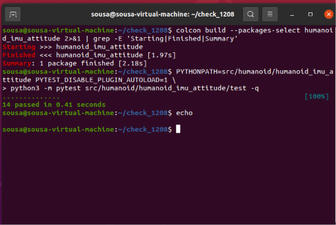
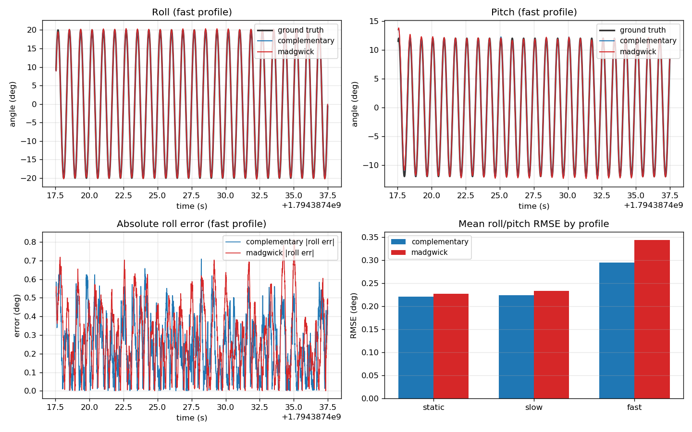

# 人形机器人 IMU 姿态解算：互补滤波与 Madgwick 对比

## 修改概述 / Overview

- 中文：新增 `humanoid_imu_attitude` 模块。用一段可复现的 IMU 仿真数据（含陀螺零偏、
  角速度噪声、加速度计噪声），同时运行互补滤波与 Madgwick 两种姿态解算，按时间对齐
  真值后输出 roll/pitch 的 RMSE、最大误差、p95 与 yaw 漂移，并生成对比图。
- English: A reproducible IMU attitude benchmark for humanoids. Synthetic gyro/accel
  data with bias and noise feeds both a complementary filter and a Madgwick filter;
  the module reports roll/pitch RMSE, max error, p95 and yaw drift against ground truth.

安装、启动、参数与话题接口见
[模块 README](../../src/humanoid/humanoid_imu_attitude/README.md)。

## 为什么做这个对比

人形机器人的平衡控制需要机体姿态，但常见的 6 轴 IMU 没有磁力计，roll/pitch 只能靠
加速度计的重力方向长期校正，yaw 则完全不可观测。互补滤波和 Madgwick 都能完成这件事，
差别在参数含义、计算量和动态跟踪能力上，只看公式很难判断实际误差。本模块把两者放在
同一段数据、同一套指标下比较，便于选型。

与仓库中已有的步态、ZMP、平衡控制模块不同，本模块只关注**姿态估计这一层的误差**，
不涉及动力学仿真和控制器设计。

## 方法

1. `trajectory.py` 定义三条姿态轨迹，角速度由欧拉角解析求导后经 ZYX 变换得到，
   不使用数值差分：
   - `static`：完全静止，用来测纯噪声下的抖动；
   - `slow`：roll/pitch 幅度 8°/4.8°，0.25 Hz；
   - `fast`：roll/pitch 幅度 20°/12°，1.2 Hz，接近行走时的躯干摆动。
2. `imu_sim.py` 以 200 Hz 发布 `sensor_msgs/Imu`：陀螺读数 = 真实角速度 + 固定零偏
   `[0.004, -0.003, 0.005] rad/s` + 高斯噪声 0.002 rad/s；加速度计读数 = 机体系重力
   方向 + 高斯噪声 0.3 m/s²。同时发布真值四元数并写 `*_ground_truth.csv`。
3. `attitude_filter.py` 订阅 `/imu/data`，第一帧只用加速度计确定初始 roll/pitch，
   之后逐帧更新，输出 `/imu/attitude/<method>` 并记录 CSV（含 yaw）。
4. `evaluate.py` 把真值线性插值到估计时刻，误差折算到 [-180°, 180°] 后统计。
   yaw 只统计末段平均漂移，因为无磁力计时它不可观测，不属于精度指标。
5. `run_eval.sh` 依次启动三个场景（每个场景单独起进程，避免节点互相影响），
   最后汇总成一张表和一张图。

两种滤波的核心区别：

- 互补滤波（`alpha=0.98`）：先积分陀螺，再按 `1-alpha` 的比例把估计重力方向旋转到
  加速度计方向，每步校正量与当前角度误差成正比。注意该比例与 `dt` 无关，时间常数约为
  `dt·alpha/(1-alpha)`，因此修改 `rate_hz` 后需要重新整定 `alpha`。
- Madgwick（`beta=0.05`）：把“估计重力 - 实测重力”写成目标函数，取归一化梯度方向，
  每步固定旋转 `beta·dt`。计算量小，但校正速率与误差大小无关。

## 文件结构

| 文件 | 说明 |
|------|------|
| `humanoid_imu_attitude/quat_math.py` | 四元数运算、互补滤波与 Madgwick 单步更新（纯 NumPy，可单测） |
| `humanoid_imu_attitude/trajectory.py` | 三条姿态轨迹与解析角速度 |
| `humanoid_imu_attitude/imu_sim.py` | 带零偏/噪声的 IMU 仿真与真值输出 |
| `humanoid_imu_attitude/attitude_filter.py` | 姿态滤波器节点，方法由参数选择 |
| `humanoid_imu_attitude/evaluate.py` | 误差统计、CSV 汇总、对比图、单步耗时 |
| `launch/main.launch.py` | 一次启动仿真 + 两个滤波器 |
| `run_eval.sh` | 三个场景连续评测 |
| `test/` | 四元数恒等式、轨迹一致性、两滤波器收敛性共 14 个用例 |

话题与参数：

| 接口 | 说明 |
|------|------|
| `/imu/data` | 仿真 IMU（`sensor_msgs/Imu`，orientation 不可用，协方差首项为 -1） |
| `/imu/ground_truth` | 真实姿态（`geometry_msgs/QuaternionStamped`） |
| `/imu/attitude/complementary` | 互补滤波估计姿态 |
| `/imu/attitude/madgwick` | Madgwick 估计姿态 |
| `profile` / `duration` / `rate_hz` / `out_dir` | 场景、时长、频率、CSV 目录 |
| `alpha` / `beta` | 两种滤波各自的增益 |

## 运行环境与命令

Ubuntu 20.04 + ROS 2 Foxy，Python 3.8，依赖 NumPy 与 Matplotlib（均已随系统安装）。
脚本需在包目录下执行，否则 `results/` 会落到当前工作目录：

```bash
colcon build --packages-select humanoid_imu_attitude
source install/setup.bash
cd src/humanoid/humanoid_imu_attitude
DURATION=20 ./run_eval.sh
```

单场景也可以直接用 launch：

```
ros2 launch humanoid_imu_attitude main.launch.py \
  profile:=fast duration:=20 out_dir:=results
```

## 运行效果

编译与 14 个单元测试用例（`colcon test-result` 全绿）：



三个场景各 20 s、200 Hz 的实测结果（`fast` 场景曲线、误差与 RMSE 对比）：



## 实测结果

数据来自本机一次完整运行（`DURATION=20`，200 Hz，每场景约 4000 个样本）：

| 场景 | 方法 | roll RMSE (°) | pitch RMSE (°) | 最大误差 (°) | p95 (°) | yaw 末段漂移 (°) |
|------|------|---------------|----------------|--------------|---------|------------------|
| static | complementary | 0.18 | 0.27 | 1.60 | 0.41 | 5.1 |
| static | madgwick | 0.18 | 0.28 | 1.60 | 0.38 | 5.1 |
| slow | complementary | 0.18 | 0.27 | 1.71 | 0.42 | 4.9 |
| slow | madgwick | 0.18 | 0.29 | 1.71 | 0.39 | 4.9 |
| fast | complementary | 0.28 | 0.31 | 1.92 | 0.53 | 3.2 |
| fast | madgwick | 0.34 | 0.35 | 1.94 | 0.61 | 3.2 |

单步耗时（纯算法，5 万次平均，不含 ROS 通信与日志；虚拟机负载不同时抖动较大）：

| 方法 | 单步耗时 |
|------|----------|
| complementary | 约 50 µs |
| madgwick | 约 16 µs |

## 结论与限制

- 在本组噪声水平下，两种滤波的 roll/pitch RMSE 都在 0.35° 以内，属同一量级；
  动态场景下互补滤波略好（`fast` 场景平均 RMSE 低约 14%），Madgwick 的固定步长校正
  在误差很小时仍会按 `beta·dt` 转动，噪声下的抖动略大。
- Madgwick 单步计算量约为互补滤波的 1/3，但两者都远小于 200 Hz 的 5 ms 周期，
  在本场景中都不构成瓶颈，选型应优先看参数可解释性而不是耗时。
- yaw 末段漂移约 5°，与 z 轴零偏 0.005 rad/s × 20 s ≈ 5.7° 吻合：没有磁力计时
  yaw 完全依赖陀螺积分，两种滤波都无法抑制这部分漂移，这也是本模块不把 yaw 计入
  精度指标的原因。
- 数据来自本模块的合成 IMU，噪声模型为高斯白噪声加常值零偏，未覆盖真实的温漂、
  振动和磁干扰；结论只说明两种算法在本模型下的相对表现，不能代替实机标定。
- 所有节点跑在同一台虚拟机上，未评估真实 DDS 网络下的时钟偏差影响。

## 复现与验证

```
# 单元测试（全部通过后再提交）
colcon test --packages-select humanoid_imu_attitude
colcon test-result --verbose

# 只看算法单步耗时
ros2 run humanoid_imu_attitude attitude_eval --bench

# 重新汇总已有 CSV（不重新采集）
ros2 run humanoid_imu_attitude attitude_eval --results results --figure results/effect.png
```
