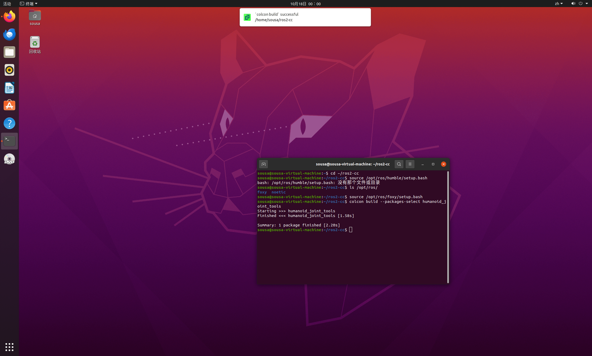
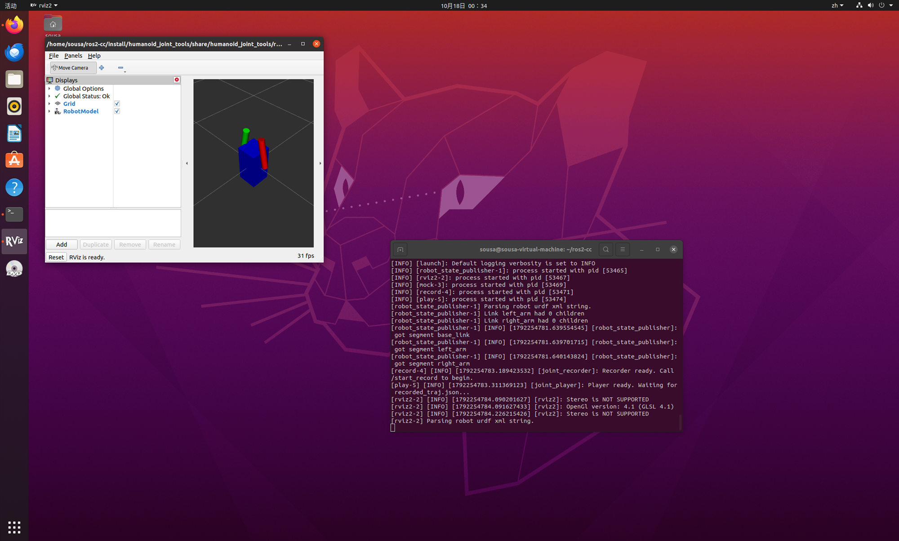
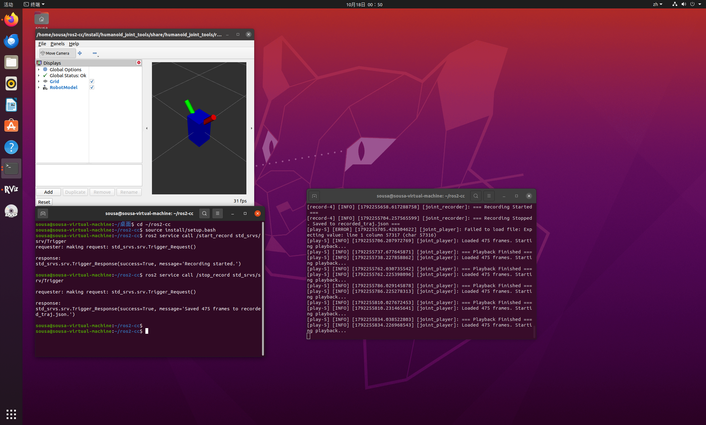
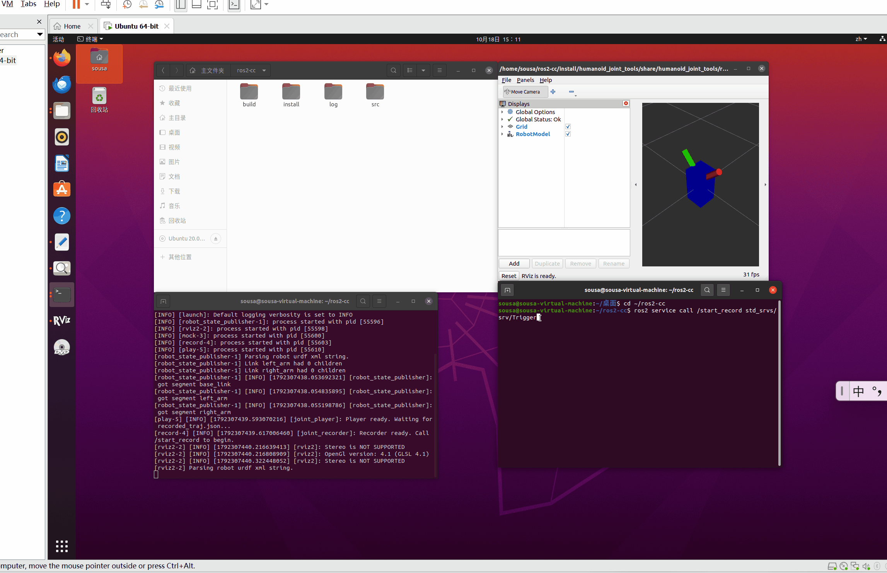

# humanoid_joint_tools 使用说明
人形机器人关节轨迹录制与回放工具（ROS 2 功能包）

## 修改概述 / Overview

- 中文：新增人形机器人关节轨迹录制与回放工具。该模块包含假数据发生器、录制节点和回放节点。通过发送 Trigger 服务指令，可实时录制 `/joint_states` 数据并保存为 JSON 文件；回放节点读取 JSON 后重新发布，驱动 RViz 中的机器人模型完美复现动作。
- English: Add humanoid joint trajectory recorder and player tool. It includes a mock driver, a recorder, and a player. Users can record `/joint_states` to a JSON file via Trigger services and replay the trajectory to drive the URDF model in RViz2.

## 运行环境
- 操作系统：Ubuntu 20.04
- ROS 版本：ROS 2 Foxy
- 依赖库：Python 3.8, `sensor_msgs`, `std_srvs`, `rviz2`

## 核心代码文件

本模块包含以下核心文件，均已提交至仓库：

```text
src/
└── humanoid/
    └── humanoid_joint_tools/
        ├── launch/
        │   └── main.launch.py                 # 节点一键启动文件
        ├── resource/
        │   └── humanoid_joint_tools           # resource 资源标识文件
        ├── humanoid_joint_tools/              # 核心代码子目录
        │   ├── __init__.py                    # Python 包初始化文件
        │   ├── mock.py                        # 假数据发生器（正弦波轨迹）
        │   ├── record.py                      # 录制节点（保存为 JSON）
        │   └── play.py                        # 回放节点（读取并重发）
        ├── urdf/
        │   └── simple_humanoid.urdf           # 演示用极简人形机器人模型
        ├── rviz/
        │   └── demo.rviz                      # RViz 配置文件
        ├── package.xml                        # ROS 2 功能包描述文件
        ├── setup.cfg                          # 节点安装路径配置文件
        └── setup.py                           # ROS 2 功能包配置文件
```
## 核心代码内容

本模块的核心代码已上传至仓库 `src/humanoid/humanoid_joint_tools/` 目录下。

完整代码请点击下方链接查看：

* [查看 mock.py 代码](../../src/humanoid/humanoid_joint_tools/humanoid_joint_tools/mock.py)
* [查看 record.py 代码](../../src/humanoid/humanoid_joint_tools/humanoid_joint_tools/record.py)
* [查看 play.py 代码](../../src/humanoid/humanoid_joint_tools/humanoid_joint_tools/play.py)
* [查看 main.launch.py 代码](../../src/humanoid/humanoid_joint_tools/launch/main.launch.py)
* [查看 setup.py 代码](../../src/humanoid/humanoid_joint_tools/setup.py)

## 功能说明 / Boundary behavior

· 中文：录制节点通过 ROS 2 Service (std_srvs/Trigger) 控制起止。启动录制后，缓存 /joint_states 数据；停止录制时，将数据序列化写入本地 recorded_traj.json 文件。回放节点会自动监听该文件，一旦生成即刻读取，并以 20Hz 的频率重新发布，实现动作的无缝回放。
· English: The recorder uses ROS 2 Services (std_srvs/Trigger) to start and stop recording. It caches /joint_states and saves them to recorded_traj.json. The player automatically monitors this file, reads it, and republishes the data at 20Hz to seamlessly replay the motion.

## 启动步骤

1. 进入 ROS2 工作空间
   ```bash
   cd ~/ros2-cc
   ```
2. 编译功能包
   ```bash
   colcon build --packages-select humanoid_joint_tools
   source install/setup.bash
   ```
3. 使用 launch 文件一键启动（启动模型、RViz、假数据及录制/回放节点）
   ```bash
   ros2 launch humanoid_joint_tools main.launch.py
   ```
4. 新开一个终端窗口，同样进入工作空间并加载环境，发送录制指令
   ```bash
   cd ~/ros2-cc
   source install/setup.bash
   
   # 开始录制
   ros2 service call /start_record std_srvs/srv/Trigger
   ```
5. 等待几秒后，发送停止录制指令（此时会自动生成 json 并触发回放）
   ```bash
   ros2 service call /stop_record std_srvs/srv/Trigger
   ```

## 运行效果

节点启动后，RViz 将显示机器人模型。执行开始/停止录制指令后，终端会打印保存成功信息，且模型会自动回放刚录制的动作。

1. **编译成功**
   
2. **启动节点与 RViz 可视化**
   
3. **录制保存成功并触发回放**
   
4. **完整操作流程演示动图**
   

```
