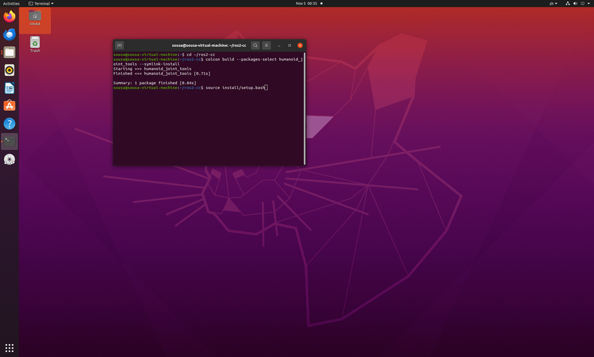
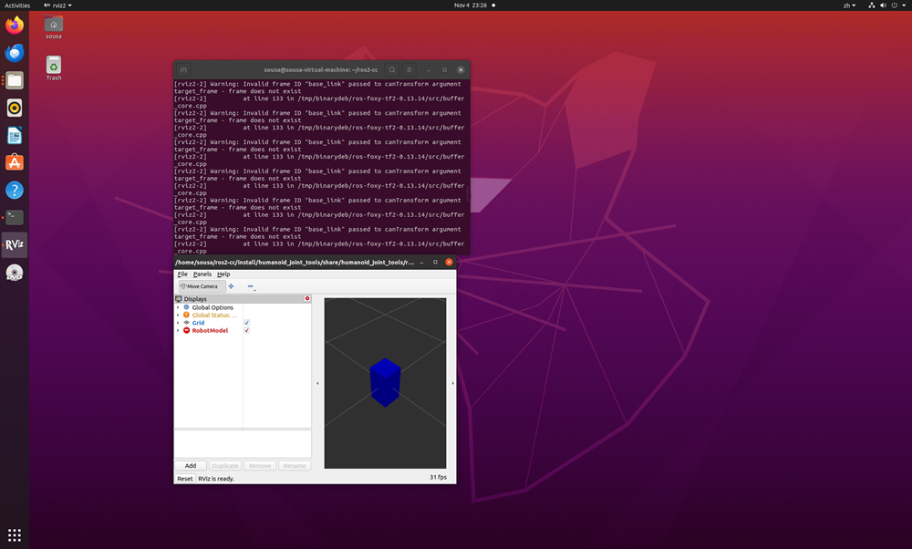
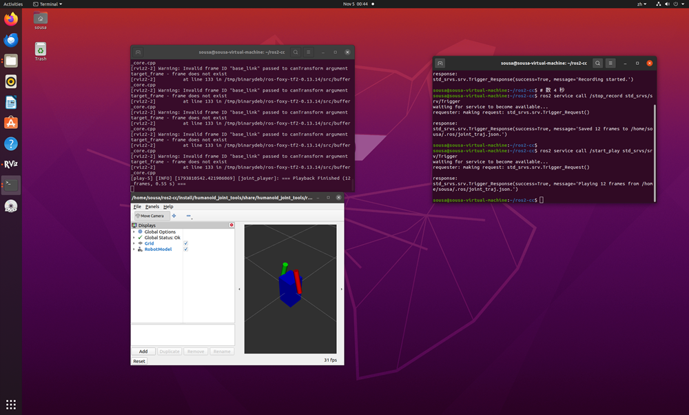
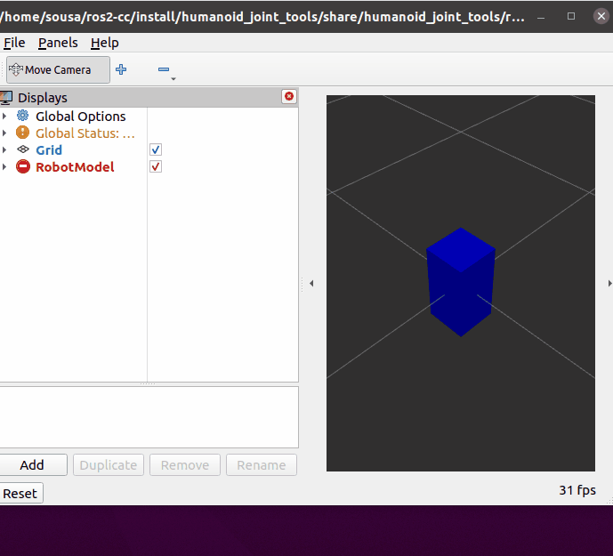

# humanoid_joint_tools 使用说明
人形机器人关节轨迹录制与回放工具（ROS 2 功能包）

## 修改概述 / Overview

- 中文：新增人形机器人关节轨迹录制与回放工具。该模块包含假数据发生器、录制节点和回放节点。通过发送 Trigger 服务指令，可实时录制 `/joint_states_raw` 数据并保存为 JSON 文件；回放节点读取 JSON 后按录制时间戳重新发布到 `/joint_states`，驱动 RViz 中的机器人模型复现动作。回放播完即止，不循环。
  
- English: Add humanoid joint trajectory recorder and player tool. It includes a mock driver, a recorder, and a player. Users can record `/joint_states_raw` to a JSON file via Trigger services, then replay the trajectory (published to `/joint_states` with original timestamps) to drive the URDF model in RViz2. Playback runs once and stops.

## 运行环境
- 操作系统：Ubuntu 20.04
- ROS 版本：ROS 2 Foxy
- 依赖库：Python 3.8, `sensor_msgs`, `std_srvs`, `launch`, `launch_ros`, `rviz2`

## 核心代码文件

本模块包含以下核心文件，均已提交至仓库：

```
src/
└── humanoid/
    └── humanoid_joint_tools/
        ├── launch/
        │   └── main.launch.py                 # 节点一键启动文件
        ├── resource/
        │   └── humanoid_joint_tools           # resource 资源标识文件
        ├── humanoid_joint_tools/              # 核心代码子目录
        │   ├── __init__.py                    # Python 包初始化文件
        │   ├── mock.py                        # 假数据发生器（正弦波轨迹）
        │   ├── record.py                      # 录制节点（保存为 JSON）
        │   └── play.py                        # 回放节点（读取并重发）
        ├── test/                              # 单元测试
        │   ├── __init__.py
        │   └── test_joint_recorder.py         # 录制节点测试
        ├── urdf/
        │   └── simple_humanoid.urdf           # 演示用极简人形机器人模型
        ├── rviz/
        │   └── demo.rviz                      # RViz 配置文件
        ├── package.xml                        # ROS 2 功能包描述文件
        ├── setup.cfg                          # 节点安装路径配置文件
        └── setup.py                           # ROS 2 功能包配置文件
```
## 核心代码内容

本模块的核心代码已上传至仓库 `src/humanoid/humanoid_joint_tools/` 目录下。

完整代码请点击下方链接查看：

* [查看 mock.py 代码](../../src/humanoid/humanoid_joint_tools/humanoid_joint_tools/mock.py)
* [查看 record.py 代码](../../src/humanoid/humanoid_joint_tools/humanoid_joint_tools/record.py)
* [查看 play.py 代码](../../src/humanoid/humanoid_joint_tools/humanoid_joint_tools/play.py)
* [查看 main.launch.py 代码](../../src/humanoid/humanoid_joint_tools/launch/main.launch.py)
* [查看 setup.py 代码](../../src/humanoid/humanoid_joint_tools/setup.py)
* [查看 test_joint_recorder.py 代码](../../src/humanoid/humanoid_joint_tools/test/test_joint_recorder.py)

## 功能说明 / Boundary behavior

- 中文：录制节点通过 ROS 2 Service (std_srvs/Trigger) 控制起止。启动录制后，缓存 `/joint_states_raw` 数据；停止录制时，将数据序列化写入 `~/.ros/joint_traj.json`。回放节点提供 `/start_play` 服务，或在 `auto_play:=true` 时检测到新文件后自动回放一次；回放按录制帧的时间戳调度发布，播完最后一帧即停止，不循环。

- English: The recorder uses ROS 2 Services (std_srvs/Trigger) to start and stop recording. It caches `/joint_states_raw` and saves them to `~/.ros/joint_traj.json`. The player exposes a `/start_play` service (or auto-replays once when a new file is detected with `auto_play:=true`). Playback is scheduled by recorded frame timestamps and stops after the last frame, with no looping.

## 启动步骤

1. 进入 ROS2 工作空间
   ```
   cd <你的 ROS 2 工作空间>
   ```
2. 编译功能包
   ```
   colcon build --packages-select humanoid_joint_tools
   source install/setup.bash
   ```
3. 使用 launch 文件一键启动（启动模型、RViz、假数据及录制/回放节点）
   ```
   ros2 launch humanoid_joint_tools main.launch.py
   ```
4. 新开一个终端窗口，同样进入工作空间并加载环境，发送录制指令
   ```
   cd <你的 ROS 2 工作空间>
   source install/setup.bash
   
   # 开始录制
   ros2 service call /start_record std_srvs/srv/Trigger
   ```
5. 等待几秒后，发送停止录制指令（此时会生成 json 文件）
   ```
   ros2 service call /stop_record std_srvs/srv/Trigger
  
6. 发送回放指令，模型按录制轨迹动作一次后停止
  

## 运行效果

节点启动后，RViz 将显示机器人模型。执行开始/停止录制指令后，终端会打印保存成功信息；随后调用 `/start_play` 服务（或启动时加 `auto_play:=true`），模型即按录制轨迹回放一次，播完停止。

1. **编译成功**
   
2. **启动节点与 RViz 可视化**
   
3. **录制保存成功并回放**
   
4. **完整操作流程演示动图**
   


