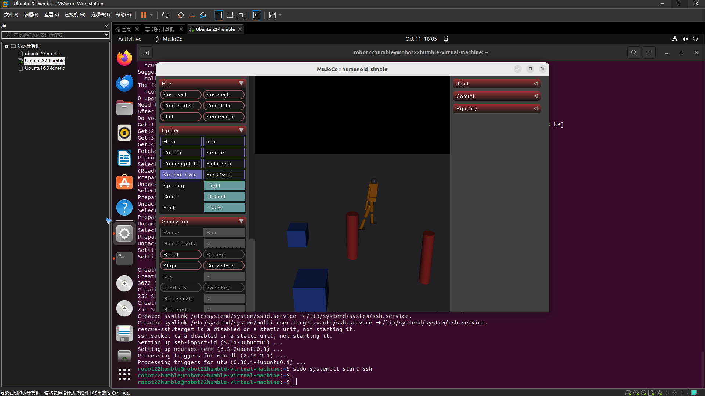

# 人形机器人键盘运动控制（humanoid_keyboard_control）

任务①「人形机器人物理仿真 + 键盘运动控制」的 MuJoCo 实现：自建简化双足人形 MJCF 模型，
在 MuJoCo 物理引擎中实时仿真，终端键盘发布速度指令，人形机器人按指令前进/后退/转向，
并发布里程计与关节状态话题。

## 1. 运行架构

```text
终端按键 ──► keyboard_teleop_node ──/cmd_vel──► mujoco_sim_node ──► MuJoCo 物理引擎
             (raw 模式读键)        (Twist 指令)   (站姿PD+运动控制)    (人形机器人)
                                     │
                                     └─► /humanoid/odom · /joint_states · /tf
```

## 2. 按键映射

| 按键 | 动作 | 指令分量 |
|---|---|---|
| `W` / `S` | 前进 / 后退 | `linear.x = ±0.3` m/s |
| `A` / `D` | 左转 / 右转 | `angular.z = ±0.4` rad/s |
| `空格` | 急停 | 全零 |
| `ESC` | 退出 | — |
| 松开按键 | 停止 | 全零 |

## 3. 依赖安装与运行

### 3.1 环境与依赖安装

```shell
# 1) 安装 ROS2 Humble（Ubuntu 22.04）：
#    参考官方文档 https://docs.ros.org/en/humble/Installation/Ubuntu-Install-Debs.html

# 2) 安装 Python 依赖（在**仓库根目录**执行；mujoco / numpy，录制 GIF 另需 imageio）
pip3 install -r src/humanoid/humanoid_keyboard_control/requirements.txt

# 3) 可视化窗口依赖（仅 Linux 桌面需要；若提示缺少 GLFW 再执行）
sudo apt install -y libglfw3
```

ROS 依赖（`rclpy`、`geometry_msgs`、`nav_msgs`、`sensor_msgs`、`tf2_ros`、
`ros2launch`）在 `colcon build` 时自动解析，无需手动安装。

### 3.2 源码放入工作空间与构建

```shell
# 1) 创建工作空间，并把本包源码放入 src/（也可直接 git clone 本仓库到 src/）
mkdir -p ~/ros2_ws/src
cp -r src/humanoid/humanoid_keyboard_control ~/ros2_ws/src/

# 2) 构建并加载环境
cd ~/ros2_ws
colcon build --symlink-install --packages-select humanoid_keyboard_control
source install/setup.bash
```

> 注意：执行完本节后当前目录是 `~/ros2_ws`，而本包被拷贝到
> `~/ros2_ws/src/humanoid_keyboard_control`（**不含 `humanoid/` 这一层**），
> 因此下一节不能用 `cd src/humanoid/...` 这种相对路径。

### 3.3 standalone（无需 ROS，最快验证）

standalone 模式**不依赖 ROS，也不要求先执行 `colcon build`**，直接用克隆下来的源码
即可运行。下面的路径以「仓库克隆在 `~/ros2`」为例，**请替换成你自己的实际路径**：

```shell
cd ~/ros2/src/humanoid/humanoid_keyboard_control   # ← 换成你自己的仓库路径
python3 main.py            # 交互：W/S 前进后退，A/D 转向（弹出可视化窗口）
python3 main.py --demo     # 自动演示动作序列，录制 GIF
python3 main.py --test     # 自动化测试
```

若想运行 3.2 节拷贝到工作空间的那一份，路径是 `~/ros2_ws/src/humanoid_keyboard_control`
（注意没有 `humanoid/` 这一层）：

```shell
cd ~/ros2_ws/src/humanoid_keyboard_control
python3 main.py
```

### 3.4 ROS2 Humble launch

```shell
cd ~/ros2_ws
colcon build --symlink-install --packages-select humanoid_keyboard_control
source install/setup.bash
ros2 launch humanoid_keyboard_control main.launch.py
```

焦点保持在启动终端，按 `W/S/A/D` 操控，松开即停，`ESC` 退出。
另开终端可查看状态：

```shell
ros2 topic echo /humanoid/odom
ros2 topic echo /joint_states
ros2 run tf2_ros tf2_echo world humanoid/base_link   # 验证 TF 可读取
```

### 3.5 可视化窗口（看到人形机器人界面）

交互模式 `python3 main.py` 与 `ros2 launch` **默认都会弹出 MuJoCo 可视化窗口**，
窗口内可实时看到自建双足人形机器人在场景中站立、前进与转向，视角自动跟踪躯干。

| 运行环境 | 能否看到窗口 | 说明 |
|---|---|---|
| 本机 Ubuntu 桌面 / 虚拟机桌面终端 | ✅ | 直接运行即可看到人形机器人界面 |
| SSH 远程登录 | 需 X11 转发 | 用 `ssh -X user@host` 登录，或先 `export DISPLAY=:0` 再运行 |
| 无显示服务器（纯命令行 / CI） | ❌ | 用下面的开关关闭窗口，仅输出命令行信息 |

```shell
# standalone
python3 main.py                     # 默认打开可视化窗口
python3 main.py --no-viewer         # 无图形环境：仅命令行输出

# ROS2 launch
ros2 launch humanoid_keyboard_control main.launch.py                    # 默认打开窗口
ros2 launch humanoid_keyboard_control main.launch.py visualize:=false   # 关闭窗口
```

若当前环境没有图形界面，程序会打印提示并自动退化为无窗口模式，
**物理仿真、话题发布与自动化测试均不受影响**。

## 4. 实现要点

### 4.1 自建人形模型（models/humanoid_simple.xml）

模型采用 **freejoint 底盘 + 15 关节双足人形**：髋（roll/pitch）×2、膝 ×2、踝（pitch/roll）×2、
肩 ×2、肘 ×2、颈 ×1，全部由 `motor` 驱动；头部带前视相机，场景中放置红色圆柱与蓝色方块
作为参照物（供移动演示与相机观察）。为双足侧向平衡，髋/踝 roll 关节单独加强增益。

### 4.2 站姿 PD 控制

每个关节的驱动力矩为比例-微分（PD）控制，目标姿态为直立位（全 0）：

\[
\tau_i = k_p (0 - q_i) - k_d \dot{q}_i,\qquad
i \in \{\text{髋/膝/踝/肩/肘/颈}\}
\]

其中 `kp=120`、`kd=6`；髋/踝 roll 关节取 `kp_roll=400` 抗侧倾。
力矩限幅 `±250 N·m`。实测 4 s 站立质心零漂移（根高 1.08 m，仿真 2.6 万 step/s）。

### 4.3 运动控制：速度级前进 + 姿态级转向

**前进/后退（速度级）**：指令速度按底盘当前偏航角分解为世界系 `vx/vy`，
使"前进"始终沿机器人当前朝向（而非固定世界系 +x），位移满足 `Δs ≈ v·t`：

```python
yaw = 底盘当前偏航角
data.qvel[root_dadr]     = v_lin * cos(yaw)   # 世界系 vx
data.qvel[root_dadr + 1] = v_lin * sin(yaw)   # 世界系 vy
```

**转向（姿态级）**：双足原地旋转时脚底与地面滑动摩擦会产生持续侧倾力矩，
是双足站立的固有物理问题（真实机器人靠步态解决）。这里采用姿态级控制——
每步对底盘四元数绕自身 z 轴做微小旋转，并清零角速度，避免摩擦滑移失稳：

```python
d = w * dt                            # 单步转角
q = data.qpos[root_qadr+3:root_qadr+7]   # 底盘四元数 (w,x,y,z)
# new_q = q ⊗ dq，dq = (cos(d/2), 0, 0, sin(d/2))，四元数乘法更新
```

实测转向角严格满足 `Δψ ≈ w·t`（w=0.5 rad/s 转 2 s → 57.3°，全程站立）。

### 4.4 终端 raw 模式与松开即停

键盘节点用 `termios`/`tty` 进入 raw 模式单键即时响应（launch 下优先打开 `/dev/tty`），
以 30 Hz 持续发布；松开按键即发布全零速度，防止机器人失控。
仿真节点对 `/cmd_vel` 设有 **0.5 s 指令超时**：超过该时间未收到新指令则自动停车；
键盘节点退出前也会主动发布零速度，避免遥控停止后仿真继续执行最后一条非零指令。

### 4.5 模型能力边界（重要）

本模块的移动控制为 **演示级运动学控制**：

- 前进/后退通过直接改写底盘 freejoint 的世界系线速度实现；
- 转向通过直接旋转根部四元数实现；
- **不包含双足步态生成**（无摆动腿 / 支撑相、摆动相规划）。

因此：

- `位移 ≈ v·t`、`转角 ≈ w·t` 的实测指标只验证 **指令执行准确性**（运动学层面）；
- 站姿 PD 测试（质心漂移、根高保持）只验证 **静态站立的物理稳定性**；
- 二者均 **不能证明真实步行控制或动力学准确性**（步态稳定性、动态平衡、
  地面反作用力等不在本模块验证范围内）。

## 5. 效果图

自动演示（前进 → 右转 → 前进 → 左转回正 → 后退，场景第三视角），关键帧截图如下：

关键帧截图（初始站姿 / 前进 / 转向 / 结束状态）：

| 初始站姿 | 前进中 | 转向后 | 结束状态 |
|---|---|---|---|
|  |  |  |  |

## 6. 验证结果

### 6.1 指令执行准确性（演示级运动学控制）

自动化测试（`test/test_standalone.py`）实测：

| 指标 | 结果 |
|---|---|
| 前进驱动（1.5 s @ 0.3 m/s） | 位移 0.446 m（理论 0.450 m，误差 0.9%） |
| 转向（2 s @ 0.5 rad/s） | 转角 57.3°（理论 57.3°） |

> 注：以上指标只验证指令执行准确性（运动学层面），不代表真实步行控制
> 或动力学准确性（见 4.5 模型能力边界）。

### 6.2 物理稳定性（静态站姿）

| 指标 | 结果 |
|---|---|
| 站姿稳定性（4 s） | 质心位移 ≈ 0，根高 1.084 m |
| 前视相机渲染 | 640×480 RGB 可用 |
| 仿真性能 | 26,294 step/s（实时因子 52.6×） |

## 7. 参考

* [rov_mujoco 水下机器人模块](../water/rov_mujoco.md)：本包 ROS2 包结构惯例参考
* [MuJoCo 文档：freejoint / motor / Renderer](https://mujoco.readthedocs.io/en/stable/XMLreference.html)
