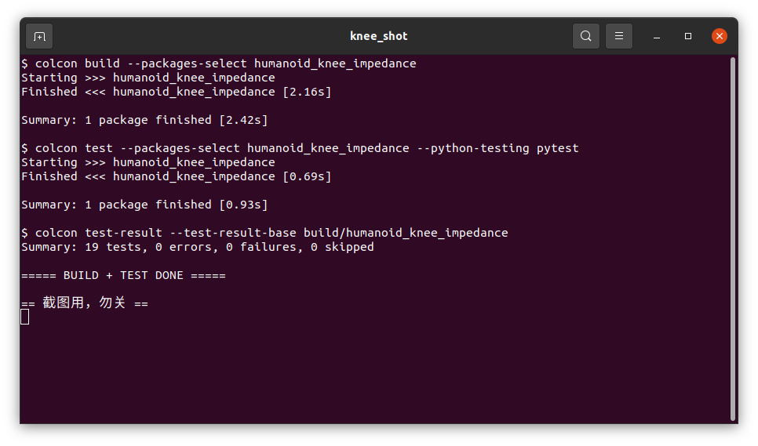
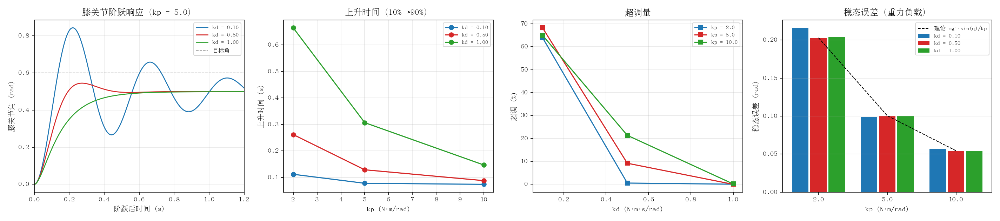

# 人形机器人膝关节阻抗参数整定

本文研究刚度与阻尼对膝关节阶跃响应的影响。

把简化双足人形机器人固定在台架上，只让膝关节由阻抗律
`τ = kp·(q_des − q) − kd·q̇` 驱动，对目标膝角施加一次阶跃，扫描刚度 `kp`
与阻尼 `kd`，量出它们对**上升时间、超调、调节时间、稳态误差、峰值力矩**的影响，
并与等效二阶系统的 `ω_n = √(kp/J)`、`ζ = kd / (2√(kp·J))` 对照。

## 原理简述

- 台架化：`useFixedBase=True` 固定底座，髋与踝用位置控制锁死，只有膝关节受
  阻抗律控制。这样阶跃响应只反映膝关节阻抗，不被脚地接触、整机离地等因素污染。
- 阻抗律：`τ = kp·(q_des − q) − kd·q̇`，按 8 N·m 上限截断；输入含 NaN/Inf 时
  输出 0，避免非法读数被放大。
- 阶跃：前 0.3 s 保持 `hold_angle`，之后目标角跳到 `step_target`，仿真 2 s，
  1 kHz 采样。
- 采样话题 `/knee_sample`：`[t, q, qd, τ, q_des]`；全分辨率数据同时由仿真节点
  直接写 CSV，指标计算不依赖话题传输。
- 等价参数（由 URDF 质量分布直接算出，不是拟合）：膝下连杆
  `J = 0.0296 kg·m²`，重力矩系数 `mgl = 1.05 N·m`。

## 运行结果

编译与 19 项单元测试（`colcon test-result` 全绿）：



kp × kd 网格扫描的实测结果（四联图：阶跃响应、上升时间、超调、稳态误差）：



| kp | kd | ζ | 上升时间 (s) | 超调 (%) | 调节时间 (s) | 稳态误差 (rad) | 峰值力矩 (N·m) |
| --- | --- | --- | --- | --- | --- | --- | --- |
| 2.0 | 0.10 | 0.21 | 0.115 | 58.8 | 2.242 | 0.203 | 1.20 |
| 2.0 | 0.50 | 1.03 | 0.262 | 0.6 | 0.412 | 0.203 | 1.20 |
| 2.0 | 1.00 | 2.05 | 0.671 | 0.0 | 1.220 | 0.203 | 1.20 |
| 5.0 | 0.10 | 0.13 | 0.078 | 68.9 | 2.235 | 0.101 | 3.00 |
| 5.0 | 0.50 | 0.65 | 0.129 | 9.2 | 0.412 | 0.101 | 3.00 |
| 5.0 | 1.00 | 1.30 | 0.307 | 0.0 | 0.557 | 0.101 | 3.00 |
| 10.0 | 0.10 | 0.09 | 0.074 | 64.3 | 2.139 | 0.054 | 6.00 |
| 10.0 | 0.50 | 0.46 | 0.088 | 21.4 | 0.430 | 0.054 | 6.00 |
| 10.0 | 1.00 | 0.92 | 0.147 | 0.2 | 0.236 | 0.054 | 6.00 |

结论：

- **kp 决定速度**：`ω_n ∝ √kp`，kd=0.1 时 kp 从 2 提到 10，上升时间
  0.115 s → 0.074 s。
- **kd 抑制超调，过量则变慢**：kp=2 时 kd 从 0.5（ζ=1.03）加到 1.0（ζ=2.05），
  超调归零，调节时间反而从 0.412 s 拉到 1.220 s。
- **稳态误差只由 kp 决定，与 kd 无关**：每个 kp 下三档 kd 的稳态误差完全相同
  （0.203 / 0.101 / 0.054），与 `mgl·sin(q_ss)/kp` 预测
  （0.203 / 0.099 / 0.054）吻合。稳态时 `q̇ = 0`，阻尼项不贡献力矩，纯 PD
  消不掉这项误差，需加重力前馈。
- **峰值力矩等于 `kp·Δq`**（1.2 / 3.0 / 6.0 N·m），三档均未触及 8 N·m 限幅，
  因此表中反映的是线性阻抗特性，而不是被限幅抹平后的结果。
- 低阻尼组（ζ≈0.09~0.21）要 2.1~2.3 s 才进入 ±2% 误差带，所以仿真窗口取
  5 s；用 2 s 时这三组收敛不了，尾段平均会把稳态误差带偏约 6%。

详细参数、指标定义与复现步骤见模块 [README](https://github.com/OpenHUTB/ros2/blob/master/src/humanoid/humanoid_knee_impedance/README.md)。

## 运行方法

```bash
cd ~/ros2_ws
colcon build --packages-select humanoid_knee_impedance
source install/setup.bash

# 单组参数
ros2 launch humanoid_knee_impedance main.launch.py knee_kp:=10.0 knee_kd:=0.50

# kp × kd 网格扫描并生成整定图
cd src/humanoid/humanoid_knee_impedance
./run_eval.sh
```

## 已知限制

- 没有重力前馈，稳态误差随 kp 减小而增大，这是本模块刻意保留的教学点。
- `ζ`、`ω_n` 由等效惯量算出，忽略踝伺服与重力非线性，只用于判断趋势：kp=2、
  kd=0.1 按线性二阶预测超调 52%，实测 58.8%——重力拉低稳态值后，以稳态值为
  基准的百分比被放大，绝对峰值仍低于线性预测。
- 仿真按墙钟推进，极慢机器上仿真时间会落后墙钟；但结束判据用的是仿真时间，
  CSV 始终是完整的 5 s 数据。
