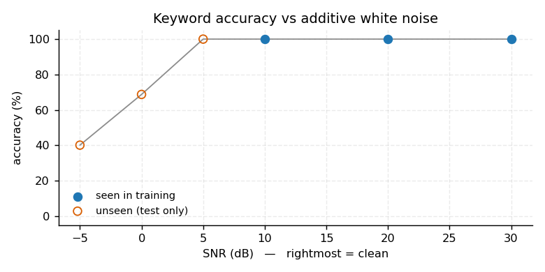
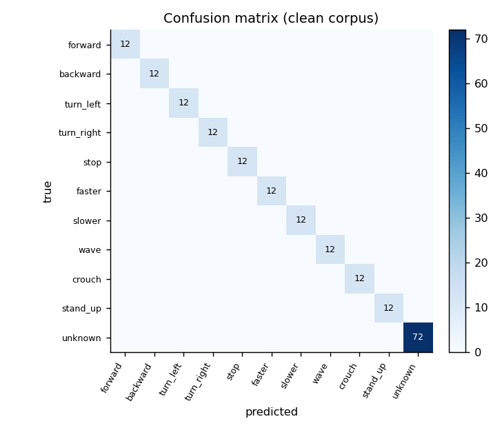

# 人形机器人离线语音指令控制：端到端关键词识别（humanoid_kws_command）

不接 ASR 引擎、不下载预训练权重，用 **log-mel 前端 + 5.9k 参数的小型 MLP** 把音频直接
分类成 10 个命令，另加 `unknown` 类做拒识。权重 25 KB。

## 效果图

| 抗噪曲线 | 混淆矩阵 |
|---|---|
|  |  |

## 一、为什么另做一个

仓库已有 `humanoid_voice_command`，它用 Whisper tiny 做 ASR、再把文本喂给意图 MLP：

| 模块 | 做法 | 依赖 | 参数量 |
|---|---|---|---|
| `humanoid_voice_command` | Whisper tiny + 文本意图 MLP | 需 72 MB 权重 | ~39 M |
| 本模块 | log-mel + MLP，端到端分类 | 只要 numpy | **5.9 k** |

两者不是替代关系：Whisper 路线能覆盖开放式语句，本模块只做**固定命令集的低延迟离线识别**，
代价是命令集固定。

## 二、前端与模型

```
WAV 16 kHz 单声道
  └─ 预加重 0.97 → 25 ms 汉明窗 / 10 ms 帧移 → 512 点 FFT → 40 带 mel → log
       └─ 每带取均值与标准差 → 80 维定长特征
            └─ 标准化 → 80-64（ReLU）→ 11（softmax）
```

- 特征维度只有 80，参数 5,899（< 50 KB），CPU 单帧推理耗时可以忽略
- 前端与训练**共用同一份常数**（`config.py` 与 `corpus.py`），避免线上线下不一致
- 全部用 numpy 与标准库 `wave` 实现，没有 librosa / torch

## 三、语料

Windows 自带 `System.Speech` 合成，**不需要联网**：

- 1 个中文语音（Microsoft Huihui Desktop，机器上仅有这一个）
- 4 种音高（−15% / 0 / +15% / +30%）× 3 种语速（0.85 / 1.0 / 1.2）= 12 种条件
- 10 个命令 + 6 个未知词，共 192 条 WAV

仓库**不存 WAV**（7.9 MB），只存提取好的特征 `data/features.npz`
（1152×80，329 KB，含 6 个 SNR 档）。这样没有 TTS 的 Linux / CI 也能完整复现训练与评测。

## 四、实测结果

| 评测 | 结果 |
|---|---|
| 留一条件交叉验证（12 折） | **100%**（最低/最高均 100%） |
| 干净 / 20 dB / 10 dB | 100% / 100% / 100% |
| **5 dB（训练未见过）** | **100%** |
| **0 dB（训练未见过）** | **68.8%** |
| **−5 dB（训练未见过）** | **40.1%** |
| FAR / FRR（干净） | 0% / 0% |

**必须说清**：干净语料上的 100% 不构成泛化证据。12 条语料同一个 TTS 语音，只变调变速，
发音和词形完全一致。留一条件 CV 的 100% 只说明「对音高/语速不敏感」，不说明「能听懂不同人」。

抗噪曲线才是有效证据：5 / 0 / −5 dB 训练时从未出现，仍能到 100% / 68.8% / 40.1%。

> 调参记录：最初只用干净数据训练，加噪到 20 dB 时准确率就从 100% 掉到 **6.2%**（几乎瞎猜）。
> 加入「干净 + 20 dB + 10 dB」训练增强后，未见过的 5 dB 也能到 100%。这是本模块唯一一次
> 真正的性能改进。

## 五、复现

```bash
cd src/humanoid/humanoid_kws_command
python3 -m pip install -r requirements.txt
python3 main.py --test     # 8 项自检
python3 main.py --train    # 留一条件 CV + 训练，写 weights/kws_mlp.npz（25 KB，约 10 s）
python3 main.py --eval     # 抗噪 / 拒识 / 混淆矩阵，写 results/
```

ROS 2：

```bash
colcon build --packages-select humanoid_kws_command
source install/setup.bash
ros2 launch humanoid_kws_command main.launch.py \
  wav_path:=/abs/path/stop.wav model_path:=/abs/path/weights/kws_mlp.npz
ros2 topic echo /kws_command_node/command --once        # 命令字符串
ros2 topic echo /kws_command_node/base_command --once   # [v, w, 置信度]
```

## 六、能力边界

- **真人语音未验证**：单一 TTS 语音，说话人多样性只靠音高模拟。要下结论必须接真人录音。
- **非流式**：一次一个 WAV，没有 VAD 与滑窗连续解码。
- **闭集 11 类**：`unknown` 是训练里的一个类，不是开集拒识。
- 只输出速度指令，不含完整人形行走。
- 干净语料 100% 是语料太容易，不作为性能声明。