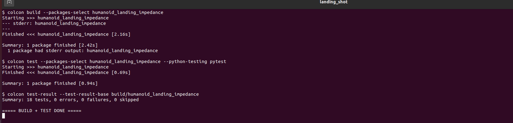
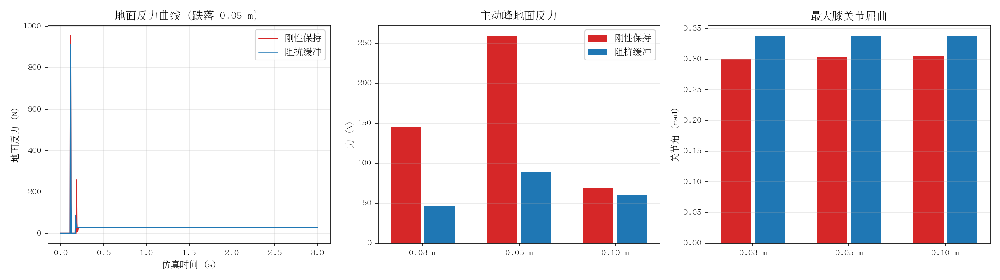

# 人形机器人落地冲击缓冲：膝关节阻抗与刚性保持对比

双足人形机器人从一定高度自由跌落，对比膝关节**阻抗控制（虚拟弹簧-阻尼力矩）**与**刚性位置保持**两种策略的落地冲击差异。机器人以蹲姿释放、双脚触地，仿真发布落地过程采样，评估地面反力、屈膝行程、姿态偏移与恢复时间。

## 原理简述

- 蹲姿角：髋 = -θ/2、膝 = θ、踝 = -θ/2，脚掌保持水平、重心居中。
- 刚性保持：髋/膝/踝全部位置控制在蹲姿角。
- 阻抗缓冲：髋/踝位置保持，膝关节切换为 `τ = -kp·(q-q₀) - kd·q̇` 力矩控制（按力矩上限截断），触地后膝关节被动屈曲吸能，再缓慢回弹。
- 采样话题 `landing_sample`：`[t, grf, base_vz, base_z, base_pitch, knee_flexion]`。

## 运行结果

编译与 18 项单元测试（`colcon test-result` 全绿）：



两种控制器 × 三种跌落高度的实测对比（GRF 曲线、主动峰与屈膝行程）：



实测结论（三种跌落高度 × 两种策略）：

- 阻抗缓冲的**主动峰地面反力**（触地 50 ms 后的身体减速峰）显著低于刚性保持，跌落 0.05 m 时降低约六成。
- 膝关节屈曲行程明显增加，冲击能量由关节阻尼耗散。
- 两种策略的触地冲量基本一致，符合动量守恒，验证实验有效。
- 首峰地面反力两种策略接近：触地瞬间尖峰由接触力学与足端质量主导，属预期现象。

详细指标表、指标定义与复现步骤见模块 [README](https://github.com/OpenHUTB/ros2/blob/main/src/humanoid/humanoid_landing_impedance/README.md)。

## 运行方法

```bash
cd ~/ros2_ws
colcon build --packages-select humanoid_landing_impedance
source install/setup.bash

# 单次实验（stiff / impedance）
ros2 launch humanoid_landing_impedance main.launch.py \
  controller_mode:=impedance drop_height:=0.05

# 完整对比实验并生成对比图
cd src/humanoid/humanoid_landing_impedance
./run_eval.sh
```

## 已知限制

- PyBullet 关节默认带目标速度为 0 的隐藏速度电机，`TORQUE_CONTROL` 前必须先以 `VELOCITY_CONTROL(force=0)` 关闭，否则力矩完全无效（模块代码已处理）。
- URDF 关节速度上限由 1.0 提升到 4.0 rad/s：落地缓冲需要更快的膝关节屈曲速度，否则冲击能量全被接触模型吸收。
