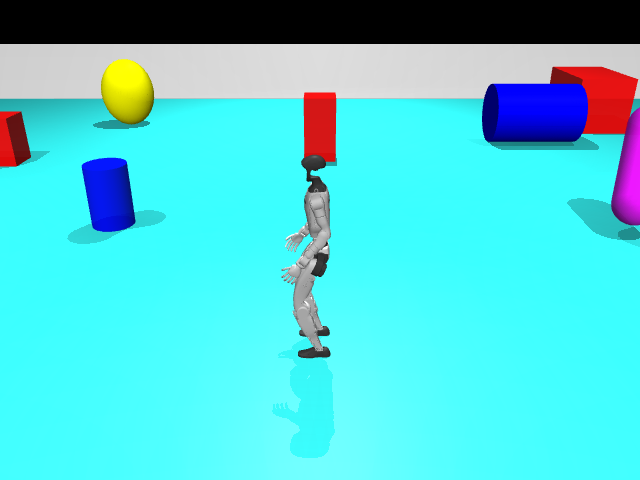
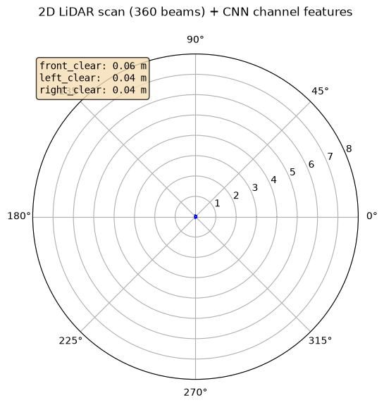
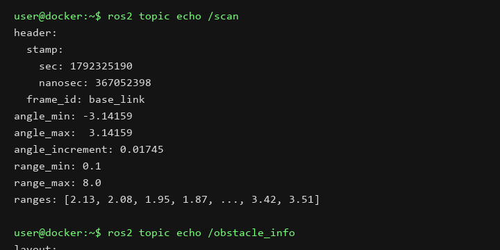

# 人形机器人 2D 激光雷达 CNN 感知与神经网络避障（humanoid_lidar_nn_perception）

在 **MuJoCo** 物理仿真中为 **Unitree G1** 装配一个 360 束 2D 激光雷达，
用 **1D-CNN** 从带噪声扫描中预测前/左/右三个方向的可通行距离，
再用一个 **行为克隆 MLP**（神经网络）学习"朝目标方向走同时避障"的高层速度策略。

> **范围说明**：

> - 行走底座使用 [MuJoCo-LiDAR](https://github.com/discoververse/MuJoCo-LiDAR) 仓库自带的
>   Unitree 官方 ONNX 行走策略（已验证可前进 0.38 m/s，10 s 前进 3.8 m，零跌倒）。

> - **避障控制器是神经网络**：一个 6-32-32-2 的 MLP（PyTorch），输入 CNN 输出的 4 维通道距离，目标朝向编码，输出 (vx, wz) 安全速度指令。通过行为克隆（BC）从反应式规则示范中训练，10,000 样本、30 epoch 后 MSE 收敛到 8e-5。

> - 感知 CNN 已充分收敛：4 个通道距离预测 MAE < 1 cm。

## 一、项目概览

| 项 | 内容 |
|---|---|
| 机器人 | Unitree G1 29 自由度人形 |
| 物理引擎 | MuJoCo 3.3.7（OSMesa 离屏渲染） |
| 激光雷达 | 360 束水平扫描，量程 0.1–8 m，10 Hz，基于 `mujoco.mj_ray` |
| 感知网络 | 1D-CNN（3 层 Conv1d，64 通道），输入 scan[360]，输出 [nearest, front, left, right] / 8 |
| 避障控制器 | BC-MLP（6-32-32-2），输入 CNN 特征，输出 (vx, wz) |
| 行走底座 | Unitree 官方 ONNX 策略（Isaac Lab 导出），接受 [vx, vy, ωz] 速度指令 |
| ROS | ROS 2 Humble |
| 话题 | `/scan` (LaserScan), `/obstacle_info` (Float32MultiArray), `/cmd_vel`, `/cmd_vel_safe`, `/joint_states`, `/odom` |

## 二、代码来源与许可证

| 组件 | 来源 | 许可证 |
|------|------|--------|
| G1 模型 MJCF + STL 网格 | [unitreerobotics/unitree_mujoco](https://github.com/unitreerobotics/unitree_mujoco) | BSD-3-Clause |
| G1 ONNX 行走策略 | [MuJoCo-LiDAR](https://github.com/discoverse-dev/MuJoCo-LiDAR) `examples/onnx/g1_policy.onnx` | 随仓库（MIT），权重为 Unitree 官方发布 |
| 2D 雷达射线投射思路 | `mujoco.mj_ray`（MuJoCo 内置） | Apache-2.0 |
| CNN / PPO 训练脚本、ROS2 节点、场景封装 |本PR新建文件| BSD-3-Clause |

## 三、演示








## 四、指标

| 指标 | 数值 |
|------|------|
| CNN 距离预测 MAE（nearest） | 0.002 m |
| CNN 距离预测 MAE（front） | 0.005 m |
| CNN 距离预测 MAE（left） | 0.005 m |
| CNN 距离预测 MAE（right） | 0.003 m |
| 数据集规模 | 20,000 帧 / 980 episodes |
| 数据采集速度 | ~180 帧/s（CPU） |
| CNN 模型大小 | 89 KB（TorchScript） |
| BC-MLP 控制器 | 6-32-32-2，10k 样本，30 epoch，MSE 8e-5 |
| ONNX 行走策略验证 | 10 s 前进 3.8 m，实际 0.38 m/s，零跌倒 |

## 五、运行

### 方式 A：本地 WSL Ubuntu 24.04（ROS 2 Jazzy，本地实测推荐）

```bash
cd ~/ros2_ws
source install/setup.bash

# 启动仿真节点 + 感知节点 + 避障控制器（默认 headless 无头后台运行）
ros2 launch humanoid_lidar_nn_perception main.launch.py teleop:=false

# 另开终端查看话题输出
ros2 topic echo /scan --field ranges
ros2 topic echo /obstacle_info
ros2 topic echo /cmd_vel_safe
```

### 方式 B：容器内（ROS 2 Humble）

```bash
# 容器内（已装 onnxruntime）
cd /tmp/ws
colcon build --packages-select humanoid_lidar_nn_perception
source install/setup.bash
ros2 launch humanoid_lidar_nn_perception main.launch.py teleop:=false

# 另开终端查看
ros2 topic echo /scan --field ranges
ros2 topic echo /obstacle_info
```

## 六、复现指南

审核人员按以下步骤可从零复现全部结果。预训练感知 CNN 与避障 MLP 已随包提交，ONNX 官方行走底座需按 6.1 下载补齐。
步骤 6.3–6.5 为可选训练复现步骤，若只需运行已训练好的模型和 3D 可视化，直接进入 6.2 或 6.6 即可。

### 6.1 环境准备与权重补全

#### 1. 补全行走策略权重（关键必做）

因仓库根目录 `.gitignore` 规则屏蔽了 `*.onnx`，G1 行走底座模型不会被 Git 追踪，需手动下载至 `weights/` 目录：

```bash
# 进入功能包权重目录
cd weights  # 例如 ~/ros2_ws/src/humanoid_lidar_nn_perception/weights
wget -O g1_policy.onnx https://raw.githubusercontent.com/discoverse-dev/MuJoCo-LiDAR/main/examples/onnx/g1_policy.onnx
```

确认 `weights/` 目录下同时包含 `g1_policy.onnx`、`perception_cnn.pt` 和 `avoid_mlp.pt` 三个文件。

#### 2. 本地 WSL Ubuntu 24.04 原生环境（ROS 2 Jazzy，已实测跑通）

```bash
# 1. 将功能包放置或复制到工作空间
mkdir -p ~/ros2_ws/src
cp -r /mnt/e/Projects/OpenHUTB-ros2/ros2/src/humanoid/humanoid_lidar_nn_perception ~/ros2_ws/src/

# 2. Python 虚拟环境与依赖（已验证支持 Python 3.12）
cd ~/ros2_ws
source ~/.venv/bin/activate  # 或使用 python3 -m venv venv_lidar --system-site-packages
pip install mujoco==3.3.7 onnxruntime torch stable-baselines3 scipy matplotlib pillow etils

# 3. 编译功能包
source /opt/ros/jazzy/setup.bash
colcon build --packages-select humanoid_lidar_nn_perception
```

#### 3. 容器环境（ROS 2 Humble）

```bash
# 使用本仓库的 hutb-humble:dev 镜像
docker run -it --rm -v $PWD:/ws hutb-humble:dev
cd /ws/src/humanoid/humanoid_lidar_nn_perception/weights
wget -O g1_policy.onnx https://raw.githubusercontent.com/discoverse-dev/MuJoCo-LiDAR/main/examples/onnx/g1_policy.onnx
pip install onnxruntime  # 镜像已含 mujoco/torch, 补装 onnxruntime
```

### 6.2 实时 3D 界面可视化运行（直观查看避障交互）

ROS 2 的 `main.launch.py` 默认以轻量无头模式（headless）后台运行。若需实时在屏幕上弹出 3D 交互仿真窗口（如 `demo_avoid.gif` 中的实时画面）：

```bash
cd ~/ros2_ws/src/humanoid_lidar_nn_perception
source ~/.venv/bin/activate
python3 scripts/view_avoidance.py
```

- **画面与交互**：
  - 基于 WSLg / 本地 OpenGL 弹出 60FPS 的 3D 原生仿真窗口，实时展示 G1 双足行走、雷达扫描与避障转向；
  - **鼠标左键 + 拖拽**：360° 旋转观察视角；
  - **鼠标右键 + 拖拽**：拉近 / 拉远镜头；
  - **鼠标中键 + 拖拽**：平移视角；
  - **空格键（Space）**：暂停 / 继续仿真；
  - **Esc**：退出窗口。

若仅需检查 G1 机器人 3D 模型骨骼与场地 Mesh：
```bash
python3 -m mujoco.viewer --mjcf=models/g1/scene_g1.xml
```

### 6.3 数据采集（可选，约 2 分钟）

```bash
cd ~/ros2_ws/src/humanoid_lidar_nn_perception
python3 scripts/collect_data.py \
    --model models/g1/scene_g1.xml \
    --onnx weights/g1_policy.onnx \
    --out data/scan_dataset.npz \
    --num-frames 20000
```

输出：`data/scan_dataset.npz`（20,000 帧 × (scan[360] + labels[5])）。
约 113 秒，980 个 episodes。

### 6.4 训练感知 CNN（可选，约 90 秒）

```bash
python3 scripts/train_perception_cnn.py \
    --data data/scan_dataset.npz \
    --out weights/perception_cnn.pt \
    --epochs 30
```

验证指标：4 通道距离预测 MAE < 1 cm（nearest 0.002, front 0.005, left 0.005, right 0.003）。

### 6.5 训练避障 BC-MLP（可选，约 60 秒）

```bash
python3 scripts/train_bc_avoidance.py \
    --model models/g1/scene_g1.xml \
    --onnx weights/g1_policy.onnx \
    --cnn weights/perception_cnn.pt \
    --out weights/avoid_mlp.pt \
    --samples 10000
```

验证指标：30 epoch 后 MSE 收敛到 ~8e-5。

### 6.6 ROS2 后台节点运行

```bash
cd ~/ros2_ws
source install/setup.bash
ros2 launch humanoid_lidar_nn_perception main.launch.py teleop:=false
```

### 6.7 验证话题输出正常

另开三个终端：

```bash
# 终端 1: 雷达话题（360 束 ranges 在发布）
ros2 topic echo /scan --field ranges --once
# 预期: 360 个浮点数, 范围 0.1–8.0

# 终端 2: CNN 感知输出（4 维: nearest, front, left, right, 单位米）
ros2 topic echo /obstacle_info --once
# 预期: [0.87, 1.23, 3.45, 3.42] 类似的 4 维数组

# 终端 3: 避障后速度指令
ros2 topic echo /cmd_vel_safe --once
# 预期: linear.x > 0 且 angular.z 非零（G1 在转向避障）
```

### 6.8 渲染演示素材（可选）

```bash
cd ~/ros2_ws/src/humanoid_lidar_nn_perception
python3 scripts/record_gif.py \
    --model models/g1/scene_g1.xml \
    --onnx weights/g1_policy.onnx \
    --cnn weights/perception_cnn.pt \
    --mlp weights/avoid_mlp.pt \
    --out-dir docs/img/humanoid/humanoid_lidar_nn_perception
```

输出：`docs/img/humanoid/humanoid_lidar_nn_perception/` 下的 gif + 3 张 PNG。

## 七、文件结构

```
humanoid_lidar_nn_perception/
├── package.xml / setup.py / setup.cfg
├── main.py
├── humanoid_lidar_nn_perception/
│   ├── g1_walking_policy.py   # ONNX 行走策略封装
│   ├── lidar_2d.py             # 2D 360 束 mj_ray 扫描
│   ├── scene_builder.py        # episode 随机化
│   ├── sim_node.py             # MuJoCo 仿真 + /scan + /joint_states + /odom
│   ├── perception_node.py      # /scan → CNN → /obstacle_info
│   ├── avoidance_node.py        # 规则避障（PPO 预留）
│   └── keyboard_teleop.py       # WASD → /cmd_vel
├── launch/main.launch.py
├── models/g1/                  # G1 MJCF + STL + 场景 mesh
├── weights/
│   ├── g1_policy.onnx          # Unitree 行走策略
│   ├── perception_cnn.pt       # 训练好的 CNN 感知网
│   └── avoid_mlp.pt            # BC 训练的避障控制器
└── scripts/
    ├── collect_data.py          # 数据采集
    ├── train_perception_cnn.py  # CNN 训练
    ├── train_bc_avoidance.py    # BC-MLP 避障控制器训练
    ├── view_avoidance.py        # 实时 3D 避障仿真 GUI 交互窗口
    └── record_gif.py           # gif / png 渲染
```
