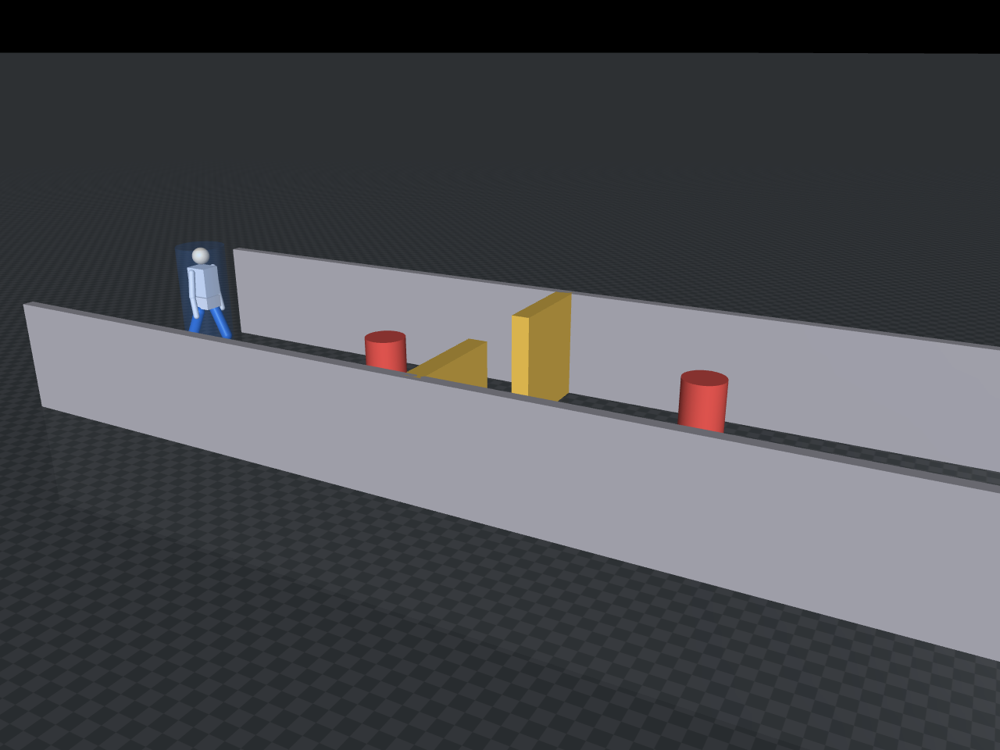
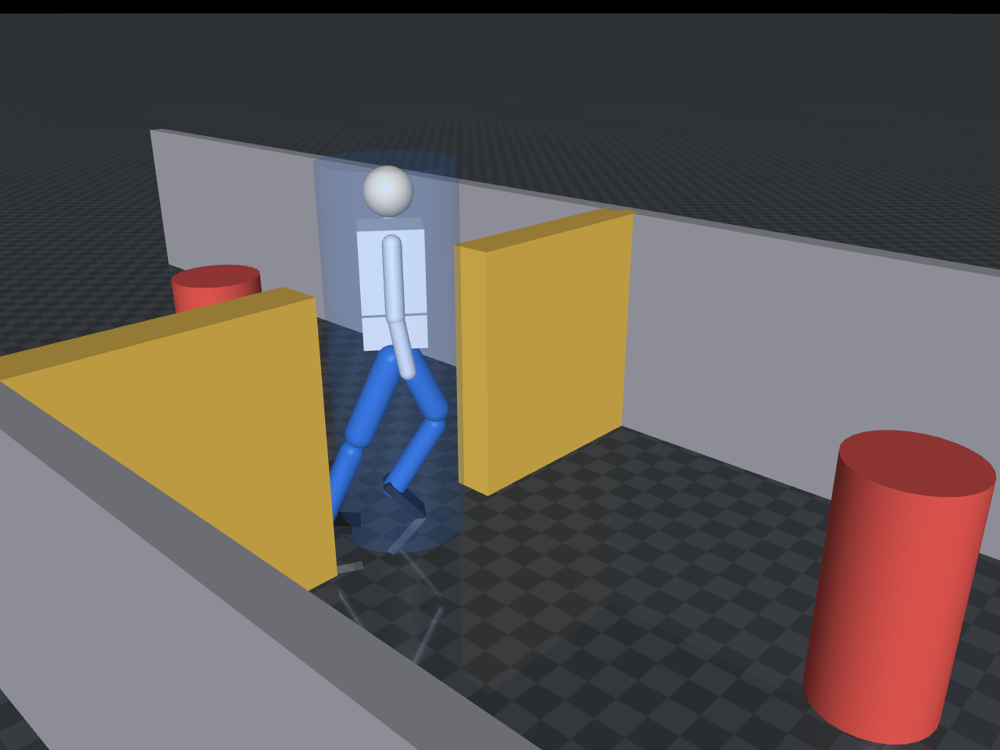
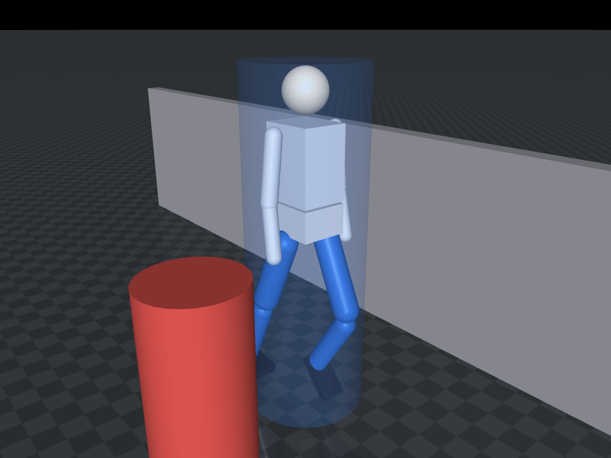
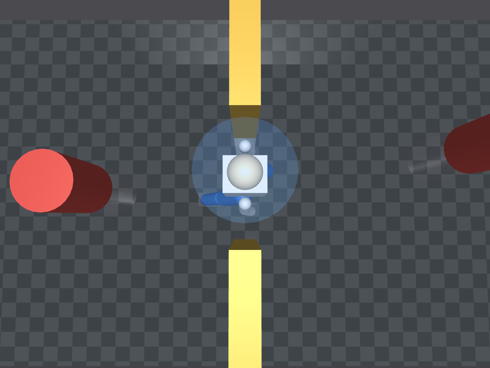
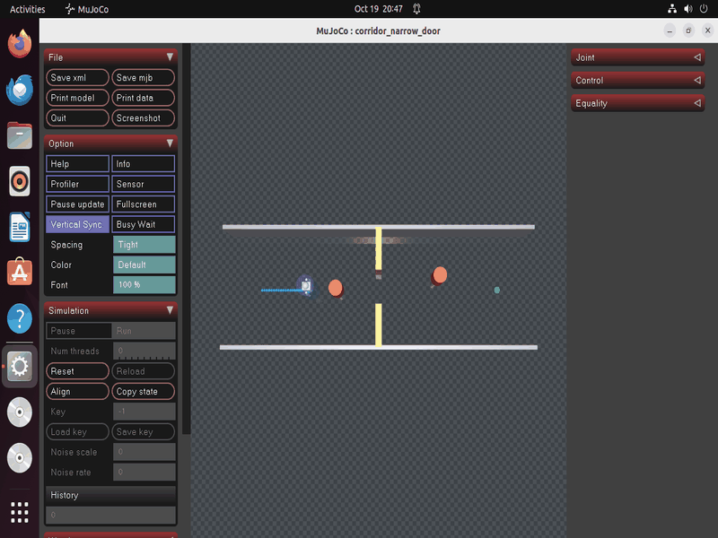

# 人形足迹下的局部避障算法对比（humanoid_local_planner_bench）

MuJoCo 场景：8 m 走廊 + **0.90 m 窄门** + 两个圆柱障碍。足迹半径 0.28 m（肩宽 0.45 m）的
人形从起点走到 8 m 外终点，横向对比 **DWA** 与 **APF** 两种局部规划器。

## 效果图

| 全景：走廊 + 障碍 + 门柱 | 过门：人形穿过 0.90 m 门洞 |
|---|---|
|  |  |

| 绕障：侧面通过圆柱障碍 | 门口俯视：0.56 m 身宽 vs 0.90 m 门宽 |
|---|---|
|  |  |

完整动画（DWA 走完全程）：



四张 `scene_*.png` 由 `python3 main.py --figures` 离屏渲染生成（文件名与 `figures.py` 的
`SCENE_VIEWS` 一一对应）；动图由 `python3 main.py --gif` 生成（默认 480×320、48 色、26 帧，953 KB；
`--gif-width 640` 实测 1462 KB，`--gif-colors` 可再降）。`--shot` 只按机位打开窗口
并保持姿势、不写文件，且保持期间不推进物理（腿没有驱动力，`mj_step` 会把步态压平）。

## 一、为什么做这个对比

仓库已有两个避障模块，都不覆盖本场景：

| 模块 | 方法 | 差异 |
|---|---|---|
| `humanoid_lidar_nn_perception` | 1D-CNN + 行为克隆 MLP（神经网络） | 本文是经典几何法，无训练、结果可解析 |
| `mujoco_car_avoidance` | 射线 + 距离分级状态机（地面小车） | 本文是人形足迹，且做算法横向对比 |

人形与轮式车的差别不在速度，在**宽度**：0.56 m 足迹塞进 0.90 m 门道，单侧净空 0.17 m。
这正是检验「质点假设」是否成立的临界条件。

## 二、场景与机器人模型

`models/corridor_scene.xml`：

```
走廊      x ∈ [-1, 9]，y = ±1.6 两道墙
窄门      x = 4，门柱内缘 y = ±0.45 → 净宽 0.90 m
障碍      (2.6, 0.0) 与 (6.0, 0.35)，半径 0.22 m
机器人    freejoint（运动学驱动）
  ├── footprint   半径 0.28 m 圆柱，contype=1 —— 唯一参与碰撞与射线的几何体
  └── 人形外形    骨盆/躯干/头/双臂/双腿，contype=0 —— 纯视觉
```

**碰撞用圆柱、外观用人形**：判定需要稳定可解释的碰撞体，画面需要看出「是个人在走」。
二者分开——腿与躯干只负责渲染。实测空洞处（x=1.5）足迹到 `obs_a` 的 `sim.clearance()`
是 **0.600 m**（1.100 是两点中心距，减去足迹半径 0.28 与障碍半径 0.22），加腿前后完全一致，
`test_gait_does_not_affect_clearance` 专门守这条。脚底几何体底面在基座 z 之上 0.00 m，
站立相位下落在地面上，不会陷进去。

**激光**：72 束、360°、量程 4 m，`mj_ray` 对真实几何体求交。射线用
`geomgroup=[1,0,1,1,1,1]` 屏蔽 `group=1` 的机器人自身，否则会打在自己的腿上
（曾导致最近测距 0.043 m、规划器原地不动）。

**步态**：腿部三关节按行进距离摆动，步幅 0.7 m，左右腿相差 π，骨盆 12 mm 起伏：

```
hip   = -0.45 * sin(φ)
knee  =  1.05 * max(0, sin(φ))
ankle =  0.30 * sin(φ)
φ    += v * dt / 0.7 * 2π
```

这不是行走控制器，只是让画面里的人形动起来。

## 三、两种规划器的实现要点

均从 `AtsushiSakai/PythonRobotics`（MIT）改写：障碍输入由「已知地图」改为「实时激光点」，
输出统一为 `(v, ω)`。

**DWA**：在速度空间栅格采样，预测 1.2 s 轨迹，**先剔除会撞的候选（硬约束）**，
再在可行解里按「朝向 + 速度」择优；无可行解时取最安全的一条兜底。

> 踩过的坑：最初把障碍代价直接减进总代价（`cost = α·head + γ·v − β·obs`），
> 符号导致「越贴障碍代价越优」，机器人会撞穿障碍。改成硬约束才正确。

**APF**：目标引力 + 障碍斥力合成方向，转成 `(v, ω)`。加了**局部极小值逃逸**：
连续 2 s 未靠近目标则叠加 1.5 s 切向分量。参数 `k_att=2.4, k_rep=0.35, d0=0.60`
——`k_rep` 取 0.7 时会在门口卡死。

**Bug2 未纳入**：跟墙逻辑按质点设计，而本场景的障碍就是门柱本身。0.56 m 足迹贴墙必然刮蹭；
把侧向阈值压到能进门的量级又会反复绕行。实测 `side_thresh` 从 0.92 扫到 0.34、
逃逸阈值从 0.60 降到 0.08，仍然要么刮蹭（最小间距 −0.17 m）、要么 60 s 超时。
属算法前提与场景不匹配，不是参数没调好。

## 四、复现

```bash
cd src/humanoid/humanoid_local_planner_bench
python3 -m pip install -r requirements.txt   # 含 mujoco>=3.3.0
python3 main.py --version      # 1.0.0
python3 main.py --test         # 10 项检查
python3 main.py --headless     # 对比表 + CSV + 三联图
python3 main.py --gif          # 演示动图
```

MuJoCo 下界取 **3.3**。3.2.x 的 `mj_geomDistance` 在「圆柱 vs box」上返回的间距偏小：
同一个起点位姿得到 0.6873 而不是 1.2600，`clearance()` 会出现负值，而 `collided()` 仍是 0。
`CorridorSim` 初始化时就检查版本，低了直接抛错并给出升级命令。

ROS 2：

```bash
colcon build --packages-select humanoid_local_planner_bench --symlink-install
source install/setup.bash
ros2 launch humanoid_local_planner_bench main.launch.py planner:=dwa
ros2 topic echo /planner_bench_node/status --once
```

## 五、实测结果

Ubuntu 22.04 + Python 3.10.12 + MuJoCo 3.15.0，控制频率 20 Hz，到达判定半径 0.35 m。

| 规划器 | 到达 | 时间 (s) | 路径 (m) | 最小间距 (m) | 碰撞步 | 平均 \|ω\| (rad/s) |
|---|---|---|---|---|---|---|
| DWA | 是 | 38.00 | 17.15 | 0.167 | 0 | 0.25 |
| APF | 是 | **17.35** | 17.39 | 0.140 | 0 | 0.83 |

1. 两者都能通过 0.90 m 窄门（单侧净空 0.17 m），全程零碰撞。
2. **APF 快 2.2 倍**（17.35 vs 38.00 s），但转向抖动大（平均 |ω| 是 DWA 的 3.3 倍）。
   合成力方向对激光点分布敏感，在门柱之间来回修正。
3. **DWA 慢而平滑**：速度栅格采样 + 硬约束使它倾向小幅调整，安全余量更大。速度窗口按
   加速度 `acc=0.6 m/s²`、角加速度 `w_acc=2.0 rad/s²` 限制在本周期可达范围内（`HORIZON_STEPS=8`），
   不是全速度空间撒点。
4. 路径长度接近（17.15 vs 17.39 m），都远长于直线 8.00 m——绕障与穿门本身的代价。

## 六、能力边界

- **不含平衡控制**：底座运动学驱动，只评价规划层，不评价"人形能否真的走过去"。
- **步态仅用于可视化**：腿部 `contype=0`，不参与碰撞、不产生推进力。
- **视觉穿插**：大幅摆腿时腿可能与障碍画面重叠（腿无碰撞体），碰撞判定一律按足迹圆柱。
- **速度指令未限幅**：输出存在抖动，实际部署需加低通或速度斜坡。
- **单一场景**：一条走廊 + 一道窄门，结论不外推到开阔地或动态障碍。

## 七、参数

| 参数 | 位置 | 默认 | 说明 |
|---|---|---|---|
| `CONTROL_HZ` | `config.py` | 20 Hz | 规划频率 |
| `N_RAYS` / `RAY_RANGE` | `config.py` | 72 / 4.0 m | 激光束数与量程 |
| `START` / `GOAL` / `GOAL_TOL` | `config.py` | (0,0,0) / (8,0) / 0.35 m | 起终点与到达判据 |
| `planner` | `config/params.yaml` | `dwa` | ROS 节点用的规划器 |
| `time_limit` | `config/params.yaml` | 60 s | 单次实验时长上限 |
