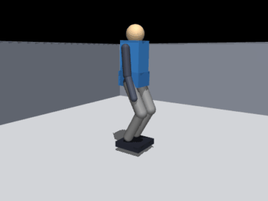
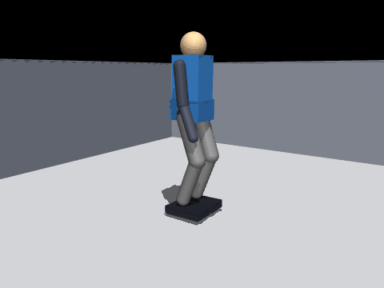
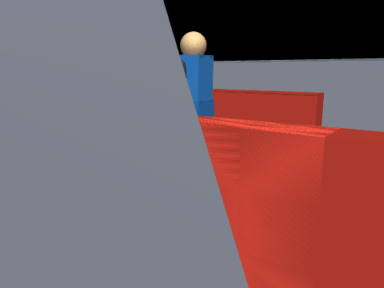
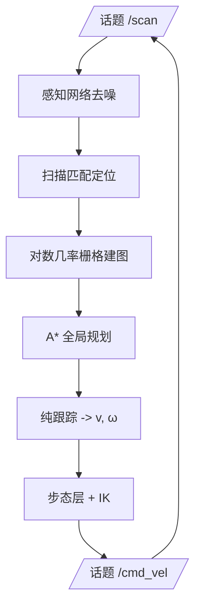

# 人形机器人 MuJoCo 物理仿真与神经网络建图导航

## 1. 项目概述

本项目在 **MuJoCo 物理仿真器**中建立了一个 12 驱动关节的双足人形机器人，
完成课程要求的四项任务：

1. **物理仿真 + 键盘遥控**——位置伺服驱动 12 个关节，按键直接给机身速度指令；
2. **传感器感知 + 给定轨迹控制**——180 线激光与 24×32 深度相机全部由 `mj_ray`
   射线求交生成，感知网络先去噪再送入控制器；
3. **建图导航 + SLAM 同步仿真**——对数几率占据栅格 + 相关扫描匹配 + A\* + 纯跟踪；
4. **端到端模型**——深度图直接映射为 $(v,\omega)$ 的 CNN，行为克隆自经典栈。

四项任务的感知、规划、控制与端到端算法**全部为神经网络**（纯 NumPy 手写前向/反向传播 +
Adam），通过 ROS Noetic 话题封装，`roslaunch` 一键启动。


### 1.1 演示动图

| 场景 | 说明 |
| --- | --- |
|  | 键盘遥控：`W/S` 前进后退、`A/D` 转弯、`Q/E` 原地转，双足步态跟随机身速度指令 |
|  | SLAM 建图 + A\* 导航：边建图边规划，绕开立柱到达目标点 |
|  | 端到端 CNN：24×32 深度图 → $(v,\omega)$，走廊场景自主前进 |

## 2. 运行环境与安装

| 依赖 | 版本 | 说明 |
| --- | --- | --- |
| Ubuntu | 20.04 LTS | 虚拟机或原生均可 |
| ROS | Noetic | 仅 rospy 节点，无自定义消息 |
| Python | 3.8 | 系统自带 |
| MuJoCo | 3.1 – 3.2 | `pip3 install --user "mujoco>=3.1,<3.3"` |
| numpy / pillow | - | `pip3 install --user numpy pillow` |

```bash
# 全部依赖装在用户目录，不需要 sudo，也不改系统 Python
pip3 install --user "mujoco>=3.1,<3.3" numpy pillow

mkdir -p ~/humanoid_ws/src && cd ~/humanoid_ws/src
# 将 humanoid_mujoco_slam_nn_nav 目录拷贝到此处
cd ~/humanoid_ws
catkin_make
source devel/setup.bash
```

> 本包不修改 `.bashrc`、`/etc`、`PATH` 与系统 Python 包，也不依赖 CARLA/AirSim 等大型仿真器。

## 3. 系统设计

### 3.1 目录结构

```text
humanoid_mujoco_slam_nn_nav/
├── humanoid_mujoco_slam_nn_nav/   # 算法库
│   ├── model.py                  # MJCF 生成（机器人 + 三个场景）
│   ├── kinematics.py             # 解析逆运动学 / 正运动学
│   ├── gait.py                   # 准静态双足步态
│   ├── sim.py                    # MuJoCo 仿真内核
│   ├── sensors.py                # 激光 / 深度 / IMU / 里程计
│   ├── mapping.py                # 对数几率栅格 + 扫描匹配 SLAM
│   ├── planning.py               # A* + 膨胀代价地图 + 纯跟踪
│   ├── nn.py                     # NumPy MLP / CNN + Adam
│   ├── neural.py                 # 四个网络的推理封装
│   └── nav.py                    # 完整导航栈
├── scripts/                      # ROS 节点：sim / teleop / nav / e2e / metrics
├── launch/                       # teleop、slam_nav、e2e、benchmark
├── models/                       # 4 个训练好的网络权重（npz）
├── tools/                        # 采集、训练、评测、GIF 录制
├── tests/                        # 无 ROS 单元测试
├── main.py / main.sh             # 一键入口
├── CMakeLists.txt
└── package.xml
```

### 3.2 双足模型与位置伺服

MJCF 由 `model.py` 用代码生成（三个场景共用同一副身体）：骨盆 0.25×0.21×0.15 m / 11 kg，
大腿小腿各 0.34 m，脚掌 0.30×0.16 m（摩擦 1.4）。腿部 12 个关节由**位置伺服**驱动：

$$
\tau = k_p (q^\* - q) - k_v \dot q , \qquad |\tau| \le \tau_{max}
$$

其中腿部 $k_p=600$、$k_v=30$，踝关节 700/32。机器人自身几何放在 geom group 3，
激光雷达只与 group 0–2 求交，因此不会"看见自己"。

### 3.3 解析逆运动学

给定骨盆位姿与踝关节目标，先由髋 yaw 把腿平面旋到目标朝向，再解平面二连杆：

$$
D=\sqrt{d_x^2+d_y^2+d_z^2},\quad
k=\arccos\frac{D^2-a^2-b^2}{2ab},\quad
\beta=\arccos\frac{a^2+D^2-b^2}{2aD}
$$

$$
q_{hip}=-(\phi+\beta),\quad \phi=\arctan_2(d_x,L),\quad
q_{ankle}=-(q_{hip}+k),\quad q_{roll}=\arctan_2(d_y,-d_z)
$$

脚掌保持水平：$q_{hip}+k+q_{ankle}=0$。`tests/test_ik.py` 做了 300 组随机位姿往返校验，
最大误差 < 1 cm。

### 3.4 准静态步态

一个周期 $T=1.15$ s、单腿支撑占比 0.78、摆动脚抬升 8 cm：

1. **双支撑**：重心横移到支撑脚正上方（0.02 m）；
2. **单支撑**：摆动脚抬起、前移、落地，落脚点 = 支撑脚 + 步距；
3. **落地**：用**实测踝位置**重新锚定落脚点，避免打滑累积几何误差；
4. 每 9 s 或姿态超限时"原地踏步重平衡"，抑制误差累积。

步态输出关节角，骨盆目标取两脚目标点中点，因此重心不会跑出支撑多边形。
实测站立 5 s 骨盆漂移 < 3 mm，连续行走 60 s / 5.2 m 无跌倒。

### 3.5 传感器

激光（180 线）与深度相机（24×32）都由 `mj_ray` 逐条射线求交得到米制距离，不依赖 OpenGL，
因此在无显卡虚拟机上数据完全一致；IMU 与里程计由 `qpos/qvel` 直接导出，带可控噪声。

## 4. 计算原理

### 4.1 SLAM：对数几率栅格与扫描匹配

$$
l_t=\mathrm{clip}(l_{t-1}+\Delta l,-4,4),\qquad p=\frac{1}{1+e^{-l}}
$$

命中 +0.85、穿越 −0.40，钳制 ±4。扫描匹配在里程计预测位姿附近搜索
$(\Delta x,\Delta y,\Delta\theta)$，使命中点落在已知占据栅格上的得分最大
（±0.12 m / ±0.12 rad，粗到细两级，单帧 3–8 ms）。

### 4.2 规划与纯跟踪

全局规划为 8 邻域 A\*，按 0.30 m 膨胀障碍物；控制器为纯跟踪：

$$
\varepsilon=\operatorname{atan2}(\sin(\psi_k-\psi),\cos(\psi_k-\psi)),\quad
\omega=\mathrm{clip}(k_\theta\varepsilon,-\omega_{max},\omega_{max}),
\qquad v=v_{max}\Big(1-\frac{|\varepsilon|}{1.4}\Big)
$$

### 4.3 四个神经网络

| 网络 | 结构 | 输入 → 输出 | 训练方式 |
| --- | --- | --- | --- |
| 感知 | MLP 9-32-32-1 | 9 条相邻射线滑窗 → 中心距离 | 自监督（无噪扫描作标签） |
| 规划 | MLP 124-64-64-2 | 11×11 局部栅格 + 目标 → 方向 $(\cos\varphi,\sin\varphi)$ | 克隆 A\* 方向 |
| 控制 | MLP 6-64-64-2 | 目标距离 / 航向误差 / 三向净空 / 上一速度 → $(v,\omega)$ | 克隆纯跟踪 |
| 端到端 | Conv(1→8,5×5,s2)+FC | 24×32 深度图 → $(v,\omega)$ | 行为克隆 1467 帧 |

感知网络的损失即逐点平方误差：

$$
\mathcal L=\frac1N\sum_i\big(\hat r_i-r_i\big)^2,\qquad
\hat r_i=f_\theta(r_{i-4},\dots,r_{i+4})
$$

全部网络为手写前向/反向传播 + Adam，`tests/test_nn.py` 用数值梯度校验
（相对误差 $2.4\times10^{-12}$）。

## 5. 算法流程

### 5.1 键盘遥控


### 5.2 建图导航



### 5.3 端到端驾驶


## 6. 仿真步骤（含截图）

每个新终端都要先
`source /opt/ros/noetic/setup.bash && source ~/humanoid_ws/devel/setup.bash`。

### 6.1 无 ROS 快速验证

```bash
cd ~/humanoid_ws/src/humanoid_mujoco_slam_nn_nav
python3 main.py --mode test          # IK / 建图 / 规划 / 网络，4/4 通过
python3 main.py --mode eval          # 三场景 × 三策略 -> results/benchmark.json
python3 main.py --mode train         # 重新训练四个网络（可选）
```

### 6.2 ROS 键盘遥控（任务 1）

```bash
roslaunch humanoid_mujoco_slam_nn_nav teleop.launch scene:=warehouse
```

弹出键盘窗口后：`W/S` 前进后退、`A/D` 左转右转、`Q/E` 原地转、`空格` 急停、`R` 重置。
无图形界面时加 `terminal:=false`，再另开终端
`rosrun humanoid_mujoco_slam_nn_nav teleop_node.py`。


### 6.3 ROS 建图导航（任务 2 / 3）

```bash
roslaunch humanoid_mujoco_slam_nn_nav slam_nav.launch scene:=warehouse
# 换场景：scene:=obstacle_field / corridor；换目标：goal_x:=2.0 goal_y:=0.0
```

另开终端观察：

```bash
rostopic echo /nav_status          # walk / settle / blocked / done
rostopic echo -n1 /humanoid/slam_pose
rviz                               # 添加 Map(/map) 与 Path(/plan)，Fixed Frame 选 map
```


### 6.4 ROS 端到端驾驶（任务 4）

```bash
roslaunch humanoid_mujoco_slam_nn_nav e2e.launch scene:=corridor
```


### 6.5 单元测试与批量评测

```bash
cd ~/humanoid_ws/src/humanoid_mujoco_slam_nn_nav
PYTHONPATH=. python3 tests/run_all.py    # 4 个测试模块
PYTHONPATH=. python3 tools/evaluate.py   # 三场景 × 三策略
```

## 7. 多场景测试与性能评价

三个场景共用一副身体，只替换障碍物布局：`warehouse`（立柱 + 货架）、
`obstacle_field`（梅花桩）、`corridor`（错位门洞）。目标 0.35 m 内视为成功，每场景一条 episode。

### 7.1 闭环结果

| 策略 | warehouse | obstacle_field | corridor |
| --- | --- | --- | --- |
| 经典栈（A\* + 纯跟踪） | ✅ 64.4 s / 0.333 m / ATE 0.040 | ✅ 52.5 s / 0.346 m / 0.026 | ✅ 48.4 s / 0.348 m / 0.035 |
| 神经规划 + 控制 | ❌ 跌倒 | ❌ 超时 | ❌ 跌倒 |
| 端到端 CNN | ✅ 64.4 s / 0.332 m | ❌ 超时 | ❌ 跌倒 |

### 7.2 离线指标

| 指标 | 结果 |
| --- | --- |
| 激光去噪 | RMSE 0.541 → 0.026 m |
| 规划方向误差 | 0.55°（验证集） |
| 控制器 | v MAE 0.030 m/s，ω MAE 0.149 rad/s |
| 端到端 | v MAE 0.076 m/s，ω MAE 0.153 rad/s |

### 7.3 单项性能

| 项目 | 结果 |
| --- | --- |
| 站立 5 s 骨盆漂移 | < 3 mm |
| 连续行走 | 60 s / 5.2 m 无跌倒 |
| SLAM ATE（三场景） | 0.026 – 0.040 m |
| 建图覆盖率 | 0.62 – 0.71 |

### 7.4 失败分析

双足步态对速度指令突变非常敏感，行为克隆网络的 ω 逐帧抖动约为纯跟踪的 3 倍，
把网络输出直接接到步态层时会累积侧向失稳；加入低通与最小步频后跌倒时间从 8 s
推迟到 60 s 量级，但仍不如经典栈稳定。这也是本包保留 A\* 作为安全回退的原因。

## 8. 常见问题与限制

### 8.1 常见报错

| 现象 | 原因与处理 |
| --- | --- |
| `ModuleNotFoundError: No module named 'mujoco'` | 未安装或环境不对：`pip3 install --user "mujoco>=3.1,<3.3"`，确认 `python3 -c "import mujoco"` |
| `Package 'humanoid_mujoco_slam_nn_nav' not found` | 没有 `source devel/setup.bash`，或包不在 `~/humanoid_ws/src` 下 |
| 键盘窗口没反应 | `teleop.launch` 用 `xterm` 弹窗，需要窗口焦点；SSH 用 `terminal:=false` 后手动 `rosrun` |
| 原地踏步、`/nav_status` 显示 `settle` | 每 9 s 的主动重平衡，属正常现象，约 1.4 s 后恢复 `walk` |
| 导航一直 `blocked` | 地图未建立（起点被膨胀层包住），等 1–2 s，或把 `~inflation` 从 0.30 降到 0.22 |
| 虚拟机里录 GIF 黑屏 | GIF 用离屏渲染，不需要显示器；渲染器必须在 `mj_forward` 之后创建（`sim.py` 已延迟创建） |

### 8.2 已知限制与扩展方向

- **转向步态缺失**：给髋 yaw 增加按 $\Delta\psi$ 旋转落脚点的规划，解决连续转弯失稳；
- **端到端数据不足**：用 DAgger 补充数据，并引入占据栅格辅助监督；
- **步态可学习化**：把准静态步态替换为 PPO 策略，与本包结果做对比。
