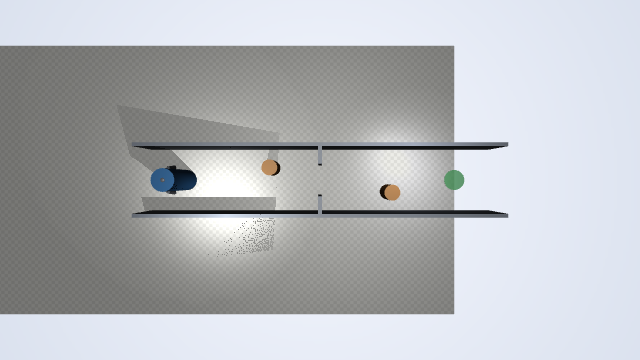
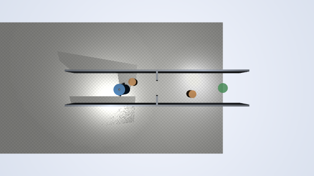
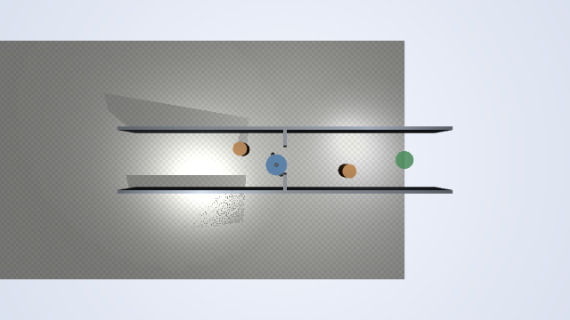
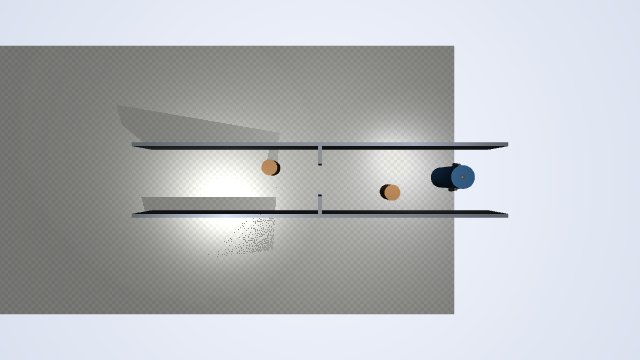
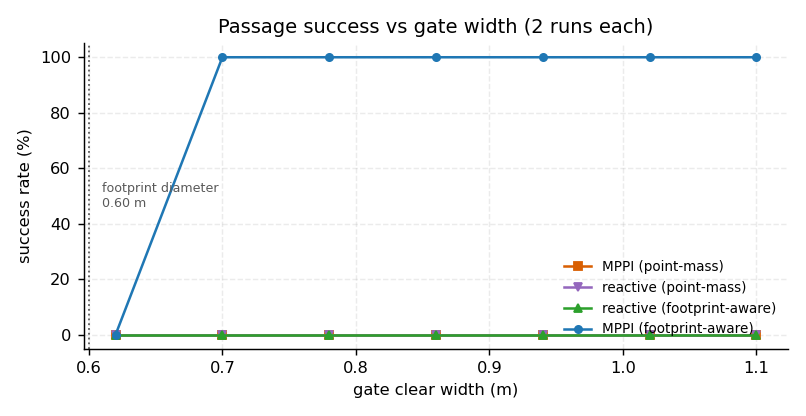
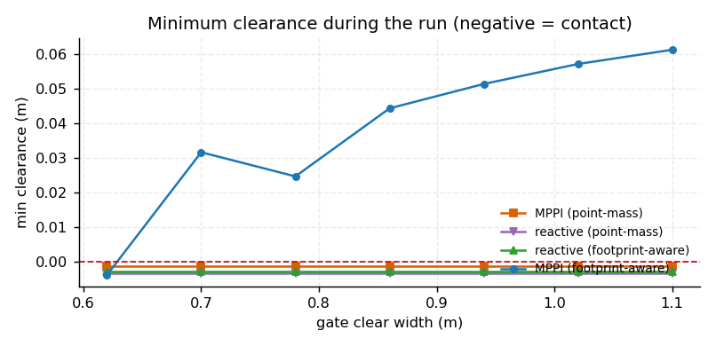
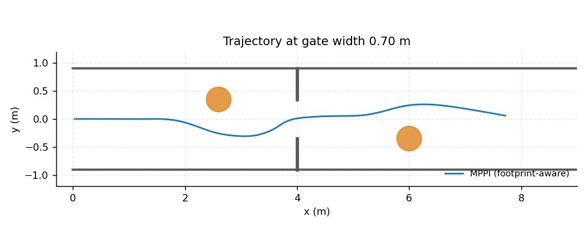

# 人形足迹下的局部避障算法对比：窄通道宽度扫描（humanoid_passage_width_sweep）

MuJoCo 场景：1.8 m 宽走廊、x=4 m 处一道净宽可调的窄门、两个半径 0.22 m 的圆柱障碍。
人形按 **半径 0.30 m 的足迹圆柱**参与碰撞与激光。用 2x2 单变量对比回答：
**人形到底需要多宽的通道，以及「把体宽当质点」会付出什么代价。**

## 效果图

| 出发 | 绕过障碍 | 穿过窄门 | 到达目标 |
|---|---|---|---|
|  |  |  |  |

| 通过率 vs 门宽 | 最小净空 vs 门宽 |
|---|---|
|  |  |

0.70 m 门口的轨迹（绕过两个圆柱再穿门）：



## 一、为什么这样设计

仓库已有 `humanoid_local_planner_bench`（DWA vs APF，固定 0.90 m 门）和
`humanoid_lidar_nn_perception`（CNN + 行为克隆）。本模块刻意换角度：

| 模块 | 比的是什么 |
|---|---|
| `humanoid_local_planner_bench` | 两种**算法**（DWA / APF）在同一场景下的差异 |
| 本模块 | 同一算法的**足迹建模**对不对，以及门宽这个变量的完整扫描 |

2x2 设计把「算法」和「足迹建模」拆开：如果同一算法只改膨胀半径就从 86% 掉到 0%，
那结论就落在足迹建模上，而不是算法优劣。

## 二、场景与机器人

`scene.build_scene_xml(width)` 参数化生成（单一真相源，`models/corridor_scene.xml`
是默认宽度那一份，测试会校验两者一致）：

```
走廊       x ∈ [0, 9]，侧墙内缘 y = ±0.90
窄门       x = 4，净宽 w ∈ {0.62 … 1.10}，门内缘 y = ±w/2
障碍       (2.60, +0.35) 与 (6.00, -0.35)，半径 0.22 —— 故意错开中心线
机器人     足迹圆柱 r = 0.30 m、高 1.70 m（唯一参与碰撞与射线的几何体）
           外观（躯干/头/双臂/双腿/双脚）contype=0，纯视觉
激光       64 束、360°、量程 4 m，mj_ray 对真实几何求交
```

**障碍为什么错开中心线**：正压在中心线上时，弹性带/采样轨迹会退化 —— 位姿到障碍点的
距离趋近 0 时推力方向没有定义，早期实现用 `d > 1e-6` 直接跳过，规划器因此「看不见」
正前方的障碍，三个规划器全撞在 x≈2.1 m。

## 三、实现要点

### 3.1 碰撞即终止

人形是运动学驱动的（直接积分位姿），**MuJoCo 不会挡住它**。早期版本让规划器穿墙而过，
`reached=True` 但 `contact` 累计 502 步，把失败伪装成成功。现在只要足迹与墙/柱接触，
本次实验立即判失败并终止。

> 另一个坑：足迹圆柱底面贴地，导致每一帧都判成接触、所有实验 0.1 s 就终止。
> 碰撞判定必须排除地面几何。

### 3.2 MPPI

每次采样 300 条 `(v, w)` 序列，在单轮车模型上前向推演 30 步（dt=0.06 s，约 1.8 s），
代价 = `40·障碍 + 6·进度 + 0.7·朝向`，softmax 加权后取加权均值的第一段控制量。
随机数用固定种子（`SEED`），结果可复现。

调通过程中修掉的问题：

| 问题 | 现象 | 处理 |
|---|---|---|
| 视界太短（0.9 s） | 到障碍跟前才反应 | 视界 18→30 步、dt 0.05→0.06 |
| 「龟速保平安」 | v 掉到 0.35 甚至 0.1，进度项压不住 | 进度权重 2.5→6，障碍权重 10→40 |
| 把「刚好擦过」当可行解 | `min_clear = 0.000`，临界失败 | 膨胀里加 **0.08 m 安全裕度** |

### 3.3 反应式斥力法

目标引力 + 障碍斥力，并按斥力方向加一个切向分量（让它沿侧向滑过去，而不是正面顶牛）。
两种膨胀半径下都失败，参数试过 `k_rep 0.55`、`k_tang 0.9`、膨胀 0.18/0.38。

## 四、实测结果

7 档门宽 × 2 次重复 = 每变体 14 次，控制 20 Hz，单次上限 60 s。

| 变体 | 通过 | 成功率 | 成功时用时 (s) | 最小净空 (m) |
|---|---|---|---|---|
| MPPI（足迹感知） | 12/14 | **86%** | 19.4–20.5 | 0.025–0.061 |
| MPPI（质点假设） | 0/14 | 0% | — | ≈ −0.001（刮蹭） |
| 斥力法（足迹感知） | 0/14 | 0% | — | ≈ −0.003（刮蹭） |
| 斥力法（质点假设） | 0/14 | 0% | — | ≈ −0.003 |

三条结论：

1. **足迹建模是决定性的**：同一 MPPI，仅把膨胀半径从 0.38 改成 0.18，通过率 86% → 0%。
   质点假设让规划器认为「贴着身体擦过去」是安全的。
2. **0.62 m 是几何极限**：该档单侧净空仅 1 cm，MPPI 也只失败在这一档。
3. **反应式方法不够**：两种膨胀都 0%，说明 0.22 m 小障碍需要约 0.5 m 的提前量，
   纯反应式没有前瞻。

## 五、复现

```bash
cd src/humanoid/humanoid_passage_width_sweep
python3 -m pip install -r requirements.txt
python3 main.py --test        # 10 项自检
python3 main.py --headless    # 56 次运行 + CSV + 3 张图（约 2 分钟）
python3 main.py --snapshots --width 0.86
```

ROS 2：

```bash
colcon build --packages-select humanoid_passage_width_sweep
source install/setup.bash
ros2 launch humanoid_passage_width_sweep main.launch.py width:=0.78
ros2 topic echo /passage_sweep_node/state --once
ros2 topic pub --once /passage_sweep_node/result std_msgs/Float64MultiArray  # 到达/失败时发布
```

## 六、参数

| 参数 | 位置 | 默认 | 说明 |
|---|---|---|---|
| `FOOTPRINT_RADIUS` | `config.py` | 0.30 m | 碰撞圆柱半径（肩宽 0.45 m 外扩） |
| `SAFETY_MARGIN` | `config.py` | 0.08 m | 代价函数安全裕度 |
| `INFLATE_FOOTPRINT` / `INFLATE_POINT` | `config.py` | 0.38 / 0.18 m | 两个被对比的膨胀半径 |
| `WIDTH_GRID` | `config.py` | 0.62–1.10 m | 7 档扫描 |
| `MPPI_SAMPLES` / `MPPI_HORIZON` | `config.py` | 300 / 30 | 采样数与推演步数 |
| `MPPI_W_OBS` / `MPPI_W_PROGRESS` | `config.py` | 40 / 6 | 代价权重 |
| `N_RAYS` / `RAY_RANGE` | `config.py` | 64 / 4.0 m | 激光 |

## 七、能力边界

- 人形运动学驱动，不评价平衡与步态；碰撞按足迹圆柱判定。
- 只测静态障碍，无动态避让。
- 0.62 m 门槛不宣称可过。
- 反应式斥力法未调通（已列出尝试过的参数），这是实测结论而非疏漏。
- 激光量程 4 m，超出量程的障碍只能靠近后才发现。