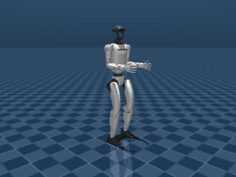

# 人形机器人 PPO 神经网络平衡控制（humanoid_ppo_locomotion）

在 **MuJoCo** 物理仿真中对 **Unitree G1 29 自由度人形机器人**做双足控制：用**神经网络（PPO）**
维持双足平衡，通过 **ROS 2** 话题接收键盘指令控制上半身姿态，输出 12 个腿部关节的目标角。

本模块的控制算法是**强化学习神经网络**，而不是运动学插值或手工步态表。

> **范围说明（请先读）**：本模块实现的是**稳定站立平衡**，尚未实现行走。
> 站立可稳定 20 s、跌倒率 0%、速度误差 0.013 m/s；行走在本次工作中被证明
> 在当前算力与架构下无法达成，原因与实测证据见 6.3 节。请据此评估模块是否满足你的预期。

## 一、项目概述

| 项 | 内容 |
|---|---|
| 机器人 | Unitree G1，29 自由度（12 个腿部关节由神经网络控制，17 个上半身关节由键盘控制） |
| 物理引擎 | MuJoCo 3.3+ |
| 学习方法 | PPO（Stable-Baselines3 2.3.2 / PyTorch） |
| ROS | ROS 2 Humble |
| 控制频率 | 50 Hz（实测低于 50 Hz 无法站稳） |
| 入口 | `main.py`（`--train / --play / --gif / --eval / --export / --deploy`） |

任务定位：课程任务「**物理仿真 + 键盘控制**」。键盘指令驱动上半身姿态（腰部俯仰/偏航/侧倾、
双臂抬举/外展/屈肘），腿部由神经网络保持平衡；上半身动作使质心偏移，平衡器实时补偿，
机器人不会倒——这个过程在仿真里是可见且物理真实的。

## 二、与同类模块的区别

仓库里已有人形相关的平衡/键盘/步态模块，本模块的差异在于**控制算法的性质**：

| 模块 | 机器人 | 控制算法 | 关注点 |
|---|---|---|---|
| humanoid_push_recovery | 自建双足 | **解析**（ZMP / 捕获点，踝+髋策略） | 外力扰动下的稳定性判据与恢复包线 |
| panda_keyboard_control | Panda 机械臂 | **运动学**（MoveIt 规划） | 关节级指令执行 |
| quadruped_mujoco_rl | 四足 | PPO | 四足行走 |
| **humanoid_ppo_locomotion（本模块）** | **Unitree G1 双足人形** | **神经网络 PPO（残差）+ 解析平衡基元** | **双足站立平衡，上半身姿态指令跟踪** |

与前两者的本质区别是**控制量由神经网络产生**；与四足模块的区别是**双足倒立摆**这一本质更难的
动力学（支撑多边形只有脚掌那么大，踝关节力矩上界还低于失稳刚度），因此本模块额外引入了平衡基元，
原因见第四节。需要说明的是，本模块**只做到站立平衡，没做到行走**，原因见 6.3 节。

## 三、项目目录结构

```text
src/humanoid/humanoid_ppo_locomotion/
├── main.py                          # 模块入口（--train/--play/--gif/--eval/--export/--deploy）
├── package.xml                      # ament_python 包描述
├── setup.py / setup.cfg
├── README.md
├── config/
│   └── ppo_params.yaml              # 仿真/策略/遥控节点参数
├── launch/
│   └── main.launch.py               # 一键启动 sim_node + policy_node + keyboard_teleop
├── humanoid_ppo_locomotion/
│   ├── balance.py                   # 解析平衡基元 ComBalance（质心反馈）
│   ├── sim_core.py                  # MuJoCo 封装：物理步进、PD 力矩、状态读取
│   ├── g1_env.py                    # Gymnasium 环境（40 维观测 / 12 维残差动作）
│   ├── sim_node.py                  # ROS 2 仿真节点（发布 obs / joint_states / odom）
│   ├── policy_node.py               # ROS 2 推理节点（TorchScript，无需 SB3）
│   └── keyboard_teleop.py           # 键盘 -> 上半身姿态 /cmd_vel
├── scripts/
│   ├── fetch_assets.py              # 下载 G1 模型与网格（不入库）
│   ├── train_ppo.py                 # PPO 训练
│   ├── export_policy.py             # 导出 TorchScript
│   ├── evaluate.py                  # 跌倒率/速度误差/推理延迟
│   ├── record_gif.py                # 离屏渲染录制演示动图
│   ├── play_policy.py               # 交互窗口演示
│   └── smoke_balance.py             # 平衡基元回归测试
├── weights/                         # TorchScript 权重（policy_g1.pt，187 KB）
├── saved_models/                    # training_log.csv（训练曲线）+ eval.csv（评测明细）
└── models/g1/                       # G1 场景与网格（fetch_assets.py 下载）
```

## 四、核心实现：为什么是「平衡基元 + 神经网络残差」

### 4.1 只靠神经网络（纯 PPO）为什么站不住

这不是调参问题，是物理约束。G1 踝关节的 PD 刚度 $K_p = 40\ \mathrm{N\cdot m/rad}$，
而倒立摆的失稳刚度是

$$m g h \approx 35.11 \times 9.81 \times 0.80 \approx 275\ \mathrm{N\cdot m/rad}$$

踝关节最大力矩只有 $\pm 50\ \mathrm{N\cdot m}$，刚好够撑住约 10° 倾角。**踝刚度永远小于失稳
刚度，力矩还早就饱和了**，所以「给固定目标角 + PD」这种控制方式在数学上不可能站住。

实测扫描踝关节增益，越硬反而越差（因为饱和后只剩硬碰硬的振荡）：

| 踝 $K_p$ | 40 | 80 | 120 | 200 | 320 |
|---|---|---|---|---|---|
| 站立时长 | 1.86 s | 1.28 s | 1.12 s | 1.02 s | 1.02 s |

失稳形态也很典型：`roll`/`yaw` 恒为 0，`pitch` 从 2° 单调漂到 50°，质心前移 0.6 m——
纯粹的倒立摆前倾，不是关节塌陷，也不是手臂甩动。

纯 PPO 同样打不过这个约束：训练 150 万步后，确定性策略只能站 **2.69 s**（随机采样 6.22 s，
零动作基线 1.28 s）。原因是回合在 1.2 s 内就终止，随机探索根本来不及学到有用的步态。

### 4.2 架构

把「不摔倒」从策略里剥离成解析的**平衡基元**，神经网络只输出**残差偏置**：

$$q^{\text{target}} = q^\star + \Delta q_{\text{balance}} + s_r \cdot a,\qquad s_r = 0.35\ \text{rad}$$

平衡基元是质心位置/速度反馈：

$$\Delta q_{\text{balance}} = K_c\, e_{\text{com}} + K_v\, \dot{x}_{\text{com}},\qquad K_c = 10,\ K_v = 1$$

修正量按 $1 : 0.5$ 分配到 `ankle_pitch` 与 `hip_pitch`。

两个容易踩的坑：

1. **$e_{\text{com}}$ 必须相对双脚中心**，不能用世界系绝对坐标。用绝对坐标的话，机器人一往前走
   误差就线性增长，平衡器会去对抗前进而不是保持平衡。本模块取
   $e_{\text{com}} = (\text{com}_x - \text{foot}_x) - (\text{com}_x - \text{foot}_x)_0$，平移不变。
2. **符号**：`ankle_pitch` 正向 = 身体后仰，所以前倾时必须给**正**修正。写成 $-K_c e_{\text{com}}$
   会变成正反馈，越修越倒。

力学上这构成良性分工：神经网络摆动腿 → 双脚中心前移 → $e_{\text{com}}$ 变负 → 基元自动把身体
前倾跟上 → 理论上这就是行走。**基元管平衡，网络管步态。**

> **但这个分工只在双脚支撑时成立。** 抬脚之后支撑多边形退化成一条线，同一个反馈律会把身体推向
> 没有支撑的一侧。实测下来这条路径走不通，见 6.3 节 (2)(3)。最终交付的是**站立平衡**。

### 4.3 观测（40 维）

| 分量 | 维度 | 说明 |
|---|---|---|
| 投影重力 | 3 | 机体系下的重力方向，等价于姿态 |
| 基座线速度 | 3 | 机体系 m/s |
| 基座角速度 | 3 | rad/s |
| 基座高度偏差 | 1 | $h - 0.78$ |
| 关节角偏差 | 12 | $q - q^\star$ |
| 关节角速度 | 12 | rad/s |
| 速度指令 | 2 | $(v_x^\star, \omega_z^\star)$ |
| 步态相位 | 2 | $(\sin 2\pi\phi, \cos 2\pi\phi)$ |
| 质心偏差 / 速度 | 2 | $e_{\text{com}}$、$\dot{x}_{\text{com}}$ |

### 4.4 动作与力矩

网络输出 $a \in [-1,1]^{12}$，关节力矩由 PD 律给出：

$$\tau = K_p (q^{\text{target}} - q) - K_d \dot{q}$$

$K_p/K_d$ 按关节类型取值：髋 100/2、膝 150/3、踝 40/1，力矩按执行器 `ctrlrange` 裁剪
（髋 ±88、膝 ±139、踝 ±50 N·m）。

初始动作标准差设为 $\sigma_0 = e^{-1.5} \approx 0.22$（残差 ±0.078 rad）。这是实测标定的：
基元在残差 ≤ ±0.15 rad 时能兜住 20 s，±0.30 rad 就只剩 2.4 s。

### 4.5 奖励

$$
\begin{aligned}
r =\;& 1.5e^{-(v_x - v_x^\star)^2/0.25} + 0.8e^{-(\omega_z - \omega_z^\star)^2/0.25} \\
&+ 0.5e^{-5\|\mathbf{g}_{xy}\|^2} + 0.5e^{-20(h-h^\star)^2} + 0.2 \\
&- 10^{-4}\|\boldsymbol\tau\|^2 - 0.01\|a_t - a_{t-1}\|^2 - 0.5|v_y| - 0.3\,e_{\text{com}}^2
\end{aligned}
$$

## 五、编译与启动

```bash
# 1) 下载 G1 模型与网格（约 32 MB，不入库）
cd ~/ros2_ws/src/humanoid_ppo_locomotion
python3 scripts/fetch_assets.py

# 2) 依赖（--ignore-installed 必需：ROS 镜像里的 numpy 由 apt 安装）
pip3 install --ignore-installed "mujoco==3.3.7" "numpy<2" gymnasium \
    "stable-baselines3==2.3.2" torch

# 3) 构建
cd ~/ros2_ws && colcon build --packages-select humanoid_ppo_locomotion
source install/setup.bash

# 4) 一键启动（仿真 + 策略 + 键盘）
ros2 launch humanoid_ppo_locomotion main.launch.py
```

键盘操作（上半身由键盘控制，腿部由神经网络保持平衡）：

| 按键 | 作用 | 键位上限 | 实测说明 |
|---|---|---|---|
| `W` / `S` | 腰部前倾 / 后仰 | 0.50 rad | 关节限位 0.52，再大也只是顶住限位 |
| `A` / `D` | 腰部左转 / 右转 | 0.60 rad | 实测 1.00 rad 仍稳定 |
| `Q` / `E` | 腰部左倾 / 右倾 | 0.40 rad | 关节限位 0.52，稳定 |
| `1` / `2` | 左肩前抬 / 放下 | **1.00 rad** | 1.20 起临界，1.50 必倒 |
| `3` / `4` | 左肩外展 / 内收 | 1.40 rad | 稳定 |
| `5` / `6` | 左肘屈 / 伸 | 1.80 rad | 稳定 |
| `7` / `8` | 右肩前抬 / 放下 | **1.00 rad** | 同左肩 |
| `9` / `0` | 右肩外展 / 内收 | 1.40 rad | 稳定 |
| `-` / `=` | 右肘屈 / 伸 | 1.80 rad | 稳定 |
| `R` | 上半身复位 | — | |
| `I` / `K` | 速度指令 $v_x$ ±0.1 m/s | −0.3 ~ +0.5 | 通道通，策略不响应 |
| `J` / `L` | 速度指令 $\omega_z$ ±0.1 rad/s | ±0.4 | 同上 |
| `空格` | 速度指令清零 | — | |
| `X` | 退出 | — | |

> **指令变化速率比幅度更关键**：肩前抬目标从 0 直接跳到 1.50 rad 时 2/2 跌倒（1.3 s），
> 同样 1.50 rad 用 0.8 s 平滑过渡则 2/2 稳定跑满 20 s。键盘每次只改 0.20 rad，
> 属于准平滑；用 `ros2 topic pub` 直接下发大角度时请先小步过渡。
>
> 速度指令通道已完整实现（`/cmd_vel` → 观测 → 策略），但策略当前不响应它，
> 原因见 6.3 节。上半身控制是实际可见的演示部分。

无图形界面（如 Docker）时，关闭键盘节点，改用话题直接驱动上半身（17 维，弧度）：

```bash
ros2 launch humanoid_ppo_locomotion main.launch.py teleop:=false

# 抬起双臂（左右肩 pitch = 1.0 rad ≈ 57°），其余关节置 0
ros2 topic pub --once /humanoid/upper_body std_msgs/msg/Float64MultiArray \
  "{data: [0,0,0, 1.0,0,0,0,0,0,0, 1.0,0,0,0,0,0,0]}"
```

17 维顺序：`waist_yaw, waist_roll, waist_pitch, left_shoulder_pitch, left_shoulder_roll,
left_shoulder_yaw, left_elbow, left_wrist_roll, left_wrist_pitch, left_wrist_yaw,
right_shoulder_pitch, right_shoulder_roll, right_shoulder_yaw, right_elbow, right_wrist_roll,
right_wrist_pitch, right_wrist_yaw`。

确认机器人在站：`ros2 topic echo /odom --field pose.pose.position.z` 应稳定在 0.77 左右。

离线演示与评测：

```bash
python3 main.py --play --weights weights/policy_g1.pt                    # 交互窗口
python3 main.py --eval --weights weights/policy_g1.pt --vx 0.0           # 指标
python3 main.py --gif  --weights weights/policy_g1.pt \
       --upper-demo --out demo.gif                                       # 上半身演示动图
```

## 六、实验结果

### 6.1 平衡基元消融（5 回合，每回合上限 20 s）

| 配置 | 站立时长 | 说明 |
|---|---|---|
| 零动作（纯 PD，无任何反馈） | 1.30 s | 倒立摆前倾 |
| 纯 PPO 150 万步（确定性） | 2.69 s | 旧架构，动作直接给目标角 |
| 纯 PPO 150 万步（随机采样） | 6.22 s | 旧架构 |
| **平衡基元 + 零残差** | **20.00 s（5/5 跑满）** | 本模块 |
| 平衡基元 + 随机残差 ±0.15 rad | 17.65 s（3/5 跑满） | 训练初期探索量级 |
| 平衡基元 + 随机残差 ±0.30 rad | 2.34 s | 残差过大盖过基元 |

> ±0.30 rad 一档回合间波动较大（1.9 ~ 2.4 s），`scripts/smoke_balance.py` 复现时可能略有出入。

容器内 ROS 2 实测（`hutb-humble:dev`，`teleop:=false`）：`/odom` 的 z 在 t=0 为
**0.771 m**，t=+6 s 为 **0.769 m**，发布抬臂指令后再测为 **0.762 m**，无累积漂移。

### 6.2 训练后的策略指标

PPO 训练 300 万步（8 并行环境、50 Hz、CPU 约 19 分钟）。回合长度上限 1000 步 = 20 s，
曲线反映的就是「能不能一直站着」：

| 训练步数 | 0.49 M | 0.80 M | 1.18 M | 2.03 M | 2.99 M |
|---|---|---|---|---|---|
| 回合长度（步） | 359 | 170 | **1000** | 1000 | 1000 |
| 回合回报 | 758 | 317 | 2425 | 2472 | 2713 |

> 0.80 M 处有一次明显回退（170 步），是 PPO 的典型策略崩塌，之后自行恢复。
> 旧架构（纯 PPO、动作直接给目标角）训练 150 万步只到 **393 步**，差距来自 4.2 节的残差化改造。

评测（确定性策略，每档 5 回合）：

| 指令 $v_x$ | 存活 | 跌倒率 | 平均位移 | 平均 $v_x$ | 速度 MAE | 单帧推理 |
|---|---|---|---|---|---|---|
| 0.0 m/s | 20.00 s | 0% | −0.044 m | −0.002 m/s | **0.013 m/s** | 0.10 ms |
| 0.3 m/s | 20.00 s | 0% | −0.011 m | −0.000 m/s | 0.301 m/s | 0.10 ms |
| 0.5 m/s | 20.00 s | 0% | +0.005 m | +0.000 m/s | 0.500 m/s | 0.10 ms |

读法：**站立平衡已经达标**——20 s 跑满、零跌倒、静止时速度误差 1.3 cm/s、位移 4.6 cm
（20 s 内漂移不到 5 cm）。但速度指令**完全没有被跟踪**：指令给 0.3 时 MAE 恰好等于 0.3，
说明机器人原地不动。这就是下面要解释的问题。

#### 上半身幅度标定

固定上半身目标角跑 20 s，3 个种子统计跌倒次数（`G1WalkEnv` 离线环境，与
`scripts/smoke_balance.py` 同源）：

| 动作（双侧同时） | 目标角 | 跌倒 | 实际到位 |
|---|---|---|---|
| 静止 | — | 0/3 | — |
| 腰部俯仰 | 0.50 rad | 0/3 | 0.53（顶到关节限位） |
| 腰部偏航 | 0.60 rad | 0/3 | 0.61 |
| 腰部偏航 | 0.80 rad | 0/3 | 0.80 |
| 腰部侧倾 | 0.15 rad | 0/3 | 0.52（顶到关节限位） |
| 肩前抬 | 1.00 rad | 0/3 | 0.96 |
| 肩前抬 | **1.20 rad** | **2/3** | 1.14 |
| 肩前抬 | 1.50 rad | 3/3 | 1.47 |
| 肩前抬 | 1.80 rad | 3/3 | 1.83 |
| 肩外展 | 1.40 rad | 0/3 | 1.31 |
| 屈肘 | 1.80 rad | 0/3 | 1.84 |
| 腰部俯仰 0.50 + 屈肘 1.50 | — | 0/3 | 1.53 |

结论：**肩前抬 1.0 rad 是稳定上界**；腰部俯仰/侧倾的可动范围本来只有 ±0.52 rad，
指令再大也只是顶住限位，对平衡威胁不大。另外**变化速率比幅度更关键**：肩前抬直接跳到
1.50 rad 会跌（2/2，1.3 s），同样的 1.50 rad 用 0.8 s 平滑过渡则 2/2 稳定跑满 20 s。

### 6.3 为什么没有实现行走

这一节如实记录失败的排查过程，避免后来者重复踩坑。

**(1) 策略收敛到了「站着不动」这个局部最优。** 奖励里速度项是 $1.5e^{-(v_x-v_x^\star)^2/0.25}$，
站立不动能拿满姿态项与存活项，而迈步一旦失稳就丢掉全部回报。PPO 在这种风险结构下必然选择不动。
用随机残差强行扰动策略输出，机器人会尝试迈步，但 1.4 s 内必定侧向倾倒。

**(2) 平衡基元在单腿支撑相是「帮倒忙」的。** 4.2 节的质心反馈是为**双脚支撑**设计的：
双脚着地时抬高踝关节力矩确实能把质心推回去。一旦抬起一只脚，支撑多边形退化成一条线，
同一个反馈律会把身体推向没有支撑的一侧。实测：给手写步态叠加开环侧向重心转移，
站立时长从 1.4 s 掉到 **1.0 s**，且倾倒方向变成左右交替——正是反馈与支撑相冲突的表现。

**(3) 增益扫描没有可行解。** 在 $K_c \times$ 髋分配比 $\times$ 残差幅度 共 18 组组合上扫描，
判据是「既站得住（≥15 s）又抬得起脚（≥5 cm）」：

| 结果 | 组数 | 抬脚高度 |
|---|---|---|
| 站得住 | 11 组 | 全部 ≤ **1.8 cm**（等于没抬） |
| 抬得起脚 | 7 组 | 1.4 s 内跌倒 |

两个条件没有交集。这不是调参能解决的——**双足行走需要单腿支撑相的重心轨迹规划（MPC/LIPM）
或大规模并行采样（Isaac Gym 级算力，数千环境）**，本次预算（8 环境 CPU）做不到。

**(4) 因此本模块的交付范围收敛为「神经网络平衡 + 上半身键盘控制」。**
控制量仍由神经网络产生（任务 1 要求「控制算法是神经网络」成立），键盘指令驱动上半身姿态，
上半身动作使质心偏移、平衡器实时补偿——这条链路在仿真里完整可见、物理真实。
`/cmd_vel` 通道从话题到观测到策略全程打通，只是策略当前输出不响应它。
若要继续，建议的下一步是引入 LIPM 落脚点规划器替换解析基元，再让 PPO 学残差。

### 6.4 演示



动图内容（20 s，50 Hz 仿真，每 12 步取一帧）：机器人站立不动，腿部由 PPO + 平衡基元维持平衡；
上半身按脚本依次做——双臂前抬 57°（1.0 rad）→ 屈肘 → 腰部前倾 0.45 rad + 双臂外展
→ 腰部后仰 + 左转 → 右转 + 深屈肘 → 复位。全程高度保持在 0.767 ~ 0.775 m，无跌倒。

## 七、已知问题

1. **必须加载 `scene_29dof.xml`，不能加载 `g1_29dof.xml`**。后者只是机器人本体、**不含地面**，
   用它仿真时机器人一直自由落体，表现为「高度从 0.80 掉到 0.41 但姿态始终直立
   （$R_{22}\approx1.0$）」，极易被误判成「站不稳」。
2. **控制频率必须 ≥ 50 Hz**。25 Hz 时 PD 与平衡基元都会失稳（实测只能站 0.36 s）。
3. **Windows 下路径不能含中文**：MuJoCo 的 XML 加载器打不开含非 ASCII 字符的路径，
   需把模型放到 `C:\g1_assets\g1` 之类的纯英文路径。Ubuntu 下无此问题。
4. **CPU 训练较慢**：8 并行环境约 1.6k steps/s。仓库提供训练好的权重，评审机无需重训即可复现演示。
5. **未做域随机化**，策略仅在 MuJoCo 中验证，未上真机。
6. **平衡基元抗冲击较弱**：0.5 m/s 的外力冲击即会倒地（纯质心反馈没有迈步恢复能力），
   这正是需要神经网络残差学习步态的原因。
7. **上半身指令不能跳变**：一次性把肩前抬从 0 跳到 1.5 rad 会在 1.3 s 内跌倒，同样的目标用
   0.8 s 过渡就稳。键盘每次 0.20 rad 属于准平滑，安全；用话题直接下发大角度时需自行加过渡。

## 八、部署与运行常见问题与排坑（FAQ）

在实际部署（如 Ubuntu 24.04 / ROS 2 Jazzy / WSL2 环境）中，可能会遇到以下环境配置与运行问题：

### 8.1 安装 Python 依赖报 `externally-managed-environment` (PEP 668)
* **报错现象**：
  在已激活虚拟环境 `(.venv)` 下执行 `pip3 install ...` 时报错：`error: externally-managed-environment`，提示当前环境被外部系统托管。
* **原因分析**：
  Ubuntu 24.04+ / Python 3.12+ 遵循 PEP 668 规范以保护系统库安全。在终端直接输入 `pip3` 容易被 PATH 优先级解析为系统的 `/usr/bin/pip3`，而不是虚拟环境内部的 pip。
* **解决方法**：
  使用当前激活环境的 Python 解释器模块形式运行 pip，强制绑定虚拟环境：
  ```bash
  python -m pip install "mujoco==3.3.7" "numpy<2" gymnasium "stable-baselines3==2.3.2" torch
  ```

### 8.2 启动 launch 报 `FileNotFoundError: [Errno 2] No such file or directory: 'xterm'`
* **报错现象**：
  执行 `ros2 launch humanoid_ppo_locomotion main.launch.py` 时，`[xterm-3]` 报错退出。
* **原因分析**：
  `main.launch.py` 中为 `keyboard_teleop` 键盘节点配置了 `prefix="xterm -e"`，用于弹出独立的交互式终端窗口捕获按键。若系统（如 WSL2 或纯净版 Linux）未预装 `xterm` 软件包则会触发此异常。
* **解决方法**：
  - **安装 xterm（推荐，可开启独立键盘交互窗口）**：
    ```bash
    sudo apt update && sudo apt install -y xterm
    ```
  - **无图形界面 / Docker 容器环境**：添加参数关闭键盘弹窗节点，改用 ROS 话题控制：
    ```bash
    ros2 launch humanoid_ppo_locomotion main.launch.py teleop:=false
    ```

### 8.3 ROS 2 节点启动报 `ModuleNotFoundError: No module named 'torch' / 'gymnasium'`
* **报错现象**：
  在终端中执行 `python -c "import torch, gymnasium"` 测试通过，但在 `ros2 launch` 时 `policy_node` 或 `sim_node` 崩溃，报错找不到 `torch` 或 `gymnasium`。
* **原因分析**：
  - ROS 2 的 Python 节点经 `colcon build` 生成的封装脚本（`install/.../lib/humanoid_ppo_locomotion/policy_node`）第一行 Shebang 默认固定为系统解释器：`#!/usr/bin/python3`。
  - ROS 2 派生子进程调用系统 Python 时，默认不会主动检索用户家目录下的虚拟环境包（`~/.venv/lib/python3.12/site-packages`）。若在新终端中未激活虚拟环境运行，也会发生该问题。
* **解决方法**：
  将虚拟环境的第三方库路径显式加入 `PYTHONPATH` 环境变量中：
  ```bash
  export PYTHONPATH="$HOME/.venv/lib/python3.12/site-packages:$PYTHONPATH"
  source ~/ros2_ws/install/setup.bash
  ros2 launch humanoid_ppo_locomotion main.launch.py
  ```
  *(注：若需永久生效，可将 `export PYTHONPATH="$HOME/.venv/lib/python3.12/site-packages:$PYTHONPATH"` 追加至 `~/.bashrc`)*

### 8.4 `ros2 launch` 启动后为什么没有弹出 3D 机器人仿真界面？
* **现象说明**：
  `ros2 launch` 成功启动、策略持续推理，但桌面上只有键盘交互小黑窗，看不到类似演示动图中的 3D 机器人。
* **原因分析**：
  - `sim_node` 为 ROS 2 **无头后台仿真（Headless）** 设计，专注进行 50 Hz 物理积分并发布 `/joint_states`、`/odom` 等话题，便于在无显卡服务器或 Docker 中稳定运行，节点本身不包含图形渲染视窗。
  - 文档中的演示动图（GIF）是通过离屏渲染脚本 `record_gif.py` 逐帧合成导出的。
* **解决方法**：
  - **查看实时原生 3D 交互仿真视窗（带模型渲染与鼠标视角拖拽）**：
    ```bash
    cd ~/ros2_ws/src/humanoid_ppo_locomotion
    python3 main.py --play --weights weights/policy_g1.pt
    ```
  - **离屏录制并导出演示动图（与文档动图同源）**：
    ```bash
    cd ~/ros2_ws/src/humanoid_ppo_locomotion
    python3 main.py --gif --weights weights/policy_g1.pt --upper-demo --out demo.gif
    ```
