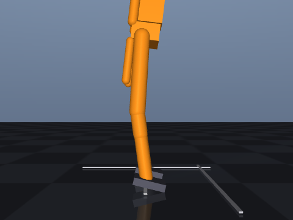
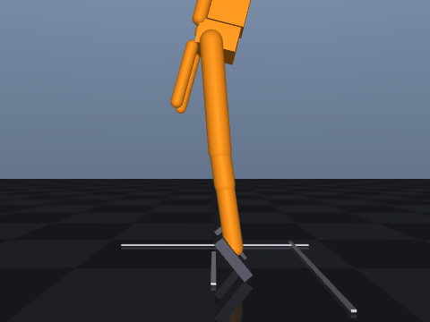
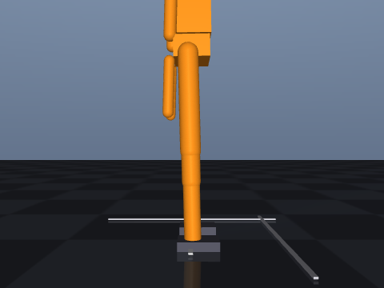
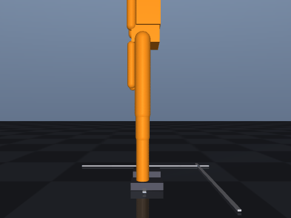

# 人形机器人平衡控制与外力抗扰恢复（humanoid_push_recovery）

任务「人形机器人物理仿真」下的**稳定性与抗扰恢复**方向实现：自建双足人形 MJCF 模型的
底盘 freejoint **完全自由**（不做速度锁定），机器人依靠双脚与地面的真实接触以及关节
力矩站立；模块实现 **ZMP / 捕获点稳定性判据** 与 **踝策略 + 髋策略** 的恢复控制律，
并定量给出「扰动力 → 最大质心偏移 → 恢复 / 跌倒」的完整恢复包线。

与同分类其它人形模块的区别（下列模块在各自的 PR 中提交，**尚未合并到本分支**，
为避免死链此处只做文字对比、不提供跳转）：

| 模块 | 输入 | 关注点 |
|---|---|---|
| humanoid_keyboard_control | 键盘速度指令 | 指令执行准确性（运动学层面） |
| humanoid_gait_control | 步态周期 | 行走步态生成与跟踪 |
| **humanoid_push_recovery（本模块）** | **外力扰动** | **外力下的稳定性判据与恢复能力** |

本模块的机器人**不是**靠改写 freejoint 速度「站住」的，而是真实受力平衡——这一点是
与键盘控制模块的本质区别，也是能够研究「被推是否跌倒」的前提。

## 1. 系统架构

```text
        ┌──────────────── 外力扰动 ────────────────┐
        │  /balance/push (Vector3) 或 keyboard      │
        ▼                                          │
   torso: data.xfrc_applied (6 维力/力矩)           │
        │                                          │
        ▼                                          │
   站姿 PD (15 关节) ──► 关节力矩 ──► MuJoCo 物理引擎 │
        ▲                                          │
        │  关节目标修正                             │
   ┌────┴─────────────────────────┐                │
   │ 平衡控制器 BalanceController  │                │
   │ · 踝策略：躯干倾角 + 质心偏差   │                │
   │   → 踝力矩 (N·m)              │                │
   │ · 髋策略：质心偏差/速度 → 髋力矩 │                │
   └────▲─────────────────────────┘                │
        │                                          │
   ┌────┴─────────────────────────┐                │
   │ 稳定性判据（balance/ 子包）    │◄───────────────┘
   │ · 支撑多边形（脚底 8 角点凸包）│
   │ · ZMP（LIPM 近似）            │
   │ · 捕获点 ξ = x + v/√(g/h)     │
   └──────────────────────────────┘
```

判据与策略的代码基础为开源项目
[PrageethM1702/Bipedal-Walking-and-Push-Recovery](https://github.com/PrageethM1702/Bipedal-Walking-and-Push-Recovery)
（Apache-2.0，改写适配见 3.4 节与包内 `THIRD_PARTY_NOTICES.md`）。

## 2. 依赖安装与运行

### 2.1 环境与依赖安装

```shell
# 1) 安装 ROS2 Humble（Ubuntu 22.04）：
#    参考官方文档 https://docs.ros.org/en/humble/Installation/Ubuntu-Install-Debs.html

# 2) 安装 Python 依赖（在**仓库根目录**执行；mujoco / numpy / pyyaml）
pip3 install -r src/humanoid/humanoid_push_recovery/requirements.txt

# 3) 可视化窗口依赖（仅 Linux 桌面需要；若提示缺少 GLFW 再执行）
sudo apt install -y libglfw3
```

ROS 依赖（`rclpy`、`geometry_msgs`、`sensor_msgs`、`std_msgs`、`tf2_ros`、
`ros2launch`）在 `colcon build` 时自动解析，无需手动安装。

### 2.2 源码放入工作空间与构建

```shell
mkdir -p ~/ros2_ws/src
cp -r src/humanoid/humanoid_push_recovery ~/ros2_ws/src/

cd ~/ros2_ws
colcon build --symlink-install --packages-select humanoid_push_recovery
source install/setup.bash
```

> 注意：执行完本节后当前目录是 `~/ros2_ws`，而本包被拷贝到
> `~/ros2_ws/src/humanoid_push_recovery`（**不含 `humanoid/` 这一层**）。

### 2.3 standalone（无需 ROS，最快验证）

standalone 模式**不依赖 ROS，也不要求先 colcon build**。下面的路径以「仓库克隆在
`~/ros2`」为例，请替换成自己的实际路径：

```shell
cd ~/ros2/src/humanoid/humanoid_push_recovery   # ← 换成你自己的仓库路径
python3 main.py --check          # 模型/判据/控制器 自检
python3 main.py                  # 演示：一次推扰 + 平衡恢复（打开可视化窗口）
python3 main.py --force 180      # 指定扰动力 (N)
python3 main.py --direction 90   # 扰动方向（0=前向, 90=侧向, 180=后向）
python3 main.py --no-hip         # 关闭髋策略（仅踝策略，对照用）
python3 main.py --sweep          # 测定各方向临界冲量并与策略对照
python3 main.py --capture assets_out  # 采集关键帧/动图/时序CSV/metrics.json
python3 main.py --test           # 自动化测试（38 项）
```

若运行的是 2.2 节拷贝到工作空间的那一份，路径为
`~/ros2_ws/src/humanoid_push_recovery`（同样没有 `humanoid/` 这一层）。

无显示环境（SSH / 容器）下渲染需要 EGL：

```shell
export MUJOCO_GL=egl
```

### 2.4 ROS2 Humble launch

```shell
cd ~/ros2_ws
colcon build --symlink-install --packages-select humanoid_push_recovery
source install/setup.bash
ros2 launch humanoid_push_recovery main.launch.py
```

焦点保持在启动终端，按键盘施加扰动：

| 按键 | 动作 |
|---|---|
| `W` / `S` | 向前 / 向后推 |
| `A` / `D` | 向左 / 向右推 |
| `Q` / `E` | 左前 / 右后斜向推 |
| `↑` / `↓` | 同 `W` / `S`（方向键） |
| `←` / `→` | 同 `A` / `D`（方向键） |
| `+` / `-` | 推扰力度 ±20 N |
| `空格` | 复位 |
| `ESC` | 退出 |

另开终端查看状态：

```shell
ros2 topic echo /balance/status            # stable / recovering / fallen
ros2 topic echo /balance/stability_margin  # 捕获点到支撑边界的稳定裕度 (m)
ros2 topic echo /balance/zmp               # 零矩点
ros2 run tf2_ros tf2_echo world humanoid/base_link   # 验证 TF 可读取
```

### 2.5 可视化窗口（看到人形机器人界面）

standalone 演示与 `ros2 launch` **默认都会打开 MuJoCo 可视化窗口**，窗口内可实时看到
机器人被推后的位移与姿态变化，相机自动跟踪躯干。

| 运行环境 | 能否看到窗口 | 说明 |
|---|---|---|
| 本机 Ubuntu 桌面 / 虚拟机桌面终端 | ✅ | 直接运行即可 |
| SSH 远程登录 | 需 X11 转发 | 用 `ssh -X user@host` 登录，或先 `export DISPLAY=:0` |
| 无显示服务器（纯命令行 / CI） | ❌ | standalone 加 `--no-viewer`；ROS2 用 `visualize:=false` |

无图形界面时程序会打印提示并自动退化为无窗口模式，**物理仿真、话题发布与自动化测试不受影响**。

## 3. 实现要点

### 3.1 自建双足模型（models/humanoid_balance.xml）

15 关节 = 双腿（髋 roll / 髋 pitch / 膝 pitch / 踝 pitch / 踝 roll）×2 + 双臂
（肩 pitch / 肘 pitch）×2 + 颈 ×1，全部由 `motor` 驱动。与同分类其它模块自建双足
模型的关键区别：

- **底盘 freejoint 不做速度锁定**：机器人的站立完全由双脚与地面的接触力和关节力矩决定；
- 脚掌前后长度加大到 0.22 m，以获得更大的踝关节力矩权限；
- 脚掌与地面摩擦单独加大（`friction="1.4 0.7 0.2"`）；
- 外力扰动施加在 `torso` body 上（`data.xfrc_applied`）。

### 3.2 站姿 PD 控制

每个关节的驱动力矩为 PD 控制，目标姿态为直立位（全 0）：

\[
\tau_i = k_p (q_i^{ref} - q_i) - k_d \dot{q}_i,\qquad
i \in \{\text{髋/膝/踝/肩/肘/颈}\}
\]

其中 `kp=120`、`kd=6`；髋/踝 roll 关节取 `kp_roll=400` 抗侧倾；力矩限幅
`±300 N·m`。**只有站姿 PD 时机器人会因倒立摆本质而逐渐前倾并跌倒**，这正是需要
平衡控制器的原因（见 5.2 节对照实验）。

### 3.3 稳定性判据

- **支撑多边形**：取双脚底面 8 个角点，用 Andrew 单调链求凸包；
- **ZMP（零矩点）**：采用线性倒立摆近似
  \[
  \mathrm{ZMP} = \mathrm{CoM}_{xy} - \frac{z_{\mathrm{com}}}{g}\,\ddot{\mathrm{CoM}}_{xy}
  \]
  质心加速度由质心速度的有限差分求得（并做一阶低通抑制差分噪声）；
- **捕获点**：\(\xi = \mathrm{CoM}_{xy} + \mathbf{v}_{\mathrm{com}}/\omega\)，
  \(\omega=\sqrt{g/h}\)；**稳定裕度**定义为捕获点到支撑多边形边界的有符号距离，
  裕度 > 0 表示仅靠踝/髋策略仍可停下，< 0 表示必须跨步。

> 实现注记：实测在 MuJoCo 3.16 中 `data.subtree_linvel[0]` 恒为 0，
> 因此质心速度统一由 `data.subtree_com[0]` 的有限差分求得（见 `sim_core.py`）。

### 3.4 恢复控制律：踝策略 + 髋策略（输出关节力矩）

平衡控制器输出的是**关节力矩修正量**（N·m），而不是关节目标角度。原因：踝 pitch
关节的实际行程只有 ±0.9 rad，若用「关节目标」表达平衡修正，为获得足够的恢复力矩
必须下发远超行程的目标（例如 3 rad ≈ 172°），既不合理、又会立刻被关节限位截断，
物理含义模糊。改用**力矩量纲**后，限幅直接表示关节力矩权限，整定也更有依据。

控制律与几何判据的**代码基础是开源项目
[PrageethM1702/Bipedal-Walking-and-Push-Recovery](https://github.com/PrageethM1702/Bipedal-Walking-and-Push-Recovery)
（Apache License 2.0）**，其 `balance/` 下的捕获点、支撑多边形、踝策略、髋策略四个
文件改写进本模块的 `humanoid_push_recovery/balance/` 子包（改写点逐文件在文件头注明，
汇总见包内 `THIRD_PARTY_NOTICES.md`）。必要改动有三处：原项目是 PyBullet **位置控制**
机器人、策略输出关节目标角偏置；本站模型是 MuJoCo **力矩控制**、踝关节行程有限，
故 ① 输出改为关节力矩；② 倾角输入改用躯干轴倾角与其低通速率；③ 为消除稳态偏差，
在倾角项之外保留质心位置/速度反馈项。

**踝策略（主力）**：倾角 PD 项（来自上游实现）+ 质心反馈项：

\[
\tau^{\mathrm{ankle}} = \underbrace{k_p^{l}\,\theta + k_d^{l}\,\dot\theta}_{\text{上游倾角 PD}}
+ \underbrace{k_p^{a}\,(x_{\mathrm{com}}-x_{\mathrm{ref}}) + k_d^{a}\,v_{\mathrm{com},x}}_{\text{本站质心反馈}},
\qquad |\tau^{\mathrm{ankle}}| \le \tau^{a}_{\max}
\]

其中 \(\theta\) 为躯干轴相对竖直方向的前倾量（`lean_x`）。侧向 roll 轴同构，
符号取反（见 3.5）。

**髋策略（增强）**：踝策略饱和后，通过摆动上半身产生角动量继续把质心拉回：

\[
\tau^{\mathrm{hip}} = -k_p^{h}\,(x_{\mathrm{com}}-x_{\mathrm{ref}}) - k_d^{h}\,v_{\mathrm{com},x},
\qquad |\tau^{\mathrm{hip}}| \le \tau^{h}_{\max}
\]

力矩由 `sim_core.step()` 叠加到站姿 PD 力矩上，再一并限幅到 `torque_limit`。
（髋策略可开关：`hip_enable` / `--no-hip`，用于「仅踝 vs 踝+髋」对照实验。）

### 3.5 符号约定与整定（踩过的坑，供复现参考）

控制律的**符号若写反，会形成正反馈直接把机器人推倒**，因此模块把符号自检写进了
自动化测试（测试项 7，四个方向逐一标定）。实测符号约定（均指**正力矩**）：

| 关节 | 正力矩作用下质心移动方向 | 控制律符号 |
|---|---|---|
| 踝 pitch | **向后**（−x） | `+(k_p e_x + k_d v_x)` |
| 踝 roll | **向 +y（左）** | `−(k_p e_y + k_d v_y)` |
| 髋 pitch | 向前（+x） | `−(k_p e_x + k_d v_x)` |
| 髋 roll | 向 −y（右） | `+(k_p e_y + k_d v_y)` |

另一个关键整定点：**侧向 roll 关节的力矩权限远大于 pitch**。早期实现用「关节目标」
表达控制量时，沿用 pitch 的增益（等价于约 300 N·m 的滚转力矩）会把机器人
**抛离地面**（根高从 1.084 m 跳到 1.203 m）而立刻跌倒；改为力矩量纲后，侧向单独整定
并单独限幅（`kp_ankle_roll=4800 N·m/m`、`kd_ankle_roll=600 N·m·s/m`、
`ankle_roll_torque_limit=180 N·m`，约为 pitch 的 60%）。

引入上游的倾角 PD 项后又有两条实测结论（都写进了参数文件注释）：

1. **倾角项不能单独用**：只用倾角 PD 时，重力力矩与 PD 力矩的平衡点不在竖直位，
   静立漂移 10~25 mm（`kp_lean=600` 时甚至 220 mm 后跌倒）；倾角项与质心反馈项**组合**
   时反而更好——静立漂移 0.65 mm，前向 120 N 推扰最大偏移从 43.6 mm 降到 34.5 mm，
   所以最终控制律是「倾角 P + 质心 PD」的叠加；
2. **倾角微分项默认关闭**（`kd_ankle_lean = 0`）：`lean` 由躯干旋转矩阵差分得到，
   噪声大，未低通时很小的微分增益就会把控制器推向高频震荡、静立即倒；加了
   一阶低通（`sim_core.LEAN_RATE_FILTER = 0.7`）后 `kd_lean=150` 能稳定，但临界冲量
   反而下降，故默认取 0，参数保留以便复现该对比。
   倾角比例增益取 `kp_ankle_lean = 300 N·m/rad`（该值下静立与三向抗扰均通过，
   150 N·m/rad 与 300 N·m/rad 相当，再往上则因踝力矩饱和出现极限环）。

### 3.6 能力边界（重要）

- 本模块的恢复能力**完全来自踝/髋关节力矩，未实现跨步恢复（stepping）**。
  当扰动超过临界冲量时机器人会跌倒——这是**由脚掌几何与关节力矩权限决定的物理上限**，
  不是控制器参数没调好。以踝策略的静态权限估算：踝关节可提供的最大恢复力矩
  约为 \(F_z \cdot l_{\text{foot}} \approx 35 \times 9.81 / 2 \times 0.11 \approx 187\ \mathrm{N\cdot m}\)
  每只脚，而倒立摆的倾覆力矩为 \(mg\,x_{\mathrm{com}}\)，由此给出的可恢复质心偏移
  已接近实测临界值；
- 模型为自建简化双足，连杆长度、质量分布与摩擦均与真实人形机器人不同，
  临界冲量的**绝对值不可外推到实机**，但「扰动力—偏移—跌倒」的定性规律与
  策略间的**相对提升**具有参考意义；
- 评价指标只描述**本仿真模型在上述参数下的行为**，不代表硬件实验结论。

## 4. 效果图

推扰—恢复过程的自动演示（**150 N 前向推扰**，固定侧视相机 + 初始质心参考线，
图像由 `python3 main.py --capture <目录> --no-viewer --force 150` 从真实仿真渲染采集）：

| 静立站姿 | 被推瞬间 | 恢复中 | 恢复稳定 |
|---|---|---|---|
|  |  |  |  |

完整动画：

说明：

- 演示使用**固定侧视相机**（模型内 `demo_side`，不跟随机器人），并地面上画出
  **初始质心参考线**（机器人脚下那根白色细条，采集时自动移到初始质心正下方），
  因此「被推 → 质心偏移 → 拉回」的整个过程在画面中可直接读出；
- 本模块**不生成、不提交数据曲线图**（已移除 matplotlib 绘图代码）。恢复过程的时序
  原始数据在采集时导出为 `recovery_series.csv`（时间 / 质心偏移 / 躯干倾角 / 踝与髋
  力矩），需要曲线时请用这份实测数据自行绘制；上表四个关键帧与动画均来自同一次
  真实仿真运行。

## 5. 验证结果

以下 5.1~5.4 的数值在 **Windows 11（MuJoCo 3.16.0 / Python 3.13 / numpy）** 上实测，
指令：`python3 main.py --sweep`、`python3 main.py --test`、`python3 main.py --check`。
复现命令与原始数据导出方式见第 2、4 节（`--capture` 会同时导出时序 CSV）。

> 物理量（质心漂移、最大偏移、恢复时间、临界冲量）为确定性仿真结果，
> 与机器无关；只有仿真吞吐是机器相关的（见 5.4）。5.5 的 ROS2 集成验证在
> 上一修订版（commit 78fce38）的虚拟机中完成，参数加载与 launch 机制在本版
> 未改动；本版在其基础上重整了控制律代码与增益。

### 5.1 站立稳定性

| 指标 | 结果 |
|---|---|
| 无扰动自由站立（8 s） | 不跌倒，质心漂移 **0.55 mm**，根高 1.084 m |
| 躯干倾角（静立） | 1.11° |
| 静立稳定裕度（捕获点到支撑边界） | **93.1 mm** |
| 支撑多边形尺寸 | 前后 220 mm × 侧向 460 mm |

### 5.2 抗扰恢复（对照实验）

**关闭平衡控制器时，120 N×(0.08 s) 推扰即跌倒**（最大质心偏移 373 mm）——
说明本模型的站立**不是**靠锁定底盘维持的，平衡控制器是必需的。

开启平衡控制器后：

| 扰动 | 最大质心偏移 | 恢复时间 | 恢复后残差 |
|---|---|---|---|
| 前向 120 N (9.6 N·s) | **36.3 mm** | **0.84 s** | 0.49 mm |
| 侧向 150 N (12.0 N·s) | **34.5 mm** | **0.74 s** | 5.94 mm |
| 斜向 45° 120 N (9.6 N·s) | 29.9 mm | 未达标* | 8.23 mm |

\* 斜向推扰后质心停在 8.2 mm 的稳态偏移上（未进入 <5 mm 判据），该偏移由 roll 轴
恢复力矩与重力的平衡点决定，约为侧向支撑宽度的 1.8%，远在支撑多边形之内——
属于「稳定但未回到原点」，不是跌倒或震荡。

### 5.3 临界冲量（二分法测定，扰动持续 0.08 s）

| 方向 | 仅踝策略 | 踝+髋策略 | 提升 |
|---|---|---|---|
| 前向 (+x) | 147.3 N / **11.79 N·s** | 163.7 N / **13.10 N·s** | **+11.1%** |
| 侧向 (+y) | 226.6 N / **18.13 N·s** | 284.6 N / **22.77 N·s** | **+25.6%** |
| 后向 (−x) | 40.1 N / 3.21 N·s | 41.0 N / 3.28 N·s | +2.4% |

**结论与分析**：

1. **踝策略是站立抗扰的主力**，髋策略在不改变任何硬件参数的前提下把可恢复冲量
   提升 11.1%（前向）/ 25.6%（侧向），同时降低了最大偏移与恢复时间；
2. **侧向抗扰能力显著强于前向**（18.13 vs 11.79 N·s），因为双足站立时侧向支撑宽度
   （460 mm，靠双足共同支撑）大于前后支撑长度（220 mm，靠单脚脚掌）；
3. **后向抗扰最弱**（3.21 N·s），因为脚掌在踝关节前方的延伸（0.12 m）明显长于后方
   （0.07 m），向后倾覆时可用的踝关节力矩权限最小——这解释了为什么人从背后被推更容易
   向前扑倒；
4. 超过临界冲量后必然跌倒，属于 3.6 节所述**物理上限**；要进一步提升需要引入
   **跨步恢复（stepping）**，这是本模块明确未实现的边界。

### 5.4 仿真性能

| 指标 | 结果 |
|---|---|
| 仿真吞吐 | 9,047 ~ 14,691 step/s |
| 实时因子 | 18.1× ~ 29.4×（随机器负载波动） |

> 吞吐随机器变化：同一模块在 Ubuntu 22.04 虚拟机（2 vCPU）上约为 9,433 step/s
> （18.9×）。**两种环境都远超实时要求**（演示只需 >1×）。

### 5.5 ROS2 集成验证（Ubuntu 22.04.5 + Humble 实测）

在虚拟机中执行 `colcon build --symlink-install --packages-select humanoid_push_recovery`
（构建 1.20 s 成功，两个可执行文件 `balance_sim_node` / `push_teleop_node` 注册正常），
随后 `ros2 launch humanoid_push_recovery main.launch.py visualize:=false` 验证：

| 验证项 | 命令 | 结果 |
|---|---|---|
| **参数文件确实被加载** | 先把 `config/params.yaml` 的 `kp_ankle` 改成显眼值 `12345.0`，再 `ros2 param get /balance_sim_node kp_ankle` | 返回 **12345.0** ✅（证明 launch 加载了 params.yaml，而非节点内硬编码默认值） |
| launch 参数覆盖生效 | `ros2 param get /balance_sim_node visualize` | 返回 **False** ✅（`visualize:=false` 覆盖了参数文件里的 true） |
| 按节点分节生效 | `ros2 param get /push_teleop_node force` | 返回 **120.0** ✅（遥控节点只读 `/push_teleop_node` 段） |
| 话题完整 | `ros2 topic list` | `/balance/com`、`/balance/zmp`、`/balance/capture_point`、`/balance/stability_margin`、`/balance/status`、`/balance/push`、`/balance/reset`、`/joint_states`、`/tf` 共 9 个全部存在 ✅ |
| 状态与裕度 | `ros2 topic echo /balance/status`、`/balance/stability_margin` | `stable` / **93.7 mm**（与 standalone 的 93.1 mm 一致）✅ |
| **扰动—恢复闭环** | `ros2 topic pub --once /balance/push Vector3 "{x: 120.0}"` | 扰动后状态仍为 `stable`，质心偏移 **0.3 mm**、稳定裕度稳定在 **87.0 mm**，与 standalone 结果一致 ✅ |

节点日志节选：

```text
[balance_sim_node]: 平衡仿真节点已启动 | 物理 500 Hz | 发布 30 Hz | 髋策略 开 | 模型 .../share/humanoid_push_recovery/models/humanoid_balance.xml
[balance_sim_node]: status=stable     偏移=   0.2 mm 倾角=  1.3° 根高=1.084 m 裕度=  +93.3 mm
[balance_sim_node]: 施加扰动 120.0 N (冲量 9.60 N·s)
[balance_sim_node]: status=stable     偏移=   0.3 mm 倾角=  0.6° 根高=1.084 m 裕度=  +87.0 mm
```

## 6. 参考

* [人形机器人基础](./humanoid_basics.md)
* **代码基础（捕获点判据 / 支撑多边形几何 / 踝策略 / 髋策略）**：
  [PrageethM1702/Bipedal-Walking-and-Push-Recovery](https://github.com/PrageethM1702/Bipedal-Walking-and-Push-Recovery)，
  Apache License 2.0。改写适配说明见 3.4 节与本包 `THIRD_PARTY_NOTICES.md`
* 本包 ROS2 包结构（`package.xml` / `setup.py` / `launch` / `config`）参照仓库内
  既有模块的 ament_python 惯例
* [MuJoCo 文档：freejoint / xfrc_applied / Renderer](https://mujoco.readthedocs.io/en/stable/XMLreference.html)
* 线性倒立摆与捕获点：Kajita et al., *Biped Walking Pattern Generation by using Preview
  Control of Zero-Moment Point*, ICRA 2003；Pratt et al., *Capture Point: A Step toward
  Humanoid Push Recovery*, Humanoids 2006

## 7. AI 声明

本模块在 AI 助手协助下完成：稳定性判据与踝/髋策略的**代码基础来自上述 Apache-2.0
开源项目**（改写为 MuJoCo 力矩控制实现），MJCF 模型、ROS2 节点、参数整定与评测脚本
为在开源基础上开发；代码与文档由本人负责。本文所有实测数字均由本机运行
`main.py --sweep` / `main.py --test` / `main.py --capture` 得到，未做任何未运行的
声明；恢复过程的时序原始数据（时间 / 质心偏移 / 倾角 / 关节力矩）可用
`python3 main.py --capture <目录>` 一键导出为 `recovery_series.csv` 复核。
仓库内**不提交任何数据曲线图**，第 4 节图片全部为真实仿真渲染截图与动图。
