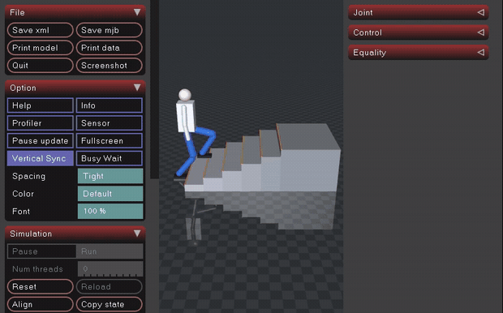

# 人形上下台阶步态仿真（humanoid_stair_climb）

MuJoCo 场景：平地 + **6 级台阶**（每级高 0.12 m、深 0.30 m）+ 平台，总爬升 0.72 m。
人形用**解析逆解 + 分段足端轨迹**交替迈步，逐级走上去，全程脚底不穿台阶、关节不越限。

## 效果图

| 起步：双脚站在台阶前 | 中段：第 4～5 级，摆动腿抬起跨级 |
|---|---|
|  |  |

完整过程（Ubuntu 虚拟机内 `ffmpeg -f x11grab` 直接录屏，6 fps，596 KB）：



静图为 Ubuntu 22.04 虚拟机桌面的直接截屏，画面里能看到左侧 dock、顶部状态栏与 MuJoCo 窗口标题栏。
动图是虚拟机内对 MuJoCo 窗口的直接录屏（`--pace --pace-scale 1.5` 放慢后 `ffmpeg -f x11grab` 录 18 s，
再转 6 fps GIF）—— GNOME 跑在 Wayland 上，X11 抓屏只能拿到 XWayland 窗口，拿不到 GNOME 合成的桌面层。

## 一、为什么做这个模块

`src/humanoid/` 下已有模块都在**平地**上：

| 模块 | 内容 | 差异 |
|---|---|---|
| `humanoid_ppo_locomotion` | PPO 神经网络平衡控制 | 学习型，平地站立/行走 |
| `humanoid_push_recovery` | 外力推挤后的恢复 | 平地抗扰 |
| `humanoid_local_planner_bench` | DWA / APF 局部避障 | 平地 + 走廊窄门 |
| `mujoco_hopper_demo` | 单足弹跳 | 单腿，无台阶 |

**台阶是平地模块覆盖不到的一类**：足端必须抬到比落点更高的高度才能跨过立面，
重心要跟着支撑脚升降，腿长余量随时可能不够。这三件事在平地上都碰不到。

## 二、场景与机器人模型

`models/stair_scene.xml`：

```
台阶     6 级实心方块，第 k 级顶面 z = 0.12k，x ∈ [0.30(k-1), 0.30k]
平台     x ∈ [1.80, 2.40]，顶面 z = 0.72
机器人   freejoint（运动学驱动）
  ├── 躯干/头/双臂           contype=0，纯视觉
  └── 每条腿 3 关节          hip / knee / ankle，轴均为 +y
```

腿部尺寸：髋在基座上方 0.76 m，大腿 0.45 m，小腿 0.45 m，脚底在踝下 0.04 m。
腿全长 0.90 m，站立时髋到踝 0.78 m，留约 0.12 m 余量——上台阶时两脚会短暂
相差两级（0.24 m 高差），余量就是留给这一下的。

## 三、步态与逆解

`humanoid_stair_climb/gait.py`，不依赖 MuJoCo，可单独跑单元测试。

**足端轨迹**按周期分三段，不是「线性上升 + 正弦拱」：

```
u ∈ [0, 0.25)   原地抬到安全高度  max(z0,z1) + 0.05
u ∈ [0.25,0.75) 水平移动到落点，全程保持安全高度
u ∈ [0.75,1.0)  落到 z1
```

> 先抬后走的原因：脚是 0.24 m 长的盒子，**前端比踝超前 0.18 m**。用正弦拱时踝还在
> 立面之前、脚前端已经伸进台阶里，脚底高度又不够，实测穿模 26 mm。改成分段后
> `max_penetration = 0.000 m`。

**解析 IK**（两连杆闭式解）：由髋到踝的向量直接解 hip / knee，踝角取 `-(hip+knee)`
让脚底保持水平。关节方向按 MuJoCo 的 `+y` 轴约定吸收进公式，往返误差实测 0.0000。

**重心高度**取两只脚里**最低**的那个目标高度（支撑脚用当前台阶，摆动脚用它即将落到的台阶）：

> 最初取「较高的一只」并让摆动脚用当前高度，实测 `髋→踝 = 0.905 m > 腿长 0.90 m`，
> IK 被 clamp，脚被拖进立面。改成取最低、并且摆动脚提前用落点高度，最大伸展降到 0.838 m。

## 四、复现

```bash
cd src/humanoid/humanoid_stair_climb
python3 -m pip install -r requirements.txt
python3 main.py --test         # 14 项检查
python3 main.py                # 打开 MuJoCo 窗口实时演示
python3 main.py --headless     # 只打印指标并写 CSV
```

录 GIF：

```bash
python3 main.py --headless --record frames --record-every 0.4
```

`--record` 走离屏渲染，导出纯场景画面、不含 UI。要录带 MuJoCo 窗口的动图，
用 `--pace --pace-scale 1.5` 打开窗口后直接 `ffmpeg -f x11grab -window_id <id>` 录屏。

ROS 2：

```bash
colcon build --packages-select humanoid_stair_climb --symlink-install
source install/setup.bash
ros2 launch humanoid_stair_climb main.launch.py
ros2 topic echo /stair_climb/status --once
```

节点发布的 `/stair_climb/joint_states`、`/stair_climb/odom`、`/stair_climb/status` 与
`/tf`（`odom → base_link`）走的是和 `main.py --headless` 同一套步态与指标，
所以 `status` 里那行摘要和终端输出逐字一致。到达平台后再按 `hold` 秒继续，
之后停在平台位姿上继续发位姿，下游查 TF 不会超时。

## 五、实测结果

Ubuntu 22.04 + Python 3.10.12 + MuJoCo 3.15.0，控制频率 50 Hz，步态周期 1.4 s。

| 指标 | 数值 |
|---|---|
| 到达平台 | 是 |
| 用时 | 11.84 s |
| 步数 | 17 |
| 爬升 | 0.720 m（= 6 × 0.12） |
| 最高基座 | 0.780 m |
| 终点 x | 2.19 m |
| 脚与台阶最小间距 | −0.000 m（无穿透） |
| 最大穿透 | 0.000 m |
| 落脚点误差 | 0.000 m |
| 关节越界 | 0 |

同一个 `--headless` 在 Windows 宿主机与 Ubuntu 虚拟机内结果逐位一致。

「关节越界 0」是把六个关节全部按 `models/stair_scene.xml` 里的 `joint range` 逐帧比对
得到的：hip ±1.6、knee [−0.02, 2.1]、ankle ±1.1。本场景实际用到的行程是
hip 最大 1.4622、knee 最大 1.9547、ankle 最大 0.9636，都留了余量。
这组限位是给这个自建模型定的，不是实测机器人的机械限位；`test_standalone.py`
里有一条测试解析 XML 比对 `config.JOINT_LIMITS`，改一处不改另一处会直接失败。

## 六、能力边界

- **不含平衡控制**：基座是 freejoint 运动学驱动，重心高度由步态给定，不是动力学算出来的。
  本模块评价的是「足端轨迹与逆解是否合理」，不是「人形会不会摔倒」。
- **脚不参与接触**：脚 `contype=0`，与台阶的间距用 `mj_geomDistance` 量，不做接触力求解。
- **无感知与规划**：台阶尺寸是给定的，不做视觉识别或落脚点搜索。
- **单一场景**：6 级等高等深的直台阶，结论不外推到变高变深、带转角的楼梯。
- **速度较慢**：设计前进速度 0.214 m/s（= 步幅 0.30 / 周期 1.4），等价于「一步一级」的保守走法。
  实测起点 x = −0.35、终点 2.19，11.84 s 走 2.54 m，平均 0.215 m/s，与设计值一致。

## 七、参数

| 参数 | 位置 | 默认 | 说明 |
|---|---|---|---|
| `STEP_HEIGHT` / `STEP_DEPTH` / `STEP_COUNT` | `config.py` | 0.12 m / 0.30 m / 6 | 台阶几何 |
| `HIP_Z` / `THIGH` / `SHANK` | `config.py` | 0.76 / 0.45 / 0.45 m | 腿部尺寸 |
| `CYCLE_TIME` / `SWING_RATIO` | `config.py` | 1.4 s / 0.42 | 步态周期与单腿摆动占比 |
| `STRIDE` / `LIFT_HEIGHT` | `config.py` | 0.30 m / 0.05 m | 每步前进距离与抬腿余量 |
| `CONTROL_HZ` | `config.py` | 50 Hz | 控制频率 |
| `TIME_LIMIT` / `HOLD_TIME` | `config.py` | 16 s / 2 s | 仿真时长上限 / 到达后停留 |
| `JOINT_LIMITS` | `config.py` | hip ±1.6、knee [−0.02,2.1]、ankle ±1.1 | 关节限位，与 XML 里 range 一致 |
| `cycle_time` / `swing_ratio` / `lift_height` | `config/params.yaml` | 同上 | ROS 节点用的参数 |
| `time_limit` / `hold` | `config/params.yaml` | 16 / 2 | ROS 节点的时长与停留，与 `config.py` 保持一致 |
