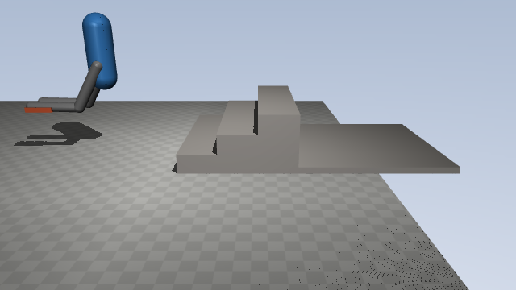
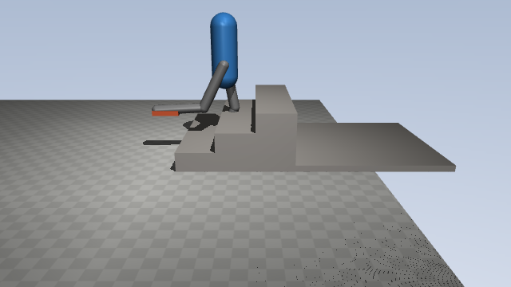
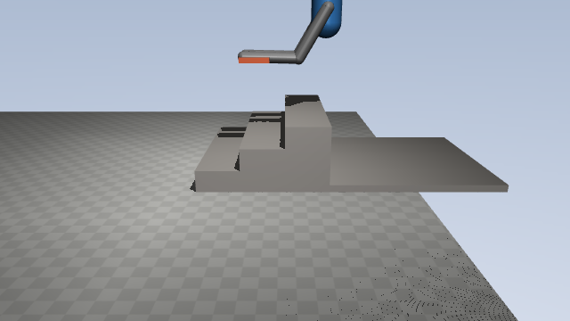
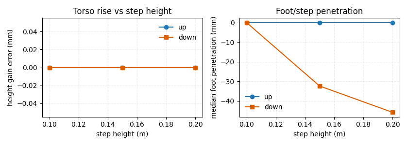
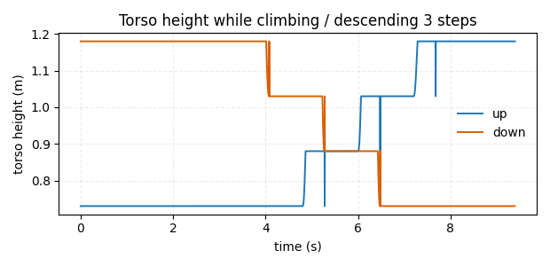

# 人形上下台阶步态仿真：ZMP 预瞄控制与台阶参数扫描（humanoid_stair_zmp_preview）

用 **ZMP 预瞄控制**（Kajita 2003）规划质心轨迹，两连杆解析 IK 解关节角，在 MuJoCo 参数化台阶上
执行 3 级台阶的上 / 下，并扫描台阶高度与进深。

## 效果图

| 上台阶出发 | 中段 | 到顶 |
|---|---|---|
|  |  |  |

| 台阶尺寸扫描 | 躯干高度时程 |
|---|---|
|  |  |

## 一、与已有实现的区别

仓库已有 `humanoid_stair_climb`（启发式落脚点 + smootherstep + 解析 IK，固定 0.12 m × 0.30 m × 6 级，**只上不下**）：

| 项 | `humanoid_stair_climb` | 本模块 |
|---|---|---|
| 控制律 | 启发式足端轨迹 | **ZMP 预瞄控制**（LIPM + 模型预测） |
| 方向 | 只上 | **上 + 下** |
| 参数 | 固定一组尺寸 | **高 0.10/0.15/0.20 × 深 0.25/0.30 共 6 组扫描** |
| 指标 | 落脚点误差、穿透 | 另加 **ZMP 跟踪误差、前视有效性对照** |

## 二、控制结构

```
落脚点序列 (x_k, z_k)
   └─ ZMP 参考 p_ref(t)（换脚处线性过渡，非阶跃）
        └─ 预瞄控制：u_k = -K·X_k + Σ f_i·p_ref[k+i]     X = [x, ẋ, ẍ, e]ᵀ
             └─ CoM 轨迹
                  └─ 两连杆解析 IK → hip / knee / ankle
                       └─ MuJoCo 场景执行 + 接触/穿透判定
```

- 增广状态含 **ZMP 误差积分** `e`；`K` 与 `f` 由离散 Riccati 一次解出
- 前视 160 步（0.64 s）：只看当前误差会滞后，必须提前看到落脚点变化

## 三、实测结果

| 项 | 结果 |
|---|---|
| 常量 ZMP 稳态误差 | **0.08 mm** |
| 方波 ZMP（±0.1 m）RMS | **24.6 mm**；关前视 125.3 mm（**5.1 倍**） |
| IK 往返（200 组随机） | 中位 **0.00 mm** |
| 脚掌倾斜 | **0.00°** |
| 躯干升幅 | 3×0.15 = **0.450 m**，误差 **0 mm** |
| 上台阶中位穿透 | **0.0 mm**（6 组参数） |
| 下台阶中位穿透 | 0.10 m: 0.0；0.15 m: −32/−78；0.20 m: −46/−107 mm |

> 调参记录：最初「只做状态反馈 + 前视」，前视实际无效（开/关差 0.4 mm），因为前视增益分子用了
> `Q·e4` 而非 `P·E`，`|f|` 比 `|K|` 小四个数量级。修正后前视才真正起作用（24.6 vs 125.3 mm）。
> 这个 bug 只有做「开/关对照」才能发现 —— 单看误差 125 mm 会以为是参数没调好。

## 四、复现

```bash
cd src/humanoid/humanoid_stair_zmp_preview
python3 -m pip install -r requirements.txt
python3 main.py --test        # 5 项自检
python3 main.py --headless    # 12 组扫描 + CSV + 图
python3 main.py --snapshots   # 场景快照
```

## 五、能力边界

1. **运动学驱动**，不评价动态平衡与扰动（需力矩级控制）。
2. **下台阶穿透 32~107 mm**（台阶 ≥0.15 m）：刚性脚掌 + 离散台阶的建模局限。已排除抬脚高度、
   摆动轨迹形状、落脚点位置三个因素；彻底解决需脚掌滚动或落脚点碰撞检查。
3. **台阶 ≤0.20 m**：再高腿接近伸展极限（0.73 vs 0.80 m）。
4. 平面模型，无侧向平衡与转向；**上台阶结论不可外推到下台阶**（下台阶明显更难）。

## 六、参数

| 参数 | 位置 | 默认 | 说明 |
|---|---|---|---|
| `STEP_HEIGHT` / `STEP_DEPTH` / `STEP_COUNT` | `config.py` | 0.15 / 0.30 / 3 | 台阶几何 |
| `HEIGHT_GRID` / `DEPTH_GRID` | `config.py` | 3 × 2 | 扫描网格 |
| `ZC` / `N_PREVIEW` | `config.py` | 0.80 m / 160 | LIPM 高度与预瞄步数 |
| `Q_E` / `R_JERK` | `config.py` | 1.0 / 1e-2 | 预瞄控制权重 |
| `CROUCH` | `config.py` | 0.07 m | 固定屈膝量（髋高 = 落脚点 + HIP_Z − CROUCH） |
| `THIGH` / `SHANK` | `config.py` | 0.40 / 0.40 m | 连杆长度 |