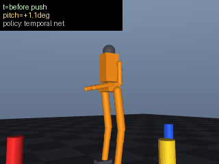

# 人形机器人多帧时序端到端视觉平衡控制

## 1. 功能概述

本模块用连续 3 帧前视图像作为唯一输入，直接回归 15 维关节目标角，端到端完成
「看 → 控制」。对应课程任务④。

网络不接触任何特权状态：不使用 root 高度、躯干欧拉角、关节速度、接触力，
输入只有 3 帧 64×64 灰度图。

与单帧端到端（PR #424）的区别是引入时序窗口；窗口的真实贡献与其局限见第 6 节。

## 2. 系统架构


## 3. 计算原理

### 3.1 图像前端

每帧 64×64 灰度图按 4×4 像素一格做均值池化：

$$
f_{ij} = \frac{1}{16}\sum_{u,v=0}^{3} I_{4i+u,\,4j+v},\qquad f\in\mathbb{R}^{16\times16}\rightarrow\mathbb{R}^{256}
$$

池化必须由**同一份实现**产生（`dataset.feat_from_gray`），训练、推理、ROS 节点
共用，避免三处各写一份导致训练/部署口径静默错位。

### 3.2 网络前向

$$
\begin{aligned}
x &= [\,f_{t-2\Delta}\;;\;f_{t-\Delta}\;;\;f_{t}\,] \in \mathbb{R}^{768}\\
h_1 &= \mathrm{ReLU}(W_1 x + b_1), &&W_1\in\mathbb{R}^{768\times256}\\
h_2 &= \mathrm{ReLU}(W_2 h_1 + b_2), &&W_2\in\mathbb{R}^{256\times128}\\
y &= W_3 h_2 + b_3, &&W_3\in\mathbb{R}^{128\times15}
\end{aligned}
$$

### 3.3 标准化

输入输出逐维 z-score：

$$
\hat{x}_k=\frac{x_k-\mu_k}{\max(\sigma_k,\;\varepsilon)},\quad \varepsilon=0.01
$$

$\varepsilon$ 是必需的：池化特征里有大量近似恒定的格子（背景占画面大部分），
$\sigma_k\to0$ 时标准化会把量化噪声放大成主信号。实测过没有该下限的版本，验证集
指标正常但真实输入预测翻转。

### 3.4 损失与优化

$$
L=\frac1N\sum_{i=1}^{N}\lVert \hat{y}_i-\hat{y}_i^{\ast}\rVert^2
$$

Adam（$\beta_1=0.9,\beta_2=0.999,\epsilon=10^{-8}$，lr$=10^{-3}$），batch 64，
80 epoch。原实现用的是一阶动量 + lr=0.01，训练会塌到输出均值。

### 3.5 执行层

关节 PD（kp=60，kd=6，力矩限幅 ±280 N·m）：

$$
\tau_i = \mathrm{clip}\big(k_p(q_i^{tgt}-q_i)+k_d(0-\dot q_i),\,\pm280\big)
$$

## 4. 采集算法

```
for episode in 1..E:
    sim.reset()                       # 用 INIT_QPOS 贴地起手，不写站姿
    sim.settle(300)                   # 老师闭环站定
    k ~ U{1,2,3}
    for j in 1..k:                    # 随机推力
        F  ~ U(20, 70) N
        θ  ~ U(0, 360)°
        t0 ~ U(0, 700)
        在 [t0, t0+40) 施加 F·
    for t in 0..899:
        sim.step()                    # 老师闭环
        if t % 10 == 0:   frames.append(feat_from_gray(render_front()))
        if t % 30 == 29 and len(frames) >= 3:
            X.append(concat(frames[-3:]));  y.append(sim.teacher_target())
```

**推力区间为什么是 20~70 N**：老师只有踝策略、没有迈步能力，实测能力边界为

| 推力（40 步） | 结果 |
|---|---|
| 20 N | 不倒，pitch 15.5°，root_z 1.018 |
| 50 N | 不倒，pitch 40.4°，root_z 0.810 |
| 80 N | 倒 @599 |
| 100 N | 倒 @550 |
| 130 N | 倒 @494 |
| 150 N | 倒 @467 |

超出 70 N 的样本老师自己都救不回来，标签不可学，故不采集。

**防泄漏**：帧间隔 10 步、样本间隔 30 步，$3\times10=30$，相邻样本的 3 帧窗口
严格不重叠。

**数据体检**（采集结束立即执行，退化直接抛错）：

- 图像唯一行 / 样本数 < 0.5 → `RuntimeError`（图像几乎全重复）
- 标签逐维 std 的中位数 < $10^{-3}$ → `RuntimeError`（标签退化成常量）

## 5. 源码解析

| 文件 | 职责 |
|---|---|
| `sim.py` | MuJoCo 封装：`INIT_QPOS` 起手、`DEFAULT_STAND_TARGET`、`SQUAT_TARGET`、`balance_offset()` 踝策略、`teacher_target()` 闭环老师、`step(target, balance)`、`render_gray/render_rgb` |
| `dataset.py` | 行为克隆采集、`feat_from_gray` 单一池化实现、stride 防泄漏、数据体检 |
| `nn.py` | MLP 前向/反向、`fit_normalizer`（`STD_FLOOR`）、Adam、`save/load`（兼容旧权重） |
| `train.py` | 训练 + 常数基线对照 + 逐维 MAE + `closed_loop_eval()`（teacher/const/net/net1） |
| `predictor.py` | 3 帧滑窗封装，帧不满时回退 `y_mean` |
| `main.py` | `--check / --collect / --train / --eval / --demo` 入口 |
| `sim_node.py` / `predictor_node.py` | ROS2 话题桥（灰度图 → 关节目标） |

### 5.1 平衡层（老师）

踝策略按压力中心与足底几何中心的偏差调节踝关节目标角：

$$
\begin{aligned}
u &= k_p^{bal}(x_{com}-x_{foot}) + k_d^{bal}\dot{x}\\
v &= k_p^{bal}(y_{com}-y_{foot}) + k_d^{bal}\dot{y}\\
\theta^{tgt}_{ankle\_pitch} &\mathrel{+}= u \quad(\text{双侧}),\qquad
\theta^{tgt}_{ankle\_roll} \mathrel{+}= \pm v
\end{aligned}
$$

$k_p^{bal}=0.5$，$k_d^{bal}=0.2$。$x_{com}$ 取 `subtree_com[0]`，$x_{foot}$ 取
`geom_xpos[foot_geom_l]`。

### 5.2 站姿与下蹲姿态

| 姿态 | 值（左 5 / 右 5 / 上肢 5） |
|---|---|
| `INIT_QPOS`（贴地起手） | `0, 0.08, -0.16, -0.08, 0` 双侧；`0, -1.4, 0, -1.4, 0` |
| `DEFAULT_STAND_TARGET` | `0, 0.16, -0.08, 0.20, 0` 双侧；上肢同上 |
| `SQUAT_TARGET` | `0, 0.45, -0.55, 0.34, 0` 双侧；上肢同上 |

`SQUAT_TARGET` 由 hip×knee×ankle 的 4×3×3 网格搜索得到（判据：躯干 |pitch| 最小
且 root_z 最低），实测蹲姿 pitch −1.4°、root_z 1.013。

## 6. 实测结果

### 6.1 站姿 3 s

| 场景 | max_pitch | root_z |
|---|---|---|
| 原代码站姿 + 纯 PD | 89.78° | 0.315（已判跌倒） |
| 本模块站姿，平衡关 | 59.81° | 0.748 |
| 本模块站姿，平衡开 | **1.73°** | **1.076** |

### 6.2 数据集

2012 样本 / 68 episodes；图像唯一行 1469/2012；标签逐维 std 中位 0.0349
（max 0.1505）；变化维 8/15。

### 6.3 开环

| 指标 | 网络 | 常数基线 | 降幅 |
|---|---|---|---|
| val_mse (rad²) | 0.00001 | 0.00455 | 99.7% |
| val_mae (rad) | 0.00185 | 0.03342 | 18× |

### 6.4 闭环（5 次 20~70 N，站定 300 步，评估 600 步）

| 策略 | 站住 | max_pitch | 平均倾角 |
|---|---|---|---|
| teacher | 5/5 | 19.1° | 7.3° |
| const | 5/5 | 27.1° | 10.0° |
| net | 5/5 | **19.6°** | **7.3°** |
| net1（单帧消融） | 5/5 | 19.6° | 7.3° |

### 6.5 时序窗口的局限（本轮实测）

| 输入 | val MAE | val MSE |
|---|---|---|
| 3 帧 | 0.00167 | 1.0e-5 |
| 最近 1 帧重复 3 次 | 0.00258 | 3.0e-5 |

开环 3 帧优于单帧 35%，但闭环指标完全相同。原因是本任务的标签
（`teacher_target()`）是**当前状态的无记忆函数**，而 10 步（20 ms）帧间隔内
相邻帧特征差只有特征 std 的 0.58%，窗口几乎不含动态信息。

把帧间隔拉到 20 步（40 ms）重采重训对照：绝对误差反而变差
（MAE 0.00167 → 0.00216），帧间差只升到 0.82% —— 旧帧只是过期信息。
故帧间隔保持 10 步。3 帧窗口的实际作用是「多帧平均抑制池化量化噪声」，
不是动力学建模。要让它承载动力学，标签需改成依赖历史的量（如预测 k 步后姿态）。

## 7. 复现

```bash
pip install -r requirements.txt
cd src/humanoid/humanoid_temporal_e2e

python3 main.py --check                      # 7 项自检
python3 main.py --collect --samples 2000     # 约 4 min
python3 main.py --train --epochs 80
python3 main.py --eval --eval-episodes 5
python3 main.py --demo --force 50 --steps 600 --gif demo.gif
python3 -m unittest discover -s test         # 10 条
```

headless 环境需 `Xvfb :99 -screen 0 1280x1024x24 &`、`export DISPLAY=:99`。

ROS2：

```bash
colcon build --packages-select humanoid_temporal_e2e
source install/setup.bash
ros2 launch humanoid_temporal_e2e main.launch.py
```

演示画面：



MuJoCo `overview` 机位逐帧真实渲染（302 帧，50 N 推力未跌倒），左上角叠加当前
pitch 与膝/踝目标角。

## 8. 与单帧端到端对比

| 维度 | PR #424（单帧） | 本模块（3 帧） |
|---|---|---|
| 输入维度 | 256 | 768（3 帧拼接） |
| 网络 | 256→128→64→15 | 768→256→128→15 |
| 开环 val MAE | — | 0.00185 |
| 闭环 max_pitch | — | 19.6°（teacher 19.1°） |
| 时序增益 | 无 | 开环 −35% MAE；闭环相同（见 6.5） |
