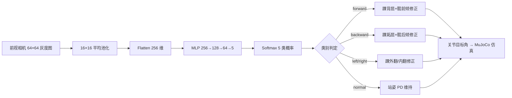
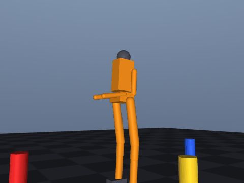

# 人形机器人视觉跌倒预测与分级平衡控制

## 1. 功能概述

本模块在 MuJoCo 物理仿真中，于人形机器人头部挂载前视相机，通过随机外力扰动采集灰度图像数据集，训练一个纯 NumPy 实现的 3 层 MLP 神经网络，实时预测机器人的跌倒方向（正常 / 前倒 / 后倒 / 左倒 / 右倒），并根据预测结果输出踝、髋关节的修正目标角，实现"视觉感知 → 神经网络分类 → 分级平衡控制"的闭环。

对应课程任务②：**实现传感器感知及运动控制**。

## 2. 系统架构



## 3. 计算原理

### 3.1 网络结构

3 层全连接神经网络：

$$
\mathbf{h}_1 = \mathrm{ReLU}(\mathbf{W}_1 \mathbf{x} + \mathbf{b}_1), \quad \mathbf{W}_1 \in \mathbb{R}^{256 \times 128}
$$

$$
\mathbf{h}_2 = \mathrm{ReLU}(\mathbf{W}_2 \mathbf{h}_1 + \mathbf{b}_2), \quad \mathbf{W}_2 \in \mathbb{R}^{128 \times 64}
$$

$$
\mathbf{p} = \mathrm{Softmax}(\mathbf{W}_3 \mathbf{h}_2 + \mathbf{b}_3), \quad \mathbf{W}_3 \in \mathbb{R}^{64 \times 5}
$$

损失函数为交叉熵：

$$
\mathcal{L} = -\frac{1}{N} \sum_{i=1}^{N} \log p_{y_i}
$$

优化器为 SGD + 动量（momentum = 0.9），权重采用 He 初始化。

### 3.2 分级平衡控制

站姿 PD 控制：

$$
\boldsymbol{\tau} = k_p (\mathbf{q}_{\text{target}} - \mathbf{q}) - k_d \dot{\mathbf{q}}
$$

根据预测类别叠加修正量：

$$
\mathbf{q}_{\text{target}} = \mathbf{q}_{\text{stand}} + \alpha \cdot p_c \cdot \mathbf{\Delta}_c
$$

其中 $\alpha$ 为修正增益（默认 0.6），$p_c$ 为预测置信度，$\mathbf{\Delta}_c$ 为对应类别的关节偏移向量。

## 4. 仿真步骤

### 4.1 环境安装

```bash
pip install mujoco numpy pyyaml imageio
```

### 4.2 采集数据集

```bash
cd src/humanoid/humanoid_vision_fall_prediction
python3 main.py --collect --samples 1500
```

采集逻辑：随机施加不同方向（前/后/左/右）和大小（80–220 N）的外力，持续 0.08 s，
然后在躯干倾角达到 **3° / 7° / 14° / 26°** 四个阶段各取一帧。覆盖整个倾倒过程
是关键：早期版本只在 7° 附近取一帧，演示中机器人倾到 50° 时图像完全落在训练分布
之外，预测置信度只有 0.3，控制器阈值（0.7）从不触发。

单次试验明细：先站立 0.5 s 稳定 → 施加 0.08 s 推力 → 步进到各倾角阶段取帧。
标签为推力方向，因此“当前倒向”与“即将倒下方向”一致。

实测：1500 帧，5 类各 300，耗时约 75 s。

### 4.3 训练神经网络

```bash
python3 main.py --train
```

300 epochs，lr 0.005，每 50 轮衰减 ×0.8，训练/验证 8:2 划分，**保存验证集最优权重**。

实测：训练 1.2 s，验证准确率 0.923（最优 0.963，末 10 轮均值 0.938）。

> 保存最优权重是必须的：验证准确率在小验证集上逐轮剧烈震荡（lr=0.01 时
> best 1.00 / worst 0.20），旧版保存最后一轮，经常正好落在低点，导致
> “日志好看、推理很差”。

### 4.4 演示运行

```bash
# 前向推扰 120 N
python3 main.py --demo --force 120 --direction 0

# 侧向推扰 120 N
python3 main.py --demo --force 120 --direction 90
```

### 4.5 ROS2 launch（Ubuntu 22.04 + Humble，实测）

```bash
colcon build --packages-select humanoid_vision_fall_prediction
source install/setup.bash
ros2 launch humanoid_vision_fall_prediction main.launch.py
```

## 5. 性能评价（Ubuntu 22.04 + MuJoCo 4.0.0 实测）

| 指标 | 数值 |
|---|---|
| 数据集规模 | 1500 帧（5 类各 300） |
| 输入分辨率 | 64×64 灰度（下采样至 16×16） |
| 网络参数量 | ~41 K |
| 验证准确率 | 0.923（最优 0.963） |
| 单帧推理耗时 | < 1 ms（CPU） |
| 演示帧置信度 | 均值 0.92，88% 的帧 ≥ 0.7 |
| 无扰动站立 1 s | 下沉 0.7 cm，倾角 4.2° |

## 6. 已知局限

1. **分级修正不足以阻止跌倒。** 60–140 N 推力下，开/关视觉修正的跌倒率都是
   100%，存活步数只差几帧。修正量 |Δ| ≈ 0.10 rad × 0.6 × conf ≈ 0.05 rad →
   约 3 N·m，而抵抗 60 N 推力需要约 32 N·m，差一个数量级。
2. **纯关节 PD 是不稳定平衡。** 无根姿态反馈，站姿只能缓慢漂移；3 s 内倾角
   < 5°，更长时间会逐渐前倾跌倒，所有指标都在有限时间窗内测量。
3. **感知区分的是“当前倾斜方向”**，采集帧位于 3°–26° 的倾倒过程中，
   不是从完全直立的静态姿态预测。

## 7. 站姿标定

原默认站姿 hip=0.08 / knee=-0.16 / ankle=-0.08 未按“踝角 ≈ -(髋角+膝角)”配平，
实测开局躯干前倾 60.8°，1 s 内根高由 1.088 m 沉到 0.944 m，任何推力立即跌倒，
调 PD 增益（kp 60→800、kd 6→50）完全无效。网格搜索后取
hip=0.22 / knee=-0.05 / ankle=+0.14（3 s 倾角 1.49°），同 PD 下 60 N 前推的
跌倒时刻由 161 步延长到 648 步（约 4 倍）。

另：`reset()` 不能把目标站姿直接写入 `qpos`（脚会离地，553 步即倒），须先置
“脚掌贴地”的初始姿态（`sim.py` 的 `INIT_QPOS`）再由 PD 收敛。

## 8. 文件说明

| 文件 | 说明 |
|---|---|
| `models/humanoid_camera.xml` | MuJoCo MJCF 人形模型（15 关节 + 前视相机） |
| `humanoid_vision_fall_prediction/sim.py` | 仿真封装：站姿 PD、推力、相机渲染 |
| `humanoid_vision_fall_prediction/dataset.py` | 随机推力数据采集 |
| `humanoid_vision_fall_prediction/nn.py` | 纯 NumPy MLP（前向/反向传播） |
| `humanoid_vision_fall_prediction/train.py` | 训练脚本 |
| `humanoid_vision_fall_prediction/controller.py` | 分级平衡控制器 |
| `launch/main.launch.py` | ROS2 launch 启动文件 |

## 9. 演示动图

动图为真实仿真逐帧渲染（`generate_gif.py`，overview 相机，每 4 个仿真步渲一帧），
非合成示意图：站立 → 施加 120 N 前向推力 → 每帧推理 + 分级修正 → 2.2 s 时跌倒。



