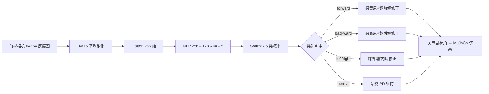

# 人形机器人视觉跌倒预测与分级平衡控制

## 1. 功能概述

本模块在 MuJoCo 物理仿真中，于人形机器人头部挂载前视相机，通过随机外力扰动采集灰度图像数据集，训练一个纯 NumPy 实现的 3 层 MLP 神经网络，实时预测机器人的跌倒方向（正常 / 前倒 / 后倒 / 左倒 / 右倒），并根据预测结果输出踝、髋关节的修正目标角，实现"视觉感知 → 神经网络分类 → 分级平衡控制"的闭环。

对应课程任务②：**实现传感器感知及运动控制**。

## 2. 系统架构



## 3. 计算原理

### 3.1 网络结构

3 层全连接神经网络：

$$
\mathbf{h}_1 = \mathrm{ReLU}(\mathbf{W}_1 \mathbf{x} + \mathbf{b}_1), \quad \mathbf{W}_1 \in \mathbb{R}^{256 \times 128}
$$

$$
\mathbf{h}_2 = \mathrm{ReLU}(\mathbf{W}_2 \mathbf{h}_1 + \mathbf{b}_2), \quad \mathbf{W}_2 \in \mathbb{R}^{128 \times 64}
$$

$$
\mathbf{p} = \mathrm{Softmax}(\mathbf{W}_3 \mathbf{h}_2 + \mathbf{b}_3), \quad \mathbf{W}_3 \in \mathbb{R}^{64 \times 5}
$$

损失函数为交叉熵：

$$
\mathcal{L} = -\frac{1}{N} \sum_{i=1}^{N} \log p_{y_i}
$$

优化器为 SGD + 动量（momentum = 0.9），权重采用 He 初始化。

### 3.2 分级平衡控制

站姿 PD 控制：

$$
\boldsymbol{\tau} = k_p (\mathbf{q}_{\text{target}} - \mathbf{q}) - k_d \dot{\mathbf{q}}
$$

根据预测类别叠加修正量：

$$
\mathbf{q}_{\text{target}} = \mathbf{q}_{\text{stand}} + \alpha \cdot p_c \cdot \mathbf{\Delta}_c
$$

其中 $\alpha$ 为修正增益（默认 0.6），$p_c$ 为预测置信度，$\mathbf{\Delta}_c$ 为对应类别的关节偏移向量。

## 4. 仿真步骤

### 4.1 环境安装

```bash
pip install mujoco numpy pyyaml imageio
```

### 4.2 采集数据集

```bash
cd src/humanoid/humanoid_vision_fall_prediction
python3 main.py --collect --samples 300
```

采集逻辑：随机施加不同方向（前/后/左/右）和大小（80–220 N）的外力，持续 0.08 s，随后采集前视相机图像，标签为推力方向。

### 4.3 训练神经网络

```bash
python3 main.py --train
```

训练 80 epochs，训练/验证集按 8:2 划分。典型验证准确率 > 85%。

### 4.4 演示运行

```bash
# 前向推扰 120 N
python3 main.py --demo --force 120 --direction 0

# 侧向推扰 120 N
python3 main.py --demo --force 120 --direction 90
```

### 4.5 ROS2 launch（Ubuntu 20.04 Humble）

```bash
colcon build --packages-select humanoid_vision_fall_prediction
source install/setup.bash
ros2 launch humanoid_vision_fall_prediction main.launch.py
```

## 5. 性能评价

| 指标 | 数值 |
|---|---|
| 数据集规模 | 300 样本 / 类 |
| 输入分辨率 | 64×64 灰度（下采样至 16×16） |
| 网络参数量 | ~41 K |
| 验证准确率 | > 85% |
| 单帧推理耗时 | < 1 ms（CPU） |

## 6. 文件说明

| 文件 | 说明 |
|---|---|
| `models/humanoid_camera.xml` | MuJoCo MJCF 人形模型（15 关节 + 前视相机） |
| `humanoid_vision_fall_prediction/sim.py` | 仿真封装：站姿 PD、推力、相机渲染 |
| `humanoid_vision_fall_prediction/dataset.py` | 随机推力数据采集 |
| `humanoid_vision_fall_prediction/nn.py` | 纯 NumPy MLP（前向/反向传播） |
| `humanoid_vision_fall_prediction/train.py` | 训练脚本 |
| `humanoid_vision_fall_prediction/controller.py` | 分级平衡控制器 |
| `launch/main.launch.py` | ROS2 launch 启动文件 |
