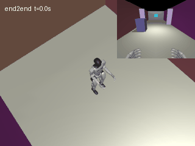
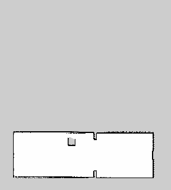

# 人形机器人视觉通行感知与室内导航

本示例在 MuJoCo 3.2.0 中驱动 Unitree G1，通过视觉通行识别和图像速度策略完成走廊通行，通过 ROS Noetic 完成同步建图导航。**当前为可复现原型，不是经过真实机器人验证的部署方案。**

## 四项任务

| 项目 | 实现 | 当前证据 |
|---|---|---|
| 键盘运动 | WASD/方向键、调速、超时停止，经官方步态输出关节力矩 | 真实 GLFW 窗口收到自动发送的前进/转向/停止按键，12秒未跌倒 |
| 感知控制 | RGB 图像 → FloorNet → MaskController → 速度 | 两个留出场景闭环通过 |
| 建图导航 | 模拟雷达＋带噪积分里程计 → gmapping 与 move_base 同时运行 | 神经辅助规划生成的五个航点均返回 SUCCEEDED |
| 端到端 | RGB 图像 → ImageController → 速度 → 步态底座 | 两个留出场景闭环通过 |

任务二的感知和控制网络均经过训练；任务三采用经典 SLAM、神经网络辅助全局搜索及经典局部避障的混合方案，并非纯神经 SLAM 或纯神经规划。任务四学习图像到高层速度，并不直接输出全身关节力矩。

## 运行效果

以下为真实 MuJoCo 物理步进的离屏渲染，右上角是机载相机画面。

### 视觉感知控制

### 图像直接控制

### SLAM 地图

地图来自运行中的 `/map`，不是场景几何直接绘制。仿真真实位置仅用于离线评价；导航接收的是对带噪速度与航向增量积分的里程计。

## 系统原理

底层采用官方预训练 G1 12 腿部关节步态策略，固定上半身。物理频率 500 Hz，策略频率 50 Hz。观测包括角速度、重力投影、速度命令、关节位置/速度、前次动作及步态相位。策略输出关节位置残差，PD 控制产生力矩：

$$\tau=K_p(q_{target}-q)-K_d\dot q,\qquad q_{target}=q_0+0.25a.$$

底层预训练网络没有在本项目重新训练。独立训练的三个视觉相关模型如下：

| 模型 | 输入 | 结构 | 输出与损失 |
|---|---|---|---|
| FloorNet | 96×128 RGB | 5×5 Conv(16)、3×3 Conv(16)、1×1 Conv(1) | 逐像素地面概率；BCE |
| MaskController | 地面语义图 | 12×16池化、64/32维MLP | 前进速度、偏航角速度；MSE |
| ImageController | 96×128 RGB | 三层步长2卷积＋64维全连接 | 前进速度、偏航角速度；MSE |

示范策略在图像中部至下部比较候选通行条带，对偏离中心的条带施加惩罚，并按前方通行像素比例限制速度。MaskController 学习此策略，任务二在线阶段使用学习后的网络输出速度。针对分割结果完全没有地面像素的情况，部署端增加规则保护并将速度和转向置零；保护不是网络能力，也不能处理所有误分割或障碍。当前测试用固定的无地面分割输出验证保护逻辑；真实 FloorNet 在空白图上的误分割仍未单独测试。它是局部反应式控制器，不等价于全局最短路规划。

任务四以同一个视觉规则控制器产生示范标签，网络推理时只接收 RGB。两者形成“显式分割＋语义控制网络”和“图像直接回归控制”的对照。速度限幅和缓动用于接口保护，不能掩盖模型失败。

## 数据与训练

MuJoCo 几何 ID 生成地面分割标签，无人工涂改。训练使用种子 0–5 共480张图，验证种子6共80张图，测试种子7–8共160张图。每个种子改变光照、墙面颜色及柜体位置，**属于同一走廊模板的变化，不是多个独立建筑**。

样本通过静态相机位置/朝向采样获得。只在数据采集和回合重置时设置根节点位置，闭环测试中机器人由关节控制与接触动力学移动。以验证损失选择模型，训练20轮，Adam学习率0.001，批量16，随机种子42。MaskController 只保留最佳验证 MSE 和测试误差，没有保存逐轮曲线；perception、end2end 和 planner 的验证历史保存在 [evaluation.json](evaluation.json)。

| 留出图像指标 | 结果 |
|---|---:|
| 地面分割 IoU | 0.7145 |
| 端到端速度 MAE | 0.0287 m/s |
| 端到端转向速度 MAE | 0.0781 rad/s |
| 语义控制网络速度 MAE | 0.0117 m/s |
| 语义控制网络转向速度 MAE | 0.0483 rad/s |

种子9–12为追加的闭环测试，不参与训练或验证；它们仍然是同一走廊模板。训练图像误差不能代替闭环效果。下面是每个留出场景各一次物理运行，没有宣称统计显著性或大样本成功率。

| 模式 | 场景种子 | 到达走廊测试终线 | 仿真耗时 | 环境碰撞步数 | 跌倒 |
|---|---:|---|---:|---:|---|
| 规则教师 | 7 | 是 | 30.36 s | 0 | 否 |
| 感知控制 | 7 | 是 | 30.42 s | 0 | 否 |
| 感知控制 | 8 | 是 | 32.10 s | 0 | 否 |
| 端到端 | 7 | 是 | 29.46 s | 0 | 否 |
| 端到端 | 8 | 是 | 31.58 s | 0 | 否 |
| 感知控制 | 9 | 是 | 31.44 s | 0 | 否 |
| 端到端 | 9 | 是 | 29.56 s | 0 | 否 |
| 感知控制 | 10 | 是 | 30.42 s | 0 | 否 |
| 端到端 | 10 | 是 | 30.00 s | 0 | 否 |
| 感知控制 | 11 | 是 | 30.82 s | 0 | 否 |
| 端到端 | 11 | 是 | 30.62 s | 0 | 否 |
| 感知控制 | 12 | 是 | 30.70 s | 0 | 否 |
| 端到端 | 12 | 是 | 31.14 s | 0 | 否 |

终线定义为机器人根节点 x≥7.5m；这是测试终止条件，并非网络的输入或控制依据。碰撞只统计墙、门框、柜体接触；正常足地接触不计为障碍碰撞。原始试验摘要见 [evaluation.json](evaluation.json)。

### 端到端近墙测试

使用实际交付的 ImageController 权重，将骨盆初始位置分别设在距走廊端墙近表面 1.5、1.0、0.6 m 处，先零速稳定 2 秒，再运行控制 3 秒。三次均未跌倒，未记录与端墙的接触；最后一种情况下控制器最初输出零前进速度并转向。记录见 [near_obstacle_20261111.json](near_obstacle_20261111.json)，复现使用源码目录的 `scripts/evaluate_near_obstacle.py --assets <资产路径> --output <结果路径>`。距离是初始骨盆到墙面的距离，不是机器人轮廓的间距；初始零速期间可能有漂移。仅测试单个静态墙面、朝向和种子，不能据此声称覆盖复杂障碍或保证安全。

## 同步 SLAM 与导航

180束平面雷达，5Hz，量程8m，排除机器人自体几何。ROS 桥发布 `/clock`、`/scan`、`/odom` 以及 `odom→base_link→laser`，gmapping 发布 `map→odom` 和 `/map`。图像消息的 `front_camera` 坐标系目前未发布对应 TF，因此不能直接用于跨坐标系融合。move_base 读取持续变化的地图，向 `/cmd_vel` 发布速度。

测试顺序目标为 (2,-0.3)、(4,-0.3)、(7,0)，三次均返回 action 状态3。位置容差 **0.5m**，终点朝向不约束。测试期间记录21次地图更新，已知栅格由11,143增至18,328。不能将该结果表述为厘米级导航。

另一次神经辅助导航测试从实时地图和 TF 位置生成5个航点，最终目标为 (7,0)，五个航点均返回 SUCCEEDED。CostNet 在240个随机障碍栅格上训练，验证与测试各40个独立种子，Dijkstra 距离为监督标签，训练20轮；测试距离 MAE 为0.7556格。

CostNet 输入障碍图与相对目标的 x/y 坐标，使用空洞卷积预测剩余代价。A* 的主排序保持 `g + Manhattan`，仅在同一主代价时使用预测值打破平局，因此是神经辅助搜索。当前实测神经辅助与普通 A* 均扩展47个节点、路径代价均为46格，**没有观察到本回合的搜索加速**。未知栅格暂按可通行处理以支持探索，实际执行仍依赖实时雷达局部避障；不保证未知区域安全或任意地图都能到达。规划路径发布在 `/neural_patrol/path`，执行结果在 `/neural_patrol/result`。

首次测试发现 TF 延迟与里程计角速度遗漏，修正后重新运行。步态零速仍有小幅漂移，长时间停车和精确停靠尚需进一步评价。

## 安装与复现

完整命令、环境、资产下载、四种模式和退出步骤见 [模块 README](https://github.com/OpenHUTB/ros2/tree/master/src/humanoid/humanoid_visual_patrol)。本页面待 PR 合并前，上述上游代码链接可能尚不存在，请使用本分支同路径。

运行顺序：安装独立仿真环境 → 获取固定版本官方资产 → smoke → 遥控 → collect/train → perception/end2end → 启动 ROS 同步导航 → 保存地图 → 检查输出证据。

四个模型权重随模块提供（分割约17KB，语义控制约61KB，图像控制约1.64MB，规划约40KB）。无需先训练即可测试，训练步骤可独立复现。大量数据和录像只保留本地；文档展示 GIF 小于5MB，PNG小于3MB。

## 与已有模块的区别及限制

已有 `humanoid_lidar_nn_perception` 以雷达扫描预测通行距离并用 MLP 避障。本模块学习 RGB 地面分割与图像速度回归，并集成同步 SLAM 多目标导航；它不是对原模块改名。共享的 G1 模型、官方步态和 ROS 软件明确归属于上游。

目前缺少动态人群、复杂光照、不同建筑、大规模重复试验，以及跌倒后的恢复。视觉训练数据规模小，IoU仍有提升空间。外部机器复现和正式维护者信息尚待补齐，当前不能直接勾选全部 PR 验收项。

## 大模型使用声明

本项目使用 OpenAI Codex 辅助编程、调试、实验和文档整理。训练及仿真结果由实际程序产生；提交者需复核并对提交内容负责。官方模型、预训练策略及许可证详见源码 `third_party_notices.md`。
