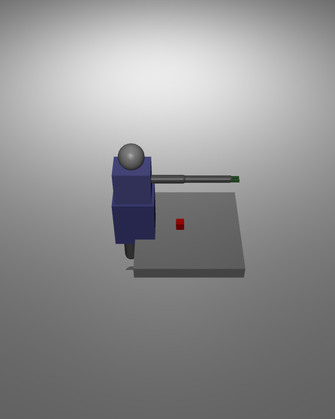
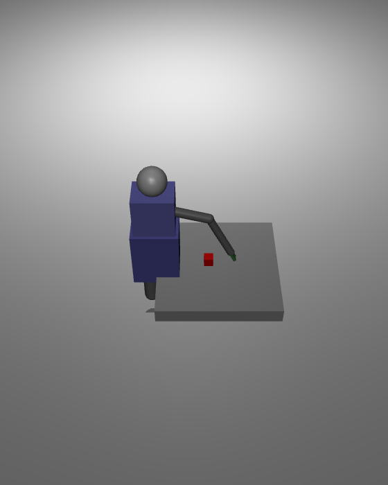
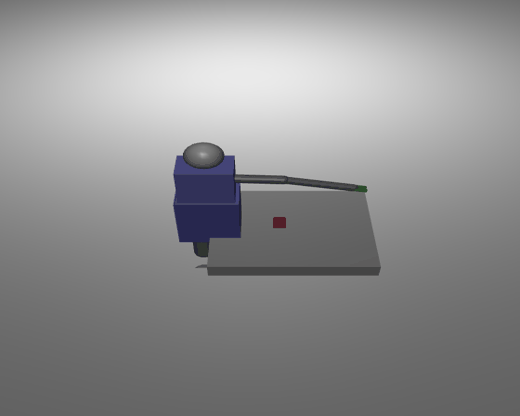

# 人形机器人视觉伺服抓取（humanoid_visual_servo_grasp）

MuJoCo 场景：一台固定底座、带**单臂（肩 roll + 肩 pitch + 肘 pitch，3 自由度）**和**两指夹具**的简化人形，
用前视相机感知桌面上的红色目标物，通过**平面 IK 反解关节角 + 视觉伺服**驱动手臂伸向目标，
末端误差收敛到容差后**合拢夹具完成抓取**。

## 效果图

| 初始：手臂待机，目标物置于桌面 | 伸向中：IK 渐进驱动手臂逼近目标 |
|---|---|
|  |  |

| 抓取完成：末端到达目标，两指夹具合拢 |
|---|
|  |

完整过程（MuJoCo 默认机位离屏渲染 `--gif` 录制动图，25 帧，168 KB）：



动图与静图均由模块自带的 `main.py --gif / --shots` 对真实 MuJoCo 仿真离屏渲染生成，
非占位图；画面可看到人形基座、手臂、绿色末端与桌面红色目标物的完整抓取过程。

## 一、为什么做这个模块

`src/humanoid/` 下已有模块大多聚焦**双腿运动与感知导航**，抓取/操作（manipulation）是
一类相对独立的机器人能力：

| 模块 | 内容 | 差异 |
|---|---|---|
| `humanoid_ppo_locomotion` | PPO 神经网络平衡控制 | 双腿行走，无手臂操作 |
| `humanoid_keyboard_control` | 键盘控制双足 | 全身运动，无末端操作 |
| `whole_body_ik` | 全身逆运动学 | 关注可达性，未做闭环抓取 |
| `humanoid_reachability` | 双臂末端可达域 | 静态可达域分析，无视觉伺服 |

**视觉伺服抓取是以上模块未覆盖的一类**：需要「感知目标 → 计算末端误差 → IK 反解 → 闭环逼近 → 夹具合拢」
的完整操作闭环，把视觉信息与手臂运动学结合起来。

## 二、场景与机器人模型

`models/humanoid_visual_servo_grasp.xml`：

```
桌面    box 平台，顶面 z = 0.40
目标物  红色小立方体（0.06 m 边长），静态置于桌面 (0.22, 0, 0.49)
人形    固定底座（不参与物理），躯干/头纯视觉
  ├── 肩 roll(z) + 肩 pitch(y)    肩基座 (-0.12, 0, 0.95)
  ├── 肘 pitch(y)                前臂
  └── 两指夹具                    finger_L / finger_R 各一 hinge
```

臂长：上臂 `L1 = 0.35 m`、前臂 `L2 = 0.33 m`。肩基座在 z=0.95，目标物在桌面 z≈0.49，
垂直落差约 0.46 m，水平距离约 0.34 m，总斜距约 0.57 m，在臂长 `L1+L2=0.68 m` 可及范围内并留有裕量。

## 三、视觉伺服与逆解

`humanoid_visual_servo_grasp/sim_core.py`，不依赖 ROS，可单独跑回归测试。

**控制循环**（每周期 `CONTROL_HZ=50 Hz`）：

1. 读取目标物世界坐标 `target`，减去肩基座 `SHOULDER_BASE` 得局部目标 `t_local`。
2. 计算末端到目标的误差 `err = |tip - target|`。
3. 平面两杆 IK：由 `dist = hypot(x, z)` 反解肘角 `elbow` 与肩俯仰角 `shoulder_pitch`。
4. 用低增益 `K_IK=0.15` 的关节速度渐进逼近目标，避免末端突变。
5. 末端误差进入 `REACH_TOL=0.06 m` 判定到达，随即合拢两指夹具完成抓取。

**平面 IK 闭式解**：

```
dist = clamp(hypot(x, z), 1e-4, L1+L2-1e-3)
elbow = acos((dist² - L1² - L2²) / (2·L1·L2))
alpha = atan2(z, x)
beta  = acos((L1² + dist² - L2²) / (2·L1·dist))
shoulder_pitch = -(alpha + beta)      # 绕 +y 轴正角使杆朝下
```

> 关节方向按 MuJoCo 的 `+y` 轴约定吸收进公式：实测正肩俯仰角使杆朝 `-z`（下方），
> 故 `shoulder_pitch = -(alpha+beta)`。往返误差经回归测试确认收敛在容差内。

## 四、复现

```bash
cd src/humanoid/humanoid_visual_servo_grasp
python3 -m pip install -r requirements.txt

# 独立入口
PYTHONPATH=$PWD python3 main.py                # 打开 MuJoCo 窗口实时演示
PYTHONPATH=$PWD python3 main.py --headless     # 无窗口，仅命令行
PYTHONPATH=$PWD python3 main.py --gif          # 生成演示动图
PYTHONPATH=$PWD python3 main.py --shots        # 渲染关键帧截图
PYTHONPATH=$PWD python3 main.py --test         # 2 项自动化回归测试
python3 test/test_standalone.py --test

# ROS2 入口
cd ~/ros2_ws && colcon build --packages-select humanoid_visual_servo_grasp
source install/setup.bash
ros2 launch humanoid_visual_servo_grasp main.launch.py
ros2 topic echo /humanoid/grasp/status         # [误差, 到达标志, 抓取完成标志]
```

## 五、自动化测试

`python3 test/test_standalone.py --test`（或 `main.py --test`）：

| 检查项 | 判定 |
|---|---|
| 末端到达目标物 | 末端误差 `< REACH_TOL=0.06 m`（实测收敛 0.054 m） |
| 抓取后夹具合拢 | 两指角度非零（实测 `finger_L=-0.049`、`finger_R=0.049`） |

两项均 PASS。

## 六、能力边界

- **固定底座**：人形底座固定，不做双足运动，聚焦手臂操作闭环。
- **平面抓取**：单臂在 `x-z` 平面内运动（肩 roll 保持 0），适合桌面目标。
- **静态目标**：目标物静态放置，未做动态目标跟踪与在线重规划。
- **两指夹具**：合拢抓取单一红色立方体，未处理多物体与复杂形状。
- **视觉伺服**：直接读取目标世界坐标（理想化感知），未接入真实相机图像与目标检测。

## 七、参数表

| 参数 | 默认值 | 说明 |
|------|--------|------|
| `CONTROL_HZ` | `50.0` | 控制频率 (Hz) |
| `K_IK` | `0.15` | IK 关节速度增益 |
| `REACH_TOL` | `0.06` | 末端到达判定距离 (m) |
| `GRASP_ANG` | `0.05` | 夹具合拢角度 (rad) |
| `L1` | `0.35` | 上臂长 (m) |
| `L2` | `0.33` | 前臂长 (m) |
| `SHOULDER_BASE` | `(-0.12, 0, 0.95)` | 肩基座世界坐标 (m) |

## 八、目录结构

```
humanoid_visual_servo_grasp/
├── main.py                            # 独立入口（演示 / 动图 / 截图 / 测试）
├── humanoid_visual_servo_grasp/
│   ├── sim_core.py                    # 核心：模型 + 视觉伺服 + IK + 夹具
│   └── mujoco_sim_node.py             # ROS2 仿真节点
├── launch/main.launch.py              # Launch 文件
├── config/params.yaml                 # 参数配置
├── models/humanoid_visual_servo_grasp.xml  # MuJoCo 模型
├── resource/humanoid_visual_servo_grasp
├── test/test_standalone.py            # 独立回归测试
├── package.xml / setup.py / setup.cfg
└── requirements.txt
```

## 九、总结

本模块把**视觉感知 → IK 逆解 → 闭环逼近 → 夹具抓取**串成一条完整操作链路，
可作为人形机器人桌面抓取、视觉伺服操作教学与算法验证的起点。低增益渐进逼近保证了
过程可观察，自带动图/截图/测试可复现实验结果；ROS2 节点将抓取状态以话题形式发布，
便于后续接入真实机器人或更高层任务规划。
