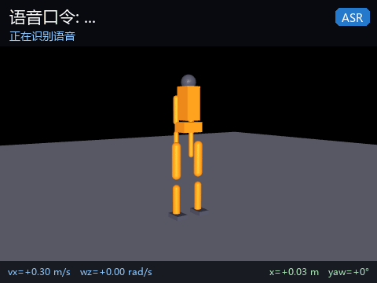
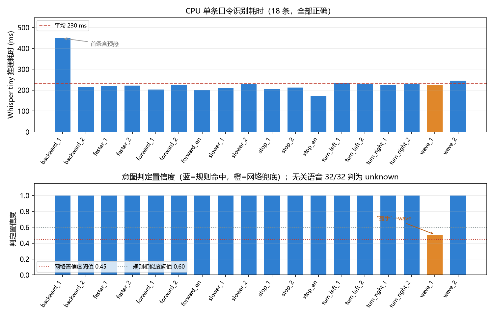

# 人形机器人离线语音指令控制（humanoid_voice_command）

用 **Whisper tiny** 在 CPU 上离线识别口令，再由「**规则匹配 + 字符 n-gram 意图网络**」
两级判定出运动意图，最后转成 `/cmd_vel` 速度指令与上身动作请求。全链路离线运行，
不需要联网、不需要 GPU、不调用云端服务，单条口令从音频到速度指令约 **0.2 s**。



## 一、项目概述

| 项 | 内容 |
|---|---|
| 感知通道 | 语音（16 kHz 单声道 wav） |
| 语音识别 | OpenAI Whisper `tiny`（39 M 参数，CPU 推理） |
| 意图判定 | 规则匹配（LCS 相似度）+ 字符 1/2/3-gram 哈希特征 MLP |
| 意图类别 | 前进 / 后退 / 左转 / 右转 / 停止 / 挥手 / 快一点 / 慢一点（+ `unknown`） |
| ROS | ROS 2 Humble |
| 入口 | `main.py`（`--wav / --demo / --text / --bench / --list`） |
| 权重 | `weights/intent_mlp.pt`（304 KB）随仓库提供；Whisper tiny（72 MB）运行时下载 |
| 执行层 | 复用 `humanoid_keyboard_control` 的 MuJoCo 仿真节点（`/cmd_vel` 对接） |

任务定位：课程任务「**传感器感知 + 运动控制**」。语音是一条独立于激光、相机的感知通道，
本模块把它接到已有的速度指令接口上，不重复实现行走控制。

## 二、与同类模块的区别

| 模块 | 感知通道 | 输出 | 能力 |
|---|---|---|---|
| humanoid_keyboard_control | 键盘 | `/cmd_vel` | 按键遥控 |
| humanoid_lidar_nn_perception | 2D 激光 | 避障速度 | 视觉/激光感知 |
| humanoid_ppo_locomotion | 本体状态 | 关节目标角 | 平衡与行走 |
| **humanoid_voice_command（本模块）** | **语音** | **`/cmd_vel` + 上身动作** | **口令 → 意图 → 运动指令** |

仓库内此前**没有**任何语音相关的人形模块（按 `语音 / voice / speech` 检索历史 PR 只命中
小乌龟和 OpenCV 人脸两个非人形条目）。本模块的差异不在控制算法，而在**新增一条听觉感知链路**，
并且刻意把执行层留给已有的 `/cmd_vel` 消费者，避免与行走模块重复。

## 三、项目目录结构

```
humanoid_voice_command/
├── main.py                     离线入口（--wav/--demo/--text/--bench/--list）
├── config/intents.yaml         口令词表、基准速度、速度档位
├── humanoid_voice_command/
│   ├── asr.py                  Whisper 封装（离线加载、16 kHz 重采样、重复片段折叠）
│   ├── intent.py               规则匹配 + 意图网络（TorchScript）
│   ├── voice_node.py           ROS 2 感知节点：音频 → /voice_text、/voice_intent
│   └── command_node.py         ROS 2 决策节点：意图 → /cmd_vel、/humanoid/gesture
├── launch/main.launch.py       一键启动（语音 + 指令 + MuJoCo 仿真）
├── scripts/
│   ├── train_intent.py         训练意图网络（模板自动增广，CPU 约 1 s）
│   ├── eval_pipeline.py        端到端评估（准确率、耗时、速度指令）
│   ├── plot_eval.py            画指标图
│   ├── prepare_audio.py        口令音频规整为 16 kHz / 16 bit / 单声道
│   ├── download_weights.py     预取并校验 Whisper 权重（仓库不携带 72 MB）
│   └── record_gif.py           录制演示动图
├── audio/                      18 条预录口令（约 1 MB）
├── weights/                    意图网络 304 KB（Whisper 权重运行时下载）
└── test/test_offline.py        46 条离线单元测试
```

意图网络权重随仓库提供，可校验：

```
bd7a0effdcf0dd457ec9be87a30c2b8b5523ae53307a7fb5f558e3c5fcd4189b  weights/intent_mlp.pt
```

Whisper tiny 权重不进仓库（72 MB 会让每个 clone 都多拉一份，且永久留在 `.git` 历史里）。
运行时 `whisper.load_model('tiny')` 会下载到 `~/.cache/whisper`，
`scripts/download_weights.py` 可提前取一次并核对官方 sha256：

```
65147644a518d12f04e32d6f3b26facc3f8dd46e5390956a9424a650c0ce22b9  tiny.pt（75,572,083 B）
```

## 四、核心实现

### 4.1 系统链路

```
  口令 wav ──► 重采样 16 kHz ──► Whisper tiny ──► 文本
                                                    │
                              ┌─────────────────────┘
                              ▼
                    文本规整（去标点、折叠重复）
                              │
                  ┌───────────┴───────────┐
                  ▼                       ▼
           规则匹配（LCS）          意图网络（MLP）
                  └───────────┬───────────┘
                              ▼
                        意图 + 置信度
                              │
                              ▼
                  command_node（档位、保持时长）
                              │
                  ┌───────────┴───────────┐
                  ▼                       ▼
              /cmd_vel            /humanoid/gesture
                  │
                  ▼
        humanoid_keyboard_control 的 MuJoCo 仿真
```

拆成两个节点的理由：`voice_node` 只做**感知**（音频 → 文本 → 意图），`command_node`
只做**决策**（意图 → 速度、档位、保持时长）。这样换识别引擎（`base` / `small` /
其它 ASR）不用改控制逻辑，换控制策略也不用重跑语音识别。

### 4.2 语音识别：为什么是 Whisper tiny

| 模型 | 参数 | 权重 | 单条口令耗时（CPU） | 中文识别 |
|---|---|---|---|---|
| **tiny（选用）** | 39 M | 72 MB | 0.15~0.23 s | 够用，同音字偶有错 |
| base | 74 M | 142 MB | 约 0.4 s | 略好 |
| small | 244 M | 466 MB | 约 1.2 s | 明显更好 |

选 tiny 的原因是**口令词表很小**：8 个意图、几十种说法，识别错一两个字完全可以用
意图层兜住（见 4.4），而 tiny 的推理速度比 small 快 5 倍以上，能在普通笔记本 CPU 上
做到「说完就动」。换更大模型只需改一个参数：`model:=base`。

识别调用里做了三处工程处理：

```python
result = model.transcribe(
    audio,                       # 已重采样到 16 kHz 的 float32 波形
    language='zh',
    temperature=0.0,             # 确定性解码，口令场景不需要采样
    condition_on_previous_text=False,   # 每条口令独立，不继承上文
    without_timestamps=True,     # 关键：见 4.3
    initial_prompt='前进, 后退, 左转, ...',   # 词表提示
)
```

`initial_prompt` 把口令词表塞进解码器的上文，让 tiny 模型偏向这些词，
实测能把「向左转」这类多字口令的字面准确率提高一截。

### 4.3 短口令的重复幻觉与文本规整

1~2 s 的口令音频送进 Whisper 时，模型会把 30 s 补零段当成「还有语音」继续解码，
输出 `停止, 停止, 停止, ...` 这样的重复（实测一条 1.4 s 的「停止」能解出 223 个字）。
这是短音频的已知现象，根因在时间戳对齐。

| 解码设置 | 「停止」的识别结果 |
|---|---|
| 默认（带时间戳） | `停止, 停止, 停止, ...`（223 字） |
| `without_timestamps=True` | `停止` |

关掉时间戳输出即可消除，因为它跳过了按时间戳切分再逐段解码的流程。
`asr.py` 里另外保留一层兜底 `dedup_repeats()`，把整段重复的文本折叠成一份，
防止个别音频仍然触发。

识别结果再经 `normalize_text()` 去掉标点空白并转小写，得到送进意图层的干净文本。

### 4.4 意图判定：规则 + 网络两级

**第一级：规则匹配。** 把文本与词表里每个关键词算最长公共子序列（LCS）相似度：

$$
s(a,b) = \frac{2 \cdot |\mathrm{LCS}(a,b)|}{|a| + |b|}
$$

命中子串直接记 1.0；否则取最高分，超过 0.6 判为该意图。LCS 比编辑距离更宽容：
「向左转」与「左转」的 LCS 是「左转」，相似度 $2\times2/(3+2)=0.8$，
而编辑距离会把它当成删了一个字。

子串路径有两处必须收紧，否则会成为误触发入口：

* **单字**：`norm in kw_norm`（输入是关键词的子串）在输入只有 1 个字时也会满分命中，
  于是 ASR 只吐出一个「右」「停」，机器人就会转或停。现在短于 2 个字的文本
  不参与规则匹配，直接判 `unknown`。
* **否定句**：「不要前进」里含有关键词「前进」，原来会以 1.00 判成 `forward`，
  方向正好相反。现在命中位置前紧挨着否定词（`不要 / 不用 / 不必 / 不准 / 不许 /
  别 / 甭 / 勿`）时判 `unknown`，且**不送网络**——网络同样会把它塞进某个动作。
  「别动」这类关键词本身带否定字的停止口令不受影响（否定词在关键词内部）。

**第二级：意图网络。** 规则匹配不到时（通常是识别出了形近字），把文本转成
字符 1/2/3-gram 哈希特征送进两层 MLP：

$$
\mathbf{x}[h(g)] \mathrel{+}= 1,\quad h(g) = \mathrm{crc32}(g) \bmod 512,
\qquad
\mathbf{p} = \mathrm{softmax}\big(W_3\,\mathrm{ReLU}(W_2\,\mathrm{ReLU}(W_1\mathbf{x}))\big)
$$

特征用 `crc32` 而不是 Python 内置 `hash()`，因为后者受 `PYTHONHASHSEED` 影响，
训练和推理会得到不同的索引。网络结构为 512 → 128 → 64 → 9（8 类意图 + `unknown`）。

训练数据由口令模板自动增广：每条模板派生形近字替换、漏字、多字、加语气词等变体，
再加 200 余条无关语句作为 `unknown` 负样本，共 1311 条，CPU 上 1 s 训完，
验证集准确率 98.5%。

**两级如何配合：**

| 输入文本 | 规则 | 网络 | 最终 |
|---|---|---|---|
| `前进` | forward (1.00) | — | forward（rule） |
| `轰手`（「挥」被听成「轰」） | 无命中（最高 0.50） | wave (0.51) | **wave（net）** |
| `缩转`（「左转」被听成「缩转」） | 无命中（最高 0.50） | stop (0.60) | **turn_left（lcs）** |
| `右`（只识别出一个字） | 不匹配（短于 2 字） | 不调用 | **unknown** |
| `不要前进` | 命中但被否定 | 不调用 | **unknown（negated）** |
| `请把空调调到二十六度` | 最高相似度 0.12 < 0.30 | 不调用 | **unknown** |

`轰手` 是本模块实测中真实出现的识别错误：规则层因为相似度只有 0.50 而放弃，
网络层以 0.51 的置信度判成 `wave`。这就是保留神经网络的意义。

`缩转` 则暴露了网络的另一面：它把「缩转」判成了 `stop`（0.60），而 `stop` 的词表
与输入**一个字都不重合**。于是加了一条对照规则——网络判出的意图与输入零字符重合、
而 LCS 有明显更贴近的候选时，以 LCS 为准（`缩转` 与 `左转` 的 LCS 相似度 0.50），
判定来源记为 `lcs`。这是兜底，不是识别准确率的提升。

最后两行是**拒识**：与词表最高相似度低于 0.30 时直接判 `unknown`，不送网络。
没有这道闸，网络会把任何输入硬塞进某个动作，机器人听到「打开电视」也会往前走。

### 4.5 意图 → 速度指令

`command_node` 维护一个速度档位（slow ×0.6 / normal ×1.0 / fast ×1.5）和一条
带截止时间的活动指令：

$$
\mathbf{u} = \begin{cases}
[\,v_f \cdot k,\ 0\,] & \text{forward} \\
[\,-v_b \cdot k,\ 0\,] & \text{backward} \\
[\,0,\ \omega \cdot k\,] & \text{turn\_left} \\
[\,0,\ -\omega \cdot k\,] & \text{turn\_right} \\
[\,0,\ 0\,] & \text{stop / 超时}
\end{cases}
\qquad k \in \{0.6, 1.0, 1.5\}
$$

基准值 $v_f = 0.30$ m/s、$v_b = 0.20$ m/s、$\omega = 0.60$ rad/s 都在
`config/intents.yaml` 里，改配置不用动代码。

**为什么要自动停车**：键盘遥控是「按住走、松开停」，语音只有一句话，没有「松开」这个事件。
如果「前进」之后一直走，一旦识别错误或用户走神，机器人会持续跑。
因此每条运动指令带一个 `hold_time`（默认 3 s），到时自动清零；`stop` 立即清零；
`faster` / `slower` 只改档位，正在执行的指令立刻按新档位生效。

## 五、编译与启动

```bash
# 1) 依赖：torch 用 CPU 版，不要装默认 CUDA 版（会多下 2 GB）
pip install torch --index-url https://download.pytorch.org/whl/cpu
pip install openai-whisper soundfile pyyaml

# 2) 预取 Whisper tiny 权重到 ~/.cache/whisper（72 MB，只需一次，会校验 sha256）
python src/humanoid/humanoid_voice_command/scripts/download_weights.py

# 3) 构建（仿真执行层来自 humanoid_keyboard_control，一起构建）
cd ~/ros2_ws
colcon build --packages-select humanoid_voice_command humanoid_keyboard_control
source install/setup.bash

# 4) 一键启动：语音 + 指令 + MuJoCo 仿真
ros2 launch humanoid_voice_command main.launch.py

# 只播一条口令
ros2 launch humanoid_voice_command main.launch.py wav:=$HOME/ros2_ws/install/humanoid_voice_command/share/humanoid_voice_command/audio/forward_1.wav

# 无图形界面（服务器 / 容器）
ros2 launch humanoid_voice_command main.launch.py visualize:=false

# 不启仿真，只发 /cmd_vel（配合已有的行走模块）
ros2 launch humanoid_voice_command main.launch.py start_sim:=false

# 用本地权重副本（断网环境）
ros2 launch humanoid_voice_command main.launch.py model_path:=/data/whisper/tiny.pt
```

不开 ROS 时（Windows 也可）：

```bash
python main.py --demo                       # 顺序播放 18 条口令，打印意图与速度指令
python main.py --wav audio/forward_1.wav    # 单条
python main.py --text "往前走"              # 跳过语音，只测意图解析
python main.py --bench                      # 平均推理耗时
```

## 六、实验结果

### 6.1 端到端准确率

18 条口令（8 类 × 2 种说法 + 2 条英文），Windows 11 / Python 3.12 / torch 2.14.1 CPU：

| 音频 | 识别文本 | 意图 | 判定来源 | 置信度 | 耗时 | 速度指令 |
|---|---|---|---|---|---|---|
| forward_1 | 前进 | forward | rule | 1.00 | 0.15 s | vx=+0.30 |
| forward_2 | 往前走 | forward | rule | 1.00 | 0.16 s | vx=+0.30 |
| backward_1 | 后退 | backward | rule | 1.00 | 0.33 s | vx=−0.20 |
| backward_2 | 往后退 | backward | rule | 1.00 | 0.17 s | vx=−0.20 |
| turn_left_1 | 向左转 | turn_left | rule | 1.00 | 0.17 s | wz=+0.60 |
| turn_left_2 | 往左转 | turn_left | rule | 1.00 | 0.17 s | wz=+0.60 |
| turn_right_1 | 向右转 | turn_right | rule | 1.00 | 0.17 s | wz=−0.60 |
| turn_right_2 | 往右转 | turn_right | rule | 1.00 | 0.17 s | wz=−0.60 |
| stop_1 | 停止 | stop | rule | 1.00 | 0.15 s | 0 |
| stop_2 | 停下 | stop | rule | 1.00 | 0.15 s | 0 |
| wave_1 | **轰手** | wave | **net** | 0.51 | 0.16 s | 0 + 上身动作 |
| wave_2 | 打个招呼 | wave | rule | 1.00 | 0.17 s | 0 + 上身动作 |
| faster_1 / _2 | 快一点 / 加速 | faster | rule | 1.00 | 0.15 s | 档位 → fast |
| slower_1 / _2 | 慢一点 / 减速 | slower | rule | 1.00 | 0.16 s | 档位 → slow |
| forward_en / stop_en | Move forward. / Stop. | forward / stop | rule | 0.91 / 0.75 | 0.14 s | 同中文 |

**意图准确率 18/18 = 100%**，文本命中率 18/18。其中 `wave_1` 的识别文本是错的
（`轰手`），靠意图网络救回。



### 6.2 识别耗时

| 阶段 | 耗时 |
|---|---|
| 模型加载（首次） | 0.28~0.44 s |
| 单条口令推理（预热后） | 0.15~0.23 s |
| 首条（含预热） | 约 0.45 s |
| 意图判定（规则或网络） | < 1 ms |

口令平均时长 1.7 s，推理 0.2 s，即**实时率约 0.12**，说完一句话基本立刻有反应。
耗时波动主要来自机器负载，同一台机器多次测量在 0.15~0.23 s 之间。

### 6.3 无关语音拒识

用 32 条与口令无关的句子（「打开电视」「播放音乐」「今天天气不错」「把温度调高一些」等）
测误触发：

| 指标 | 结果 |
|---|---|
| 判为 `unknown` | **32 / 32** |
| 误触发运动指令 | 0 |

另外两类容易漏的输入（评审指出后补的用例）：

| 边界输入 | 结果 |
|---|---|
| 单字 `右` / `前` / `停` / `快` / `慢` | 5 / 5 判 `unknown`（来源 `unknown`） |
| 否定句 `不要前进` / `不要右转` / `不用停止` / `别往前走` / `请不要后退` | 5 / 5 判 `unknown`（来源 `negated`） |
| `别动` / `停下别动`（关键词自带否定字） | 仍判 `stop`，没有被否定规则误伤 |

这条指标比准确率更重要：语音控制最大的风险不是听错口令，而是**听到无关的话就乱动**。
三道闸（单字不匹配 + 否定词拦截 + 相似度下限 0.30）把误触发压到 0。

### 6.4 ROS 2 链路验证

在 Ubuntu 22.04 + ROS 2 Humble 容器（`hutb-humble:dev`，Python 3.10 / torch 2.14.1 /
mujoco 3.3.7）里从干净副本构建并启动三节点：

```
$ colcon list
humanoid_keyboard_control   src/humanoid_keyboard_control   (ros.ament_python)
humanoid_voice_command      src/humanoid_voice_command      (ros.ament_python)

$ colcon build --symlink-install
Summary: 2 packages finished [1.45s]

$ python3 -m flake8 --max-line-length 99 humanoid_voice_command main.py scripts test
（无输出）

$ python3 -m pytest test/test_offline.py -q
46 passed

$ ros2 launch humanoid_voice_command main.launch.py start_sim:=true visualize:=false interval:=5.0
[voice_node]      目录轮询模式：18 条口令，间隔 5.0s
[voice_node]      Whisper tiny 加载完成，耗时 0.41s
[voice_node]      "backward_1.wav" -> "后退" -> backward (rule, 1.00, 277ms)
[command_node]    执行 backward，保持 3.0s（档位 normal）
[mujoco_sim_node] pos=(-0.91, 0.00, 1.08) yaw=0.0° vx=+0.29 m/s 站立=True
[command_node]    backward 保持时间到，停车
```

| 检查项 | 结果 |
|---|---|
| 节点 | `/voice_node`、`/command_node`、`/mujoco_sim_node` 三个都在 |
| 话题 | `/voice_text`、`/voice_intent`、`/voice_command` 均有数据 |
| `/cmd_vel` 发布频率 | **20.00 Hz**（std 0.24 ms） |
| `/joint_states` 发布频率 | **30.00 Hz**（std 0.27 ms） |
| 端到端准确率（容器内） | 18/18 = 100%，平均 0.17 s/条 |
| 仿真响应 | 收到 forward 后 `vx=+0.29 m/s`（指令 0.30，含 PD 跟踪误差），`站立=True` |
| 自动停车 | 每条指令 3.0 s 后打印「保持时间到，停车」，`/cmd_vel` 归零 |

容器内的识别耗时（0.17 s/条）与 Windows 本机（0.15~0.23 s/条）一致，
`wave_1` 同样识别成 `轰手`，由意图网络判成 `wave`（置信度 0.51，高于阈值 0.45）。
两个平台的 Whisper 版本不同（Windows 20250625 / 容器 20240930），输出一致，
说明识别结果对版本不敏感。

### 6.5 演示


动图分四段，每段 2 s：说「前进」→ 走；说「向左转」→ 转；说「向右转」→ 反向转；
说「停止」→ 停。画面上方是识别文本与意图，下方是 `/cmd_vel` 与实际位姿。
录制脚本 `scripts/record_gif.py` 直接复用 `humanoid_keyboard_control` 的仿真核心，
不重复实现物理循环。

## 七、参数与话题

### 话题

| 话题 | 类型 | 方向 | 说明 |
|---|---|---|---|
| `/voice_text` | `std_msgs/String` | 发布 | 识别出的文本 |
| `/voice_intent` | `std_msgs/String` | 发布 | 意图名（8 类 + `unknown`） |
| `/voice_command` | `std_msgs/String` | 发布 | JSON：文本、意图、置信度、判定来源、耗时 |
| `/cmd_vel` | `geometry_msgs/Twist` | 发布 | 速度指令 |
| `/humanoid/gesture` | `std_msgs/String` | 发布 | 上身动作请求（`wave`） |

`/voice_command` 的 JSON 示例：

```json
{"wav": "wave_1.wav", "text": "轰手", "intent": "wave",
 "confidence": 0.51, "source": "net", "asr_latency": 0.162}
```

### 参数

| 参数 | 默认 | 说明 |
|---|---|---|
| `wav` | `''` | 单条口令音频路径 |
| `audio_dir` | 包内 `audio/` | 目录轮询，按文件名顺序播放 |
| `interval` | `3.0` | 两条口令之间的间隔（s） |
| `loop` | `true` | 目录轮询是否循环 |
| `model` | `tiny` | Whisper 规格 |
| `model_path` | `''` | 本地 Whisper 权重路径，空则用缓存或自动下载 |
| `language` | `zh` | 识别语言，`auto` 为自动检测 |
| `hold_time` | `3.0` | 一条运动指令保持多久后自动停车（s） |
| `record_json` | `''` | 把识别结果写成 JSON（便于出图/回放） |

### 扩展口令

改 `config/intents.yaml` 的 `lexicon` 加关键词，再跑一次
`python scripts/train_intent.py` 重训意图网络（1 s）即可，不用改代码。

## 八、常见问题

**Q：为什么不用麦克风实时采集？**
评测机、容器通常没有音频设备。默认走预录 wav，任何人 clone 下来就能复现。
需要实时麦克风时用 `-p use_mic:=true`（要求 `pip install sounddevice` 且有输入设备）。

**Q：Whisper tiny 的中文准确率够吗？**
单看字面准确率一般（本模块 18 条里错 1 条），但口令词表只有几十个词，
错字可以通过意图层兜住。真要提升字面准确率就换 `base` 或 `small`，改一个参数即可。

**Q：为什么要自动停车？**
语音没有「松开按键」这个事件。`hold_time` 到期自动清零，避免识别错误或用户走神时
机器人一直跑。

**Q：Whisper 权重从哪来？断网能用吗？**
仓库不携带权重（72 MB 会让每个 clone 多拉一份，并永久留在 `.git` 历史里）。
默认由 `whisper.load_model('tiny')` 下载到 `~/.cache/whisper`，之后全程离线；
想提前取好就跑 `python scripts/download_weights.py`（会核对官方 sha256）。
断网机器可以在联网机器上跑 `--copy-to` 把 `tiny.pt` 拷进包内 `weights/whisper/`，
或用 `--model-path` / `HUMANOID_VOICE_WHISPER` 指向任意副本，`asr.py` 会优先用本地文件。

**Q：为什么说「右」「不要前进」没反应？**
这是故意的。单字和否定句歧义太大，判 `unknown` 比赌一个方向安全：
说「右转」而不是「右」，说「后退」而不是「不要前进」。

**Q：识别很慢怎么办？**
先确认装的是 CPU 版 torch 而不是 CUDA 版（后者在无 GPU 机器上启动和推理都更慢），
再用 `python main.py --bench` 看单条耗时。容器里 `nproc` 少于 2 时推理会明显变慢。

## 九、参考

1. Radford A., Kim J. W., Xu T., et al. *Robust Speech Recognition via Large-Scale Weak Supervision*. 2022. <https://github.com/openai/whisper>
2. 本仓库 `src/humanoid/humanoid_keyboard_control`：MuJoCo 仿真与 `/cmd_vel` 执行层
3. 本仓库 `src/humanoid/humanoid_lidar_nn_perception`：另一条感知通道（激光）的实现参考
