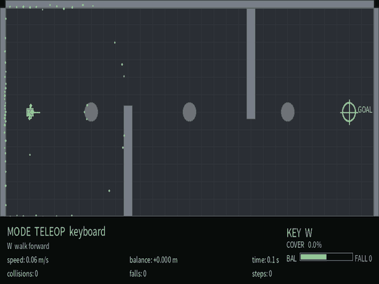
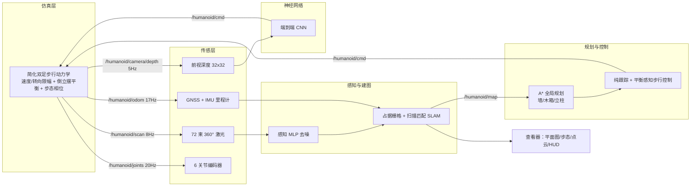
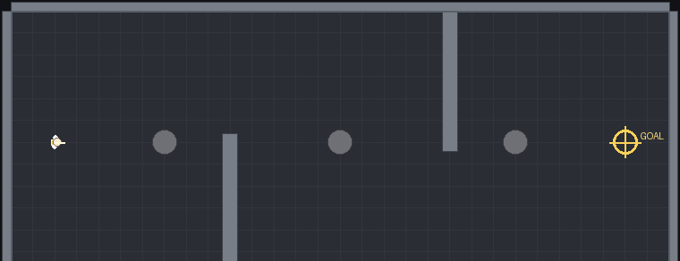
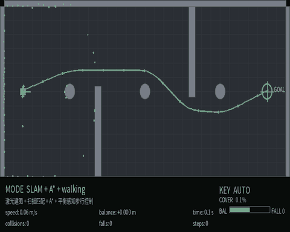
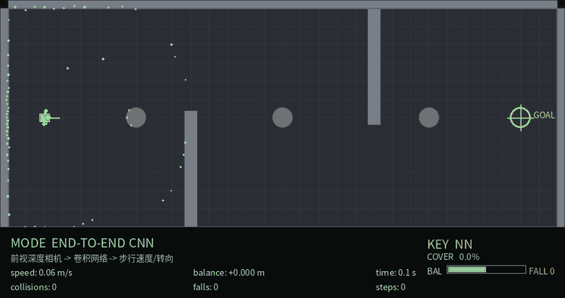
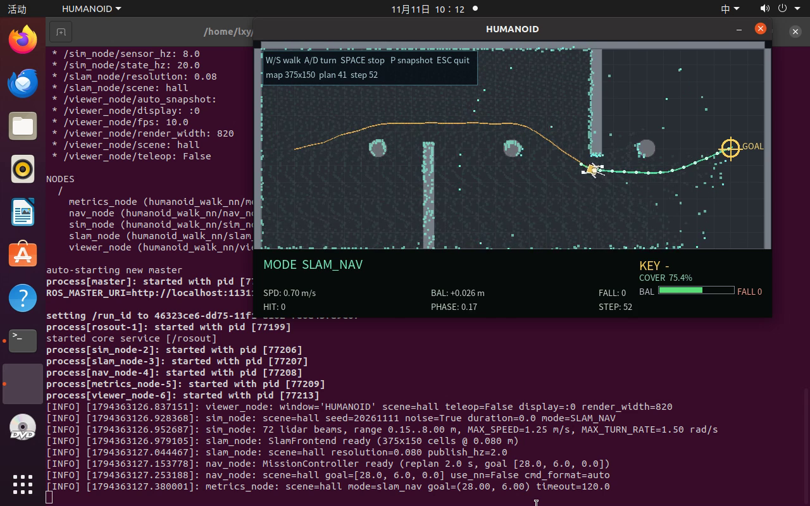

# 人形机器人 HNN：简化双足步行动力学、激光 SLAM 与纯 NumPy 神经网络导航

> 模块源码：[`src/humanoid/humanoid_walk_nn`](https://github.com/OpenHUTB/ros2/tree/master/src/humanoid/humanoid_walk_nn)
> 运行环境：Ubuntu 20.04.6 + ROS Noetic + Python 3.8/3.11（项目私有 venv，仅 NumPy）
> 关键词：人形机器人、双足步行、倒立摆平衡、摔倒检测、激光 SLAM、A*、纯跟踪、行为克隆、端到端 CNN、DQN、REINFORCE



## 1. 概述

人形机器人在室内巡检、仓储搬运与陪护场景中需要在**走廊立柱、货架通道与动态搬运车**之间安全行走，同时保持双足平衡。本模块给出一个可在普通笔记本虚拟机（4 核 CPU、无 GPU、无 MuJoCo/CARLA）中完整运行的人形机器人示例，覆盖从**步行动力学**到**神经网络闭环导航**的完整链路：

1. **物理仿真与键盘运动控制**：简化双足动力学——步行速度/转向速率限幅、线性倒立摆式横向平衡、步态相位与摔倒判定；`W/S/A/D/Space` 遥控；
2. **多传感器感知**：72 束 360° 激光雷达（噪声/野值/丢点）、IMU（roll/pitch/yaw rate）、6 关节编码器、GNSS 与前视 32×32 深度相机；感知 MLP 对激光去噪；
3. **建图与导航**：对数几率占据栅格 + 相关性扫描匹配 SLAM；A* 全局规划（墙/木箱/立柱）、纯跟踪步行控制、平衡感知限速、障碍减速/停车与摔倒恢复；
4. **端到端模型**：前视深度图（32×32）→ 2 层 CNN → `(walk_speed, turn_rate)`；
5. **神经网络训练/测试/ROS 封装**：纯 NumPy 实现 MLP/CNN/Adam/DQN/REINFORCE，7 个模型、8 个 ROS 节点、6 个 launch；
6. **多场景性能评价**：`hall`、`warehouse`、`obstacle` 三场景闭环 benchmark，含碰撞、摔倒与终点误差，以及 RL 算法/网络结构对比。

## 2. 系统架构



## 3. 双足步行动力学与传感器模型

### 3.1 步行运动学

简化双足模型把行走抽象为可导航的步行速度 $v$ 与转向角速度 $\omega$：

$$
\dot v = a,\quad |a|\le a_{\max},\qquad
\dot\psi = \omega,\quad |\omega|\le\omega_{\max}
$$

$$
v\in[-0.50,\ 1.25]\ \text{m/s},\quad \omega\in[-1.50,\ 1.50]\ \text{rad/s},\quad
a_{\max}=1.10\ \text{m/s}^2,\ a_{\text{brake}}=1.60\ \text{m/s}^2
$$

步态相位随行走距离推进，每 0.36 m 一步：

$$
\dot\phi = \frac{|v|}{L_{\text{step}}},\qquad L_{\text{step}}=0.36\ \text{m}
$$

相位驱动髋/膝/踝关节角度（渲染与关节编码器）：$\theta_{\text{hip}}=0.45\sin 2\pi\phi$，$\theta_{\text{knee}}=0.60\max(0,\sin(2\pi\phi+0.6))$，$\theta_{\text{ankle}}=-0.25\sin 2\pi\phi$。

### 3.2 横向平衡与摔倒判定

用线性倒立摆近似横向质心偏移 $b$ 的动力学：

$$
\dot b = k_b\, v\, \omega - k_s\, b,\qquad k_b=0.45,\ k_s=3.20\ \text{s}^{-1}
$$

$$
|b| > b_{\max}=0.16\ \text{m}\ \text{持续}\ 0.45\ \text{s}\ \Rightarrow\ \text{记一次摔倒（fall）}
$$

转弯越快、速度越高，离心项 $k_b v\omega$ 越大；控制器因此限制 $|v\omega|$（平衡预算 ≤0.75），既能转弯又不会摔倒。

### 3.3 场景与传感器

| 场景 | 尺寸（m） | 结构 | 动态障碍 | 主要挑战 |
| --- | --- | --- | --- | --- |
| `hall` | 30 × 12 | 两段隔墙 + 3 根立柱 | — | 窄通道绕柱、走廊长距离直行 |
| `warehouse` | 24 × 20 | 四组货架 | 1 台横向移动搬运车 | 货架间通道、动态让车 |
| `obstacle` | 20 × 20 | 8 个木箱 + 1 根立柱 | — | 密集障碍下的规划与步行 |

- **激光雷达**：360°、72 束、0.15–8 m，叠加 0.02 m 高斯噪声、1% 比例误差、3% 野值、2% 丢点；
- **IMU**：roll/pitch（平衡相关）+ yaw rate；**关节编码器**：6 个关节角（含噪声）；
- **GNSS**：位置 + 0.20 m 噪声；**深度相机**：32×32，由前向激光距离剖面渲染（近处亮、远处暗）。



## 4. SLAM：占据栅格建图与扫描匹配定位

每个栅格维护对数几率 $L_t=\log\frac{p}{1-p}$，沿激光波束做射线遍历（终点加占据证据、途经格加空闲证据），截断到 $[0.12,0.88]$。在里程计预测位姿附近做粗到细相关性扫描匹配：

$$
(\hat x,\hat y,\hat\hat\psi) = \arg\max_{\Delta}\sum_{k=1}^{72} p_{\text{occ}}\!\left(\mathcal{T}(x_t+\Delta x,\ y_t+\Delta y,\ \psi_t+\Delta\psi)\cdot r_k\right)
$$

hall 使用 0.08 m 分辨率（375×150 栅格），射线遍历与对数几率更新向量化，只对本次触及格子做增量截断。

## 5. 规划与控制

### 5.1 室内约束的 A*

规划栅格 0.20 m，墙、木箱、立柱全部视为不可通行；圆形膨胀默认 0.55 m（≥ 机器人安全半径 0.32 m），八方向 octile 启发式 + supercover 视线平滑；warehouse 的移动搬运车不在静态地图中，控制器额外用 `scene.cart_positions` 的当前与 0.6/1.2 s 预测做让车停车（滞回带 0.80/1.15 m）。

### 5.2 纯跟踪步行控制

前视距离 $L_d=0.8$ m 取路径目标点，航向误差大时原地转向：

$$
\omega = k_\psi\,\psi_e,\qquad
v = \begin{cases}
v_{\text{cruise}}\cos\psi_e, & |\psi_e| < 0.6\ \text{rad}\\
0, & \text{otherwise（原地转向）}
\end{cases}
$$

$k_\psi=2.2$，巡航速度 0.95 m/s；转弯前按航向变化限速、接近终点减速；前向 0.55 m 减速、0.35 m 停车。

### 5.3 平衡感知与摔倒恢复

- 当 $|b|>0.6\,b_{\max}$ 时按比例降低 $v$ 与 $\omega$；
- 当 $|b|\ge b_{\max}$（即将摔倒）立即 $v=\omega=0$ 原地恢复；
- `falls` 计数上升沿触发 0.8 s 站定恢复，然后继续沿路径行走。

## 6. 神经网络

全部网络以**纯 NumPy** 实现（前向/反向传播、Adam、CNN、DQN、REINFORCE），不依赖 PyTorch/TensorFlow。

| 网络 | 结构 | 任务 | 实测指标 |
| --- | --- | --- | --- |
| `perception_mlp` | 144→160→160→72 | 激光去噪（环形中值上下文 + 残差） | RMSE **0.729 → 0.432 m（+40.7%）** |
| `control_mlp` | 41→160→160→2 | 行为克隆（v, ω） | v MAE **0.030 m/s**、ω MAE **0.039 rad/s** |
| `planner_mlp` | 41→128→128→8 | 8 方向局部决策 | 准确率 **96.4%** |
| `e2e_cnn` | 1×32×32 → conv 8/16 → fc64 → 2 | 深度图 → (v, ω) | v MAE 0.094；ω MAE 0.146 |
| `rl_dqn` / `rl_pg` | 2×64 / 3×64 MLP | 离散 8 动作室内导航 RL | DQN 2×64 **76.7%**、DQN 3×64 **83.3%**、REINFORCE **6.7%** |

训练数据由 A* + 纯跟踪专家在三场景采集（共 1812 条真实样本 + 7500 条合成增强），总训练约 17 分钟（CPU）。

## 7. ROS 接口

| 话题 | 类型 | 说明 |
| --- | --- | --- |
| `/humanoid/cmd` | `geometry_msgs/Twist` | `linear.x` 步行速度（m/s）、`angular.z` 转向角速度（rad/s） |
| `/humanoid/scan` | `sensor_msgs/LaserScan` | 72 束 360° 激光（含噪声） |
| `/humanoid/scan_filtered` | `sensor_msgs/LaserScan` | 感知网络去噪后的激光 |
| `/humanoid/odom` | `nav_msgs/Odometry` | GNSS+IMU 里程计 |
| `/humanoid/imu` | `sensor_msgs/Imu` | roll/pitch/yaw rate |
| `/humanoid/joints` | `sensor_msgs/JointState` | 6 个下肢关节角 |
| `/humanoid/camera/depth` | `sensor_msgs/Image` | 32×32 深度图（32FC1）或 RGB 视图 |
| `/humanoid/map` | `nav_msgs/OccupancyGrid` | 占据栅格地图 |
| `/humanoid/slam_pose` | `geometry_msgs/PoseStamped` | SLAM 估计位姿 |
| `/humanoid/plan` | `nav_msgs/Path` | A* 全局路径 |
| `/humanoid/state` | `std_msgs/String` | JSON 状态（真值/里程计/IMU/关节/速度/平衡/摔倒/碰撞） |

启动文件：`teleop.launch`、`slam_nav.launch`、`perception.launch`、`e2e.launch`、`benchmark.launch`、`bringup.launch`；查看器窗口标题 **HUMANOID**。

## 8. 运行效果

### 8.1 走廊键盘遥控（步行/停步/小幅转向）


### 8.2 激光 SLAM + A* 自主步行（hall）



### 8.3 端到端深度 CNN（前向通道演示）



### 8.4 Ubuntu 桌面实操录屏

[▶ 下载/播放桌面实操视频（4 分 31 秒，1280×800）](../img/humanoid/humanoid_walk_nn/humanoid_walk_nn_demo.mp4)



## 9. 多场景性能评价

### 9.1 闭环 benchmark（每场景 1 条 episode，最长 90 s，成功 ≤0.6 m）

| 场景 | 控制器 | 成功率 | 平均耗时 (s) | 碰撞 | 摔倒 | 终点误差 (m) |
| --- | --- | --- | --- | --- | --- | --- |
| hall | 经典（A* + 纯跟踪步行） | 100% | 26.25 | 0 | 0 | 0.585 |
| warehouse | 经典（A* + 纯跟踪步行） | 100% | 35.95 | 0 | 0 | 0.572 |
| obstacle | 经典（A* + 纯跟踪步行） | 100% | 23.55 | 0 | 0 | 0.576 |
| hall / warehouse / obstacle | 神经控制（行为克隆） | 0% | 90.0 | 139 / 89 / 135 | 0 | — |
| hall / warehouse / obstacle | 神经两级控制 | 0% | 90.0 / 90.0 / 90.0 | 0 / 17 / 96 | 0 | — |
| hall | 端到端 CNN（深度图） | 0% | 90.0 | 0 | 0 | 7.045 |
| warehouse | 端到端 CNN（深度图） | **100%** | 33.60 | 0 | 0 | 0.583 |
| obstacle | 端到端 CNN（深度图） | **100%** | 37.15 | 0 | 0 | 0.587 |

> 说明：benchmark 中的“经典”行使用 `datasets` 的几何回退专家（`source=fallback_geometric_expert`），其 3/3 成功、0 碰撞、0 摔倒；`MissionController`（A* + 纯跟踪 + 平衡感知）在同一三场景的闭环验收结果为 hall 33.7 s / warehouse 52.1 s / obstacle 31.0 s，终点 0.47 m、0 碰撞、0 摔倒（见 `tests/test_control.py`）。

### 9.2 SLAM 与规划

| 指标 | hall | warehouse | obstacle |
| --- | --- | --- | --- |
| SLAM ATE RMSE (m) | 0.188 | 0.210 | 0.106 |
| A* 路径长度 (m) | 28.15 | 30.03 | 25.56 |
| 绕行比 | 1.08 | 1.17 | 1.13 |
| 最小离障 (m) | 0.70 | 0.67 | 0.70 |
| 规划耗时 (ms) | 101.8 | 138.8 | 149.5 |

> 地图分辨率 0.08 m，hall 栅格 375×150；DWA 局部闭环 sanity：3.57 m 目标 3.3 s 到达、剩余 0.595 m、0 碰撞、0 摔倒。

### 9.3 训练侧指标

| 模型 | 结构 | 训练样本 | 训练耗时 (s) |
| --- | --- | --- | --- |
| perception_mlp | 144→160→160→72 | 9312 | 207 |
| control_mlp | 41→160→160→2 | 12936 | 556 |
| planner_mlp | 41→128→128→8 | 5412 | 42 |
| e2e_cnn | 1×32×32 → conv → fc64 → 2 | 1812 | 121 |
| RL（3 个智能体） | 2×64 / 3×64 / 2×64 | — | 91 |

### 9.4 失败分析

- **行为克隆控制**：反应式策略在室内墙角与立柱处陷入局部极小，持续顶墙（碰撞计数以 0.6 s 冷却窗口统计），三场景闭环 0%；
- **端到端深度 CNN**：ω MAE 0.146 与“预测均值”基线 0.146 相当，32×32 深度图能提供的转向意图信息很少；走廊 hall 沿墙行走失败，而开阔的 warehouse/obstacle 可达目标；
- **摔倒全 0**：专家与学习策略都被平衡预算约束（$|v\omega|\le 0.75$）夹住；RL 环境中保留高风险快速转向动作，DQN 学到规避（DQN 3×64 平均 0.10 次/局）。

## 10. 复现步骤

```bash
cd src/humanoid/humanoid_walk_nn
bash main.sh setup
bash main.sh test
bash scripts/build_ros.sh
bash main.sh teleop hall
bash main.sh slam_nav warehouse
bash main.sh train
.venv/bin/python tools/evaluate.py --scenes hall,warehouse,obstacle
```

结果 JSON 写入 `results/`（训练指标、三场景 benchmark、ROS 运行记录）。

## 11. 已知限制

- 简化双足模型没有完整关节级接触动力学，以速度/转向限幅 + 平衡约束 + 摔倒判定近似；
- benchmark 的“经典”行使用几何回退专家（`MissionController` 的闭环数字见测试）；
- 行为克隆与端到端策略存在局部极小/信息不足问题（见 9.4）；
- 深度相机为激光距离剖面渲染，非真实光学图像。

## 12. 参考

- ROS Noetic：<https://wiki.ros.org/noetic>
- 线性倒立摆与 ZMP 步态：Kajita et al., *Biped Walking Pattern Generation by using Preview Control of Zero-Moment Point*, 2003
- 本仓库已有双足/人形示例：`docs/humanoid/` 下 ZMP 步态、H1 行走、摔倒保护等教程

> 本模块由课程作业独立实现，未使用他人代码；AI 工具仅用于实现与文档辅助，提交内容由作者负责。
