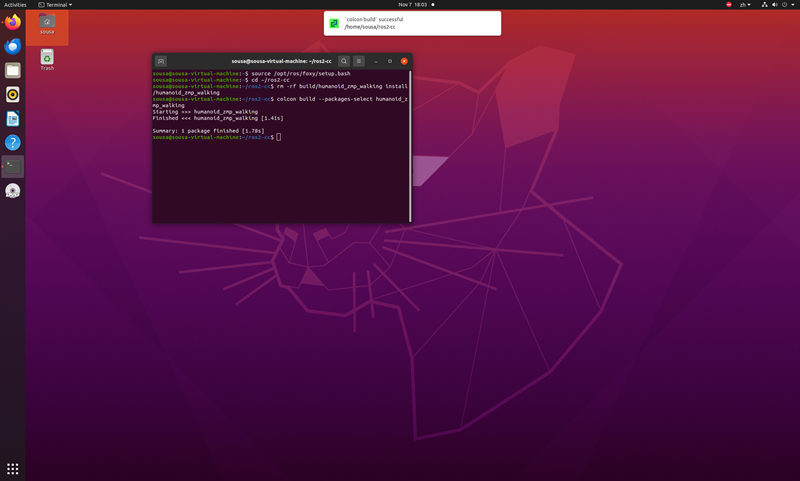
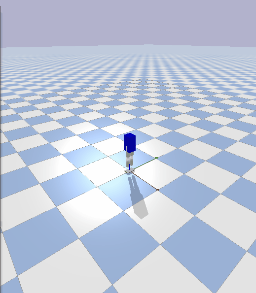

# 人形机器人轻量级 ZMP 步行控制基线

## 修改概述 / Overview

- 中文：新增 `humanoid_zmp_walking` 模块，用线性倒立摆模型（LIPM）完成
  「落脚点序列 → 平滑质心轨迹 → ZMP 反算 → 支撑多边形判定」的离线规划，
  再由 ROS 2 话题把 6 个关节指令送入 PyBullet 仿真。
- English: A lightweight ZMP walking baseline built on the linear inverted
  pendulum model (LIPM). It plans a footstep sequence, computes a ZMP
  reference from a smooth center-of-mass trajectory, verifies that the ZMP
  stays inside the support polygon, and streams joint commands to a
  6-joint humanoid in PyBullet.

安装、启动、参数与话题接口见
[模块 README](../../src/humanoid/humanoid_zmp_walking/README.md)。

## 规划原理

1. `lipm.py` 实现零力矩点与质心的互算关系：

   `p = c - (z_c / g) * a`，以及反向的 `a = (c - p) / (z_c / g)`

2. `footstep.py` 生成左右交替的落脚点序列。默认 `t_step = 1.0 s`，即每
   1.0 s 落一步，其中摆动期 0.4 s、双脚支撑期 0.6 s。两条腿的摆动窗口
   相互错开，因此任一时刻最多只有一只脚离地。

3. `gait.py` 先构造平滑的质心轨迹：前进方向匀速（加速度为 0），侧向按
   2 s 周期做余弦摆动、幅度等于 `step_width`，摆动中心取单脚支撑区间的
   中点（0.8 s、1.8 s……），使摆动腿离地时质心正对支撑脚。

4. 由质心二阶差分代入 LIPM 关系反算 ZMP。除首尾点用三点单侧二阶差分
   外，内部点均用中心差分，避免把速度误当作加速度。

## 支撑多边形与判定

- 支撑多边形只包含**已落地**的脚掌：某只脚进入摆动区间后整只被剔除，
  直到落地才更新到新落点。
- 支撑多边形取已落地脚掌矩形的**凸包**。单脚支撑时退化为该脚矩形，
  双支撑时包含两脚之间的连桥区域。若按矩形之并判定，会把双支撑过渡段
  中位于两脚之间的 ZMP 误判为越界。
- `_check_support` 在单脚支撑时段断言矩形数为 1，判定方式本身出错时
  直接抛出异常。
- 默认参数（`com_height = 0.65 m`、`step_length = 0.10 m`、
  `step_width = 0.06 m`、6 步）下，601 个采样点全部位于支撑多边形内，
  ZMP 侧向幅值约 ±0.099 m，前后范围为 -0.050 ~ 0.550 m。

## 关节时序

- 每条腿由**自身的摆动窗口**驱动，不是独立的正弦：摆动期内髋、膝按
  `sin(pi * progress)` 抬起（窗口首末为 0），支撑腿的关节角保持 0。
- 膝关节只做单向屈曲（非负），踝关节取 `-(髋 + 膝)` 并限幅，使脚掌尽量
  保持水平。
- 抬腿窗口与落脚时序一致：左脚 0.6~1.0 s、右脚 1.6~2.0 s，依次交替。

## 环境说明：仿真不是实时的

`play.py` 显式调用 `p.setTimeStep(1/240)` 作为固定步长，并在每个 ROS
定时器回调里按实际经过时间累积、补足若干个固定步（单次上限 10 步），
用于抵消 executor 调度抖动与 GUI 渲染开销。仿真时间因此不保证与墙钟
严格同步；日志按仿真时间每满 1 s 输出一次。

## 已知限制：仿真中会失稳

本包的定位是**规划层基线**，只负责回答「ZMP 是否始终位于支撑多边形
内」，不包含平衡控制器：

- `zmp_generator` 输出的 ZMP 轨迹由质心轨迹反算得到，逐点判定已通过
  （601 个采样点全部在支撑域内），这部分与仿真是否摔倒无关。
- 模型只有绕 y 轴的俯仰关节（髋、膝、踝），没有侧向自由度，规划中的
  横向质心摆动在物理上无法执行；单侧膝屈曲后支撑腿变短，躯干只能向
  该侧倾斜。
- `play.py` 是开环关节回放，没有 IMU、没有踝力矩反馈、没有接触力闭环，
  因此机器人会在一段时间后失稳倒下。这是预期行为，不是规划失败。
- 若要实现动态步行，需要在此基线上增加侧向自由度与基于 ZMP 误差的
  平衡反馈，属于后续工作。

## 运行效果

