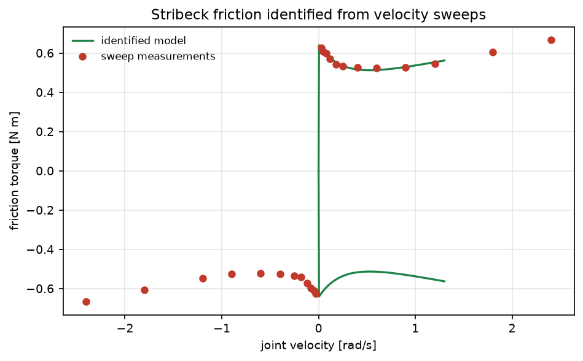
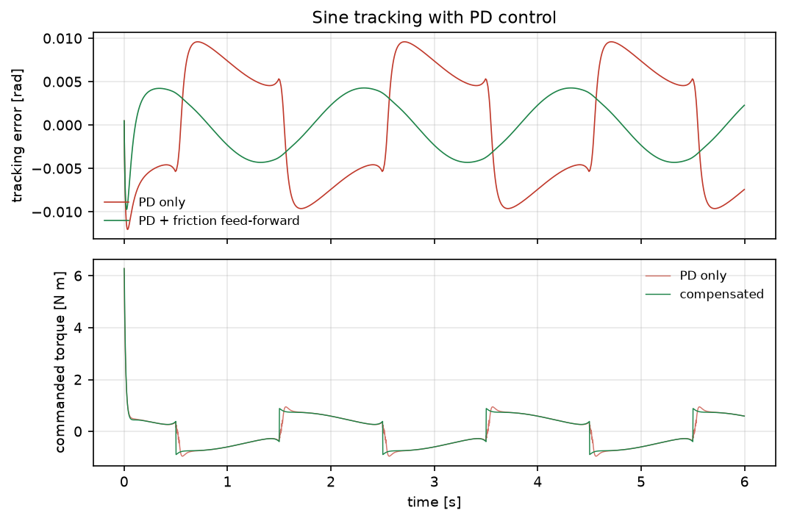

# 关节 Stribeck 摩擦辨识与前馈补偿

人形/机械臂关节在低速换向时的摩擦是跟踪误差的主要来源之一。本模块用恒速扫掠数据辨识
Stribeck 摩擦的四个参数，并把模型作为前馈加入 PD 控制，量化跟踪误差的改善。

与仓库已有模块的区别：

- 仓库里没有摩擦辨识/Stribeck 相关模块（`friction`、`stribeck`、`lugre` 关键词命中数仅 1 处图片名）；
- `humanoid_zmp_walking`、`humanoid_ppo_locomotion` 关注步态与平衡，本模块关注**关节级摩擦参数**；
- `pid_auto_tuning` 整定的是控制器增益，本模块辨识的是被控对象里的非线性力矩。

## 1. 方法

### 1.1 摩擦模型

$$
\tau_f(v)=\tau_c\,\mathrm{sign}(v)+\tau_v v+
(\tau_s-\tau_c)\,\mathrm{sign}(v)\,e^{-|v|/v_s}
$$

- $\tau_c$：库仑摩擦；$\tau_v$：黏性系数；$\tau_s$：静摩擦（低速峰值）；$v_s$：Stribeck 速度。
要求 $\tau_s\ge\tau_c$、$v_s>0$。

### 1.2 恒速扫掠辨识

恒速时 $\ddot q=0$，关节力矩只平衡摩擦（与少量线性阻尼）：

$$
\tau_{\text{meas}}(v_i)=\tau_f(v_i)+b\,v_i+\varepsilon_i
$$

对给定 $v_s$，模型对 $(\tau_c,\tau_v,\tau_s)$ 是**线性**的：

$$
\tau=\tau_c\,(s_i-d_i)+\tau_v\,v_i+\tau_s\,d_i,\qquad
s_i=\mathrm{sign}(v_i),\ d_i=s_i e^{-|v_i|/v_s}
$$

因此外层对 $v_s$ 做一维网格搜索（0.02–2 rad/s，120 点），内层用最小二乘闭式求解，
取残差最小的组合。

### 1.3 前馈补偿

控制律

$$
\tau_{\text{cmd}}=K_p(q_d-q)-K_d\dot q+K_d\dot q_d+\hat\tau_f(\dot q)
$$

跟踪 0.5 Hz、±0.5 rad 的正弦，对比有无前馈的误差。

### 1.4 数据

12 个扫速点（0.03–2.4 rad/s，覆盖 Stribeck 拐点两侧与黏性主导区），
力矩噪声 0.01 N·m；跟踪仿真 500 Hz、6 s，惯量 0.05 kg·m²、阻尼 0.01。

## 2. ROS 2 接口

| 节点 | 作用 |
|---|---|
| `friction_sim` | 按扫速发布稳态速度与力矩 |
| `friction_identifier` | 收满 8 个点后辨识并发布参数 JSON |

## 3. 构建与运行

```bash
source /opt/ros/humble/setup.bash
cd ~/hutb_ws
colcon build --symlink-install --packages-select joint_friction_identification
source install/setup.bash
ros2 launch joint_friction_identification main.launch.py
```

离线：

```bash
cd src/humanoid/joint_friction_identification
python3 main.py --out results --figure-dir ../../../docs/img/humanoid/joint_friction_identification
python3 -m unittest discover -s tests -v
```

## 4. 结果

环境：Windows 11、Python 3.12.14、NumPy 2.3.5。真值 $\tau_c=0.45$、$\tau_v=0.08$、
$\tau_s=0.65$、$v_s=0.20$。

### 4.1 参数辨识

| 参数 | 真值 | 辨识值 | 误差 |
|---|---|---|---|
| 库仑摩擦 [N·m] | 0.45 | 0.4425 | **−1.7 %** |
| 黏性系数 | 0.08 | 0.0917 | +14.6 % |
| 静摩擦 [N·m] | 0.65 | 0.6434 | **−1.0 %** |
| Stribeck 速度 [rad/s] | 0.20 | 0.2380 | +19.0 % |

拟合残差 RMS 0.0061 N·m（噪声 0.01）。



库仑与静摩擦误差都在 2 % 以内；黏性与 Stribeck 速度误差偏大（15–19 %），原因是这两者在
有限扫速范围内高度相关——把 $v_s$ 调大、同时把 $\tau_v$ 调小可以得到几乎相同的曲线。
文档第 6 节把它列为已知限制，而不是藏起来。

### 4.2 跟踪补偿

| 控制 | RMS 误差 [rad] | 最大误差 [rad] |
|---|---|---|
| 仅 PD | 0.00703 | 0.0120 |
| PD + 摩擦前馈 | **0.00310** | 0.0097 |
| 改善 | **55.9 %** | 19.2 % |



上图：换向处的误差尖峰被前馈明显削平；下图：补偿后指令力矩在换向处多出一段"抵消库仑"的平台。

## 5. 复现

```bash
cd src/humanoid/joint_friction_identification
python3 main.py --out results --figure-dir ../../../docs/img/humanoid/joint_friction_identification
python3 -m unittest discover -s tests -v    # 13 项
```

| 文件 | 内容 |
|---|---|
| `joint_friction_identification/core.py` | Stribeck 模型、网格 + 线性最小二乘辨识、参数误差 |
| `joint_friction_identification/scene.py` | 扫掠数据与 PD 跟踪仿真 |
| `joint_friction_identification/headless.py` | 实验与 `results/summary.json` |
| `joint_friction_identification/plotting.py` | 两张图 |
| `joint_friction_identification/nodes.py` | 仿真与辨识节点 |
| `results/summary.json` | 本文全部数值 |

## 6. 限制

1. 恒速扫掠假设稳态，未做低速爬行（stick-slip）与预滑动位移建模。
2. 黏性与 Stribeck 速度在本扫速范围内相关，误差 15–19 %；延长低速段或加扫频激励可改善。
3. 未考虑温度、负载与关节角对摩擦的影响（实际需要多工况标定表）。
4. 前馈使用测量速度，未做速度估计滤波；噪声大时前馈会引入抖动。
5. 只做了单关节，未验证多关节耦合与重力项。
6. ROS 2 端只做了 `compileall`、`package.xml` 解析与桩模块联调，未在本机执行 `colcon build` 与 `ros2 launch`。

## 7. 大模型使用声明

使用 DeepSeek Harness（deepseek-flash）辅助完成代码、推导整理、测试与文档。作者核对了 Stribeck 模型、
网格 + 线性最小二乘的分解，并在本机实际运行了离线实验与 13 项单元测试，数值来自 `results/summary.json`。
