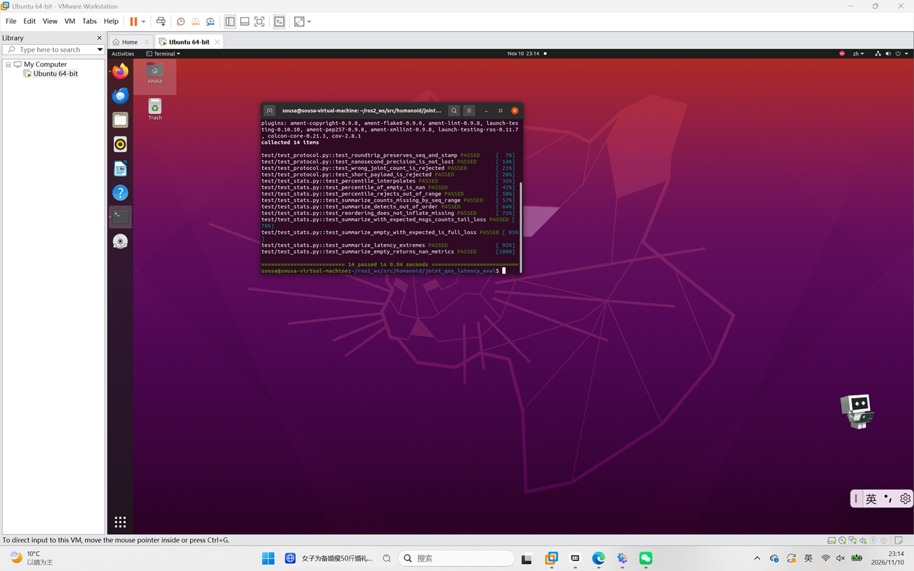
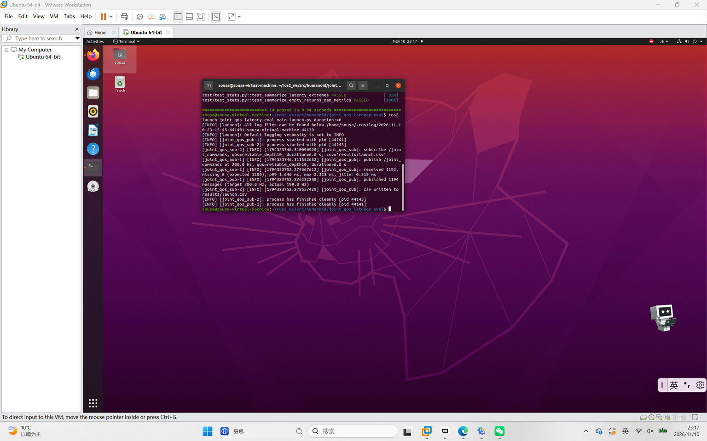
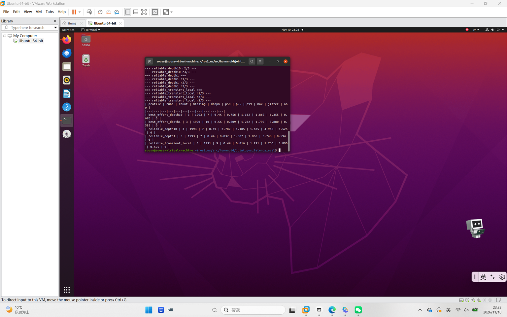

# 关节指令的 QoS 与时延影响评估

## 修改概述 / Overview

- 中文：新增 `joint_qos_latency_eval` 模块，用 ROS 2 话题以固定频率发布 6 个关节的
  目标角，在同一台机器上切换可靠性策略与队列深度，量化单程时延、抖动、丢包与乱序，
  输出可直接对比的表格。
- English: A QoS benchmark for high-frequency joint command topics. It publishes
  6-joint targets at a fixed rate, swaps the reliability policy and history depth,
  and measures one-way latency, jitter, packet loss and reordering.

安装、启动、参数与话题接口见
[模块 README](../../src/humanoid/joint_qos_latency_eval/README.md)。

## 为什么要做这个评估

关节指令是典型的高频、小载荷话题：200 Hz 意味着每 5 ms 就有一条消息，单条载荷
只有 72 字节。这类话题的瓶颈通常不在带宽，而在**接收队列能否及时取走**。QoS 配置
一旦选错，表现为偶发丢包和抖动，而且很难在日常调试中发现。

## 测量方法

1. `protocol.py` 把一条指令编码成 `Float64MultiArray`（长度 9）：
   `[seq, stamp_sec, stamp_nanosec, q1..q6]`。ROS 2 消息自身没有序号，丢包与乱序
   只能靠自带序号判断；时间戳拆成秒 + 纳秒两段，避免浮点秒在 1e9 量级丢精度。
2. `joint_pub.py` 用定时器按 `rate_hz` 发布，同时记录发送时刻（同一 ROS 时钟）。
   启动时先等订阅者匹配（`start_timeout`，默认 5 s）再开定时器，否则 launch 同时起
   两端时，DDS 发现期的几十毫秒会被如实计入丢包，结果与 `run_sweep.sh` 不可比。
3. `joint_sub.py` 在回调里取到达时刻，算出单程时延、相邻到达间隔、序号缺口，
   写 CSV：`seq,stamp_ns,recv_ns,latency_ms,gap`。其中 `gap` 是与上一条消息的序号差，
   仅供排查；统计层按 `seq` 去重计算丢包，不依赖这一列。
4. `stats.py` 提供纯函数统计（分位数、抖动标准差、丢包率），与 ROS 解耦，可单测。
   丢包按 `seq` 去重计算，乱序到达不会重复计数；分母为应发总数
   `expected_msgs = rate_hz × duration`（由 `run_sweep.sh` / launch 传入），
   因此末尾丢包与发布端欠触发都会被计入，而不只是序号区间内的缺口。
   发布端退出时打印 `published N (actual X Hz)`，可与 `count` 对照区分
   “定时器欠触发”与“传输丢失”。
5. `run_sweep.sh` 逐个场景起进程（不共享内存，避免交叉干扰），每个场景重复
   `REPEATS` 次（默认 3），最后 `qos_summarize --median` 按场景取中位数汇总成一张
   对比表。单次结果对系统负载敏感，中位数比单次值可靠。

## 受测 QoS 组合

| 名称 | reliability | history | depth | durability |
|------|-------------|---------|-------|------------|
| `reliable_depth10` | RELIABLE | KEEP_LAST | 10 | VOLATILE |
| `reliable_depth1` | RELIABLE | KEEP_LAST | 1 | VOLATILE |
| `best_effort_depth10` | BEST_EFFORT | KEEP_LAST | 10 | VOLATILE |
| `best_effort_depth1` | BEST_EFFORT | KEEP_LAST | 1 | VOLATILE |
| `reliable_transient_local` | RELIABLE | KEEP_LAST | 1 | TRANSIENT_LOCAL |

注意兼容性：`BEST_EFFORT` 发布端 + `RELIABLE` 订阅端属于不兼容组合，收不到数据；
反向组合是兼容的，订阅端会降级。

## 运行环境与命令

Ubuntu 20.04 + ROS 2 Foxy，Python 3.8，无需第三方依赖。脚本需在包目录下执行，
否则 `results/` 会落到当前工作目录：

```
colcon build --packages-select joint_qos_latency_eval
source install/setup.bash
cd src/humanoid/joint_qos_latency_eval
DURATION=10 RATE=200 REPEATS=3 bash run_sweep.sh
```

单场景也可以用 launch 一次起两端（CSV 默认写到 `results/launch.csv`）：

```
ros2 launch joint_qos_latency_eval main.launch.py \
  pub_profile:=best_effort_depth1 sub_profile:=best_effort_depth1 duration:=10
```

数值参数 `rate_hz` / `duration` 传整数或小数都可以（如 `duration:=10` 与
`duration:=10.0` 等价），节点内部会统一转成 float。

## 运行效果







## 结果结论

完整的实测结果表（`REPEATS=3` 中位数）只维护一份，见
[模块 README](../../src/humanoid/joint_qos_latency_eval/README.md)
的「实测结果」一节，避免两处表格分叉。结论摘要：

1. **观测到 BEST_EFFORT 的 p50 略低于 RELIABLE**（同 depth 低 0.026~0.028 ms），
   但差异与噪声同量级，不足以归因于可靠传输的确认开销。
2. **队列深度与持久性的影响都在噪声边界内**：`depth=1` 与 `depth=10` 的 p50
   差 0.053~0.055 ms；`reliable_transient_local` 介于两者之间，测不出独立效应。
3. **missing 主要来自发布定时器欠触发而非传输丢失**：15 次运行 11 次
   `published == received`，其余最多差 3 条；但另一轮 `best_effort_depth10`
   曾单次真实丢 301 条（15.3%），因此 `run_sweep.sh` 默认 `REPEATS=3` 取中位数，
   丢包结论不能只看单次。

## 测试

```
colcon test --packages-select joint_qos_latency_eval
colcon test-result --verbose
```

14 个用例（载荷编解码 4 个 + 统计函数 10 个），不依赖 ROS，`0 failures`。
